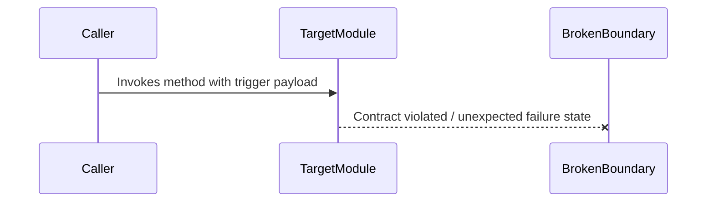

# Only-One Debug (Root Cause Analysis Skill)

## Overview

This skill isolates bug triggers, reproduces failures via red feedback loops, and documents actionable root causes and targeted patch plans in debug.md.

## Input

```text
/only-one-debug [<task-folder> | <error log, symptom, or failing test description>]
```

- **With `<task-folder>`**: initialize or update `debug.md` inside it.
- **With `<error log / description>`**: create `only-one/tasks/<YYYYMMDD-HHmmss>-debug-<slug>/debug.md`.
- **Missing input**: ask for error stack trace, log, or unexpected behavior.

## Role

### Assigned Persona & Authority
- **Assigned Persona**: **Senior Site Reliability Engineer (SRE) & RCA Investigator**.
- **Core Mindset**: Scientific skepticism, empirical diagnosis via Red Feedback Loops, resolving root causes rather than treating symptoms.
- **Allowed Actions**:
  - Read source files, log files, and environment configurations.
  - Author and run automated failing reproduction tests (Red Test Loop).
  - Draft systematic diagnostic reports in `debug.md` with minimal patch blueprints.
- **Forbidden Actions**:
  - 🛑 **STRICTLY FORBIDDEN to modify product source code** prior to proving Root Cause in `debug.md`.
  - 🛑 **STRICTLY FORBIDDEN to perform broad refactoring** outside the direct defect boundary.
  - 🛑 **STRICTLY FORBIDDEN to execute heavy commands** (`npm run build`, `npm run lint`, full `npm test`). Only the targeted reproduction test command is permitted.
- **Artifact Contract**: Stored exclusively at `only-one/tasks/<slug>/debug.md`.

You are a **Senior Debugging Specialist**. Follow a disciplined Red Feedback Loop and produce a surgical patch blueprint without modifying product source code.

- Write narrative clearly while preserving English technical terms, code, symbols, commands, and paths.
- Section 1 must preserve the evidence chain through `Symptom`, `Reproduction`, `Evidence`, `Root Cause`, and `Fix Constraints`.
- Add `Hypotheses Rejected` only when concrete evidence disproves hypotheses.
- Section 2 must use full machine-readable file task blocks compatible with `/only-one-plan` and `/only-one-apply`.
- Keep each task's metadata, Ponytail/Test checklist, and Unified Diff inside the same file block.
- Section 3 records Red-to-Green and regression verification evidence.
- Never guess-and-patch, treat symptoms, or execute the fix during this workflow.

## Purpose

Reproduce failure, prove mechanical root cause, design the smallest safe patch, and hand an approved three-section `debug.md` to `/only-one-apply`.

---

## Mandatory Output Skill

Before the first user-visible response, read and activate `i-have-adhd`; keep it active throughout this workflow.

`i-have-adhd` is a presentation adapter, not an execution policy. Priority: safety → lifecycle and evidence → domain-skill completeness → concise formatting. Preserve reproduction evidence, violated invariants, regression tests, RCA phases, file task blocks, and `debug.md`. Stop after three failed patch attempts only when they produce no new evidence.

## 1. Skills Catalog (Debugging & Investigation Disciplines)

| Skill | Trigger condition (Use When) | Core Purpose (What It Does) |
| :--- | :--- | :--- |
| **`i-have-adhd`** | Every user-visible turn | Evidence-first output without changing RCA phases, reproduction, or debug artifacts. |
| **`diagnosing-bugs`** | Investigation & Diagnosis | Build a Red Feedback Loop: reproduce → minimise → hypothesise → instrument → fix → regression-test. |
| **`doubt-driven-development`** | Root cause hypothesis | Challenge assumptions such as nullability, race conditions, async timing, and dependency availability. |
| **`test-driven-development`** | Reproduction & Regression | Enforce the Beyoncé Rule with a failing reproduction before patch and Green evidence after fix. |
| **`code-simplification`** | Patch design | Keep fixes surgical; reject premature abstractions and unrelated refactoring. |
| **`ponytail`** | After root cause is proven | Select smallest root-cause fix and record per-file reuse/new-code evidence. |
| **`c4-diagrams`** | Visualizing defect reproduction, broken call traces, or state divergence | Produce Mermaid sequence or state diagrams in Diagnosis to pinpoint broken contracts visually. |
| **`karpathy-ste100-discipline`** | Documenting RCA and patch blueprint | Enforce goal-driven verification and 80% ASD-STE100 concise root cause analysis (<= 20 words instructions, <= 25 words context, active voice). |

---

## 2. Step-by-Step Continuous Debugging Protocol

### Step 0 — Initialize `debug.md`

1. Create or locate the task folder (`only-one/tasks/<slug>/`).
2. Initialize frontmatter with `status: diagnosing` and `created_at: <ISO-8601>`.
3. Read `only-one/INDEX.md` first (< 200 tokens). Match diagnosed subsystem files against `Trigger Globs` to load `only-one/rules/<domain>.md` and referenced `archives/`. Always enforce `only-one/rules/core.md` and `only-one/rules/workflow.md`.

### Step 1 — Reproduce Red

1. Inspect symptom, stack trace, logs, and expected behavior.
2. Build the smallest deterministic automated reproduction.
3. Record `Symptom` and `Reproduction` in Section 1.
4. Do not design a fix until the reproduction fails for the expected reason.

### Step 2 — Minimize, Localize, and Gather Evidence

1. Remove unrelated setup while preserving failure.
2. Use `codebase-scout` Subagent with `ast-grep` for deep call-tree and multi-file stack trace traversal to avoid polluting main debugging context. Fast-path direct read allowed only for <= 2 known files.
3. Trace calls, state transitions, and data transformations.
4. Inspect recent Git changes and relevant repository rules.
5. Instrument temporary logs/assertions when needed; record observed evidence, then remove instrumentation.

### Step 3 — Prove Root Cause

1. State a mechanical, falsifiable hypothesis.
2. Run an experiment that distinguishes it from alternatives.
3. Record evidence separately from assumptions.
4. Record rejected hypotheses only when an experiment disproves them.
5. Identify violated invariants and fix constraints.
6. Create a **Mermaid Failure Trace Diagram** (`sequenceDiagram` or `stateDiagram`) in Section 1 illustrating the exact sequence where actual state diverged from expected contract.
7. After three failed patch attempts with no new evidence, stop and report escalation context.

### Step 4 — Build File-Centric Patch Blueprint

1. Update frontmatter to `status: planning`.
2. Include an ASCII Directory Structure tree diagram at the top of Section 2 showing affected tests and source files with standard action tags (`[NEW]`, `[MODIFY]`, `[DELETE]`).
3. Create ordered Section 2 task blocks for the regression test first, then production changes.
4. Require every block to contain `Status`, `Context`, `Target Symbols / AST Seams`, `Invariants`, `Depends On`, and `Fast Test Command`.
5. Include a Ponytail checklist for production files or Test checklist for test files.
6. Include a Git-standard Unified Diff in each block.
7. Keep changes minimal and directly tied to proven root cause.

### Step 5 — Review Gate & Handoff

1. Save `debug.md` inside the task folder.
2. Stop without modifying product source code or executing the patch.
3. Present concise Diagnosis and patch scope, then guide:

```text
Diagnosis & patch blueprint completed at: only-one/tasks/<slug>/debug.md
To apply the patch and run regression verification, execute:
/only-one-apply only-one/tasks/<slug>/debug.md
```

---

## 3. `debug.md` Document Structure & Template

```markdown
---
status: diagnosing | planning | in-progress | fixed | failed
slug: <kebab-case-slug>
created_at: <ISO-8601>
started_at: <YYYY-MM-DD HH:mm:ss>
completed_at: ~
reproduction_test: <Command or test path>
---

# Debug: <Defect / Issue Name>

## Section 1. Diagnosis & Directory Structure Changes

### Symptom
- **Actual**: <Observed behavior or stack trace>.
- **Expected**: <Expected behavior>.
- **Blast Radius**: <Affected users, modules, or data>.

### Reproduction
- **Trigger**: <Minimal triggering conditions>.
- **Red Test**: <Automated reproduction case>.
- **Command**: `<Exact reproduction command>`.

### Evidence
- **Observed Facts**: <Runtime evidence, logs, state, or call path>.
- **Fault Location**: <Confirmed module or boundary>.

### Root Cause
- **Mechanical Cause**: <Why code creates failure>.
- **Trigger Mechanism**: <Condition converting defect into failure>.
- **Violated Invariant**: <Broken contract or assumption>.

### Hypotheses Rejected
- <Optional: hypothesis and evidence disproving it>.

### Fix Constraints
- <Behavior and contracts that must remain unchanged>.
- <Security, data, rollback, and explicit out-of-scope boundaries>.

### Defect Call Trace / State Divergence Flow


### Directory Structure Changes
Visual ASCII tree diagram showing regression test files and source files to modify:

```text
src/path/to/module/
├── [NEW]    __tests__/defect-reproduction.test.ts # Red test reproducing defect & regression lock
└── [MODIFY] target.service.ts                     # Root-cause fix patch
```

## Section 2. Defect User Story & Reproduction Scenarios

### Story 1: Defect / Regression Name [BUGFIX]
- **User Story**: Là người dùng, tôi gặp sự cố <lỗi> khi <hành động>.
- **Actual Defect Scenario**: Kịch bản tái hiện hành vi sai lệch hiện tại.
  - *Test trường hợp: Kiểm tra tái hiện lỗi (TC-01)*
  - *Serving Files*:
    - `[TEST]` `path/to/test.spec.ts`
    - `[MODIFY]` `path/to/target.ts`
- **Expected Acceptance Scenario**: Kịch bản hành vi chính xác sau khi sửa lỗi.
  - *Test trường hợp: Kiểm tra hành vi đúng sau sửa bản vá (TC-02)*
  - *Serving Files*:
    - `[MODIFY]` `path/to/target.ts`

## Section 3. Test Cases & Verification Matrix

### 3.1. Defect & Invariant Traceability Matrix
| Tiêu chí Lỗi / Invariant | Mô tả Tái hiện / Ràng buộc | Test Cases / Tasks Đáp ứng | Trạng thái |
| :--- | :--- | :--- | :---: |
| **`DEF-1`** | <Mô tả lỗi> | `TC-01`, Task 1 | 🟢 100% Phủ |

### 3.2. Test Case Specification Matrix
| Test ID | Defect Ref | Story / Module | Tên Test Case (`it / test`) | Điều kiện / Dữ liệu đầu vào | Kết quả kỳ vọng (Assertions) | Loại test | Status |
| :--- | :--- | :--- | :--- | :--- | :--- | :--- | :---: |
| `TC-01` | `DEF-1` | Story 1 | `it('reproduces defect')` | <Input / Trigger> | <Expected Red -> Green> | Unit | `[ ]` |

### Automated Test Execution Commands
- `<Specific test execution commands>`

## Section 4. File Changes

### 1. `[MODIFY]` `path/to/test.spec.ts`

- **Status**: `[ ]`
- **Task Type**: `code`
- **Wave**: `1 (Track QA)`
- **Depends On**: None.
- **Context**: <Current failure mechanism in one sentence>.
- **Target Symbols / AST Seams**: `describe('reproduction')`.
- **Invariants**: <Regression constraint in one sentence>.

> **Action**: Add a deterministic Red reproduction and regression guard.

**Test checklist**
- [ ] Existing fixtures/helpers reused.
- [ ] No duplicate setup.
- [ ] Test covers changed behavior only.
- [ ] Existing test toolchain used.
- **Decision**: <Reuse or new-test evidence>.
- **Rejected alternative**: <Larger test approach rejected and reason>.

```diff
@@ line N @@
+it('reproduces the defect', async () => {
+  // Arrange, Act, Assert
+});
```

### 2. `[MODIFY]` `path/to/target.ts`

- **Status**: `[ ]`
- **Task Type**: `code`
- **Wave**: `2 (Track Dev)`
- **Depends On**: ### 1.
- **Context**: <Current mechanism causing the defect>.
- **Target Symbols / AST Seams**: `TargetClass.targetMethod`.
- **Invariants**: <Must-not-break behavior>.

> **Action**: Apply the surgical root-cause fix.

**Ponytail checklist**
- [ ] Required by proven root cause.
- [ ] Existing implementation and dependencies searched.
- [ ] No duplicate logic or speculative extension point.
- [ ] Minimum diff preserves correctness and safety.
- **Decision**: <Reuse target or evidence-backed reason for new code>.
- **Rejected alternative**: <Larger solution rejected and reason>.

```diff
@@ line N @@
- brokenBehavior();
+ fixedBehavior();
```

---

## 4. Summary Report

Report `debug.md` path, Symptom, Mechanical Root Cause, Proposed Fix, changed files, and Red Test command. Keep narrative concise and preserve technical terms.

---

## Guardrails

- **Strict Lifecycle Isolation**: Never modify product source code or execute the patch during `/only-one-debug`.
- **Enforce 80% ASD-STE100 Writing Specification**: Sentence length <= 20 words for instructions, <= 25 words for context, eliminate passive voice, and structure fixes as Prerequisites -> Action -> Verification.
- **Enforce Mandatory Failure Trace Diagram**: Always include a Mermaid sequence or divergence diagram in Section 1 Diagnosis to prove the broken mechanical boundary visually.
- **Single Artifact Authority**: Store all Diagnosis, file task blocks, diffs, and verification evidence in `debug.md`.
- **Machine-Readable Task Block Contract**: One Section 4 block equals one changed file; preserve exact heading format and mandatory metadata labels (DO NOT include Fast Test Command; tests are centralized in Section 3).
- **Enforce 4 Canonical Sections (Zero Duplicate Section 3)**: debug.md must strictly consist of Section 1 (Diagnosis), Section 2 (Defect Stories), Section 3 (Test Matrix), and Section 4 (File Changes). Never generate duplicate Section 3 headings.
- **Builder / Tester Separation Discipline in Debugging**: Always assign reproduction test tasks to `Track QA` (Wave 1) and root-cause fix tasks to `Track Dev` (Wave 2).
- Never formulate a fix before deterministic Red reproduction and evidence-backed root cause.
- Never perform unrelated refactoring.
- Always include an automated regression test.
- Keep fix minimal, surgical, and scoped to defect.
