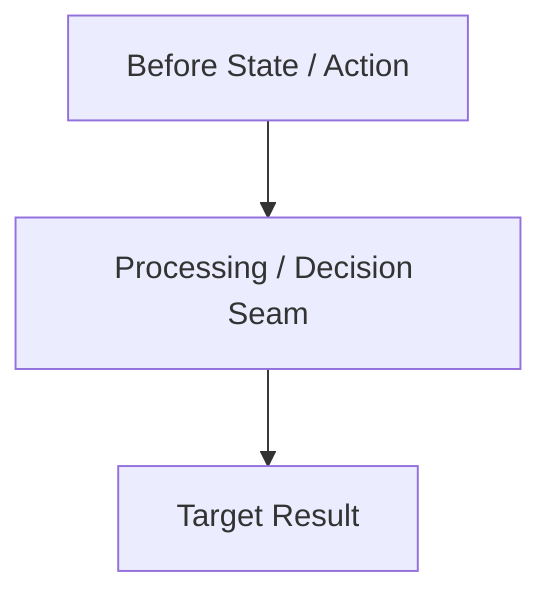

# Concept: {{title}}

## 1. Problem & Goal

### Problem (Current Bottlenecks & Deficiencies)
- **Context & Trigger**: <Where the issue occurs or the user action leading to it>.
- **Symptom & Defect**: <Specific error behavior or technical bottleneck>.
- **Root Cause**: <Technical cause (unsynchronized state, missing validation, race condition, etc.)>.
- **Impact / Blast Radius**: <Impact on users, system, or data integrity>.

### Goal (Target Technical Outcomes)
- **Core Goal**: <Primary technical outcome required>.
- **Acceptance Criteria**:
  - <Core functional criteria & Happy path rules>.

## 2. Scope Boundaries
- **In-Scope**: <Mandatory features and behaviors to implement>.
- **Explicit Out-of-Scope**: <Deferred or excluded items to prevent scope creep>.

## 3. Proposed Solution & Core Mechanism
- **Core Mechanism**: <Conceptual solution and operating model; no low-level code>.
- **Conceptual Flow / Domain Model**:

- **UI Wireframe (Mandatory for features with UI)**:
```text
+-----------------------------------------------------------+
| [Header / Title]                                          |
+-----------------------------------------------------------+
```

## 4. Critical Risks & Edge Cases (Phân tích Rủi ro & Cơ chế Phòng vệ)
- **Rủi ro 1: <Tên rủi ro kỹ thuật hoặc ngoại lệ>**
  - *Mặt tiêu cực / Nguy cơ*: <Hậu quả kỹ thuật xấu nhất có thể xảy ra>.
  - *Cơ chế phòng vệ*: <Giải pháp kỹ thuật cụ thể để triệt tiêu hoặc khoanh vùng nguy cơ>.
