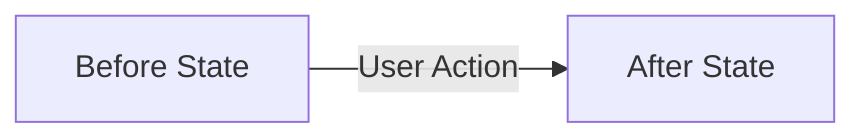

# Plan: {{title}}

## Section 1. Directory Structure Changes

```text
<visual tree of files to be added, modified, or deleted>
```

## Section 2. Story Board (User Journey & Feature Scenarios)

### Story 1: Feature / Component Name [NEW|MODIFY|DELETE]
- **User Story**: As a <role>, I want <goal> so that <benefit>.
- **Before**: <Behavior or state before change in one sentence>.
- **After**: <Behavior or state after change in one sentence>.
- **Key Scenarios**:
  - *Scenario 1 (Happy Path)*: ...
    - *Serving Files*:
      - `[TEST]` `path/to/test.spec.ts`
      - `[MODIFY]` `path/to/file.ts`
  - *Scenario 2 (Edge Case / Failure)*: ...
    - *Serving Files*:
      - `[MODIFY]` `path/to/error-handler.ts`



## Section 3. Test Cases & Verification Matrix

### 3.1. Concept Coverage & Traceability Matrix
| Tiêu chí Concept | Mô tả Nghiệm thu | Test Cases / Tasks Đáp ứng | Trạng thái |
| :--- | :--- | :--- | :---: |
| **`AC-1`** | <Acceptance Criteria 1> | `TC-01`, Task 1 | 🟢 100% Phủ |

### 3.2. Test Case Specification Matrix
| Test ID | Concept Ref | Story / Module | Tên Test Case (`it / test`) | Điều kiện / Dữ liệu đầu vào | Kết quả kỳ vọng (Assertions) | Loại test | Status |
| :--- | :--- | :--- | :--- | :--- | :--- | :--- | :---: |
| `TC-01` | `AC-1` | Story 1 (Happy) | `it('...')` | <Input / Precondition> | <Expected Assertion> | Unit | `[ ]` |

### Automated Test Execution Commands
- `<Test execution commands for full suite or specific modules>`

## Section 4. File Changes

### 1. `[NEW]` `path/to/file.test.ts`

- **Status**: `[ ]`
- **Task Type**: `code`
- **Context**: <Test suite purpose>.
- **Target Symbols / AST Seams**: `describe('...')`.
- **Invariants**: <Invariants>.
- **Depends On**: None.

> **Action**: <Add test cases specifying target behavior>.

**Test Matrix**
- [ ] Happy Path: <Scenario>.
- [ ] Boundary / Edge Cases: <Scenario>.
- [ ] Failure / Error Handling: <Scenario>.

```diff
<unified diff>
```

### 2. `[MODIFY]` `path/to/file.ts`

- **Status**: `[ ]`
- **Task Type**: `code`
- **Context**: <Current mechanism in one sentence>.
- **Target Symbols / AST Seams**: `Class.methodName`.
- **Invariants**: <Constraint that must not be broken in one sentence>.
- **Depends On**: `path/to/file.test.ts`.

> **Action**: <Brief one-sentence description of modification purpose>.

```diff
<unified diff>
```

### 3. `[MODIFY]` `path/to/doc.md`

- **Status**: `[ ]`
- **Task Type**: `non-code`
- **Context**: <Documentation update>.
- **Target Symbols / AST Seams**: <Section header>.
- **Invariants**: <Invariants>.
- **Depends On**: None.

> **Action**: <Update documentation content>.

```diff
<unified diff>
```
