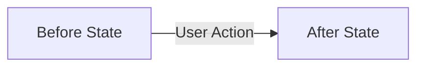

# Plan: {{title}}

## Section 1. Directory Structure Changes

```text
<visual tree of files to be added, modified, or deleted>
```

## Section 1.5. Story Board (User Journey & Feature Scenarios)

### Story 1: Feature / Component Name [NEW|MODIFY|DELETE]
- **User Story**: As a <role>, I want <goal> so that <benefit>.
- **Before**: <Behavior or state before change in one sentence>.
- **After**: <Behavior or state after change in one sentence>.
- **Key Scenarios**:
  - *Scenario 1 (Happy Path)*: ...
  - *Scenario 2 (Edge Case / Failure)*: ...



## Section 2. File Changes

### 1. `[MODIFY]` `path/to/file.ts`

- **Status**: `[ ]`
- **Task Type**: `code`
- **Context**: <Current mechanism in one sentence>.
- **Target Symbols / AST Seams**: `Class.methodName`.
- **Invariants**: <Constraint that must not be broken in one sentence>.
- **Depends On**: None.
- **Fast Test Command**: `npm test path/to/file.test.ts`.

> **Action**: <Brief one-sentence description of modification purpose>.

```diff
<unified diff>
```

### 2. `[NEW]` `path/to/file.test.ts`

- **Status**: `[ ]`
- **Task Type**: `code`
- **Context**: <Test suite purpose>.
- **Target Symbols / AST Seams**: `describe('...')`.
- **Invariants**: <Invariants>.
- **Depends On**: `path/to/file.ts`.
- **Fast Test Command**: `npm test path/to/file.test.ts`.

> **Action**: <Add test cases for file.ts>.

**Test Matrix**
- [ ] Happy Path: <Scenario>.
- [ ] Boundary / Edge Cases: <Scenario>.
- [ ] Failure / Error Handling: <Scenario>.

```diff
<unified diff>
```

### 3. `[MODIFY]` `path/to/doc.md`

- **Status**: `[ ]`
- **Task Type**: `non-code`
- **Context**: <Documentation update>.
- **Target Symbols / AST Seams**: <Section header>.
- **Invariants**: <Invariants>.
- **Depends On**: None.
- **Fast Test Command**: `None (Non-code task)`.

> **Action**: <Update documentation content>.

```diff
<unified diff>
```

## Section 3. Test Cases & Verification
- **Automated Tests**:
- **Manual Checks**:
