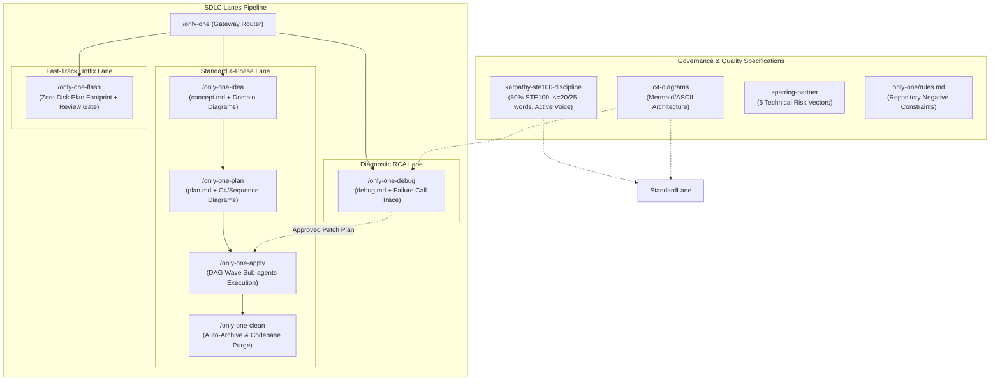

# Archive: Kiến Trúc Hợp Nhất của Hệ Thống Workflows, SDLC Lanes, DAG Sub-agents, 80% ASD-STE100 & Visual Diagrams

## 1. Problem Statement & Core Value (Bài toán & Giá trị Cốt lõi)

### 1.1. Core Problems
1. **Bệnh béo phì tài liệu & Phân mảnh nguồn chân lý**: Các quy trình trước đây sinh tài liệu dài dòng, rườm rà; file `walkthrough.md` gây trùng lặp lãng phí đĩa.
2. **Kém hiệu quả khi diễn giải kiến trúc bằng văn xuôi**: Đọc khối chữ dài để hiểu tương tác đa module hay luồng lỗi dẫn tới hiểu sai và tốn token ngữ cảnh; thiếu sơ đồ trực quan.
3. **Văn phong rào đón & Bệnh nịnh bợ (AI Slop & Sycophancy)**: LLM thường dùng câu bị động, rào đón xã giao và dễ đồng thuận mù quáng trước thiết kế lỗi của con người.
4. **Chi phí thời gian lớn cho Quick Tasks**: Các tác vụ nhỏ bị bắt buộc phải chạy qua 3 giai đoạn độc lập nặng nề.
5. **Thực thi tuần tự gây nghẽn (Sequential Bottleneck)**: `/only-one-apply` chạy từng file một làm chậm tiến độ và phình to ngữ cảnh Main Agent.
6. **Vi phạm ranh giới vòng đời (Lifecycle Drift)**: Debug tự ý sửa code sản phẩm; review không có định dạng thực thi chuẩn.

### 1.2. Core Value & Solutions
1. **Gateway Router ([`/only-one`](file:///d:/Sources/PERSONAL/only-one-cli/assets/workflows/only-one.md))**: Triage ý đồ người dùng, quét trạng thái workspace và điều hướng sang workflow chuyên biệt tối ưu.
2. **Phân cấp 3 Làn Thực Thi SDLC**:
   - **Standard Lane (`/only-one-idea` $\rightarrow$ `/only-one-plan` $\rightarrow$ `/only-one-apply` $\rightarrow$ `/only-one-clean`)**:
     - Chuẩn hóa **3 Sections Tinh gọn** cho [`plan.md`](file:///d:/Sources/PERSONAL/only-one-cli/assets/workflows/only-one-plan.md) & [`debug.md`](file:///d:/Sources/PERSONAL/only-one-cli/assets/workflows/only-one-debug.md):
       + *Section 1*: Directory Structure Changes (Sơ đồ cây ASCII kèm Action Tags `[NEW]`, `[MODIFY]`, `[DELETE]`).
       + *Section 2*: Machine-Readable File Task Blocks (heading `### <order>. [<ACTION>] <path>`, metadata chuẩn `Status`, `Context`, `Target Symbols`, `Invariants`, `Depends On`, `Fast Test Command`, `Ponytail checklist`, và Git-standard Unified Diff).
       + *Section 3*: Test Cases & Verification Evidence.
     - **Strict Two-File Task Invariant**: Mỗi thư mục task chỉ chứa duy nhất `concept.md` và `plan.md`/`debug.md`. Cấm tuyệt đối tạo `walkthrough.md` trên đĩa.
   - **Fast-Track Lane (`/only-one-flash`)**:
     - Xử lý tác vụ nhỏ, hotfix với **Zero Disk Plan Footprint** (không tạo thư mục task hay markdown trên đĩa).
     - Kế hoạch trình bày trực tiếp qua chat, có Review Gate bắt buộc ở Step 2 trước khi sửa code ở Step 3.
   - **Strict Lifecycle RCA Lane (`/only-one-debug`)**:
     - Tuân thủ 2 pha tách biệt: Pha 1 chẩn đoán lỗi, dựng Red feedback loop, lập kế hoạch vá trong `debug.md` và dừng tại Review Gate (Zero Direct Code Modifications); Pha 2 giao cho `/only-one-apply` thực thi.
3. **Quy Chuẩn Viết 80% ASD-STE100 & Triệt Tiêu Thể Bị Động ([`karpathy-ste100-discipline`](file:///d:/Sources/PERSONAL/only-one-cli/assets/skills/karpathy-ste100-discipline/SKILL.md))**:
   - Khống chế trần từ: Câu chỉ dẫn $\le 20$ từ, câu mô tả/ngữ cảnh $\le 25$ từ.
   - Cấm triệt để thể bị động (*passive voice*); 100% sử dụng câu chủ động trực diện.
   - Cấu trúc 3 tầng: Prerequisites $\rightarrow$ Action $\rightarrow$ Verification.
4. **Bắt Buộc Trực Quan Hóa Bằng Sơ Đồ ([`c4-diagrams`](file:///d:/Sources/PERSONAL/only-one-cli/assets/skills/c4-diagrams/SKILL.md))**:
   - `concept.md`: Bắt buộc Mermaid Flowchart/State Diagram cho luồng dữ liệu nghiệp vụ và máy trạng thái.
   - `plan.md`: Bắt buộc C4 Component Diagram hoặc Mermaid Sequence Diagram khi có $\ge 2$ modules tương tác hoặc luồng bất đồng bộ.
   - `debug.md`: Bắt buộc Mermaid Failure Call Trace Diagram hoặc State Divergence Diagram chứng minh cơ học điểm gãy vỡ của hợp đồng hệ thống.
5. **Cơ chế Thực thi Song song Sub-agent theo DAG trong `/only-one-apply`**:
   - Phân tích trường `Depends On` để nhóm các task độc lập thành các Execution Waves.
   - Áp dụng **Disjoint File Invariant** ngăn chặn 2 Sub-agents sửa chung 1 file cùng lúc.
   - Parallel Dispatch với 3-4 Sub-agents chạy song song và Barrier Synchronization giữa các wave.
6. **Chống Nịnh bợ & Tư duy Phản biện ([`sparring-partner`](file:///d:/Sources/PERSONAL/only-one-cli/assets/skills/sparring-partner/SKILL.md))**:
   - Loại bỏ lời khen sáo rỗng (*Zero Sycophantic Fillers*), đánh giá rủi ro theo 5 trục kỹ thuật (Boundary conditions, Simplicity, Blast radius, Concurrency, Security) và đề xuất phương án thay thế tốt hơn trước khi đồng thuận.

---

## 2. Key Architecture & Workflows Matrix

### Bảng Ma trận Workflows

| Workflow | Vai trò & Trọng trách Cốt lõi | Input & Artifacts | Sơ đồ Trực quan Bắt buộc |
| :--- | :--- | :--- | :--- |
| **[`/only-one`](file:///d:/Sources/PERSONAL/only-one-cli/assets/workflows/only-one.md)** | Gateway router, triage ý đồ & điều hướng | Input tự do $\rightarrow$ gợi ý workflow | Không |
| **[`/only-one-idea`](file:///d:/Sources/PERSONAL/only-one-cli/assets/workflows/only-one-idea.md)** | Khám phá bài toán & kiến trúc giải pháp | `concept.md` (SSOT cho What & Why) | Flowchart / State Diagram |
| **[`/only-one-plan`](file:///d:/Sources/PERSONAL/only-one-cli/assets/workflows/only-one-plan.md)** | Lập kế hoạch 3 sections diff-centric | Ingest `concept.md` $\rightarrow$ `plan.md` | C4 Component / Sequence ($\ge 2$ modules) |
| **[`/only-one-apply`](file:///d:/Sources/PERSONAL/only-one-cli/assets/workflows/only-one-apply.md)** | Thực thi DAG waves song song với Sub-agents | Ingest `plan.md`/`debug.md` $\rightarrow$ Code | Execution Wave Graph |
| **[`/only-one-flash`](file:///d:/Sources/PERSONAL/only-one-cli/assets/workflows/only-one-flash.md)** | Fast-track hotfix & quick tasks với Review Gate | Zero Disk Plan (In-chat plan & apply) | ASCII Target Structure |
| **[`/only-one-debug`](file:///d:/Sources/PERSONAL/only-one-cli/assets/workflows/only-one-debug.md)** | RCA cơ học, Red feedback loop, plan vá | `debug.md` (Strict Lifecycle Isolation) | Mermaid Failure Call Trace |
| **[`/only-one-review`](file:///d:/Sources/PERSONAL/only-one-cli/assets/workflows/only-one-review.md)** | Chuẩn hóa kết quả Open CodeReview (OCR) | `review.md` $\rightarrow$ multi-select apply | Không |
| **[`/only-one-conflict`](file:///d:/Sources/PERSONAL/only-one-cli/assets/workflows/only-one-conflict.md)** | Giải quyết xung đột git merge/rebase an toàn | Conflict hunks $\rightarrow$ clean resolution | Không |
| **[`/only-one-clean`](file:///d:/Sources/PERSONAL/only-one-cli/assets/workflows/only-one-clean.md)** | Tự động archive task, đối soát & thanh lọc | Purge task folder $\rightarrow$ Living Archives | Không |

---

## 3. Scope & Key Changes (Phạm vi & Thay đổi Chính)

- [`assets/skills/karpathy-ste100-discipline/SKILL.md`](file:///d:/Sources/PERSONAL/only-one-cli/assets/skills/karpathy-ste100-discipline/SKILL.md): Nâng chuẩn 80% ASD-STE100, khống chế 20/25 từ, cấm thể bị động.
- [`.agents/skills/karpathy-ste100-discipline/SKILL.md`](file:///d:/Sources/PERSONAL/only-one-cli/.agents/skills/karpathy-ste100-discipline/SKILL.md): Đồng bộ với assets.
- [`assets/rules/04-karpathy-ste100-discipline.md`](file:///d:/Sources/PERSONAL/only-one-cli/assets/rules/04-karpathy-ste100-discipline.md): Cập nhật rule manifest và version `0.0.2`.
- [`assets/skills/index.ts`](file:///d:/Sources/PERSONAL/only-one-cli/assets/skills/index.ts): Version `0.0.2` cho `karpathy-ste100-discipline`.
- [`assets/rules/index.ts`](file:///d:/Sources/PERSONAL/only-one-cli/assets/rules/index.ts): Version `0.0.2` cho `karpathy-ste100-discipline`.
- [`assets/workflows/index.ts`](file:///d:/Sources/PERSONAL/only-one-cli/assets/workflows/index.ts): Bổ sung `c4-diagrams` vào `requiredSkills`, bump versions `only-one-idea` (`0.0.9`), `only-one-plan` (`0.0.12`), `only-one-debug` (`0.0.10`).
- [`assets/workflows/only-one-idea.md`](file:///d:/Sources/PERSONAL/only-one-cli/assets/workflows/only-one-idea.md): Tích hợp chuẩn sơ đồ luồng dữ liệu/trạng thái nghiệp vụ và 80% STE100.
- [`.agents/workflows/only-one-idea.md`](file:///d:/Sources/PERSONAL/only-one-cli/.agents/workflows/only-one-idea.md): Đồng bộ với assets.
- [`assets/workflows/only-one-plan.md`](file:///d:/Sources/PERSONAL/only-one-cli/assets/workflows/only-one-plan.md): Bắt buộc C4 Component hoặc Sequence Diagram khi có $\ge 2$ modules hoặc async, chuẩn 80% STE100.
- [`.agents/workflows/only-one-plan.md`](file:///d:/Sources/PERSONAL/only-one-cli/.agents/workflows/only-one-plan.md): Đồng bộ với assets.
- [`assets/workflows/only-one-debug.md`](file:///d:/Sources/PERSONAL/only-one-cli/assets/workflows/only-one-debug.md): Bắt buộc Mermaid Failure Call Trace Diagram trong Section 1, chuẩn 80% STE100.
- [`.agents/workflows/only-one-debug.md`](file:///d:/Sources/PERSONAL/only-one-cli/.agents/workflows/only-one-debug.md): Đồng bộ với assets.
- [`only-one/rules.md`](file:///d:/Sources/PERSONAL/only-one-cli/only-one/rules.md): Cập nhật Rule 34 (80% ASD-STE100) và Rule 35 (Sơ đồ trực quan `c4-diagrams`).

---

## 4. Verification Evidence & PR (Bằng chứng Nghiệm thu)

- **Trạng thái Test**: 100% Passed.
  - `npx vitest run test/core/workflow-registry.test.ts` (10/10 passed)
  - `npx vitest run test/core/assets/version-gate.test.ts` (2/2 passed)
  - `npx vitest run test/core/rule-adapters.test.ts` (3/3 passed)
  - `npm run format:check && npx tsc --noEmit` (passed, zero errors)
- **Đồng bộ**: 100% giữa `assets/` và `.agents/`.
