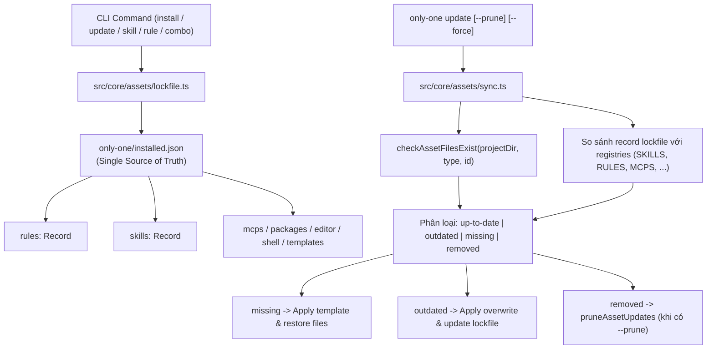

# Archive: Kiến Trúc Phân Cấp Tài Nguyên 3 Domain, Định Danh Phiên Bản Độc Lập, Lockfile Hợp Nhất & Auto-Restore

## 1. Problem & Core Value (Bài toán & Giá trị Cốt lõi)
- **Vấn đề (Problem)**:
  1. **Cấu trúc Thư mục Phẳng & Thiếu Ranh giới Domain**: Thư mục gốc `assets/` trước đây chứa hàng loạt thư mục phẳng rời rạc (`skills/`, `rules/`, `mcps/`, `vs/`, `packages/`, `workflows/`, `combos/`, `git/`), gây lộn xộn kiến trúc và làm nhòe ranh giới giữa tài nguyên AI Agent, môi trường phát triển (DevEnv) và mẫu dự án (Templates).
  2. **Thiếu cơ chế định danh phiên bản độc lập**: Trước đây các asset manifests hoàn toàn không có trường `version`. Cập nhật asset bị ghép cặp chặt với `cliVersion`, không thể phát hiện asset nào thực sự thay đổi.
  3. **Phân mảnh Lockfile**: Trạng thái cài đặt bị lưu trữ phân tán ở `.only-one/installed.json` và `only-one/skills-lock.json` cho remote GitHub skills.
  4. **Rủi ro Lockfile Drift & Bypass CI**: Thiếu công cụ tăng phiên bản và chốt chặn CI khi thay đổi template asset.
  5. **Thành phần Bị Xóa & File Bị Mất**: File mồ côi tồn đọng trên đĩa khi asset bị gỡ bỏ upstream; hoặc khi người dùng vô tình xóa file vật lý thì không tự động khôi phục.
  6. **Phân mảnh vị trí cài đặt Global Assets**: Global skills, workflows và rules trước đây lưu phân tán trong thư mục riêng của từng tool (`~/.gemini/config/`), gây khó khăn khi tích hợp chéo giữa các agent runners (Antigravity, Claude Code, Codex).
- **Giá trị Cốt lõi (Core Value)**:
  - **Tổ chức Chuẩn Hóa 3 Domain (`assets/agents/`, `assets/devenv/`, `assets/templates/`)**: Phân loại dứt điểm tài nguyên thành 3 domain riêng biệt không qua re-export facade shims, tuân thủ quy tắc `CORE-006`.
  - **100% Manifest Version Coverage**: Bổ sung `version: string` chuẩn hóa cơ số 10 (`X.Y.Z`) cho toàn bộ manifests trong `assets/`.
  - **Decimal Rollover Engine**: Triển khai thuật toán tăng phiên bản cơ số 10 (`0.0.1` -> `0.0.9` -> `0.1.0` -> `0.9.9` -> `1.0.0`).
  - **Unified Asset Lockfile (`only-one/installed.json`)**: Áp dụng triệt để chính sách Hard Cutover, hợp nhất hoàn toàn `skills-lock.json` vào `only-one/installed.json` (Single Source of Truth).
  - **Auto-Restore & Pruning Engine**: Lệnh `only-one update` tự động:
    - Đối soát version đã cài với upstream và cập nhật asset outdated.
    - Phát hiện file vật lý bị mất (`status: 'missing'`) và tự động khôi phục từ template gốc.
    - Khi dùng cờ `--prune`: dọn sạch file mồ côi (`status: 'removed'`) trên đĩa và trong lockfile.
  - **Multi-IDE Target Resolution & Hooks Isolation**: Triển khai cài đặt toàn cục (`--global`) hướng trực tiếp về cấu hình riêng của từng IDE được chọn trong `AI_TOOLS` (`~/.gemini/config/skills/`, `~/.gemini/config/rules/`, `~/.gemini/hooks/` cho Antigravity; `~/.claude/` & `~/.claude/hooks/` cho Claude Code; `~/.cursor/` cho Cursor), thay vì ép buộc ghi cứng vào `~/.agents/`.
  - **Dynamic Command Path Hooks Generation**: Tự động sinh đường dẫn script thực thi động trong file cấu hình hooks (`hooks.json` của Antigravity, `settings.json` của Claude Code) trỏ tới vị trí script của IDE đó.
  - **Combo Scope & Agent Compatibility Matrix**: Phân loại các bộ Combos theo phạm vi (`global` vs `project`) và độ tương thích với target agents (`antigravity`, `cursor`, `copilot`), kiểm soát qua schema validation nghiêm ngặt.
  - **Phân Phối Subagents Toàn Cục Qua Combos (Global First-Class Subagent Asset)**:
    - Nâng cấp `ComboManifest` trong `assets/types.ts` chính thức hỗ trợ trường `subagents?: string[]`.
    - Phân bổ 4 Subagents chuyên trách (`codebase-scout`, `terminal-runner`, `browser-tester`, `api-tester`) vào các combo toàn cục (`only-one-flow`, `frontend-flow`, `backend-flow`).
    - Mở rộng `resolveToolDestinationPaths` hỗ trợ asset type `subagents` ở chế độ Global: tự động định tuyến tới `~/.gemini/config/agents/<name>.md` cho Antigravity, `~/.claude/agents/<name>.md` cho Claude Code, và `~/.cursor/agents/` cho Cursor.
    - Cập nhật engine cài đặt combo `src/core/combo/index.ts` và báo cáo `COMBO REPORT` hiển thị trạng thái cài đặt toàn cục (`success`, `skipped`, `failed`).
  - **Developer Tooling & Zero-Bypass CI Gate**: Cung cấp `scripts/bump-asset.ts` (`pnpm asset:bump <type> <id>`) và bài test `test/core/assets/version-gate.test.ts` chặn commit vi phạm.

## 2. Key Architecture & Decisions (Kiến trúc & Quyết định Then chốt)

### 2.1. Cấu trúc Quản lý Trạng thái Tài nguyên Hợp nhất (Unified State Architecture)

### 2.2. Các Quyết định Kỹ thuật Chính
1. **3-Domain Asset Hierarchy ([CORE-006](file:///d:/Sources/PERSONAL/only-one-cli/only-one/rules/core.md))**:
   - `assets/agents/`: `combos/`, `hooks/`, `mcps/`, `packages/`, `rules/`, `skills/`.
   - `assets/devenv/`: `editor/`, `linter/`, `shell/`.
   - `assets/templates/`: `configs/`, `ignore/`.
   - Ánh xạ đường dẫn qua `tsconfig.json` (`@agents/*`, `@devenv/*`, `@templates/*`, `@assets/*`) và `scripts/postbuild-paths.cjs`.
2. **Decimal Rollover Arithmetic ([src/core/assets/version.ts](file:///d:/Sources/PERSONAL/only-one-cli/src/core/assets/version.ts))**: Hàm thuần túy kiểm tra định dạng `^\d+\.\d+\.\d+$`, cuộn vòng từ 9 về 0 và tăng chữ số liền trước.
3. **Hard Cutover Single Source of Truth ([src/core/assets/lockfile.ts](file:///d:/Sources/PERSONAL/only-one-cli/src/core/assets/lockfile.ts))**: Hàm `resolveInstalledLockfilePath` trỏ trực tiếp đến `join(projectDir, 'only-one', 'installed.json')`, loại bỏ toàn bộ code path dự phòng của thư mục `.only-one/`.
4. **Accurate Asset Sync Engine ([src/core/assets/sync.ts](file:///d:/Sources/PERSONAL/only-one-cli/src/core/assets/sync.ts))**:
   - `inspectAssetUpdates(projectDir)` kiểm tra file trên đĩa và đối chiếu phiên bản với upstream manifests.
   - `applyAssetUpdates()` tự động cập nhật hoặc khôi phục file bị thiếu vào thư mục target agent (`.agents`, `.cursor`, `.claude`) và cập nhật lockfile đồng thời.
   - Chỉ xóa file mồ côi khi có cờ tường minh `--prune`, tuyệt đối không xóa file tùy biến do người dùng tự tạo nếu không có trong `installed.json`.
5. **Native Go Wizard Scanner ([src/tui/internal/wizard/scanner.go](file:///d:/Sources/PERSONAL/only-one-cli/src/tui/internal/wizard/scanner.go))**:
   - Thay thế toàn bộ scanner cũ của React Ink bằng Go scanner hiệu năng cao, quét trạng thái cài đặt tài nguyên đa nguồn trực tiếp qua lockfiles và IDE extension directories.

## 3. Scope & Key Modules (Phạm vi & Các Module Chính)
- **Asset Manifest Registries**:
  - [`assets/agents/rules/index.ts`](file:///d:/Sources/PERSONAL/only-one-cli/assets/agents/rules/index.ts)
  - [`assets/agents/skills/index.ts`](file:///d:/Sources/PERSONAL/only-one-cli/assets/agents/skills/index.ts)
  - [`assets/agents/mcps/index.ts`](file:///d:/Sources/PERSONAL/only-one-cli/assets/agents/mcps/index.ts)
  - [`assets/agents/packages/index.ts`](file:///d:/Sources/PERSONAL/only-one-cli/assets/agents/packages/index.ts)
  - [`assets/agents/combos/index.ts`](file:///d:/Sources/PERSONAL/only-one-cli/assets/agents/combos/index.ts)
  - [`assets/devenv/editor/index.ts`](file:///d:/Sources/PERSONAL/only-one-cli/assets/devenv/editor/index.ts)
  - [`assets/devenv/shell/index.ts`](file:///d:/Sources/PERSONAL/only-one-cli/assets/devenv/shell/index.ts)
  - [`assets/templates/configs/index.ts`](file:///d:/Sources/PERSONAL/only-one-cli/assets/templates/configs/index.ts)
  - [`assets/templates/ignore/index.ts`](file:///d:/Sources/PERSONAL/only-one-cli/assets/templates/ignore/index.ts)
- **Core Versioning & Lockfile**:
  - [`assets/types.ts`](file:///d:/Sources/PERSONAL/only-one-cli/assets/types.ts): Định nghĩa kiểu `ComboManifest` hỗ trợ `subagents?: string[]`.
  - [`src/core/assets/version.ts`](file:///d:/Sources/PERSONAL/only-one-cli/src/core/assets/version.ts): Thuật toán decimal rollover arithmetic.
  - [`src/core/assets/types.ts`](file:///d:/Sources/PERSONAL/only-one-cli/src/core/assets/types.ts): Khai báo `InstalledAssetRecord`, `RemoteSkillLockMeta`, `OnlyOneInstalledState`, `AssetUpdateStatus`.
  - [`src/core/assets/lockfile.ts`](file:///d:/Sources/PERSONAL/only-one-cli/src/core/assets/lockfile.ts): Đọc/ghi và xóa record `only-one/installed.json` atomic.
  - [`src/core/skill/remote/lockfile.ts`](file:///d:/Sources/PERSONAL/only-one-cli/src/core/skill/remote/lockfile.ts): Adapter layer cho GitHub remote skills.
  - [`src/core/skill/manifest-bridge.ts`](file:///d:/Sources/PERSONAL/only-one-cli/src/core/skill/manifest-bridge.ts): Cầu nối đồng bộ non-destructive `skills.json` sang `~/.agents/` và `~/.gemini/config/`.
  - [`src/core/agent/tools.ts`](file:///d:/Sources/PERSONAL/only-one-cli/src/core/agent/tools.ts): Phân giải đường dẫn tài nguyên toàn cục hướng về `~/.agents/` và subagents toàn cục (`~/.gemini/config/agents/`, `~/.claude/agents/`).
  - [`src/core/combo/index.ts`](file:///d:/Sources/PERSONAL/only-one-cli/src/core/combo/index.ts): Engine cài đặt combo và sao chép subagents toàn cục.
  - [`src/commands/combo/actions/step-5-execute-and-report.ts`](file:///d:/Sources/PERSONAL/only-one-cli/src/commands/combo/actions/step-5-execute-and-report.ts): Báo cáo tiến trình cài đặt combo và subagents.
  - [`src/core/assets/sync.ts`](file:///d:/Sources/PERSONAL/only-one-cli/src/core/assets/sync.ts): Engine kiểm tra file trên đĩa, auto-restore và prune.
- **Developer Tooling & CI Gate**:
  - [`src/core/assets/bump.ts`](file:///d:/Sources/PERSONAL/only-one-cli/src/core/assets/bump.ts) & [`scripts/bump-asset.ts`](file:///d:/Sources/PERSONAL/only-one-cli/scripts/bump-asset.ts): Tự động bump version.
  - [`src/core/assets/gate.ts`](file:///d:/Sources/PERSONAL/only-one-cli/src/core/assets/gate.ts): Zero-bypass gate kiểm tra coverage và version bumps.
- **TUI Init Wizard Integration**:
  - [`src/tui/internal/wizard/scanner.go`](file:///d:/Sources/PERSONAL/only-one-cli/src/tui/internal/wizard/scanner.go): Quét trạng thái tài nguyên cho Go Init Wizard.
- **Commands Integration**:
  - [`src/commands/update/command.ts`](file:///d:/Sources/PERSONAL/only-one-cli/src/commands/update/command.ts): Hỗ trợ cờ `--prune`.

## 4. Verification Evidence (Bằng chứng Kiểm thử)
- **Unit & Integration Tests**:
  - `test/core/assets/version.test.ts` passed.
  - `test/core/assets/lockfile.test.ts` passed.
  - `test/core/assets/version-gate.test.ts` passed.
  - `test/core/assets/sync.test.ts` passed.
  - `test/commands/update/update.test.ts` passed.
  - `test/core/combo.test.ts` passed.
  - `test/combo/installComboSubagents.test.ts` passed (100% verified subagents global distribution).
  - `test/core/skill-lockfile.test.ts` passed.
  - `test/commands/skill/skill.test.ts` passed.
- **Build**: `npm run format:check && npm run build` sạch 100% (0 errors).
