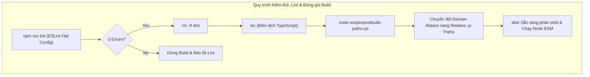

# Archive: Hệ Sinh Thái CLI Tooling, Postbuild Path Mapping, Phẫu Thuật Loại Bỏ Legacy & ESLint Enterprise Flat Config

## 1. Problem & Core Value (Bài toán & Giá trị Cốt lõi)
- **Vấn đề (Problem)**:
  1. **Tồn đọng Script Mồ côi & Phân phối Thừa**: Thư mục `scripts/` tồn đọng các tệp script mồ côi (1 shell script publish cũ và 3 migration scripts dùng 1 lần) không còn bất kỳ caller nào; phân phối npm package chứa toàn bộ thư mục `scripts` không cần thiết.
  2. **Gánh nặng Legacy CocoIndex & Timesheet**: Tính năng CocoIndex ban đầu được dùng để tạo code index artifact nhưng đã lỗi thời và phân mảnh rải rác trên nhiều tầng (Python script, doctor checks, Docker lifecycle, prebuilt bundles); tương tự là hệ sinh thái chấm công mồ côi. Người dùng bị ép kiểm tra Python 3.11+ và Docker container ngoài.
  3. **Lỗi Nạp ESM Sau Tái Cấu Trúc 3 Domain**: Việc chuyển `assets/` sang 3 domain (`agents/`, `devenv/`, `templates/`) gây lỗi `ERR_MODULE_NOT_FOUND` khi chạy binary CLI do script chuyển đổi path hậu biên dịch (`scripts/postbuild-paths.cjs`) dùng phép thế tiền tố phẳng (`@assets/` -> `../../assets/`) không phản ánh cấu trúc phân cấp.
  4. **Thiếu Phân Tích Tĩnh & Nguy Cơ Rò Rỉ Lỗi Runtime**: Dự án chỉ dựa vào Prettier (`format:check`) để định dạng khoảng trắng, thiếu kiểm tra tĩnh cho imports lộn xộn, thiếu `import type`, nguy cơ floating promises không được await, và nguy cơ phụ thuộc vòng giữa các tầng module (`src/core/` import ngược từ `src/commands/`).
  5. **Crash Khi Hiển Thị Checkbox Prompt Trống Lựa Chọn**: Khi gọi `@inquirer/checkbox` mà mảng `choices: []` rỗng (ví dụ: chạy `only-one combo` ở chế độ local project trong khi toàn bộ combos đều có `scope: 'global'`), `@inquirer/checkbox` ném ngoại lệ `ValidationError: [checkbox prompt] No selectable choices` làm sập tiến trình CLI.
  6. **Bỏ Qua Cập Nhật Khi Bấm Enter & Thiếu Cờ Force Sync Trong Combos**: Checkbox ghi đè tài nguyên trong `confirmComboOverwriteStep` trước đây mặc định `checked: false` cho toàn bộ tài sản đã tồn tại; khi người dùng bấm phím Enter theo quán tính, `overwriteList` rỗng và toàn bộ bản cập nhật bị bỏ qua (`skipped`). Lệnh combo cũng thiếu cờ `-f, --force` để tự động ghi đè không qua prompt trong các quy trình CI/scripted.
- **Giá trị Cốt lõi (Value)**:
  - **Tinh gọn Tooling & Đóng gói Sạch**: Thu gọn `scripts/` về đúng các dev tools cần thiết (`publish.js`, `bump-asset.ts`, `build-go.js`, `postbuild-paths.cjs`) và thu gọn danh sách đóng gói npm package về đúng 2 thư mục: `["dist", "assets"]`.
  - **Phẫu thuật Loại bỏ Triệt để (Surgical Purge)**: Xóa bỏ 100% mã nguồn, doctor checks, container runners và metadata của CocoIndex và Timesheet workflows/MCPs, giúp lệnh `doctor` siêu tốc và không còn phụ thuộc ngoài.
  - **Domain Subpath Mapping trong Postbuild Transformer**: Thiết lập bảng ánh xạ `domainMappings` rõ ràng trong `scripts/postbuild-paths.cjs` (`@assets/ignore/` -> `templates/ignore/`, `@assets/skills/` -> `agents/skills/`, `@assets/rules/` -> `agents/rules/`, `@assets/vs/` -> `devenv/editor/`, `@assets/git/` -> `devenv/shell/`), đảm bảo 100% lệnh CLI khởi chạy mượt mà.
  - **Tách Biệt Linter Nội Bộ & Enterprise Ruleset**: Khởi tạo thư mục `eslint-rules/` ở root dự án (bảo vệ tuyệt đối `assets/` không bị pha trộn tooling nội bộ), kích hoạt bộ quy tắc TypeScript Enterprise (`simple-import-sort`, `consistent-type-imports`, `padding-line-between-statements`), cùng 3 custom rules nội bộ (`async-safety`, `interface-member-ordering`, `architectural-boundaries`).
  - **Chốt Chặn Pre-Build Lint Gate**: Tích hợp `npm run lint` vào quy trình `npm run build` để chặn đứng mã nguồn không đạt chuẩn trước khi biên dịch artifact.
  - **Chốt Chặn Kiểm Tra Lựa Chọn Trước Khi Hiển Thị Prompt (Empty Choices Guard)**: Kiểm tra sớm `compatibleCombos.length` trước khi gọi prompt. Nếu rỗng, hiển thị thông báo hướng dẫn người dùng sử dụng cờ `-g` / `--global` và thoát êm đẹp với mã 0 thay vì làm sập CLI.
  - **Cơ Chế Ghi Đè Thông Minh & Force Sync ([CLI-012](file:///d:/Sources/PERSONAL/only-one-cli/only-one/rules/cli.md))**: Bổ sung cờ `-f, --force` cho lệnh combo để bypass toàn bộ prompt; trong chế độ tương tác, tự động pre-select `checked: true` cho các thành phần có phiên bản cũ hơn manifest kèm huy hiệu `[UPDATE: old -> new]`.

## 2. Key Architecture & Decisions (Kiến trúc & Quyết định Then chốt)
- **Surgical Purge & Clean Seams**:
  - Xóa bỏ hoàn toàn `scripts/cocoindex_documents.py`, `src/core/indexing/tools.ts` và test `tools.test.ts`.
  - Tách định nghĩa `DoctorMode = 'docker' | 'local'` vào trực tiếp [src/core/doctor/types.ts](file:///d:/Sources/PERSONAL/only-one-cli/src/core/doctor/types.ts).
  - Bảo toàn các generic Docker helpers hữu ích trong [src/core/indexing/docker-runtime.ts](file:///d:/Sources/PERSONAL/only-one-cli/src/core/indexing/docker-runtime.ts).
  - Làm sạch [src/core/prebuilt/manifest.ts](file:///d:/Sources/PERSONAL/only-one-cli/src/core/prebuilt/manifest.ts) và [bundle.ts](file:///d:/Sources/PERSONAL/only-one-cli/src/core/prebuilt/bundle.ts).
- **Domain Subpath Mapping trong Postbuild ESM Transformer**:
  - `scripts/postbuild-paths.cjs` duyệt đệ quy thư mục `dist/` và chuyển đổi toàn bộ import specifiers của `@/`, `@assets/`, `@agents/`, `@devenv/`, `@templates/` thành relative paths hợp lệ trỏ tới file `.js`.
  - Cập nhật [src/core/ignore/index.ts](file:///d:/Sources/PERSONAL/only-one-cli/src/core/ignore/index.ts) trỏ trực tiếp đến `@assets/templates/ignore/index.js`.
- **Hệ Thống ESLint Flat Config & Custom Ruleset**:
  - **Tooling Isolation**: Toàn bộ plugin và custom rules được đặt tại `eslint-rules/` ở cấp root, bảo vệ `assets/` chỉ chứa tài nguyên mẫu phân phối.
  - **Root Flat Config (`eslint.config.mjs`)**: Nạp `@eslint/js`, `typescript-eslint`, `eslint-plugin-simple-import-sort`, `customRulesPlugin` từ `./eslint-rules/index.js`, và ghi đè bằng `eslint-config-prettier` ở cuối mảng cấu hình để triệt tiêu xung đột định dạng.
  - **Custom Rules**:
    1. `custom/async-safety`: Ép buộc await hoặc xử lý promise rejection cho toàn bộ hàm bất đồng bộ.
    2. `custom/interface-member-ordering`: Sắp xếp các thuộc tính bắt buộc (required) đứng trước thuộc tính tùy chọn (optional) trong interface.
    3. `custom/architectural-boundaries`: Ngăn chặn tầng `src/core/` import ngược từ `src/commands/` hoặc `src/cli/`.
  - **Enterprise Formatting**: Tự động sort imports theo 4 nhóm (`node:`, third-party, `@/`, relative), ép buộc cú pháp `import type`, và yêu cầu dòng trống trước/sau câu lệnh điều khiển (`return`, `if`, `for`, `try`).

## 3. Scope & Key Changes (Phạm vi & Thay đổi Chính)
- **Xoá tệp rác & legacy**:
  - `[DELETE]` `scripts/publish-npm.sh`
  - `[DELETE]` `scripts/fix-imports.mjs`
  - `[DELETE]` `scripts/move-tests-to-test-dir.mjs`
  - `[DELETE]` `scripts/port-openspec-adapters.mjs`
  - `[DELETE]` `scripts/cocoindex_documents.py`
  - `[DELETE]` `src/core/indexing/tools.ts`
  - `[DELETE]` `test/core/indexing/tools.test.ts`
- **Cấu hình & Postbuild Tooling**:
  - `[MODIFY]` `package.json` & `scripts/publish.js`
  - `[MODIFY]` `scripts/postbuild-paths.cjs`: Bổ sung domainMappings table cho 3-domain assets.
  - `[MODIFY]` `src/core/ignore/index.ts`: Cập nhật import target sang domain alias.
  - `[NEW]` `test/core/postbuild-paths.test.ts`: Kiểm thử toàn vẹn biến đổi đường dẫn ESM.
  - `[MODIFY]` `src/core/doctor/types.ts`, `checks.ts`, `install.ts`
  - `[MODIFY]` `src/core/indexing/docker-runtime.ts`
  - `[MODIFY]` `src/core/prebuilt/bundle.ts`, `manifest.ts`, `indexers.ts`
  - `[MODIFY]` `src/core/client/types.ts`
- **Hệ thống Linter & Ruleset Nội bộ**:
  - `[NEW]` `eslint.config.mjs`: Cấu hình ESLint Flat Config cấp root tích hợp Enterprise ruleset.
  - `[NEW]` `eslint-rules/index.js`: Plugin export custom rules và presets.
  - `[NEW]` `eslint-rules/presets/index.js`: Khởi tạo presets.
  - `[NEW]` `eslint-rules/rules/architectural-boundaries.js`: Kiểm soát ranh giới phân tầng (`core` không import từ `commands`/`cli`).
  - `[NEW]` `eslint-rules/rules/async-safety.js`: Kiểm tra an toàn async/await.
  - `[NEW]` `eslint-rules/rules/interface-member-ordering.js`: Kiểm tra sắp xếp required đứng trước optional properties.
  - `[NEW]` `test/core/linter/architectural-boundaries.test.ts`: Unit test ranh giới kiến trúc.
  - `[NEW]` `test/core/linter/async-safety.test.ts`: Unit test an toàn bất đồng bộ.
  - `[NEW]` `test/core/linter/interface-member-ordering.test.ts`: Unit test sắp xếp thuộc tính interface.
- **CLI Commands Defect Remediation**:
  - `[MODIFY]` `src/commands/combo/actions/step-3-select-combos.ts`: Guard candidate choices và early exit với hướng dẫn `-g` / `--global` khi mảng combos rỗng.
  - `[MODIFY]` `test/commands/combo/combo.test.ts`: Bổ sung regression test `handles interactive combo selection gracefully when no compatible combos exist for the scope`.

## 4. Verification Evidence (Bằng chứng Nghiệm thu)
- **Lint Suite**:
  - `npm run lint` hoàn thành với **0 lỗi vi phạm** (178 warnings không chặn build).
  - Tự động sắp xếp imports và chuẩn hóa `import type` trên toàn bộ codebase qua `npm run lint:fix`.
- **Unit Test Suite**:
  - `npm test` đạt **100% Passed**: 78 test suites passed, 347 unit tests passed, 4 skipped, 0 failures.
  - Test case `handles interactive combo selection gracefully when no compatible combos exist for the scope` verified 100% passed.
  - Test suite `test/combo/smartOverwriteSync.test.ts` verified 100% passed (force flag bypass, outdated pre-select, and rules manifest).
  - Test suites cho custom linter rules (`test/core/linter/*.test.ts`) đạt 100% Passed.
- **Postbuild Verification**:
  - `npm run build` thực thi trơn tru: kích hoạt lint gate $\rightarrow$ tsc compile $\rightarrow$ postbuild-paths.cjs transform.
  - `node dist/src/index.js --help` exit code 0.
  - `node dist/src/index.js tui --help` exit code 0.
  - `npm test test/core/postbuild-paths.test.ts` passed (3/3).
- **Format & Build**: 100% Passed (`npm run format:check` và `npm run build`).
- **NPM Local Package**: Đóng gói và cài đặt toàn cục thành công qua `npm run publish:local`.

