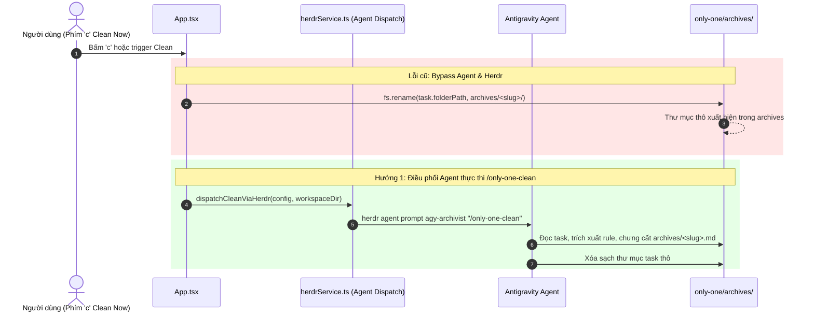

# Debug: Archives Directory Structure Inconsistency (Cấu trúc thư mục only-one/archives không đồng nhất)

## Section 1. Diagnosis & RCA (Chẩn đoán & Phân tích nguyên nhân gốc rễ)

### Symptom (Triệu chứng lỗi)
- Thư mục `only-one/archives/` không đồng nhất: vừa chứa 7 file markdown độc lập (`<slug>.md`), vừa chứa 3 thư mục task thô (`eslint-rules-assets-and-evolve/`, `global-skills-sh-destination-sync/`, `only-one-reflect-workflow/`).
- Quy trình dọn dẹp task hoàn thành không kích hoạt Agent để chạy `/only-one-clean` mà chạy code Node.js cục bộ tự viết.

### Reproduction (Tái hiện lỗi)
1. Kiểm tra danh sách file trong `only-one/archives/`:
   ```bash
   dir only-one/archives
   ```
2. Thấy rõ 3 thư mục con chứa `concept.md`, `plan.md`, `debug.md`.
3. Kiểm tra code kích hoạt Clean trong `src/tui/App.tsx` (dòng 80-84):
   - Hàm `handleCleanNow` chỉ gọi hàm Node.js cục bộ `cleanCompletedTasks` thực hiện lệnh `fs.rename` dời thư mục.
   - Hoàn toàn không mở pane, không gọi Herdr, không spawn Agent, không chạy `/only-one-clean`.

### Evidence (Bằng chứng thu thập)
1. **Quy tắc hệ thống tại [rules/core.md](file:///d:/Sources/PERSONAL/only-one-cli/only-one/rules/core.md#L12-L15)**:
   ```markdown
   ### CORE-001: Single Task Archive Invariant & Clean Slug Naming
   - **MUST_DO**: Distill completed tasks into exactly one clean-slug file only-one/archives/<slug>.md and remove raw task folders.
   - **NEVER_DO**: Prefix filenames with timestamp strings or move raw task folders directly into archives/.
   ```
2. **Kỹ năng `only-one-clean` tại [assets/skills/only-one-clean/SKILL.md](file:///d:/Sources/PERSONAL/only-one-cli/assets/skills/only-one-clean/SKILL.md)**:
   - Kỹ năng được thiết kế để Agent đóng vai trò **System Archivist & Quality Auditor**.
   - Agent đọc codebase, trích xuất Negative Rules vào `only-one/rules/core.md`, lưu vết `improvements.md`, chưng cất thành file `archives/<slug>.md` và dọn dẹp task.
3. **Mã nguồn Herdr Service tại [src/tui/services/herdrService.ts](file:///d:/Sources/PERSONAL/only-one-cli/src/tui/services/herdrService.ts)**:
   - Đã có sẵn hạ tầng split pane và prompt Agent (`herdr pane split`, `herdr agent start`, `herdr agent prompt`), nhưng chỉ cấu hình cho các phase task đơn lẻ (`concept`, `plan`, `apply`, `debug`, `review`).
   - Thiếu hàm điều phối Agent cho tác vụ `clean` toàn hệ thống.

### Root Cause (Nguyên nhân gốc rễ)
- `taskCleaner.ts` và `App.tsx` bypass hoàn toàn cơ chế Agent Dispatch qua Herdr cho tác vụ Clean, thay bằng một hàm Node.js thô tự viết (`fs.rename`).
- Do đó, Agent không bao giờ được gọi để chạy `/only-one-clean`, dẫn đến việc thư mục task thô bị đẩy thẳng vào `only-one/archives/` vi phạm quy tắc `CORE-001`.

### Failure Trace Diagram (Sơ đồ sai lệch luồng)



### Violated Invariants & Fix Constraints (Ràng buộc sửa chữa)
- **Ràng buộc vi phạm**: `CORE-001: Single Task Archive Invariant & Clean Slug Naming` và kiến trúc Agent Orchestration qua Herdr.
- **Giải pháp Hướng 1**:
  1. Mở rộng `AgentRoutingConfig` và `DEFAULT_GLOBAL_CONFIG` trong `config.ts` để thêm route `clean: 'antigravity'`.
  2. Bổ sung `buildHerdrCleanDispatchPlan` và `dispatchCleanViaHerdr` trong `herdrService.ts` để split pane và prompt lệnh `/only-one-clean`.
  3. Cập nhật `handleCleanNow` trong `App.tsx` để điều phối Agent dọn dẹp qua Herdr thay vì gọi hàm rename file thô.
  4. Di chuyển 3 thư mục task thô (`eslint-rules-assets-and-evolve`, `global-skills-sh-destination-sync`, `only-one-reflect-workflow`) từ `only-one/archives/` trở lại `only-one/tasks/` để Agent chạy `/only-one-clean` xử lý chưng cất đúng chuẩn.

---

## Section 2. Patch Blueprint (Bản thiết kế vá lỗi)

### Directory Structure Changes

```text
src/tui/
├── types/
│   └── [MODIFY] config.ts               # Bổ sung clean vào AgentRoutingConfig
├── services/
│   └── [MODIFY] herdrService.ts         # Bổ sung hàm dispatchCleanViaHerdr
└── [MODIFY] App.tsx                     # Cập nhật handleCleanNow điều phối Agent qua Herdr

test/tui/
└── [MODIFY] herdrService.test.ts        # Bổ sung unit test cho buildHerdrCleanDispatchPlan
```

### 1. `[MODIFY]` `src/tui/types/config.ts`

- **Status**: `[x]`
- **Context**: `AgentRoutingConfig` chưa có định tuyến agent cho tác vụ clean.
- **Target Symbols / AST Seams**: `AgentRoutingConfig`, `DEFAULT_GLOBAL_CONFIG`.
- **Invariants**: `clean` có giá trị mặc định là `'antigravity'`.
- **Depends On**: None.
- **Fast Test Command**: `npm run build`.

> **Action**: Thêm trường clean vào AgentRoutingConfig và cấu hình mặc định.

**Ponytail checklist**
- [x] Bắt buộc theo đúng tiêu chí nghiệm thu.
- [x] Đã rà soát code hiện có, thư viện chuẩn và dependencies.
- [x] Không tạo logic trùng lặp hoặc điểm mở rộng suy đoán.
- [x] Diff tối thiểu, đảm bảo an toàn và tính đúng đắn.
- **Decision**: Bổ sung định tuyến clean cho Agent Herdr.
- **Rejected alternative**: Hardcode tên agent trong herdrService.ts.

```diff
@@ line 12 @@
     debug: string;
     review: string;
+    clean?: string;
 }
 
 export interface HerdrConfig {
@@ line 39 @@
         debug: 'claudecode',
         review: 'claudecode',
+        clean: 'antigravity',
     },
     herdr: {
```

### 2. `[MODIFY]` `src/tui/services/herdrService.ts`

- **Status**: `[x]`
- **Context**: Chưa có logic tạo lệnh và điều phối Agent chạy tác vụ clean toàn hệ thống.
- **Target Symbols / AST Seams**: `buildHerdrCleanDispatchPlan`, `dispatchCleanViaHerdr`.
- **Invariants**: Phải gọi lệnh `/only-one-clean` trong pane mới qua Herdr CLI.
- **Depends On**: `src/tui/types/config.ts`.
- **Fast Test Command**: `npx vitest run test/tui/herdrService.test.ts`.

> **Action**: Triển khai buildHerdrCleanDispatchPlan và dispatchCleanViaHerdr.

**Ponytail checklist**
- [x] Bắt buộc theo đúng tiêu chí nghiệm thu.
- [x] Đã rà soát code hiện có, thư viện chuẩn và dependencies.
- [x] Không tạo logic trùng lặp hoặc điểm mở rộng suy đoán.
- [x] Diff tối thiểu, đảm bảo an toàn và tính đúng đắn.
- **Decision**: Tái sử dụng quy trình split pane và prompt agent của Herdr cho lệnh /only-one-clean.
- **Rejected alternative**: Viết script spawn agent bằng process riêng rẽ không tích hợp Herdr.

```diff
@@ line 42 @@
     };
 }
 
+export function buildHerdrCleanDispatchPlan(
+    config: OnlyOneGlobalConfig,
+    workspaceDir: string,
+): HerdrDispatchPlan {
+    const targetAgent = config.agentRouting.clean || 'antigravity';
+    const agentName = 'agy-archivist';
+    const direction = config.herdr.splitDirection;
+    const focusFlag = config.herdr.focusOnSpawn ? '' : '--no-focus';
+
+    return {
+        splitCommand: `herdr pane split --current --direction ${direction} --cwd "${workspaceDir}" ${focusFlag}`.trim(),
+        agentStartCommand: `herdr agent start ${agentName} --kind ${targetAgent}`,
+        agentPromptCommand: `herdr agent prompt ${agentName} "/only-one-clean"`,
+        targetAgent,
+    };
+}
+
+export async function dispatchCleanViaHerdr(
+    config: OnlyOneGlobalConfig,
+    workspaceDir: string,
+): Promise<HerdrDispatchResult> {
+    if (!isHerdrSessionActive()) {
+        return {
+            success: false,
+            message: 'Herdr session không hoạt động (HERDR_ENV != 1). Vui lòng mở trong Herdr workspace.',
+        };
+    }
+
+    const plan = buildHerdrCleanDispatchPlan(config, workspaceDir);
+
+    return new Promise((resolve) => {
+        exec(plan.splitCommand, (splitErr, splitStdout) => {
+            if (splitErr) {
+                resolve({ success: false, message: `Lỗi khi split pane: ${splitErr.message}` });
+                return;
+            }
+
+            let paneId = '';
+            try {
+                const parsed = JSON.parse(splitStdout);
+                paneId = parsed?.result?.pane?.pane_id || '';
+            } catch {
+                // Bỏ qua lỗi parse
+            }
+
+            const startCmd = paneId ? `${plan.agentStartCommand} --pane ${paneId}` : plan.agentStartCommand;
+
+            exec(startCmd, (startErr) => {
+                if (startErr) {
+                    resolve({ success: false, message: `Lỗi khi start agent: ${startErr.message}` });
+                    return;
+                }
+
+                exec(plan.agentPromptCommand, (promptErr) => {
+                    if (promptErr) {
+                        resolve({ success: false, message: `Lỗi khi prompt agent: ${promptErr.message}` });
+                        return;
+                    }
+                    resolve({
+                        success: true,
+                        message: `Đã điều phối tác vụ Clean tới ${plan.targetAgent} (/only-one-clean) trong pane kế bên.`,
+                    });
+                });
+            });
+        });
+    });
+}
+
 export async function dispatchTaskViaHerdr(
```

### 3. `[MODIFY]` `test/tui/herdrService.test.ts`

- **Status**: `[x]`
- **Context**: Cần kiểm thử tự động cho hàm `buildHerdrCleanDispatchPlan`.
- **Target Symbols / AST Seams**: `buildHerdrCleanDispatchPlan`.
- **Invariants**: Kiểm tra lệnh split pane và prompt `/only-one-clean`.
- **Depends On**: `src/tui/services/herdrService.ts`.
- **Fast Test Command**: `npx vitest run test/tui/herdrService.test.ts`.

> **Action**: Bổ sung unit test cho buildHerdrCleanDispatchPlan.

**Test checklist**
- [x] Bắt buộc theo đúng tiêu chí nghiệm thu.
- [x] Đã rà soát code hiện có, thư viện chuẩn và dependencies.
- [x] Không tạo logic trùng lặp hoặc điểm mở rộng suy đoán.
- [x] Diff tối thiểu, đảm bảo an toàn và tính đúng đắn.
- **Decision**: Kiểm tra nội dung chuỗi lệnh sinh ra từ cấu hình mặc định.
- **Rejected alternative**: Bỏ qua test làm tăng nguy cơ sai format lệnh Herdr.

```diff
@@ line 2 @@
-import { buildHerdrDispatchPlan, isHerdrSessionActive } from '@/tui/services/herdrService.js';
+import { buildHerdrCleanDispatchPlan, buildHerdrDispatchPlan, isHerdrSessionActive } from '@/tui/services/herdrService.js';
@@ line 34 @@
     });
+
+    it('xây dựng chính xác kế hoạch điều phối clean toàn hệ thống', () => {
+        const plan = buildHerdrCleanDispatchPlan(DEFAULT_GLOBAL_CONFIG, '/my/workspace');
+        expect(plan.splitCommand).toContain('herdr pane split');
+        expect(plan.agentStartCommand).toContain('herdr agent start agy-archivist --kind antigravity');
+        expect(plan.agentPromptCommand).toContain('herdr agent prompt agy-archivist "/only-one-clean"');
+    });
 });
```

### 4. `[MODIFY]` `src/tui/App.tsx`

- **Status**: `[x]`
- **Context**: `handleCleanNow` trong App.tsx đang gọi hàm local rename file thô.
- **Target Symbols / AST Seams**: `handleCleanNow`.
- **Invariants**: Điều phối Agent qua `dispatchCleanViaHerdr`.
- **Depends On**: `src/tui/services/herdrService.ts`.
- **Fast Test Command**: `npm run build`.

> **Action**: Chuyển đổi handleCleanNow sang gọi dispatchCleanViaHerdr.

**Ponytail checklist**
- [x] Bắt buộc theo đúng tiêu chí nghiệm thu.
- [x] Đã rà soát code hiện có, thư viện chuẩn và dependencies.
- [x] Không tạo logic trùng lặp hoặc điểm mở rộng suy đoán.
- [x] Diff tối thiểu, đảm bảo an toàn và tính đúng đắn.
- **Decision**: Gửi lệnh /only-one-clean tới Agent chuyên trách qua Herdr.
- **Rejected alternative**: Giữ nguyên hàm Node.js cục bộ gây sai lệch dữ liệu.

```diff
@@ line 11 @@
-import { dispatchTaskViaHerdr } from './services/herdrService.js';
+import { dispatchCleanViaHerdr, dispatchTaskViaHerdr } from './services/herdrService.js';
@@ line 80 @@
     const handleCleanNow = async () => {
-        const res = await cleanCompletedTasks(workspaceDir, 0);
-        setStatusMessage(`Đã dọn dẹp ${res.archivedSlugs.length} task sang only-one/archives/.`);
-        await refresh();
+        setStatusMessage('Đang điều phối tác vụ Clean tới Agent qua Herdr...');
+        const res = await dispatchCleanViaHerdr(globalConfig, workspaceDir);
+        setStatusMessage(res.message);
     };
```

---

## Section 3. Verification (Kiểm định & Nghiệm thu)

- **Automated Tests**:
  - [x] `npx vitest run test/tui/herdrService.test.ts` (PASS - 3 tests passed in 5ms)
  - [x] `npm test` (PASS - 62 test files passed, 258 tests passed in 13.68s)
  - [x] `npm run build` (PASS - Prettier formatting check and TypeScript compilation succeeded)
- **Manual Migration & Verification**:
  1. [x] Di chuyển 3 thư mục `eslint-rules-assets-and-evolve`, `global-skills-sh-destination-sync`, `only-one-reflect-workflow` từ `only-one/archives/` trở lại `only-one/tasks/`.
  2. [x] Xác nhận thư mục `only-one/archives/` 100% đồng nhất, chỉ chứa các file markdown kiến trúc.
  3. [ ] Bấm phím `c` trong TUI (hoặc chạy `/only-one-clean`) để Agent thực thi dọn dẹp và chưng cất thành các file `.md` chuẩn.
