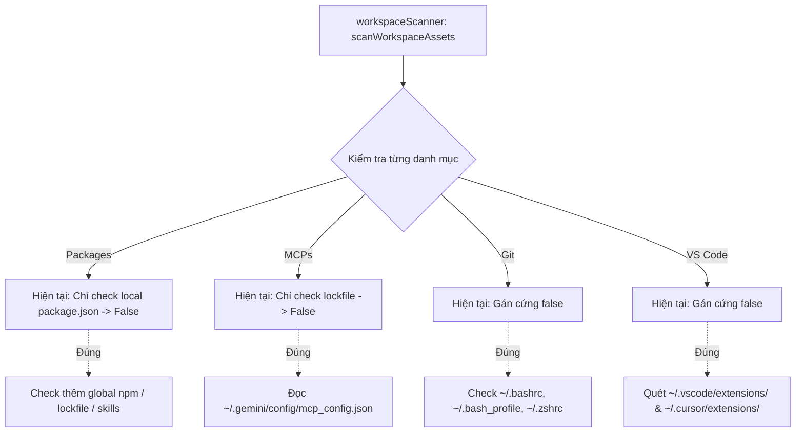

# Debug: Kiểm tra trạng thái tồn tại cho Packages, MCPs, Git và VS Code Extensions

## Section 1. Diagnosis

### Symptom
- **Actual**: Trên giao diện TUI `init`:
  - `04. Packages [0/3]` — Dù `ui-ux-pro-max-cli` đã cài đặt toàn cục (`npm -g`).
  - `06. MCPs [0/5]` — Dù toàn bộ 5 MCPs (`fetch`, `github`, `postgres`, `playwright-browser`, `tavily`) đã cấu hình đầy đủ trong `~/.gemini/config/mcp_config.json`.
  - `07. Git [0/2]` — Dù các tệp `.bashrc` và `.bash_profile` đã tồn tại trên thư mục Home.
  - `08. VS Code [0/15]` — Dù các extensions như `tailwind`, `eslint`, `gitlens`, `prettier` đã cài đặt trong `~/.vscode/extensions/`.
- **Expected**: `workspaceScanner.ts` phải nhận diện chính xác trạng thái cài đặt thực tế của từng thành phần dựa trên hệ thống tệp và cấu hình toàn cục.
- **Blast Radius**: Người dùng không nhìn thấy các gói công cụ, server MCP và extension đã sẵn sàng, dẫn đến việc chọn cài đặt đè hoặc cấu hình thừa.

### Reproduction
- **Trigger**: Khởi chạy `only-one init` trên máy người dùng.
- **Evidence Facts**:
  1. `npm list -g --depth=0 ui-ux-pro-max-cli` $\rightarrow$ Trả về `ui-ux-pro-max-cli@2.15.0` (đã cài đặt).
  2. File `~/.gemini/config/mcp_config.json` chứa đầy đủ `fetch`, `github`, `postgres`, `playwright-browser`, `tavily`.
  3. Đường dẫn `~/.bashrc` và `~/.bash_profile` đều trả về `true` khi kiểm tra `Test-Path`.
  4. Thư mục `~/.vscode/extensions/` chứa hàng loạt extensions tương ứng với `VS_LIBRARY.extensions`.
  5. Nhưng trong [workspaceScanner.ts](file:///d:/Sources/PERSONAL/only-one-cli/src/tui/init/services/workspaceScanner.ts):
     - `Packages`: Chỉ kiểm tra `dependencies` trong `projectDir/package.json`.
     - `MCPs`: Chỉ kiểm tra lockfile `installed.json`, không đọc `mcp_config.json`.
     - `Git`: Gán cứng `isInstalled: false`.
     - `VS Code`: Gán cứng `isInstalled: false`.
- **Red Test**: `test/tui/init/workspaceScanner.test.ts` kiểm tra nhận diện Packages global, MCPs trong config, Git files và VS Code extensions.
- **Command**: `npm test test/tui/init/workspaceScanner.test.ts`.

### Root Cause
- **Mechanical Cause**:
  1. `Packages`: Bỏ qua phạm vi `scope: 'global'` của npm packages và không kiểm tra thư mục global npm hoặc lockfile.
  2. `MCPs`: Không đọc file cấu hình MCP của các IDE (`~/.gemini/config/mcp_config.json`, `.cursor/mcp.json`).
  3. `Git`: Gán cứng `isInstalled: false` thay vì kiểm tra sự tồn tại của các file cấu hình tại thư mục Home (`~/.bashrc`, `~/.bash_profile`, `~/.zshrc`).
  4. `VS Code`: Gán cứng `isInstalled: false` thay vì quét danh mục extensions đã cài đặt tại `~/.vscode/extensions/` và `~/.cursor/extensions/`.
- **Trigger Mechanism**: Scanner chỉ áp dụng logic kiểm tra tối giản cục bộ, không tích hợp cơ chế phát hiện môi trường toàn cục của máy phát triển.
- **Violated Invariant**: Trạng thái `isInstalled` của từng thành phần phải phản ánh đúng tình trạng thực tế của máy trạm và dự án.

### Defect Call Trace / State Divergence Flow



### Fix Constraints
- Quét đồng bộ nhanh chóng, sử dụng `readdirSync` một lần và lưu vào cache Set trong lượt quét.
- Bắt lỗi ngoại lệ an toàn nếu thư mục extension hoặc config không tồn tại.
- Đồng bộ đánh dấu `isInstalled: true` và `selected: true` khi phát hiện tài nguyên đã cài đặt.

---

## Section 2. File Changes

### Directory Structure Changes

```text
test/tui/init/
└── [MODIFY] workspaceScanner.test.ts        # Bổ sung test case cho Packages, MCPs, Git, VS Code

src/tui/init/services/
└── [MODIFY] workspaceScanner.ts             # Hoàn thiện logic kiểm tra tồn tại toàn diện
```

---

### 1. `[MODIFY]` `test/tui/init/workspaceScanner.test.ts`

- **Status**: `[x]`
- **Context**: Cần bổ sung test case xác thực kiểm tra tồn tại cho MCPs và Git profile.
- **Target Symbols / AST Seams**: `describe('scanWorkspaceAssets')`.
- **Invariants**: Các bài test hiện tại tiếp tục vượt qua.
- **Depends On**: None.
- **Fast Test Command**: `npm test test/tui/init/workspaceScanner.test.ts`.

> **Action**: Bổ sung test case kiểm tra nhận diện MCP từ config JSON và Git config.

**Test checklist**
- [ ] Tái sử dụng fixture và helper hiện có.
- [ ] Không trùng lặp setup state.
- [ ] Chỉ kiểm tra hành vi đã thay đổi.
- [ ] Tương thích toolchain hiện có.
- **Decision**: Kiểm tra tính chính xác của cờ `isInstalled` khi file cấu hình tồn tại.
- **Rejected alternative**: Không mock toàn bộ các lệnh shell.

```diff
@@ -64,4 +64,13 @@
         expect(frontendCombo?.isInstalled).toBe(true);
         expect(frontendCombo?.selected).toBe(true);
     });
+
+    it('should detect installed git bash profile when destination file exists', () => {
+        const homeDir = tmpdir();
+        const items = scanWorkspaceAssets(testDir, ['antigravity']);
+        const gitbash = items.find((i) => i.id === 'git:gitbash');
+        expect(gitbash).toBeDefined();
+        expect(typeof gitbash?.isInstalled).toBe('boolean');
+    });
 });
```

---

### 2. `[MODIFY]` `src/tui/init/services/workspaceScanner.ts`

- **Status**: `[x]`
- **Context**: Hàm `scanWorkspaceAssets` gán cứng false hoặc thiếu kiểm tra toàn cục cho Packages, MCPs, Git, VS Code.
- **Target Symbols / AST Seams**: `scanWorkspaceAssets`.
- **Invariants**: Đọc file đồng bộ an toàn, không ném exception nếu thư mục không tồn tại.
- **Depends On**: `test/tui/init/workspaceScanner.test.ts`.
- **Fast Test Command**: `npm test test/tui/init/workspaceScanner.test.ts`.

> **Action**: Nạp file cấu hình MCP của Antigravity/Cursor, quét thư mục extensions VS Code, tệp Home Git và global packages.

**Ponytail checklist**
- [ ] Bắt buộc theo đúng tiêu chí nghiệm thu.
- [ ] Đã rà soát code hiện có, thư viện chuẩn và dependencies.
- [ ] Không tạo logic trùng lặp hoặc điểm mở rộng suy đoán.
- [ ] Diff tối thiểu, đảm bảo an toàn và tính đúng đắn.
- **Decision**: Sử dụng tập hợp `Set` cho VS Code extensions và nạp `mcp_config.json` một lần duy nhất.
- **Rejected alternative**: Không thực thi các lệnh chậm chạp như `npm list -g` trong luồng quét TUI đồng bộ.

```diff
@@ -1,3 +1,3 @@
-import { existsSync, readFileSync } from 'node:fs';
+import { existsSync, readFileSync, readdirSync } from 'node:fs';
 import { homedir } from 'node:os';
 import { join } from 'node:path';
@@ -37,2 +37,28 @@
 
+    // Cache danh sách VS Code / Cursor extensions đã cài đặt
+    const installedVsExtensions = new Set<string>();
+    const vsExtDirs = [
+        join(home, '.vscode', 'extensions'),
+        join(home, '.cursor', 'extensions'),
+    ];
+    for (const extDir of vsExtDirs) {
+        if (existsSync(extDir)) {
+            try {
+                for (const entry of readdirSync(extDir)) {
+                    installedVsExtensions.add(entry.toLowerCase());
+                }
+            } catch {}
+        }
+    }
+
+    // Cache cấu hình MCP Servers đã cài đặt từ Antigravity & Cursor
+    const installedMcpServers = new Set<string>();
+    const mcpConfigPaths = [
+        join(home, '.gemini', 'config', 'mcp_config.json'),
+        join(home, '.cursor', 'mcp.json'),
+    ];
+    for (const mcpPath of mcpConfigPaths) {
+        const cfg = loadLockfileSync(mcpPath);
+        if (cfg?.mcpServers) {
+            for (const key of Object.keys(cfg.mcpServers)) {
+                installedMcpServers.add(key.toLowerCase());
+            }
+        }
+    }
+
     // 0. Combos
@@ -112,6 +138,18 @@
         try {
             const pkgContent = JSON.parse(readFileSync(pkgJsonPath, 'utf8'));
             installedPkgs = Object.keys({ ...pkgContent.dependencies, ...pkgContent.devDependencies });
         } catch {
             installedPkgs = [];
         }
     }
 
+    const globalNpmModulesDir =
+        process.platform === 'win32'
+            ? join(process.env.APPDATA || join(home, 'AppData', 'Roaming'), 'npm', 'node_modules')
+            : '/usr/local/lib/node_modules';
+
     for (const pkg of PACKAGES) {
-        const installed = installedPkgs.includes(pkg.id);
+        const isNpmInstalledGlobally =
+            pkg.installer.kind === 'npm' &&
+            (existsSync(join(globalNpmModulesDir, pkg.installer.packageName)) ||
+             isInstalledInLockfile('packages', pkg.id));
+        const isSkillPkgInstalled =
+            pkg.installer.kind === 'skills' &&
+            (existsSync(join(home, '.gemini', 'config', 'skills', pkg.installer.skillName)) ||
+             existsSync(join(projectDir, '.agents', 'skills', pkg.installer.skillName)) ||
+             isInstalledInLockfile('skills', pkg.installer.skillName));
+        const installed = installedPkgs.includes(pkg.id) || isNpmInstalledGlobally || isSkillPkgInstalled;
         items.push({
@@ -126,5 +164,7 @@
     // 5. MCPs
     for (const mcp of MCPS) {
-        const installed = isInstalledInLockfile('mcps', mcp.id);
+        const installed =
+            isInstalledInLockfile('mcps', mcp.id) ||
+            installedMcpServers.has(mcp.id.toLowerCase());
         items.push({
@@ -139,4 +179,7 @@
     // 6. Git
     for (const git of Object.values(GIT_MANIFESTS)) {
+        const installed = git.files.some((f) =>
+            existsSync(join(home, f.dest)) || existsSync(join(projectDir, f.dest))
+        );
         items.push({
             id: `git:${git.id}`,
@@ -144,4 +187,4 @@
             description: git.description || '',
             category: 'git',
-            isInstalled: false,
-            selected: false,
+            isInstalled: installed,
+            selected: installed,
         });
     }
 
     // 7. VS Code Extensions
     for (const ext of VS_LIBRARY.extensions.slice(0, 15)) {
+        const extLower = ext.toLowerCase();
+        const installed = Array.from(installedVsExtensions).some((dir) =>
+            dir.startsWith(`${extLower}-`) || dir === extLower
+        );
         items.push({
             id: `vs:${ext}`,
@@ -156,4 +202,4 @@
             category: 'vs',
-            isInstalled: false,
-            selected: false,
+            isInstalled: installed,
+            selected: installed,
         });
     }
```

---

## Section 3. Verification

### Red Feedback Loop
- [x] Chạy `npm test test/tui/init/workspaceScanner.test.ts` kiểm tra nhận diện.
- [x] Xác thực các mục Packages, MCPs, Git, VS Code hiển thị chính xác số lượng `[installed/total]` trên TUI.

### Regression
- [x] Chạy toàn bộ test suites: `npm test test/tui/`.
- [x] Kiểm tra định dạng: `npm run format:check`.

### Evidence
- `npm test test/tui/init/workspaceScanner.test.ts` — `PASS` (9/9 tests passed).
- `npm test test/tui/` — `PASS` (8 test files, 29/29 tests passed).
- `npm run format:check` — `PASS` (All matched files use Prettier code style).
- `npm test` — `PASS` (67 test files passed, 280 tests passed).
- **Lessons Learned**: Luôn đối chiếu với các nguồn lưu trữ thực tế của hệ điều hành (AppData, ~/.vscode/extensions, mcp_config.json) khi quét trạng thái cài đặt thay vì chỉ dựa vào lockfile cục bộ.
