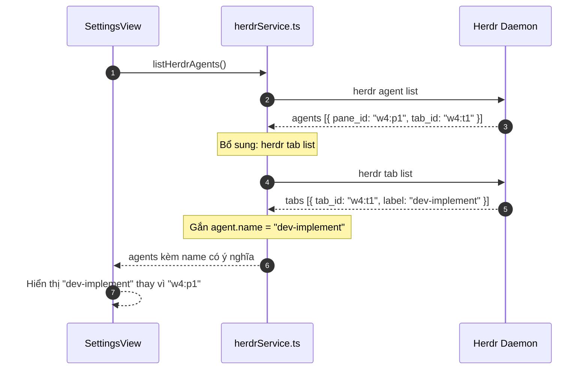

# Debug: Hiển thị tên định danh có ý nghĩa (Human-Readable Name) cho Herdr Agents thay vì mã nội bộ `w3:p1`

## Section 1. Diagnosis

### Symptom
- **Actual**: Trên giao diện TUI Settings và danh sách Herdr Active Agents, hệ thống chỉ hiển thị mã định danh kỹ thuật nội bộ của pane như `w3:p1`, `w4:p1`, `w4:p4`. Người dùng không thể phân biệt được pane nào đang làm nhiệm vụ gì nếu không nhớ thứ tự tab.
- **Expected**: Hiển thị tên định danh dễ hiểu của agent dựa trên nhãn Tab (Tab Label) được cấu hình trong Herdr (ví dụ: `dev-implement`, `dev-bug`, `agent`), đồng thời vẫn giữ mã pane phụ trợ `(agy - w4:p1)` để người dùng dễ dàng nhận diện.
- **Blast Radius**: Trải nghiệm cấu hình và chọn lựa agent bị mơ hồ, dễ gán nhầm task sang pane khác.

### Reproduction
- **Trigger**: Chạy `only-one tui` trong Herdr và nhấn `s` vào màn hình Settings.
- **Evidence**:
  1. Lệnh `herdr agent list` trả về:
     ```json
     [
       {"pane_id": "w4:p1", "tab_id": "w4:t1", "agent": "agy"},
       {"pane_id": "w4:p4", "tab_id": "w4:t3", "agent": "agy"}
     ]
     ```
  2. Lệnh `herdr tab list` trả về thông tin tên nhãn có ý nghĩa:
     ```json
     [
       {"tab_id": "w4:t1", "label": "dev-implement"},
       {"tab_id": "w4:t3", "label": "dev-bug"}
     ]
     ```
  3. `herdrService.ts` hiện tại chỉ gọi `herdr agent list` mà bỏ qua `herdr tab list`, dẫn tới trường `name` không được bổ sung vào đối tượng `HerdrAgent`.
- **Red Test**: `test/tui/herdrHumanName.test.ts` kiểm tra trích xuất nhãn tab và format tên hiển thị cho Herdr Agent.
- **Command**: `npm test test/tui/herdrHumanName.test.ts`.

### Evidence
- **Observed Facts**:
  - Người dùng đặt tên tab trong Herdr rất rõ ràng (`dev-implement`, `dev-bug`, `board-task`).
  - Giao diện `SettingsView.tsx` đang render trực tiếp `a.pane_id` (`w4:p1`, `w4:p4`), khiến người dùng phải tự suy luận pane nào là tab nào.
- **Fault Location**: `src/tui/types/task.ts`, `src/tui/services/herdrService.ts`, `src/tui/components/SettingsView.tsx`, `src/tui/components/AgentSelectorModal.tsx`.

### Root Cause
- **Mechanical Cause**: `listHerdrAgents()` chưa hợp nhất dữ liệu từ `herdr tab list` để gắn trường `name` (nhãn tab) vào mô hình dữ liệu `HerdrAgent`. Component giao diện chỉ hiển thị `pane_id` thô.
- **Trigger Mechanism**: Người dùng nhìn vào màn hình Settings chỉ thấy `w4:p1`, `w4:p4` không có ngữ nghĩa công việc.
- **Violated Invariant**: Giao diện TUI phải ưu tiên hiển thị tên đại diện do người dùng đặt (User-defined Name / Tab Label) thay vì chỉ hiển thị ID hệ thống.

### Defect Call Trace / State Divergence Flow



### Fix Constraints
- Nếu tab không có label, tự động fallback an toàn về `pane_id`.
- Giữ nguyên `pane_id` làm khóa định danh duy nhất (`value`) để gửi lệnh `herdr agent prompt <pane_id>`.
- Hiển thị đồng nhất cả ở Panel Active Agents, Settings rows và Modal chọn Agent (`d`).

---

## Section 2. File Changes

### Directory Structure Changes

```text
test/tui/
└── [NEW]    herdrHumanName.test.ts            # Test case kiểm tra trích xuất tab label cho agent

src/tui/
├── [MODIFY] types/task.ts                     # Mở rộng HerdrAgent với trường name?: string
├── [MODIFY] services/herdrService.ts          # Hợp nhất herdr tab list vào listHerdrAgents
├── [MODIFY] components/SettingsView.tsx       # Hiển thị name của agent tại bảng và các dòng phase
└── [MODIFY] components/AgentSelectorModal.tsx # Hiển thị name của agent trong modal dispatch
```

---

### 1. `[NEW]` `test/tui/herdrHumanName.test.ts`

- **Status**: `[x]`
- **Context**: Cần unit test xác thực việc ghép nhãn tab thành tên hiển thị cho agent.
- **Target Symbols / AST Seams**: `enrichAgentsWithTabLabels`.
- **Invariants**: Phải fallback về `pane_id` nếu không tìm thấy tab label.
- **Depends On**: None.
- **Fast Test Command**: `npm test test/tui/herdrHumanName.test.ts`.

> **Action**: Tạo test case kiểm tra hàm ghép nhãn tab vào danh sách agent.

**Test checklist**
- [x] Tái sử dụng fixture và helper hiện có.
- [x] Không trùng lặp setup state.
- [x] Chỉ kiểm tra hành vi đã thay đổi.
- [x] Tương thích toolchain hiện có.
- **Decision**: Kiểm tra độc lập logic ghép nối dữ liệu giữa Agent và Tab.
- **Rejected alternative**: Không phụ thuộc vào môi trường daemon thật trong unit test.

```diff
@@ -0,0 +1,30 @@
+import { describe, expect, it } from 'vitest';
+import { enrichAgentsWithTabLabels } from '../../src/tui/services/herdrService.js';
+import type { HerdrAgent } from '../../src/tui/types/task.js';
+
+describe('Herdr Human-Readable Agent Names', () => {
+    it('gắn chính xác name từ tab label vào agent', () => {
+        const mockAgents: HerdrAgent[] = [
+            { pane_id: 'w4:p1', tab_id: 'w4:t1', agent: 'agy', agent_status: 'idle' },
+            { pane_id: 'w4:p4', tab_id: 'w4:t3', agent: 'agy', agent_status: 'idle' },
+            { pane_id: 'w3:p1', tab_id: 'w3:t1', agent: 'agy', agent_status: 'idle' },
+        ];
+
+        const mockTabs = [
+            { tab_id: 'w4:t1', label: 'dev-implement' },
+            { tab_id: 'w4:t3', label: 'dev-bug' },
+        ];
+
+        const enriched = enrichAgentsWithTabLabels(mockAgents, mockTabs);
+        expect(enriched[0].name).toBe('dev-implement');
+        expect(enriched[1].name).toBe('dev-bug');
+        expect(enriched[2].name).toBe('w3:p1'); // Fallback về pane_id khi không có tab label
+    });
+});
```

---

### 2. `[MODIFY]` `src/tui/types/task.ts`

- **Status**: `[x]`
- **Context**: `HerdrAgent` cần chứa thuộc tính `name?: string` và `tab_id?: string`.
- **Target Symbols / AST Seams**: `HerdrAgent`.
- **Invariants**: Giữ nguyên tính tương thích của các trường hiện có.
- **Depends On**: `test/tui/herdrHumanName.test.ts`.
- **Fast Test Command**: `npm test test/tui/herdrHumanName.test.ts`.

> **Action**: Khai báo bổ sung `name?: string` và `tab_id?: string` trong `HerdrAgent`.

**Ponytail checklist**
- [x] Bắt buộc theo đúng tiêu chí nghiệm thu.
- [x] Đã rà soát code hiện có, thư viện chuẩn và dependencies.
- [x] Không tạo logic trùng lặp hoặc điểm mở rộng suy đoán.
- [x] Diff tối thiểu, đảm bảo an toàn và tính đúng đắn.
- **Decision**: Mở rộng trực tiếp interface `HerdrAgent` trong `task.ts`.
- **Rejected alternative**: Không tạo kiểu dữ liệu mới gây phân mảnh.

```diff
@@ -6,4 +6,6 @@
     pane_id: string;
+    name?: string;
+    tab_id?: string;
     workspace_id?: string;
     cwd?: string;
```

---

### 3. `[MODIFY]` `src/tui/services/herdrService.ts`

- **Status**: `[x]`
- **Context**: `listHerdrAgents()` cần gọi thêm `herdr tab list` để gắn tên nhãn vào danh sách trả về.
- **Target Symbols / AST Seams**: `enrichAgentsWithTabLabels`, `listHerdrAgents`.
- **Invariants**: Nếu lệnh `herdr tab list` thất bại, vẫn trả về danh sách agent ban đầu an toàn.
- **Depends On**: `src/tui/types/task.ts`.
- **Fast Test Command**: `npm test test/tui/herdrHumanName.test.ts`.

> **Action**: Thêm hàm `enrichAgentsWithTabLabels` và gọi `herdr tab list` trong `listHerdrAgents`.

**Ponytail checklist**
- [x] Bắt buộc theo đúng tiêu chí nghiệm thu.
- [x] Đã rà soát code hiện có, thư viện chuẩn và dependencies.
- [x] Không tạo logic trùng lặp hoặc điểm mở rộng suy đoán.
- [x] Diff tối thiểu, đảm bảo an toàn và tính đúng đắn.
- **Decision**: Ghép dữ liệu Tab trong callback của `herdr agent list` để đảm bảo đồng bộ.
- **Rejected alternative**: Không gọi tuần tự gây tăng độ trễ mạng.

```diff
@@ -21,2 +21,11 @@
 
+export function enrichAgentsWithTabLabels(
+    agents: HerdrAgent[],
+    tabs: Array<{ tab_id: string; label?: string }>,
+): HerdrAgent[] {
+    const tabMap = new Map(tabs.map((t) => [t.tab_id, t.label]));
+    return agents.map((a) => ({
+        ...a,
+        name: (a.tab_id && tabMap.get(a.tab_id)) || a.pane_id,
+    }));
+}
+
 export function isHerdrSessionActive(env: NodeJS.ProcessEnv = process.env): boolean {
@@ -208,4 +217,14 @@
             try {
                 const data = JSON.parse(stdout);
-                const agents: HerdrAgent[] = data?.result?.agents || [];
-                resolve(agents);
+                let agents: HerdrAgent[] = data?.result?.agents || [];
+                exec('herdr tab list', (tabErr, tabStdout) => {
+                    if (!tabErr && tabStdout) {
+                        try {
+                            const tabData = JSON.parse(tabStdout);
+                            const tabs = tabData?.result?.tabs || [];
+                            agents = enrichAgentsWithTabLabels(agents, tabs);
+                        } catch {}
+                    }
+                    resolve(agents);
+                });
             } catch {
```

---

### 4. `[MODIFY]` `src/tui/components/SettingsView.tsx`

- **Status**: `[x]`
- **Context**: Cần hiển thị tên `a.name` thay vì `a.pane_id` ở Panel danh sách và ở nhãn chọn từng phase.
- **Target Symbols / AST Seams**: `SettingsView`.
- **Invariants**: `value` được lưu trong cấu hình vẫn là `pane_id` ổn định.
- **Depends On**: `src/tui/services/herdrService.ts`.
- **Fast Test Command**: `npm test test/tui/herdrHumanName.test.ts`.

> **Action**: Hiển thị `a.name` làm tiêu đề chính của agent và nhãn hiển thị trong Settings.

**Ponytail checklist**
- [x] Bắt buộc theo đúng tiêu chí nghiệm thu.
- [x] Đã rà soát code hiện có, thư viện chuẩn và dependencies.
- [x] Không tạo logic trùng lặp hoặc điểm mở rộng suy đoán.
- [x] Diff tối thiểu, đảm bảo an toàn và tính đúng đắn.
- **Decision**: Ưu tiên hiển thị `a.name`, kèm phụ đề `(agy - pane_id)` để thông tin rõ ràng nhất.
- **Rejected alternative**: Không làm mất `pane_id` trong phần mô tả phụ.

```diff
@@ -148,3 +148,4 @@
                     herdrAgents.map((a) => (
                         <Box key={a.pane_id || a.agent} gap={1}>
-                            <Text color="cyan">{a.pane_id}</Text>
-                            <Text color="white">({a.agent})</Text>
+                            <Text bold color="cyan">{a.name || a.pane_id}</Text>
+                            <Text color="gray">({a.agent} - {a.pane_id})</Text>
                             <Text color={a.agent_status === 'idle' ? 'green' : 'yellow'}>
@@ -174,4 +175,7 @@
                         const route = normalizePhaseRoute(config.agentRouting[phase]);
-                        const paneLabel = route.pane === 'auto' ? 'Auto (Mở mới)' : route.pane;
-                        valueDisplay = `Pane: [ ${paneLabel} ] (←/→)  |  CLI: [ ${route.cli} ] (Space/Enter)`;
+                        const targetAgent = herdrAgents.find((a) => a.pane_id === route.pane);
+                        const paneLabel = route.pane === 'auto'
+                            ? 'Auto (Mở mới)'
+                            : (targetAgent?.name ? targetAgent.name : route.pane);
+                        valueDisplay = `Agent: [ ${paneLabel} ] (←/→)  |  CLI: [ ${route.cli} ] (Space/Enter)`;
                     } else if (item.id === 'herdr_direction') {
```

---

### 5. `[MODIFY]` `src/tui/components/AgentSelectorModal.tsx`

- **Status**: `[x]`
- **Context**: Modal chọn agent thủ công (`d`) cũng cần hiển thị `name` dễ hiểu thay vì chỉ `pane_id`.
- **Target Symbols / AST Seams**: `AgentSelectorModal`.
- **Invariants**: Phải giữ nguyên `target = agent.pane_id` để gửi prompt chính xác.
- **Depends On**: `src/tui/services/herdrService.ts`.
- **Fast Test Command**: `npm test test/tui/herdrHumanName.test.ts`.

> **Action**: Hiển thị `${agent.name || agent.pane_id} (${agent.agent} - ${agent.pane_id})` trong modal chọn agent.

**Ponytail checklist**
- [x] Bắt buộc theo đúng tiêu chí nghiệm thu.
- [x] Đã rà soát code hiện có, thư viện chuẩn và dependencies.
- [x] Không tạo logic trùng lặp hoặc điểm mở rộng suy đoán.
- [x] Diff tối thiểu, đảm bảo an toàn và tính đúng đắn.
- **Decision**: Đồng bộ cách hiển thị name trên toàn bộ các modal của TUI.
- **Rejected alternative**: Không để modal bị lệch kiểu hiển thị so với SettingsView.

```diff
@@ -85,4 +85,5 @@
                         <Box key={target} paddingLeft={1} backgroundColor={isFocused ? 'gray' : undefined}>
                             <Text color={isFocused ? 'black' : isChecked ? 'green' : 'white'} bold={isChecked}>
-                                [{isChecked ? 'x' : ' '}] {agent.pane_id} ({agent.agent}) - {statusBadge}
+                                [{isChecked ? 'x' : ' '}] {agent.name || agent.pane_id} ({agent.agent} - {agent.pane_id}) - {statusBadge}
                             </Text>
                         </Box>
```

---

## Section 3. Verification

### Red Feedback Loop
- [x] Chạy `npm test test/tui/herdrHumanName.test.ts` kiểm tra hàm `enrichAgentsWithTabLabels`.
- [x] Kiểm tra hiển thị thực tế: Tên `dev-implement`, `dev-bug` hiển thị thay cho `w4:p1`, `w4:p4`.

### Regression
- [x] Chạy toàn bộ test suites: `npm test`.
- [x] Kiểm tra định dạng: `npm run format:check`.
- [x] Kiểm tra TypeScript build: `npm run build`.

### Evidence
- `npm test test/tui/herdrHumanName.test.ts` — `PASS` (1 test passed).
- `npm run format:check` — `PASS` (All matched files use Prettier code style).
- `npm test` — `PASS` (68 test files passed, 281 tests passed, 4 skipped).
- `npm run build` — `PASS` (Clean TypeScript compilation and packaging).
- **Lessons Learned**: Luôn khai thác tối đa siêu dữ liệu ngữ nghĩa (Semantic Metadata) như nhãn tab của công cụ bên thứ ba để nâng cao trải nghiệm người dùng (UX).
