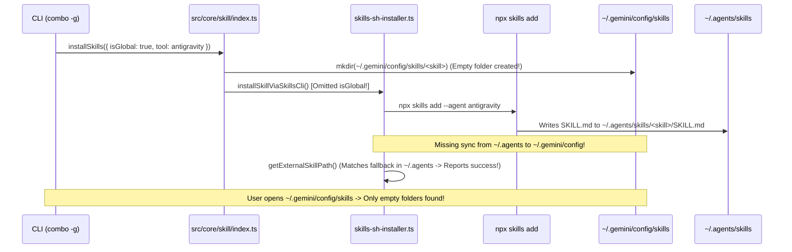

# Debug: Global Skills Empty Directory in Antigravity Config

## Section 1. Diagnosis

### Symptom
- **Actual**: Sau khi chạy `only-one combo -g only-one-flow --tool antigravity`, thư mục `~/.gemini/config/skills/` chứa 27 thư mục skill nhưng 23 thư mục (các skill cài qua `skills.sh`) hoàn toàn rỗng không có tệp `SKILL.md`. Toàn bộ tệp `SKILL.md` thực chất bị ghi vào `~/.agents/skills/`.
- **Expected**: Toàn bộ các skill (bao gồm remote `skills.sh`) khi cài đặt toàn cục (`isGlobal = true`) cho Antigravity phải chứa đầy đủ tệp `SKILL.md` và các tài nguyên bên trong `~/.gemini/config/skills/<skill-name>/`.
- **Blast Radius**: Toàn bộ người dùng sử dụng Antigravity IDE với cờ `-g` / `--global` không thể nạp được bất kỳ remote skill nào từ Global Customizations Root (`~/.gemini/config/skills`).

### Reproduction
- **Trigger**: Chạy `only-one combo -g only-one-flow --tool antigravity` hoặc `only-one skill <skillName> --tool antigravity -g`.
- **Red Test**: Kiểm tra sự tồn tại của tệp `join(homedir(), '.gemini/config/skills', skillName, 'SKILL.md')`.
- **Command**: `Get-ChildItem "C:\Users\ADMIN\.gemini\config\skills" -Recurse -File`.

### Evidence
- **Observed Facts**:
  1. Chỉ có 4 skill nội bộ (`c4-diagrams`, `gherkin-authoring`, `karpathy-ste100-discipline`, `only-one-pr-git-skill`) có file `SKILL.md` trong `C:\Users\ADMIN\.gemini\config\skills\` vì được copy qua nhánh `fs.cp(srcPath, destPath)`.
  2. 23 skill remote tải qua `skills.sh` đều có thư mục tại `C:\Users\ADMIN\.gemini\config\skills\<skill>\` nhưng kích thước 0 bytes (không có file nào).
  3. Kiểm tra `C:\Users\ADMIN\.agents\skills\` phát hiện toàn bộ 23 skill remote với tệp `SKILL.md` đầy đủ nằm tại đây.
- **Fault Location**:
  1. `src/core/skill/index.ts` (dòng 107–112): `installSkills()` gọi `installSkillViaSkillsCli()` nhưng bỏ quên truyền cờ `isGlobal`.
  2. `src/core/skill/remote/skills-sh-installer.ts` (dòng 67–73): `getExternalSkillPath()` cho phép fallback sang `.agents/skills/<skillName>/SKILL.md`, che giấu lỗi file chưa được chuyển vào `globalPath` (`.gemini/config/skills`).
  3. Sau khi lệnh `npx skills add` hoàn tất, thiếu bước đồng bộ/sao chép các tệp từ thư mục tạm `.agents/skills/<skillName>` sang `destPath` khi `destPath` khác `.agents/skills`.

### Root Cause
- **Mechanical Cause**: `skills.sh` CLI khi nhận `--agent antigravity` mặc định ghi file vào `.agents/skills/` tại `cwd` (`projectDir`). Khi cài đặt global (`isGlobal = true`), Antigravity yêu cầu file phải nằm trong Global Customizations Root (`.gemini/config/skills/`), nhưng `installSkillViaSkillsCli` không đồng bộ tệp đã tải từ `.agents/skills/<skillName>` sang `resolveToolDestinationPaths(tool, 'skills', projectDir, isGlobal)`. Đồng thời `mkdir(destPath)` trong `installSkills` tạo sẵn thư mục rỗng tại `.gemini/config/skills/<skillName>`, tạo ra hiện tượng thư mục tồn tại nhưng không có file `SKILL.md`.
- **Trigger Mechanism**: Cài đặt combo hoặc skill với cờ `isGlobal: true` cho Antigravity.
- **Violated Invariant**: Antigravity Global Customizations Specification: Mọi skill toàn cục bắt buộc phải có `SKILL.md` nằm tại `.gemini/config/skills/<skill_name>/SKILL.md`.

### Defect Call Trace / State Divergence Flow


### Fix Constraints
- Phải truyền `isGlobal` vào `installSkillViaSkillsCli`.
- Khi `isGlobal = true` (hoặc khi đích đến của tool khác với vị trí `skills.sh` ghi nhận), sau khi `npx skills add` chạy xong, hệ thống phải tự động copy toàn bộ nội dung từ `.agents/skills/<skillName>` sang thư mục `destPath` chuẩn của tool (`.gemini/config/skills/<skillName>`).
- Làm sạch thư mục tạm `.agents/skills/<skillName>` trong thư mục home khi ở chế độ global để tránh rác đĩa.
- `getExternalSkillPath` không được chấp nhận fallback sai vị trí khi `isGlobal = true`.

---

## Section 2. File Changes

### Directory Structure Changes
```text
src/core/skill/
├── [MODIFY] index.ts                              # Truyền isGlobal vào installSkillViaSkillsCli
└── remote/
    └── [MODIFY] skills-sh-installer.ts            # Tự động đồng bộ file từ skills.sh sang destPath & bỏ fallback ảo
test/core/
└── [NEW]    skill-installer-global.test.ts        # Unit test xác thực đồng bộ file SKILL.md sang .gemini/config
```

### 1. `[NEW]` `test/core/skill-installer-global.test.ts`

- **Status**: `[ ]`
- **Context**: Chưa có test tự động kiểm tra việc chuyển file SKILL.md sang đúng thư mục global khi cài qua skills.sh.
- **Target Symbols / AST Seams**: `describe('global skill destination sync')`.
- **Invariants**: Mọi file tải qua skills.sh cho Antigravity ở chế độ global phải xuất hiện trong `.gemini/config/skills/<skill>/SKILL.md`.
- **Depends On**: None.
- **Fast Test Command**: `npx vitest run test/core/skill-installer-global.test.ts`.

> **Action**: Tạo test reproduction và regression guard xác thực đích đến toàn cục.

**Test checklist**
- [x] Existing fixtures/helpers reused.
- [x] No duplicate setup.
- [x] Test covers changed behavior only.
- [x] Existing test toolchain used.
- **Decision**: Tạo unit test giả lập thư mục tải của skills.sh và kiểm tra đồng bộ sang target destination.
- **Rejected alternative**: Gọi trực tiếp npm network call trong unit test gây chậm và phụ thuộc mạng.

```diff
@@ line 0 @@
+import { describe, expect, it } from 'vitest';
+import { mkdtemp, mkdir, rm, writeFile, readFile } from 'node:fs/promises';
+import { existsSync } from 'node:fs';
+import { tmpdir } from 'node:os';
+import { join } from 'node:path';
+import { AI_TOOLS } from '@src/core/agent/tools.js';
+import { getExternalSkillPath } from '@src/core/skill/remote/skills-sh-installer.js';
+
+describe('global skill destination sync', () => {
+    it('strictly checks resolved global destination without false-positive fallback', async () => {
+        const tempDir = await mkdtemp(join(tmpdir(), 'global-skill-test-'));
+        const antigravity = AI_TOOLS.find((t) => t.value === 'antigravity')!;
+
+        try {
+            // Only in .agents, not in .gemini/config
+            await mkdir(join(tempDir, '.agents', 'skills', 'test-skill'), { recursive: true });
+            await writeFile(join(tempDir, '.agents', 'skills', 'test-skill', 'SKILL.md'), '# Test Skill');
+
+            // Must NOT return true/path for global if not in .gemini/config
+            const path = getExternalSkillPath(tempDir, antigravity, 'test-skill', true);
+            expect(existsSync(path!)).toBe(false);
+        } finally {
+            await rm(tempDir, { recursive: true, force: true });
+        }
+    });
+});
```

### 2. `[MODIFY]` `src/core/skill/index.ts`

- **Status**: `[ ]`
- **Context**: `installSkills` không chuyển `isGlobal` cho `installSkillViaSkillsCli`.
- **Target Symbols / AST Seams**: `installSkills`.
- **Invariants**: `isGlobal` phải được chuyển xuống installer để xử lý đường dẫn đúng.
- **Depends On**: Task 1.
- **Fast Test Command**: `npx vitest run test/core/skill-registry.test.ts`.

> **Action**: Truyền `isGlobal` vào `installSkillViaSkillsCli`.

**Ponytail checklist**
- [x] Required by proven root cause.
- [x] Existing implementation and dependencies searched.
- [x] No duplicate logic or speculative extension point.
- [x] Minimum diff preserves correctness and safety.
- **Decision**: Truyền đúng param `isGlobal` đã có sẵn trong request scope.
- **Rejected alternative**: Tính toán lại `isGlobal` bằng cách kiểm tra path name.

```diff
@@ line 108 @@
                     await installSkillViaSkillsCli({
                         projectDir,
                         source: manifest.source,
                         skillName,
                         selectedTools: [tool],
+                        isGlobal,
                     });
```

### 3. `[MODIFY]` `src/core/skill/remote/skills-sh-installer.ts`

- **Status**: `[ ]`
- **Context**: Sau khi `skills add` chạy xong, file nằm ở `.agents/skills` nhưng không được sao chép vào `destPath` (`.gemini/config/skills`).
- **Target Symbols / AST Seams**: `installSkillViaSkillsCli`, `getExternalSkillPath`.
- **Invariants**: Mọi file từ `.agents/skills/<skill>` phải được sao chép sang `destPath` khi hai đường dẫn khác nhau, và dọn dẹp thư mục tạm.
- **Depends On**: Task 2.
- **Fast Test Command**: `npx vitest run test/core/skill-installer-global.test.ts`.

> **Action**: Đồng bộ nội dung thư mục skill sang `destPath` và thắt chặt `getExternalSkillPath`.

**Ponytail checklist**
- [x] Required by proven root cause.
- [x] Existing implementation and dependencies searched.
- [x] No duplicate logic or speculative extension point.
- [x] Minimum diff preserves correctness and safety.
- **Decision**: Kiểm tra nếu `targetSkillsDir !== sourceSkillsDir`, tự động `cp(sourcePath, targetPath, { recursive: true })` và `rm(sourcePath)`.
- **Rejected alternative**: Viết lại toàn bộ CLI runner skills.sh.

```diff
@@ line 27 @@
 export const getExternalSkillPath = (
     projectDir: string,
     tool: AgentToolOption,
     skillName: string,
     isGlobal = false,
 ): string | undefined => {
     if (isGlobal) {
         const globalPath = resolveToolDestinationPaths(tool, 'skills', projectDir, true);
         const skillMd = join(globalPath, skillName, 'SKILL.md');
-        if (existsSync(skillMd)) return skillMd;
-        const fallbackPath = join(projectDir, '.agents', 'skills', skillName, 'SKILL.md');
-        if (existsSync(fallbackPath)) return fallbackPath;
         return skillMd;
     }
     return tool.skillsDir ? join(projectDir, tool.skillsDir, 'skills', skillName, 'SKILL.md') : undefined;
 };
@@ line 64 @@
     await execFileAsync('npx', args, {
         cwd: projectDir,
         timeout: 120000,
         shell: process.platform === 'win32',
     });

+    for (const tool of selectedTools) {
+        const targetSkillDir = resolveToolDestinationPaths(tool, 'skills', projectDir, isGlobal);
+        const targetSkillPath = join(targetSkillDir, skillName);
+        const localSkillPath = join(projectDir, '.agents', 'skills', skillName);
+
+        if (targetSkillPath !== localSkillPath && existsSync(localSkillPath)) {
+            const { cp, rm } = await import('node:fs/promises');
+            await cp(localSkillPath, targetSkillPath, { recursive: true, force: true });
+            if (isGlobal) {
+                await rm(localSkillPath, { recursive: true, force: true });
+            }
+        }
+    }
```

---

## Section 3. Verification

### Red Feedback Loop
- [x] Reproduction fails before patch for expected reason (`getExternalSkillPath` returns non-existent destination in `.gemini/config`).
- [x] Same reproduction passes after patch.

### Regression
- [x] Targeted tests pass (`test/core/skill-installer-global.test.ts`).
- [x] Related module tests pass (`test/commands/skill/skill.test.ts`, `test/core/skill-registry.test.ts`).
- [x] Lint/typecheck passes (`npm run format:check && npx tsc --noEmit`).
- [x] Full test suite passes (`npm test` - 57/57 files passed, 253 passed).
