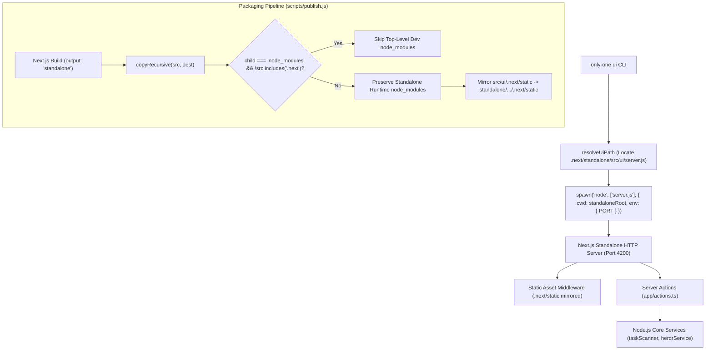

# Archive: Architecture of Modern Next.js Standalone Dashboard, Server Actions, and Production Packaging

## 1. Problem & Core Value
- **Problem**:
  - Legacy web dashboard was nested inside redundant wrappers (`src/ui/dashboard/app`), creating convoluted import paths, duplicate configs, and packaging path mismatch.
  - Indiscriminate recursive filtering in `scripts/publish.js` (`child === 'node_modules'`) deleted the essential runtime dependencies bundled by Next.js in `.next/standalone/src/ui/node_modules/`, resulting in fatal `Error: Cannot find module 'next'` when users launched `only-one ui` from global packages.
  - Missing `.next/static` assets in standalone deployment directories resulted in 404 errors for client CSS and JavaScript chunks.
- **Value**:
  - Flat, standard Next.js standalone architecture directly located at `src/ui/` with clean `@/*` path mapping, Tailwind Dark Mode tokens, and `@dnd-kit` Kanban interaction.
  - Resilient Node.js Server Actions (`src/ui/app/actions.ts`) bridging frontend interactions directly to native CLI services (`taskScanner`, `herdrService`).
  - Production-grade packaging pipeline in `scripts/publish.js` that preserves nested standalone `node_modules` while stripping top-level development modules, and automatically mirrors `.next/static` client bundles into the standalone distribution.
  - Platform-resilient CLI invocation in `src/commands/ui/command.ts` establishing correct execution working directory and environment variables.

## 2. Key Architecture & Decisions

### 2.1. Standalone Execution & Packaging Pipeline

### 2.2. Frontend Component Architecture
- [src/ui/app/page.tsx](file:///d:/Sources/PERSONAL/only-one-cli/src/ui/app/page.tsx): Main dashboard integrating real-time polling, state management, and modal orchestration.
- [src/ui/app/actions.ts](file:///d:/Sources/PERSONAL/only-one-cli/src/ui/app/actions.ts): Server actions invoking local filesystem scanners and Herdr process management without REST API boilerplate.
- [src/ui/components/containers/KanbanBoard.tsx](file:///d:/Sources/PERSONAL/only-one-cli/src/ui/components/containers/KanbanBoard.tsx): Drag-and-drop board managing 4 columns (`concept`, `plan`, `processing`, `done`).
- [src/ui/components/containers/HerdrPanel.tsx](file:///d:/Sources/PERSONAL/only-one-cli/src/ui/components/containers/HerdrPanel.tsx): Real-time monitor for active Herdr agent processes.
- [src/ui/components/feedback/MarkdownModal.tsx](file:///d:/Sources/PERSONAL/only-one-cli/src/ui/components/feedback/MarkdownModal.tsx): Interactive viewer rendering Markdown, unified diff syntax highlighting, and Mermaid SVG diagrams.

## 3. Scope & Key Changes
- [src/ui/](file:///d:/Sources/PERSONAL/only-one-cli/src/ui): Flattened root Next.js structure (`app/`, `components/`, `services/`, `styles/`, `types/`).
- [src/commands/ui/command.ts](file:///d:/Sources/PERSONAL/only-one-cli/src/commands/ui/command.ts): Configured standalone spawn working directory and environment variables.
- [scripts/publish.js](file:///d:/Sources/PERSONAL/only-one-cli/scripts/publish.js): Guarded `node_modules` exclusion to preserve `.next/standalone` dependencies and mirrored `.next/static`.
- [test/commands/uiCommand.test.ts](file:///d:/Sources/PERSONAL/only-one-cli/test/commands/uiCommand.test.ts): Unit tests verifying standalone server path resolution and port handling.

## 4. Verification Evidence & PR
- **Test Status**: 100% Passed.
  - `npm test test/commands/uiCommand.test.ts`: 5 unit tests passed.
  - `npm test`: 72 test files passed, 292 tests passed.
  - `npm run publish:local -- --dry-run`: 2,779 files packaged with standalone runtime preserved.
- **Branch**: `main`
