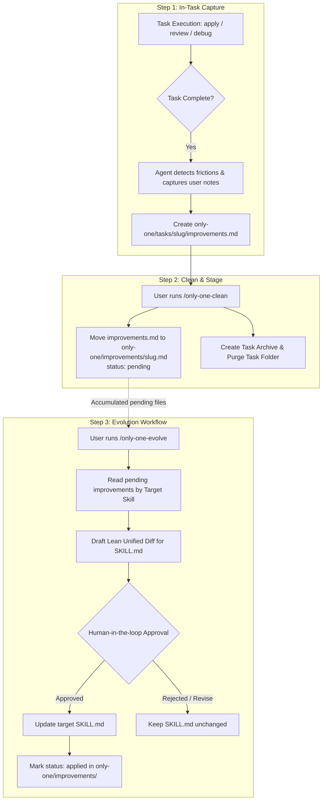

# Concept: Chu Trình Đúc Kết & Cải Tiến Kỹ Năng Tự Động (improvements.md -> clean -> /only-one-evolve)

## 1. Problem & Goal

### Problem (Current Bottlenecks & Deficiencies)
- **Context & Trigger**: Trong quá trình thực hiện task qua các workflow `only-one-*` (idea, plan, apply, debug, review), agent thường bộc lộ những điểm vấp váp (lỗi test lặp lại, quên checklist, vi phạm quy tắc) hoặc nhận được các prompt chỉnh sửa trực tiếp từ người dùng.
- **Symptom & Defect**: Chưa có bất kỳ cơ chế nào để ghi nhận lại các điểm cần cải thiện ngay tại task. Khi task kết thúc và chạy clean, toàn bộ bài học thực tiễn bị biến mất.
- **Root Cause**: Quy trình hiện tại thiếu mắt xích ghi nhận tại chỗ trong thư mục task, đồng thời thiếu sự liên kết giữa lúc thực thi task, lúc dọn dẹp task (clean), và lúc cập nhật kỹ năng.
- **Impact / Blast Radius**: AI liên tục lặp lại các lỗi tương tự ở các task kế tiếp. Người dùng phải mất công nhắc đi nhắc lại các chỉ dẫn đã từng sửa.

### Goal (Target Technical Outcomes)
- **Core Goal**: Thiết lập chu trình khép kín 3 bước: (1) Tự động ghi nhận `improvements.md` tại task, (2) Chuyển giao sang `only-one/improvements/` khi clean, và (3) Triển khai nâng cấp skill thông qua `/only-one-evolve`.
- **Acceptance Criteria**:
  - `only-one-apply` / `only-one-review` tự động tạo/cập nhật `only-one/tasks/<slug>/improvements.md` ở cuối bước hoàn tất task (kèm ghi nhận ý kiến người dùng nếu có).
  - File `improvements.md` ghi nhận rõ: Điểm cần cải tiến (Deficiencies), Ghi chú bối cảnh & Lý do (Root Cause/Context), và Kỹ năng mục tiêu (`target_skills`).
  - `only-one-clean` tự động thu thập `improvements.md` từ task folder và di chuyển/lưu vào thư mục tập trung `only-one/improvements/<slug>.md` (với `status: pending`) trước khi purge task folder.
  - Skill độc lập `/only-one-evolve`: Quét các file `pending` trong `only-one/improvements/`, tổng hợp và đề xuất Unified Diff tinh gọn cho `SKILL.md` tương ứng.
  - Cổng kiểm duyệt Human-in-the-loop: Chỉ áp dụng thay đổi vào `SKILL.md` khi người dùng phê duyệt diff.
  - Tuân thủ kỷ luật ASD-STE100 & Karpathy: Câu chỉ dẫn <= 20 từ, chống phình to quy tắc (rule bloat), chỉ bổ sung checklist/guardrails súc tích.

## 2. Scope Boundaries

- **In-Scope**:
  - Chuẩn hóa cấu trúc file ghi nhận tại task: `only-one/tasks/<slug>/improvements.md`.
  - Bổ sung bước tự động ghi nhận vào cuối workflow `only-one-apply` và `only-one-review`.
  - Cập nhật quy trình `only-one-clean` để lưu trữ `improvements.md` sang `only-one/improvements/<slug>.md`.
  - Xây dựng skill mới `/only-one-evolve` để tổng hợp bài học và áp dụng nâng cấp vào các file `SKILL.md`.
  - Cơ chế quản lý trạng thái (`pending` -> `applied`) của các bản ghi cải tiến.
- **Explicit Out-of-Scope**:
  - Không tự ý chỉnh sửa file `SKILL.md` trong lúc làm task hoặc trong lúc clean.
  - Không sửa đổi mã nguồn phần mềm dự án (`src/`, `test/`) trong quy trình evolve.
  - Không tự động commit hay push các file skill lên git remote mà không có lệnh người dùng.
  - Không can thiệp vào các skill ngoài namespace `only-one-*` trừ khi được chỉ định rõ.

## 3. Proposed Solution & Core Mechanism

### Core Mechanism (Chu Trình 3 Bước Khép Kín)

1. **Bước 1: Ghi nhận tại Task (`only-one/tasks/<slug>/improvements.md`)**
   - **Thời điểm**: Cuối bước `only-one-apply` (sau khi verification pass) hoặc cuối `only-one-review` (khi hoàn tất đánh giá).
   - **Cơ chế**:
     - Agent tự động tổng kết các điểm vấp phải trong task (lỗi compile/test, vi phạm quy tắc, số lần sửa chữa).
     - Tiếp nhận ghi chú bổ sung từ người dùng nếu có.
     - Khởi tạo file `only-one/tasks/<slug>/improvements.md` với định dạng chuẩn.

2. **Bước 2: Thu gom & Chuyển giao khi Clean (`only-one/improvements/<slug>.md`)**
   - **Thời điểm**: Khi người dùng chạy `/only-one-clean`.
   - **Cơ chế**:
     - Trong Step 0 (Pre-Clean Auto-Archive), `only-one-clean` kiểm tra file `improvements.md` trong thư mục task.
     - Di chuyển nội dung sang `only-one/improvements/<slug>.md` với metadata `status: pending`.
     - Lưu trữ task archive và tiến hành xóa thư mục task tạm thời như bình thường.

3. **Bước 3: Triển khai Nâng cấp Kỹ năng độc lập (`/only-one-evolve`)**
   - **Thời điểm**: Người dùng chủ động kích hoạt khi muốn cập nhật kỹ năng (`/only-one-evolve [skill-name | all]`).
   - **Cơ chế**:
     - Quét các file `pending` trong `only-one/improvements/`.
     - Gom nhóm theo từng skill mục tiêu (`only-one-plan`, `only-one-apply`, v.v.).
     - Sinh đề xuất Unified Diff cho file `SKILL.md` (tuân thủ ASD-STE100, câu ngắn <= 20 từ, thêm checklist / guardrail thay vì văn xuôi dài dòng).
     - Trình bày cho người dùng duyệt. Khi được duyệt, cập nhật vào `SKILL.md` và chuyển trạng thái file improvement sang `status: applied`.

### Conceptual Flow & State Transitions



### Task Improvement File Schema (`only-one/tasks/<slug>/improvements.md`)

```markdown
---
task_slug: <slug>
created_at: <ISO-8601>
target_skills:
  - only-one-plan
  - only-one-apply
---

# Task Improvements: <Task Title>

## 1. Observed Deficiencies (Các Điểm Vấp Váp Cần Cải Tiến)
- **only-one-plan**: Kế hoạch đề xuất thiếu Fast Test Command cho module phụ thuộc.
- **only-one-apply**: Thực thi bỏ sót bước kiểm tra lint trước khi báo hoàn thành.

## 2. Context & Root Cause (Ghi Chú Bối Cảnh & Lý Do)
- **Bối cảnh**: Trong quá trình sửa lỗi `<feature>`, agent phải chạy lại 3 lần vì sai type definition.
- **Lý do gốc**: `SKILL.md` của `only-one-apply` thiếu guardrail kiểm tra type trước khi verify logic.
- **User Feedback**: Người dùng phải nhắc "cần chạy tsc trước khi test".

## 3. Desired Skill Guardrail / Checklist
- Thêm bước kiểm tra kiểu `tsc --noEmit` vào Section Protocol của `only-one-apply`.
```

## 4. Critical Risks & Edge Cases

- **Task Không Có Vấp Váp Nào (Clean Tasks)**:
  - *Risk*: Ép buộc tạo file improvement ngay cả khi task chạy trơn tru 100%, gây loãng thông tin.
  - *Mitigation*: Nếu task không có lỗi lặp lại, không có nhắc nhở từ user và không có vi phạm quy tắc, agent chỉ ghi chú "No major deficiencies observed" hoặc bỏ qua việc tạo file.
- **Rule Bloat Khi Áp Dụng (Prompt Bloat)**:
  - *Risk*: Các lần cập nhật skill nối thêm văn xuôi dài làm tăng token context của skill.
  - *Mitigation*: `/only-one-evolve` áp dụng bộ lọc Karpathy & STE-100: Bắt buộc câu chỉ dẫn <= 20 từ, quy đổi bài học thành các mục checklist atomic ngắn gọn (MUST_DO / NEVER_DO).
- **Trùng Lặp Đề Xuất Giữa Các Task (Duplicate Insights)**:
  - *Risk*: Nhiều task khác nhau cùng phản ánh một thiếu sót của cùng một skill.
  - *Mitigation*: `/only-one-evolve` tự động nhóm các file theo `target_skills` và loại bỏ trùng lặp trước khi sinh diff.
