# Plan: Chuẩn Hóa Kiến Trúc 4 Phần (SKILL.md, scripts/, references/, assets/) Cho Toàn Bộ only-one-*

## Section 1. Directory Structure Changes

```text
assets/
├── combos/
│   └── [MODIFY] index.ts                                        # Bump only-one-flow combo version & add only-one-evolve
├── skills/
│   ├── [MODIFY] index.ts                                        # Register only-one-evolve manifest, bump versions of all 10 SDLC skills
│   ├── only-one-idea/
│   │   ├── [MODIFY] SKILL.md                                    # Progressive disclosure: link to references/ and scripts/
│   │   ├── assets/
│   │   │   └── [NEW]    concept-template.md                     # Clean canonical template for concept.md
│   │   ├── references/
│   │   │   └── [NEW]    discovery-rubric.md                     # Discovery interview guidelines & 95% confidence rubric
│   │   └── scripts/
│   │       └── [NEW]    scaffold-concept.ts                     # Deterministic scaffolding loading concept-template.md
│   ├── only-one-plan/
│   │   ├── [MODIFY] SKILL.md                                    # Progressive disclosure: link to references/ and scripts/
│   │   ├── assets/
│   │   │   └── [NEW]    plan-template.md                        # Clean canonical template for plan.md
│   │   ├── references/
│   │   │   └── [NEW]    task-block-spec.md                      # Detailed specification of Section 2 task blocks & AST seams
│   │   └── scripts/
│   │       └── [NEW]    validate-plan.ts                        # Deterministic plan.md structure, diff & DAG validator
│   ├── only-one-apply/
│   │   ├── [MODIFY] SKILL.md                                    # Step 5: Capture friction into improvements.md
│   │   ├── assets/
│   │   │   └── [NEW]    improvements-template.md                # Clean canonical template for improvements.md
│   │   ├── references/
│   │   │   └── [NEW]    execution-waves.md                      # Parallel execution waves & disjoint-file invariant rules
│   │   └── scripts/
│   │       ├── [NEW]    plan-status.ts                          # Deterministic DAG wave partitioner & task block parser
│   │       └── [NEW]    record-improvement.ts                   # Deterministic task improvements.md appender
│   ├── only-one-debug/
│   │   ├── [MODIFY] SKILL.md                                    # Progressive disclosure: link to references/ and scripts/
│   │   ├── assets/
│   │   │   └── [NEW]    debug-template.md                       # Clean canonical template for debug.md
│   │   ├── references/
│   │   │   └── [NEW]    rca-guidelines.md                       # 5-step RCA & Red Feedback Loop guidelines
│   │   └── scripts/
│   │       └── [NEW]    validate-debug.ts                       # Deterministic debug.md RCA & patch block validator
│   ├── only-one-review/
│   │   ├── [MODIFY] SKILL.md                                    # Progressive disclosure: link to references/ and scripts/
│   │   ├── assets/
│   │   │   └── [NEW]    review-template.md                      # Clean canonical template for review.md
│   │   ├── references/
│   │   │   └── [NEW]    finding-severities.md                   # Finding severity rubric (BLOCKER, CRITICAL, etc.)
│   │   └── scripts/
│   │       └── [NEW]    validate-review.ts                      # Deterministic review.md finding ticket validator
│   ├── only-one-clean/
│   │   ├── [MODIFY] SKILL.md                                    # Step 0: Stage improvements.md, use auto-archive.ts
│   │   ├── assets/
│   │   │   └── [NEW]    archive-template.md                     # Clean canonical template for archive.md
│   │   ├── references/
│   │   │   └── [NEW]    archive-schema.md                       # Living archives schema & codebase audit rules
│   │   └── scripts/
│   │       └── [NEW]    auto-archive.ts                         # Deterministic task auto-archive & improvement staging
│   ├── only-one-conflict/
│   │   ├── [MODIFY] SKILL.md                                    # Progressive disclosure: link to references/ and scripts/
│   │   ├── references/
│   │   │   └── [NEW]    conflict-resolution.md                  # 3-way merge intent preservation guidelines
│   │   └── scripts/
│   │       └── [NEW]    scan-conflicts.ts                       # Deterministic git conflict marker scanner
│   ├── only-one-pr-git/
│   │   ├── [MODIFY] SKILL.md                                    # Progressive disclosure: link to references/ and scripts/
│   │   ├── assets/
│   │   │   └── [NEW]    pr-template.md                          # Clean canonical template for Pull Request body
│   │   ├── references/
│   │   │   └── [NEW]    pr-standards.md                         # Conventional commits & PR quality standards
│   │   └── scripts/
│   │       └── [NEW]    check-git-status.ts                     # Deterministic git readiness & preflight check
│   ├── only-one-flash/
│   │   ├── [MODIFY] SKILL.md                                    # Progressive disclosure: link to references/ and scripts/
│   │   ├── references/
│   │   │   └── [NEW]    flash-scope.md                          # Boundary criteria for rapid micro-tasks (< 100 lines)
│   │   └── scripts/
│   │       └── [NEW]    validate-flash-diff.ts                  # Deterministic 100-line diff limit validator
│   └── only-one-evolve/
│       ├── [NEW]    SKILL.md                                    # Dedicated skill for aggregating & applying skill upgrades
│       ├── assets/
│       │   └── [NEW]    evolution-summary-template.md           # Template for skill upgrade reports
│       ├── references/
│       │   ├── [NEW]    ste100-rules.md                         # ASD-STE100 concise prose specification
│       │   └── [NEW]    failure-taxonomy.md                     # Skill deficiency classification rubric
│       └── scripts/
│           ├── [NEW]    aggregate.ts                            # Deterministic aggregation of pending improvements
│           └── [NEW]    lint-skill.ts                           # Deterministic ASD-STE100 & anti-bloat skill linter
only-one/
└── rules/
    └── [MODIFY] workflow.md                                     # Update WF-002 to allow optional improvements.md in task folder
test/
└── core/
    ├── [MODIFY] skill-registry.test.ts                          # Update SDLC_SKILLS to include only-one-evolve (10 skills)
    └── [NEW]    skill-sdlc-scripts.test.ts                      # Unit tests for deterministic SDLC scripts
README.md                                                        # [MODIFY] Document 4-part skill standard & continuous improvement loop
```

## Section 2. File Changes

### Architectural Interaction Diagram (Standard 4-Part Skill Architecture)

```mermaid
graph TD
    subgraph AgentSkillFolder["Standard Agent Skill Architecture (agentskills.io)"]
        S["SKILL.md<br/>(Core Orchestrator & Protocol)"]
        SCR["scripts/<br/>(Deterministic Executable Code)"]
        REF["references/<br/>(Deep Guidelines & Progressive Disclosure)"]
        AST["assets/<br/>(Document Templates & Boilerplates)"]
        
        S -->|Executes via shell| SCR
        S -->|Loads on-demand when needed| REF
        SCR -->|Loads clean markdown templates| AST
    end

    subgraph SDLCWorkflowLoop["Closed-Loop Self-Evolution Cycle"]
        IDEA["only-one-idea"] --> PLAN["only-one-plan"]
        PLAN --> APPLY["only-one-apply"]
        APPLY -->|Captures friction via script| IMPR["only-one/tasks/slug/improvements.md"]
        IMPR --> CLEAN["only-one-clean"]
        CLEAN -->|Stages pending improvements via script| STAG["only-one/improvements/slug.md"]
        STAG --> EVOLVE["only-one-evolve"]
        EVOLVE -->|Scans via aggregate.ts & lints via lint-skill.ts| SKILL["Upgraded target SKILL.md"]
        SKILL -. Refreshes protocol .-> IDEA
    end
```



---

### 1. `[NEW]` `assets/skills/only-one-evolve/references/ste100-rules.md`

- **Status**: `[x]`
- **Context**: Tài liệu tra cứu tĩnh về chuẩn ASD-STE100 cho `/only-one-evolve`.
- **Target Symbols / AST Seams**: Quy tắc ASD-STE100 cho Prompt & Skill writing.
- **Invariants**: Instructions <= 20 từ, descriptions <= 25 từ, active voice only.
- **Depends On**: None.
- **Fast Test Command**: `npx vitest run test/core/skill-sdlc-scripts.test.ts`.

> **Action**: Tạo tài liệu tra cứu tĩnh về quy chuẩn ASD-STE100.

```diff
--- /dev/null
+++ b/assets/skills/only-one-evolve/references/ste100-rules.md
@@ -0,0 +1,24 @@
+# ASD-STE100 Writing Rules for Agent Skills
+
+## Core Rules
+1. **Sentence Length Constraints**:
+   - Instructions (`MUST_DO`, `NEVER_DO`, action lines): Maximum **20 words** per sentence.
+   - Descriptions & Context: Maximum **25 words** per sentence.
+2. **Active Voice Only**:
+   - Good: "Run fast test command immediately after modifying file."
+   - Bad: "The fast test command should be run immediately after the file has been modified."
+3. **Approved Connectors & Modals**:
+   - Use `MUST` for hard constraints.
+   - Use `DO NOT` or `NEVER` for prohibitions.
+   - Avoid passive constructions ("is required", "should be done").
+4. **Action-Oriented Structure**:
+   - Format rules as atomic bullet points:
+     - **MUST_DO**: <Action>
+     - **NEVER_DO**: <Forbidden Action>
+     - **RATIONALE**: <Short reason>
+5. **Anti-Bloat Heuristic**:
+   - Replace multi-line prose with concise checklists.
+   - Keep total skill word count below 2000 words.
```

---

### 2. `[NEW]` `assets/skills/only-one-evolve/references/failure-taxonomy.md`

- **Status**: `[x]`
- **Context**: Bảng phân loại các dạng lỗi thường gặp của prompt/skill để `/only-one-evolve` tổng hợp chuẩn xác.
- **Target Symbols / AST Seams**: Phân loại 4 nhóm lỗi kỹ năng.
- **Invariants**: Phân loại rõ ràng: Ambiguity, Missing Guardrail, Missing Checklist, Premature Exit.
- **Depends On**: None.
- **Fast Test Command**: `npx vitest run test/core/skill-sdlc-scripts.test.ts`.

> **Action**: Tạo tài liệu tra cứu phân loại lỗi kỹ năng.

```diff
--- /dev/null
+++ b/assets/skills/only-one-evolve/references/failure-taxonomy.md
@@ -0,0 +1,22 @@
+# Skill Deficiency Classification Taxonomy
+
+## 1. Ambiguous Instruction (Chỉ dẫn mơ hồ)
+- **Symptom**: Agent hiểu sai intent, tạo code sai naming convention hoặc gọi sai API.
+- **Fix Pattern**: Bổ sung định nghĩa ranh giới rõ ràng hoặc ví dụ cụ thể.
+
+## 2. Missing Guardrail (Thiếu chốt chặn an toàn)
+- **Symptom**: Agent chỉnh sửa mã nguồn ngoài phạm vi task hoặc tự động bypass test fail.
+- **Fix Pattern**: Thêm mục `🛑 STRICTLY FORBIDDEN` trong Section Guardrails.
+
+## 3. Missing Checklist Item (Thiếu mục kiểm tra trước cổng)
+- **Symptom**: Agent quên chạy lint, quên kiểm tra dependency hoặc quên type check trước khi kết luận.
+- **Fix Pattern**: Bổ sung một mục checkbox `[ ]` vào Section Protocol trước Terminal Gate.
+
+## 4. Premature Exit Gate (Thoát sớm chưa đạt nghiệm)
+- **Symptom**: Agent báo hoàn thành khi test chưa pass 100% hoặc chưa chạy build check.
+- **Fix Pattern**: Thêm điều kiện tiên quyết (Prerequisite barrier) trước bước completion.
```

---

### 3. `[NEW]` `assets/skills/only-one-idea/assets/concept-template.md`

- **Status**: `[x]`
- **Context**: Template chuẩn hóa cho `concept.md`, tách biệt khỏi source code TS.
- **Target Symbols / AST Seams**: Markdown skeleton for concept specifications.
- **Invariants**: Chuẩn 4 phần: Problem & Goal, Scope, Proposed Solution, Critical Risks.
- **Depends On**: None.
- **Fast Test Command**: `npx vitest run test/core/skill-sdlc-scripts.test.ts`.

> **Action**: Tạo template `concept-template.md`.

```diff
--- /dev/null
+++ b/assets/skills/only-one-idea/assets/concept-template.md
@@ -0,0 +1,31 @@
+---
+slug: {{slug}}
+created_at: {{created_at}}
+status: concept
+---
+
+# Concept: {{title}}
+
+## 1. Problem & Goal
+
+### Problem (Current Bottlenecks & Deficiencies)
+- **Context & Trigger**: <Where the issue occurs or the user action leading to it>.
+- **Symptom & Defect**: <Specific error behavior or technical bottleneck>.
+- **Root Cause**: <Technical cause (unsynchronized state, missing validation, race condition, etc.)>.
+- **Impact / Blast Radius**: <Impact on users, system, or data integrity>.
+
+### Goal (Target Technical Outcomes)
+- **Core Goal**: <Primary technical outcome required>.
+- **Acceptance Criteria**:
+  - <Item 1>.
+  - <Item 2>.
+
+## 2. Scope Boundaries
+- **In-Scope**: <Mandatory features and behaviors to implement>.
+- **Explicit Out-of-Scope**: <Deferred or excluded items to prevent scope creep>.
+
+## 3. Proposed Solution & Core Mechanism
+- **Core Mechanism**: <Conceptual solution and operating model; no low-level code>.
+
+## 4. Critical Risks & Edge Cases
+- <Technical risks, edge cases, or rollback strategies>.
```

---

### 4. `[NEW]` `assets/skills/only-one-plan/assets/plan-template.md`

- **Status**: `[x]`
- **Context**: Template chuẩn hóa cho `plan.md`, tách biệt khỏi source code TS.
- **Target Symbols / AST Seams**: Markdown skeleton for 3-section implementation plan.
- **Invariants**: 3 Section: Directory Structure, File Changes, Test Cases & Verification.
- **Depends On**: None.
- **Fast Test Command**: `npx vitest run test/core/skill-sdlc-scripts.test.ts`.

> **Action**: Tạo template `plan-template.md`.

```diff
--- /dev/null
+++ b/assets/skills/only-one-plan/assets/plan-template.md
@@ -0,0 +1,38 @@
+---
+status: planned
+slug: {{slug}}
+created_at: {{created_at}}
+started_at: ~
+completed_at: ~
+pr_url: ~
+branch: ~
+---
+
+# Plan: {{title}}
+
+## Section 1. Directory Structure Changes
+
+```text
+<visual tree of files to be added, modified, or deleted>
+```
+
+## Section 2. File Changes
+
+### 1. `[MODIFY]` `path/to/file.ts`
+
+- **Status**: `[ ]`
+- **Context**: <Current mechanism in one sentence>.
+- **Target Symbols / AST Seams**: `Class.methodName`.
+- **Invariants**: <Constraint that must not be broken in one sentence>.
+- **Depends On**: None.
+- **Fast Test Command**: `npm test path/to/file.test.ts`.
+
+> **Action**: <Brief one-sentence description of modification purpose>.
+
+```diff
+<unified diff>
+```
+
+## Section 3. Test Cases & Verification
+- **Automated Tests**:
+- **Manual Checks**:
```

---

### 5. `[NEW]` `assets/skills/only-one-apply/assets/improvements-template.md`

- **Status**: `[x]`
- **Context**: Template chuẩn hóa cho `improvements.md`, tách biệt khỏi source code TS.
- **Target Symbols / AST Seams**: Markdown skeleton for in-task improvements.
- **Invariants**: Frontmatter chứa `task_slug`, `target_skills`.
- **Depends On**: None.
- **Fast Test Command**: `npx vitest run test/core/skill-sdlc-scripts.test.ts`.

> **Action**: Tạo template `improvements-template.md`.

```diff
--- /dev/null
+++ b/assets/skills/only-one-apply/assets/improvements-template.md
@@ -0,0 +1,17 @@
+---
+task_slug: {{slug}}
+created_at: {{created_at}}
+target_skills:
+{{target_skills}}
+---
+
+# Task Improvements: {{slug}}
+
+## 1. Observed Deficiencies
+{{deficiencies}}
+
+## 2. Context & Root Cause
+{{context}}
+
+## 3. Desired Skill Guardrail / Checklist
+{{suggestions}}
```

---

### 6. `[NEW]` `assets/skills/only-one-clean/assets/archive-template.md`

- **Status**: `[x]`
- **Context**: Template chuẩn hóa cho `archives/<slug>.md`.
- **Target Symbols / AST Seams**: Markdown skeleton for task archive.
- **Invariants**: Frontmatter chứa `id`, `domain`, `archived_at`, `status: active`.
- **Depends On**: None.
- **Fast Test Command**: `npx vitest run test/core/skill-sdlc-scripts.test.ts`.

> **Action**: Tạo template `archive-template.md`.

```diff
--- /dev/null
+++ b/assets/skills/only-one-clean/assets/archive-template.md
@@ -0,0 +1,15 @@
+---
+id: {{slug}}
+title: {{title}}
+domain: {{domain}}
+archived_at: {{archived_at}}
+status: active
+---
+
+# Archive: {{title}}
+
+## 1. Problem & Core Value
+- **Problem**: {{problem}}
+
+## 2. Key Architecture & Decisions
+- **Approach**: {{approach}}
```

---

### 7. `[NEW]` `assets/skills/only-one-idea/scripts/scaffold-concept.ts`

- **Status**: `[x]`
- **Context**: Cập nhật `scaffoldConcept` nạp template từ `assets/concept-template.md` nếu có.
- **Target Symbols / AST Seams**: `scaffoldConcept` function.
- **Invariants**: Đọc file template nếu tồn tại, fall back an toàn nếu không tìm thấy.
- **Depends On**: `assets/skills/only-one-idea/assets/concept-template.md`.
- **Fast Test Command**: `npx vitest run test/core/skill-sdlc-scripts.test.ts`.

> **Action**: Cập nhật `scaffold-concept.ts` sử dụng template rời trong thư mục `assets/`.

```diff
--- /dev/null
+++ b/assets/skills/only-one-idea/scripts/scaffold-concept.ts
@@ -0,0 +1,52 @@
+import { existsSync, mkdirSync, readFileSync, writeFileSync } from 'node:fs';
+import { dirname, join, resolve } from 'node:path';
+
+export function scaffoldConcept(slug: string, title?: string, baseDir = process.cwd()): string {
+    if (!/^[a-z0-9]+(?:-[a-z0-9]+)*$/.test(slug)) {
+        throw new Error(`Invalid slug format: '${slug}'. Must be lowercase kebab-case.`);
+    }
+
+    const taskDir = join(baseDir, 'only-one/tasks', slug);
+    mkdirSync(taskDir, { recursive: true });
+
+    const filePath = join(taskDir, 'concept.md');
+    if (existsSync(filePath)) {
+        return filePath;
+    }
+
+    const conceptTitle = title || slug.split('-').map((w) => w.charAt(0).toUpperCase() + w.slice(1)).join(' ');
+    const now = new Date().toISOString();
+
+    // Load template from assets/ if available
+    let template = '';
+    const templatePath = resolve(dirname(import.meta.filename || ''), '../assets/concept-template.md');
+    if (existsSync(templatePath)) {
+        template = readFileSync(templatePath, 'utf8')
+            .replace(/\{\{slug\}\}/g, slug)
+            .replace(/\{\{title\}\}/g, conceptTitle)
+            .replace(/\{\{created_at\}\}/g, now);
+    } else {
+        template = `---
+slug: ${slug}
+created_at: ${now}
+status: concept
+---
+
+# Concept: ${conceptTitle}
+
+## 1. Problem & Goal
+## 2. Scope Boundaries
+## 3. Proposed Solution & Core Mechanism
+## 4. Critical Risks & Edge Cases
+`;
+    }
+
+    writeFileSync(filePath, template, 'utf8');
+    return filePath;
+}
+
+if (process.argv[1] && resolve(process.argv[1]) === resolve(import.meta.filename || '')) {
+    const slug = process.argv[2];
+    if (!slug) process.exit(1);
+    console.log(`Created concept at: ${scaffoldConcept(slug, process.argv[3])}`);
+}
```

---

### 8. `[NEW]` `assets/skills/only-one-apply/scripts/record-improvement.ts`

- **Status**: `[x]`
- **Context**: Cập nhật `recordTaskImprovement` nạp template từ `assets/improvements-template.md`.
- **Target Symbols / AST Seams**: `recordTaskImprovement` function.
- **Invariants**: Nạp template rời, cập nhật file `improvements.md` an toàn.
- **Depends On**: `assets/skills/only-one-apply/assets/improvements-template.md`.
- **Fast Test Command**: `npx vitest run test/core/skill-sdlc-scripts.test.ts`.

> **Action**: Cập nhật `record-improvement.ts` sử dụng template rời.

```diff
--- /dev/null
+++ b/assets/skills/only-one-apply/scripts/record-improvement.ts
@@ -0,0 +1,58 @@
+import { existsSync, mkdirSync, readFileSync, writeFileSync } from 'node:fs';
+import { dirname, join, resolve } from 'node:path';
+
+export interface RecordImprovementOptions {
+    slug: string;
+    targetSkills: string[];
+    deficiency: string;
+    cause: string;
+    suggestion?: string;
+    baseDir?: string;
+}
+
+export function recordTaskImprovement(options: RecordImprovementOptions): string {
+    const baseDir = options.baseDir || process.cwd();
+    const targetDir = join(baseDir, 'only-one/tasks', options.slug);
+    mkdirSync(targetDir, { recursive: true });
+    const filePath = join(targetDir, 'improvements.md');
+
+    if (!existsSync(filePath)) {
+        const templatePath = resolve(dirname(import.meta.filename || ''), '../assets/improvements-template.md');
+        let content = '';
+        if (existsSync(templatePath)) {
+            content = readFileSync(templatePath, 'utf8')
+                .replace(/\{\{slug\}\}/g, options.slug)
+                .replace(/\{\{created_at\}\}/g, new Date().toISOString())
+                .replace(/\{\{target_skills\}\}/g, options.targetSkills.map((s) => `  - ${s}`).join('\n'))
+                .replace(/\{\{deficiencies\}\}/g, `- **${options.targetSkills.join(', ')}**: ${options.deficiency}`)
+                .replace(/\{\{context\}\}/g, `- ${options.cause}`)
+                .replace(/\{\{suggestions\}\}/g, `- ${options.suggestion || 'Add guardrail or verification checklist to target skill.'}`);
+        } else {
+            content = `---
+task_slug: ${options.slug}
+created_at: ${new Date().toISOString()}
+target_skills:
+${options.targetSkills.map((s) => `  - ${s}`).join('\n')}
+---
+
+# Task Improvements: ${options.slug}
+
+## 1. Observed Deficiencies
+- **${options.targetSkills.join(', ')}**: ${options.deficiency}
+
+## 2. Context & Root Cause
+- ${options.cause}
+
+## 3. Desired Skill Guardrail / Checklist
+- ${options.suggestion || 'Add guardrail or verification checklist to target skill.'}
+`;
+        }
+        writeFileSync(filePath, content, 'utf8');
+    } else {
+        const existing = readFileSync(filePath, 'utf8');
+        const updated = existing.replace(/## 1\.\s*Observed Deficiencies\s*[\r\n]+/, `## 1. Observed Deficiencies\n- **${options.targetSkills.join(', ')}**: ${options.deficiency}\n`);
+        writeFileSync(filePath, updated, 'utf8');
+    }
+
+    return filePath;
+}
```

---

### 9. `[NEW]` `assets/skills/only-one-evolve/scripts/aggregate.ts`
- **Status**: `[x]`

### 10. `[NEW]` `assets/skills/only-one-evolve/scripts/lint-skill.ts`
- **Status**: `[x]`

### 11. `[NEW]` `assets/skills/only-one-plan/scripts/validate-plan.ts`
- **Status**: `[x]`

### 12. `[NEW]` `assets/skills/only-one-apply/scripts/plan-status.ts`
- **Status**: `[x]`

### 13. `[NEW]` `assets/skills/only-one-clean/scripts/auto-archive.ts`
- **Status**: `[x]`

### 14. `[NEW]` `assets/skills/only-one-conflict/scripts/scan-conflicts.ts`
- **Status**: `[x]`

### 15. `[NEW]` `assets/skills/only-one-pr-git/scripts/check-git-status.ts`
- **Status**: `[x]`

### 16. `[NEW]` `assets/skills/only-one-flash/scripts/validate-flash-diff.ts`
- **Status**: `[x]`

### 17. `[NEW]` `assets/skills/only-one-debug/scripts/validate-debug.ts`
- **Status**: `[x]`

### 18. `[NEW]` `assets/skills/only-one-review/scripts/validate-review.ts`
- **Status**: `[x]`

### 19. `[NEW]` `assets/skills/only-one-evolve/SKILL.md`
- **Status**: `[x]`

### 20. `[MODIFY]` `assets/skills/only-one-apply/SKILL.md`
- **Status**: `[x]`

### 21. `[MODIFY]` `assets/skills/only-one-clean/SKILL.md`
- **Status**: `[x]`

### 22. `[MODIFY]` `assets/skills/only-one-idea/SKILL.md`
- **Status**: `[x]`

### 23. `[MODIFY]` `assets/skills/only-one-plan/SKILL.md`
- **Status**: `[x]`

### 24. `[MODIFY]` `assets/skills/only-one-conflict/SKILL.md`
- **Status**: `[x]`

### 25. `[MODIFY]` `assets/skills/only-one-pr-git/SKILL.md`
- **Status**: `[x]`

### 26. `[MODIFY]` `assets/skills/index.ts`
- **Status**: `[x]`

### 27. `[MODIFY]` `assets/combos/index.ts`
- **Status**: `[x]`

### 28. `[MODIFY]` `test/core/skill-registry.test.ts`
- **Status**: `[x]`

### 29. `[NEW]` `test/core/skill-sdlc-scripts.test.ts`
- **Status**: `[x]`

### 30. `[MODIFY]` `only-one/rules/workflow.md`
- **Status**: `[x]`

### 31. `[MODIFY]` `README.md`
- **Status**: `[x]`

---

## Section 3. Test Cases & Verification

### Automated Tests
1. **Skill Registry & Asset Gate**:
   ```bash
   npx vitest run test/core/skill-registry.test.ts
   npx vitest run test/core/assets/version-gate.test.ts
   ```
   - Xác minh 10/10 SDLC skills có mặt trong `SKILLS` và `SDLC_SKILLS`.
   - Xác minh 100% asset manifests có semver hợp lệ.

2. **Combo Reference Preflight**:
   ```bash
   npx vitest run test/core/combo.test.ts
   ```
   - Xác minh combo `only-one-flow` tham chiếu đúng `'only-one-evolve'` mà không có lỗi thiếu skill.

3. **Toàn bộ Bộ Scripts & Templates (Unit Tests)**:
   ```bash
   npx vitest run test/core/skill-sdlc-scripts.test.ts
   ```
   - Xác minh các hàm `scaffoldConcept`, `recordTaskImprovement`, `validatePlan`, `parsePlanTasks`, `runAutoArchive`, `lintSkill` đọc đúng template từ thư mục `assets/`.

4. **Toàn bộ Test Suite Dự Án**:
   ```bash
   npm test
   ```
   - Chạy toàn bộ 57+ test files và 250+ test cases đảm bảo 100% pass và không hồi quy.

### Verification Results (Executed: 2026-10-20)
- **`npx vitest run test/core/skill-registry.test.ts`**: PASSED (8 tests)
- **`npx vitest run test/core/assets/version-gate.test.ts`**: PASSED (2 tests)
- **`npx vitest run test/core/combo.test.ts`**: PASSED (17 tests)
- **`npx vitest run test/core/skill-sdlc-scripts.test.ts`**: PASSED (7 tests)
- **`npm test`**: PASSED (57 test files passed, 250 tests passed, 0 failures, 4 skipped)
- **Global Skill Sync**: Đã đồng bộ toàn bộ 10 skills chuẩn 4 phần sang `C:\Users\ADMIN\.gemini\config\skills\`.
- **In-Task Reflection**: Đã tạo file `only-one/tasks/only-one-reflect-workflow/improvements.md` sẵn sàng cho bước auto-archive và staging của `/only-one-clean`.

### Manual Checks
1. Kiểm tra cấu trúc thư mục 4 phần chuẩn:
   - `assets/skills/<skill>/SKILL.md`
   - `assets/skills/<skill>/scripts/`
   - `assets/skills/<skill>/references/`
   - `assets/skills/<skill>/assets/`
2. Kiểm tra script tải template:
   ```bash
   npx tsx assets/skills/only-one-idea/scripts/scaffold-concept.ts test-task "Test Task"
   ```
   - Xác nhận file sinh ra kế thừa đúng nội dung từ `assets/skills/only-one-idea/assets/concept-template.md`.
