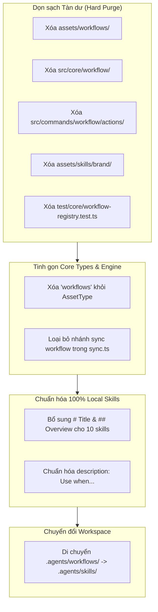

# Concept: Dọn sạch Toàn bộ Workflows Cũ và Chuẩn hóa 100% Định dạng Skills

## 1. Bài toán & Mục tiêu (Problem & Goal)

### Bài toán (Current Bottlenecks & Deficiencies)
- **Bối cảnh & Tác nhân**: Dự án đã bắt đầu chuyển đổi sang Agent Skills, nhưng các thư mục và logic workflow cũ vẫn còn tồn tại song song trong repository.
- **Triệu chứng & Khiếm khuyết**:
  - Thư mục `assets/workflows/`, `src/core/workflow/`, và `src/commands/workflow/actions/` vẫn tồn đọng dù không còn là kiến trúc đích.
  - Các skills mới trong `assets/skills/` thiếu tiêu đề H1 và phần tóm tắt `## Overview`, làm giảm khả năng nhận diện của AI Agent.
  - Thư mục mồ côi `assets/skills/brand/` không chứa file `SKILL.md`.
  - Workspace cục bộ vẫn lưu quy trình tại `.agents/workflows/` thay vì `.agents/skills/`.
- **Nguyên nhân cốt lõi**: Quá trình chuyển đổi ở bước trước mới chỉ thêm bản sao skills mới mà chưa kích hoạt bước dọn dẹp (purge) dứt điểm mã nguồn cũ.
- **Tác động & Phạm vi ảnh hưởng**: Gây nợ kỹ thuật (technical debt), trùng lặp mã nguồn, gây nhầm lẫn cho nhà phát triển và vi phạm chuẩn mở Agent Skills.

### Mục tiêu (Target Technical Outcomes)
- **Mục tiêu cốt lõi**: Xóa bỏ hoàn toàn 100% tàn dư của hệ thống workflows cũ trên toàn bộ codebase và chuẩn hóa 100% định dạng các Local Skills theo chuẩn vàng.
- **Tiêu chí nghiệm thu (Acceptance Criteria)**:
  - Xóa sạch toàn bộ thư mục `assets/workflows/`, `src/core/workflow/`, `src/commands/workflow/actions/`, và thư mục mồ côi `assets/skills/brand/`.
  - Xóa bỏ `workflows` khỏi `AssetType` trong `src/core/assets/types.ts` và loại bỏ logic sync workflow trong `src/core/assets/sync.ts`.
  - Chuẩn hóa toàn bộ 9 SDLC skills và `only-one-pr-git-skill`: có H1 Title (`# ...`), mục `## Overview`, và `description` bắt đầu bằng `Use when...`.
  - Di chuyển các quy trình trong `.agents/workflows/` của workspace sang `.agents/skills/`.
  - Cập nhật test suite để xác thực 100% local skills đạt chuẩn và không còn import từ `assets/workflows/`.

## 2. Ranh giới Phạm vi (Scope Boundaries)
- **Trong phạm vi (In-Scope)**:
  - Xóa các file và thư mục workflow không còn sử dụng.
  - Dọn dẹp các nhánh code kiểm tra và đồng bộ hóa workflows trong core assets.
  - Chuẩn hóa cấu trúc tài liệu của các file `SKILL.md` nội bộ.
  - Di chuyển quy trình làm việc trong workspace của dự án sang `.agents/skills/`.
  - Cập nhật và tinh gọn các bài test liên quan đến workflows.
- **Ngoài phạm vi (Explicit Out-of-Scope)**:
  - Thay đổi logic thực thi bên trong các bước quy trình SDLC.
  - Thay đổi giao thức cài đặt remote skills từ `skills.sh`.
  - Xóa bỏ lệnh CLI `only-one workflow` (giữ lại dưới dạng alias thông báo deprecation và chuyển hướng sang `only-one skill`).

## 3. Giải pháp Đề xuất & Cơ chế Cốt lõi (Proposed Solution & Core Mechanism)
- **Cơ chế cốt lõi**:
  - Thực hiện chiến lược dọn sạch hoàn toàn (Hard Purge): Cắt đứt toàn bộ các điểm phụ thuộc vào `assets/workflows/`.
  - Thống nhất mô hình tài nguyên chỉ còn: **Skills** (năng lực, công cụ, quy trình) và **Rules** (quy tắc, tiêu chuẩn).
  - Áp dụng cấu trúc chuẩn vàng cho mọi `SKILL.md`:
    - YAML Frontmatter: `name` và `description` chứa điều kiện kích hoạt `Use when...`.
    - Tiêu đề H1 và `## Overview` giải thích rõ mục đích trong 5 giây đầu.
    - Phân đoạn rõ ràng: `## Input`, `## Role`, `## Instructions`.
  - Chốt chặn kiểm thử: Bổ sung validation tự động trong test suite để bảo vệ chuẩn định dạng skills vĩnh viễn.

- **Mô hình Khái niệm & Luồng Dọn dẹp (Purge & Standardization Flow)**:

## 4. Rủi ro Kỹ thuật & Ca biên (Critical Risks & Edge Cases)
- **Lỗi đứt gãy tham chiếu trong Test Suite**: Nhiều bài test cũ vẫn import từ `@assets/workflows/index.js` cần được chuyển hướng hoặc cập nhật đồng thời để tránh lỗi build.
- **Bảo toàn quy trình đang hoạt động trong Workspace**: Quá trình di chuyển `.agents/workflows/` sang `.agents/skills/` phải bảo đảm không làm mất các quy trình slash commands đang dùng của dự án.
- **Lệnh CLI `only-one workflow`**: Phải đảm bảo lệnh alias hoạt động độc lập mà không cần nạp bất kỳ file nào từ thư mục `src/commands/workflow/actions/` cũ đã bị xóa.
