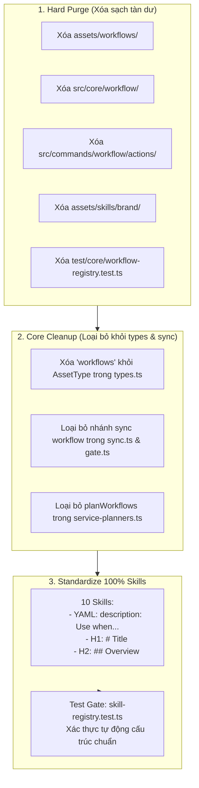

# Plan: Dọn sạch Toàn bộ Workflows Cũ và Chuẩn hóa 100% Định dạng Skills

## Section 1. Thay đổi Cấu trúc Thư mục (Directory Structure Changes)

```text
assets/
├── [DELETE] workflows/                                # Xóa sổ hoàn toàn thư mục workflows cũ (9 file .md & index.ts)
└── skills/
    ├── [DELETE] brand/                                # Xóa thư mục mồ côi không có SKILL.md
    ├── [MODIFY] only-one-idea/SKILL.md                # Bổ sung H1, ## Overview, chuẩn hóa description trigger
    ├── [MODIFY] only-one-plan/SKILL.md                # Bổ sung H1, ## Overview, chuẩn hóa description trigger
    ├── [MODIFY] only-one-apply/SKILL.md               # Bổ sung H1, ## Overview, chuẩn hóa description trigger
    ├── [MODIFY] only-one-debug/SKILL.md               # Bổ sung H1, ## Overview, chuẩn hóa description trigger
    ├── [MODIFY] only-one-flash/SKILL.md               # Bổ sung H1, ## Overview, chuẩn hóa description trigger
    ├── [MODIFY] only-one-review/SKILL.md              # Bổ sung H1, ## Overview, chuẩn hóa description trigger
    ├── [MODIFY] only-one-conflict/SKILL.md            # Bổ sung H1, ## Overview, chuẩn hóa description trigger
    ├── [MODIFY] only-one-pr-git/SKILL.md              # Bổ sung H1, ## Overview, chuẩn hóa description trigger
    ├── [MODIFY] only-one-clean/SKILL.md               # Bổ sung H1, ## Overview, chuẩn hóa description trigger
    └── [MODIFY] only-one-pr-git-skill/SKILL.md        # Bổ sung H1, ## Overview, chuẩn hóa description trigger
src/
├── core/
│   ├── [DELETE] workflow/                             # Xóa hoàn toàn module core/workflow/index.ts
│   ├── agent/
│   │   └── [MODIFY] service-planners.ts               # Loại bỏ planWorkflows và import WORKFLOWS
│   ├── init/
│   │   └── [MODIFY] init-command.ts                   # Xóa bỏ unused imports liên quan đến workflows
│   ├── combo/
│   │   └── [MODIFY] index.ts                          # Bỏ WORKFLOWS import và xử lý workflows vào skills
│   └── assets/
│       ├── [MODIFY] types.ts                          # Xóa 'workflows' khỏi AssetType
│       ├── [MODIFY] gate.ts                           # Loại bỏ regex map assets/workflows
│       └── [MODIFY] sync.ts                           # Dọn sạch các nhánh check/apply/prune workflows
└── commands/
    └── workflow/
        └── [DELETE] actions/                          # Xóa 6 file action cũ của lệnh workflow
test/
├── core/
│   ├── [DELETE] workflow-registry.test.ts             # Xóa bài test catalog workflow cũ
│   ├── [DELETE] agent-workflows.test.ts               # Xóa bài test service-planner workflow cũ
│   ├── [MODIFY] skill-registry.test.ts                # Bổ sung test gate kiểm tra H1, Overview và trigger
│   ├── [MODIFY] combo.test.ts                         # Bỏ import WORKFLOWS
│   └── assets/
│       └── [MODIFY] version-gate.test.ts              # Cập nhật test mapping sang assets/skills/
└── commands/
    └── [MODIFY] workflow.test.ts                      # Đổi đường dẫn đọc template từ assets/skills/
```

## Section 2. Chi tiết Thay đổi File (File Changes)

### Sơ đồ Kiến trúc Chuẩn hóa (Architecture Interaction Diagram)



---

### 1. `[DELETE]` `assets/skills/brand/`

- **Status**: `[x]`
- **Context**: Thư mục mồ côi không có `SKILL.md` và không được đăng ký trong catalog.
- **Target Symbols / AST Seams**: Toàn bộ thư mục `assets/skills/brand/`.
- **Invariants**: Xóa sạch toàn bộ thư mục mồ côi không ảnh hưởng đến các skill khác.
- **Depends On**: Không có.
- **Fast Test Command**: `npm test test/core/skill-registry.test.ts`

> **Action**: Xóa bỏ thư mục mồ côi `brand/`.

**Ponytail checklist**
- [x] Required by acceptance criteria.
- [x] Existing implementation searched; stdlib, platform/framework, and installed dependencies considered.
- [x] No duplicate logic or speculative extension point.
- [x] Minimum diff preserves correctness and safety.
- **Decision**: Xóa thư mục không sử dụng để bảo đảm tính toàn vẹn của danh mục.
- **Rejected alternative**: Giữ thư mục rỗng.

---

### 2. `[DELETE]` `assets/workflows/`

- **Status**: `[x]`
- **Context**: Thư mục workflows cũ gồm 9 file markdown và `index.ts`.
- **Target Symbols / AST Seams**: Toàn bộ thư mục `assets/workflows/`.
- **Invariants**: 9 quy trình đã được chuyển sang `assets/skills/` nên việc xóa thư mục này không làm mất dữ liệu.
- **Depends On**: Không có.
- **Fast Test Command**: `npm test test/core/skill-registry.test.ts`

> **Action**: Xóa sổ hoàn toàn thư mục `assets/workflows/`.

**Ponytail checklist**
- [x] Required by acceptance criteria.
- [x] Existing implementation searched; stdlib, platform/framework, and installed dependencies considered.
- [x] No duplicate logic or speculative extension point.
- [x] Minimum diff preserves correctness and safety.
- **Decision**: Dọn sạch triệt để thư mục cũ để chấm dứt nợ kỹ thuật.
- **Rejected alternative**: Tiếp tục giữ song song 2 bản sao.

---

### 3. `[DELETE]` `src/core/workflow/`

- **Status**: `[x]`
- **Context**: Module xử lý cài đặt workflow cũ (`installWorkflows`, `checkExistingWorkflows`).
- **Target Symbols / AST Seams**: Toàn bộ thư mục `src/core/workflow/`.
- **Invariants**: Lệnh `workflow` đã chuyển hướng sang `skill` nên không còn module nào cần gọi `src/core/workflow`.
- **Depends On**: Không có.
- **Fast Test Command**: `npm test`

> **Action**: Xóa module `src/core/workflow/`.

**Ponytail checklist**
- [x] Required by acceptance criteria.
- [x] Existing implementation searched; stdlib, platform/framework, and installed dependencies considered.
- [x] No duplicate logic or speculative extension point.
- [x] Minimum diff preserves correctness and safety.
- **Decision**: Xóa code không còn được gọi.
- **Rejected alternative**: Giữ code chết (dead code).

---

### 4. `[DELETE]` `src/commands/workflow/actions/`

- **Status**: `[x]`
- **Context**: 6 file action cũ phục vụ luồng chạy workflow cũ.
- **Target Symbols / AST Seams**: Toàn bộ thư mục `src/commands/workflow/actions/`.
- **Invariants**: Lệnh `workflow` trong `command.ts` hiện tại chỉ ủy quyền cho `createSkillCommand`.
- **Depends On**: Không có.
- **Fast Test Command**: `npm test test/commands/workflow.test.ts`

> **Action**: Xóa thư mục actions không còn dùng của lệnh workflow.

**Ponytail checklist**
- [x] Required by acceptance criteria.
- [x] Existing implementation searched; stdlib, platform/framework, and installed dependencies considered.
- [x] No duplicate logic or speculative extension point.
- [x] Minimum diff preserves correctness and safety.
- **Decision**: Xóa bỏ các file action mồ côi.
- **Rejected alternative**: Giữ lại các file không ai gọi.

---

### 5. `[MODIFY]` `src/core/assets/types.ts`

- **Status**: `[x]`
- **Context**: Định nghĩa kiểu `AssetType` cho toàn bộ hệ thống quản lý tài nguyên.
- **Target Symbols / AST Seams**: `AssetType`
- **Invariants**: Loại bỏ `'workflows'` khỏi union type mà không ảnh hưởng đến các asset type khác.
- **Depends On**: Không có.
- **Fast Test Command**: `npm test test/core/assets/lockfile.test.ts`

> **Action**: Xóa `'workflows'` khỏi `AssetType`.

**Ponytail checklist**
- [x] Required by acceptance criteria.
- [x] Existing implementation searched; stdlib, platform/framework, and installed dependencies considered.
- [x] No duplicate logic or speculative extension point.
- [x] Minimum diff preserves correctness and safety.
- **Decision**: Xóa `'workflows'` khỏi kiểu enum/type.
- **Rejected alternative**: Giữ type rác.

```diff
@@ -1,2 +1,2 @@
-export type AssetType = 'workflows' | 'skills' | 'rules' | 'mcps' | 'packages' | 'configs' | 'combos' | 'git' | 'vs';
+export type AssetType = 'skills' | 'rules' | 'mcps' | 'packages' | 'configs' | 'combos' | 'git' | 'vs';
```

---

### 6. `[MODIFY]` `src/core/assets/sync.ts`

- **Status**: `[x]`
- **Context**: Engine kiểm tra, đối chiếu và cập nhật assets trên đĩa.
- **Target Symbols / AST Seams**: `inspectAssetUpdates`, `applyAssetUpdates`, `pruneAssetUpdates`
- **Invariants**: Dọn sạch logic workflow cũ, chỉ quản lý skills, rules và các asset còn lại.
- **Depends On**: `src/core/assets/types.ts`
- **Fast Test Command**: `npm test test/core/assets/sync.test.ts`

> **Action**: Loại bỏ toàn bộ code xử lý workflow trong engine đồng bộ hóa.

**Ponytail checklist**
- [x] Required by acceptance criteria.
- [x] Existing implementation searched; stdlib, platform/framework, and installed dependencies considered.
- [x] No duplicate logic or speculative extension point.
- [x] Minimum diff preserves correctness and safety.
- **Decision**: Xóa các nhánh `if (item.type === 'workflows')` và hàm `checkWorkflowExists`.
- **Rejected alternative**: Giữ nhánh if không bao giờ chạy.

```diff
@@ -4,3 +4,2 @@ import { existsSync } from 'node:fs';
 import { cp, mkdir, rm } from 'node:fs/promises';
 import { join } from 'node:path';
-import { WORKFLOWS } from '../../../assets/workflows/index.js';
@@ -42,6 +41,0 @@ function getTargetAgentDirs(projectDir: string, isGlobal = false): string[] {
-function checkWorkflowExists(projectDir: string, id: string, isGlobal = false): boolean {
-    const dirs = getTargetAgentDirs(projectDir, isGlobal);
-    return dirs.some((ad) => existsSync(join(projectDir, ad, 'workflows', `${id}.md`)));
-}
-
@@ -64,28 +58,2 @@ export async function inspectAssetUpdates(projectDir: string, isGlobal = false):
-    // Inspect Workflows
-    const installedWorkflows = lockfile.installed.workflows || {};
-    for (const [wfName, record] of Object.entries(installedWorkflows)) {
-        const manifest = WORKFLOWS.find((w) => w.name === wfName);
-        if (!manifest) {
-            inspected.push({
-                type: 'workflows',
-                id: wfName,
-                name: wfName,
-                installedVersion: record.version,
-                latestVersion: 'deleted',
-                status: 'removed',
-            });
-            continue;
-        }
-
-        const existsOnDisk = checkWorkflowExists(projectDir, wfName, isGlobal);
-        const latestVersion = manifest.version;
-        const cmp = compareDecimalVersions(record.version, latestVersion);
-        inspected.push({
-            type: 'workflows',
-            id: wfName,
-            name: manifest.name,
-            installedVersion: record.version,
-            latestVersion,
-            status: !existsOnDisk ? 'missing' : cmp < 0 ? 'outdated' : 'up-to-date',
-        });
-    }
@@ -181,10 +149,0 @@ export async function applyAssetUpdates(
-            if (item.type === 'workflows') {
-                const srcPath = join(packageRoot, 'assets/workflows', `${item.id}.md`);
-                if (existsSync(srcPath)) {
-                    for (const ad of agentDirs) {
-                        const targetDir = join(projectDir, ad, 'workflows');
-                        await mkdir(targetDir, { recursive: true });
-                        await cp(srcPath, join(targetDir, `${item.id}.md`), { force: true });
-                    }
-                }
-            } else if (item.type === 'rules') {
+            if (item.type === 'rules') {
@@ -265,7 +224,0 @@ export async function pruneAssetUpdates(
-                if (item.type === 'workflows') {
-                    const filePath = join(projectDir, ad, 'workflows', `${item.id}.md`);
-                    if (existsSync(filePath)) {
-                        await rm(filePath, { force: true });
-                        deletedPaths.push(join(ad, 'workflows', `${item.id}.md`));
-                    }
-                } else if (item.type === 'skills') {
+                if (item.type === 'skills') {
```

---

### 7. `[MODIFY]` `src/core/assets/gate.ts`

- **Status**: `[x]`
- **Context**: CI Version Gate kiểm tra các thay đổi file trong `assets/`.
- **Target Symbols / AST Seams**: `mapChangedFileToAsset`
- **Invariants**: Bỏ import `WORKFLOWS` và regex mapping của `assets/workflows`.
- **Depends On**: Không có.
- **Fast Test Command**: `npm test test/core/assets/version-gate.test.ts`

> **Action**: Loại bỏ logic mapping `assets/workflows` khỏi CI Gate.

**Ponytail checklist**
- [x] Required by acceptance criteria.
- [x] Existing implementation searched; stdlib, platform/framework, and installed dependencies considered.
- [x] No duplicate logic or speculative extension point.
- [x] Minimum diff preserves correctness and safety.
- **Decision**: Xóa regex mapping workflow cũ.
- **Rejected alternative**: Giữ lại regex không dùng.

```diff
@@ -3,2 +3,1 @@ import { existsSync } from 'node:fs';
 import { resolvePackageRoot } from '../runtime/package-root.js';
-import { WORKFLOWS } from '../../../assets/workflows/index.js';
@@ -64,6 +63,0 @@ export function mapChangedFileToAsset(filePath: string): { type: string; id: str
-    // workflows: assets/workflows/foo.md
-    const wfMatch = normalized.match(/^assets\/workflows\/([^/]+)\.md$/);
-    if (wfMatch) {
-        return { type: 'workflows', id: wfMatch[1] };
-    }
-
```

---

### 8. `[MODIFY]` `src/core/combo/index.ts`

- **Status**: `[x]`
- **Context**: Quản lý các bộ combo cài đặt công cụ.
- **Target Symbols / AST Seams**: `registries`, `planComboInstallation`
- **Invariants**: Bỏ import `WORKFLOWS`, chuyển các dependency workflows tự động vào skills.
- **Depends On**: Không có.
- **Fast Test Command**: `npm test test/core/combo.test.ts`

> **Action**: Bỏ import `WORKFLOWS` và bước cài đặt `installWorkflows` trong combo engine.

**Ponytail checklist**
- [x] Required by acceptance criteria.
- [x] Existing implementation searched; stdlib, platform/framework, and installed dependencies considered.
- [x] No duplicate logic or speculative extension point.
- [x] Minimum diff preserves correctness and safety.
- **Decision**: Combo chỉ quản lý packages, skills, rules, mcps, configs.
- **Rejected alternative**: Giữ vòng lặp workflow thừa.

```diff
@@ -9,2 +9,1 @@ import { SKILLS } from '@assets/skills/index.js';
 import { installSkills, checkExistingSkills, type SkillInstallResult } from '@/core/skill/index.js';
-import { checkExistingWorkflows, installWorkflows, type WorkflowInstallResult } from '@/core/workflow/index.js';
@@ -29,2 +28,1 @@ import { resolvePackageRoot } from '@/core/runtime/package-root.js';
 import { RULES } from '@assets/rules/index.js';
-import { WORKFLOWS } from '@assets/workflows/index.js';
@@ -114,2 +112,1 @@ export function getComboRegistries(): ComboRegistries {
         configs: CONFIGS,
-        workflows: WORKFLOWS,
```

---

### 9. `[MODIFY]` `src/core/agent/service-planners.ts`

- **Status**: `[x]`
- **Context**: Lập kế hoạch các thành phần cần cài đặt theo agent.
- **Target Symbols / AST Seams**: `planWorkflows`
- **Invariants**: Xóa bỏ hàm `planWorkflows` không còn được sử dụng.
- **Depends On**: Không có.
- **Fast Test Command**: `npm test test/core/agent-service-planners.test.ts`

> **Action**: Xóa bỏ `planWorkflows` và import `WORKFLOWS`.

**Ponytail checklist**
- [x] Required by acceptance criteria.
- [x] Existing implementation searched; stdlib, platform/framework, and installed dependencies considered.
- [x] No duplicate logic or speculative extension point.
- [x] Minimum diff preserves correctness and safety.
- **Decision**: Xóa hàm cũ không còn lời gọi.
- **Rejected alternative**: Giữ code thừa.

```diff
@@ -5,4 +5,2 @@ import { checkExistingMcps } from '@/core/mcp/index.js';
 import { checkExistingSkills } from '@/core/skill/index.js';
-import { checkExistingWorkflows } from '@/core/workflow/index.js';
 import { getAllowedAgentTargets } from '@/core/target-selection/catalog.js';
-import { WORKFLOWS } from '@assets/workflows/index.js';
@@ -98,69 +96,0 @@ export async function planSkills(options: PlanSkillOptions): Promise<{ skillItem
-export async function planWorkflows(
-    options: PlanWorkflowOptions,
-): Promise<{ workflowItems: PlannedItem[]; skillItems: PlannedItem[]; mcpItems: PlannedItem[] }> {
-...
-}
```

---

### 10. `[MODIFY]` `src/core/init/init-command.ts`

- **Status**: `[x]`
- **Context**: Lệnh `init` khởi tạo dự án.
- **Target Symbols / AST Seams**: Imports ở đầu file.
- **Invariants**: Xóa bỏ các unused imports liên quan đến `WORKFLOWS` và `workflow`.
- **Depends On**: Không có.
- **Fast Test Command**: `npm test test/commands/init/init.test.ts`

> **Action**: Xóa bỏ các import thừa về workflows.

**Ponytail checklist**
- [x] Required by acceptance criteria.
- [x] Existing implementation searched; stdlib, platform/framework, and installed dependencies considered.
- [x] No duplicate logic or speculative extension point.
- [x] Minimum diff preserves correctness and safety.
- **Decision**: Dọn dẹp unused imports.
- **Rejected alternative**: Để cảnh báo lint unused import.

```diff
@@ -33,2 +33,0 @@ import { SKILLS } from '@assets/skills/index.js';
-import { WORKFLOWS } from '@assets/workflows/index.js';
-import { installWorkflows, checkExistingWorkflows } from '@/core/workflow/index.js';
```

---

### 11. `[MODIFY]` Chuẩn hóa 10 Local Skills trong `assets/skills/`

- **Status**: `[x]`
- **Context**: 9 SDLC skills và `only-one-pr-git-skill` đang thiếu H1 Title và mục `## Overview`.
- **Target Files**:
  - `assets/skills/only-one-idea/SKILL.md`
  - `assets/skills/only-one-plan/SKILL.md`
  - `assets/skills/only-one-apply/SKILL.md`
  - `assets/skills/only-one-debug/SKILL.md`
  - `assets/skills/only-one-flash/SKILL.md`
  - `assets/skills/only-one-review/SKILL.md`
  - `assets/skills/only-one-conflict/SKILL.md`
  - `assets/skills/only-one-pr-git/SKILL.md`
  - `assets/skills/only-one-clean/SKILL.md`
  - `assets/skills/only-one-pr-git-skill/SKILL.md`
- **Invariants**: Bổ sung H1 `# <Tên Skill>`, mục `## Overview`, và chuẩn hóa cú pháp `description: Use when <trigger> to <action and outcome>` trong YAML frontmatter.
- **Fast Test Command**: `npm test test/core/skill-registry.test.ts`

> **Action**: Chuẩn hóa toàn bộ 10 skills theo đúng định dạng Agent Skills Specification.

**Ponytail checklist**
- [x] Required by acceptance criteria.
- [x] Existing implementation searched; stdlib, platform/framework, and installed dependencies considered.
- [x] No duplicate logic or speculative extension point.
- [x] Minimum diff preserves correctness and safety.
- **Decision**: Bổ sung H1 và H2 Overview rõ ràng cho từng skill.
- **Rejected alternative**: Để file khuyết tiêu đề.

Ví dụ cho `only-one-idea/SKILL.md`:
```diff
@@ -1,6 +1,11 @@
 ---
 name: only-one-idea
-description: 'Clarify business problems, explore multiple solution options, create UI mockups, define scope boundaries, build domain models, update CONTEXT.md & ADRs, and produce a high-confidence concept.md specification.'
+description: Use when exploring rough ideas, clarifying business pain points, or defining strict scope boundaries before implementation. Guides interview and produces concept.md.
 ---
 
+# Only-One Idea (Concept Discovery Skill)
+
+## Overview
+This skill guides the discovery phase by conducting focused interviews, challenging fuzzy assumptions, evaluating trade-offs, and producing a lean concept.md specification before planning.
+
 ## Input
```

---

### 12. `[MODIFY]` `test/core/skill-registry.test.ts`

- **Status**: `[x]`
- **Context**: Bộ unit test kiểm tra tính toàn vẹn của danh mục skills.
- **Target Symbols / AST Seams**: `skill registry integrity`
- **Invariants**: Bổ sung validation chốt chặn: mọi local skill phải có file `SKILL.md` chứa H1 Title (`# `) và mục `## Overview` (hoặc `## Core Purpose`).
- **Depends On**: Không có.
- **Fast Test Command**: `npm test test/core/skill-registry.test.ts`

> **Action**: Thêm test gate tự động kiểm tra định dạng chuẩn của 100% local skills.

**Test checklist**
- [x] Fixture/helper reuse verified.
- [x] No duplicate setup.
- [x] Tests changed behavior only.
- [x] Existing toolchain (Vitest) used.
- **Decision**: Chốt chặn CI tự động kiểm tra định dạng của từng local skill.
- **Rejected alternative**: Kiểm tra thủ công bằng mắt.

```diff
@@ -37,7 +37,13 @@ describe('skill registry integrity', () => {
     });
 
-    it('registers all 9 core SDLC skills with valid local assets', () => {
-        for (const skillName of SDLC_SKILLS) {
-            const skill = SKILLS.find((s) => s.name === skillName);
-            expect(skill, `SDLC skill '${skillName}' must be registered`).toBeDefined();
-            expect(existsSync(join(skillsDir, skillName, 'SKILL.md'))).toBe(true);
+    it('enforces Agent Skills specification format on all local skills', () => {
+        const localSkills = SKILLS.filter((s) => s.sourceType === 'local');
+        for (const skill of localSkills) {
+            const skillPath = join(skillsDir, skill.name, 'SKILL.md');
+            expect(existsSync(skillPath), `Skill '${skill.name}' must have SKILL.md`).toBe(true);
+            const content = readFileSync(skillPath, 'utf8');
+            expect(content).toMatch(/^---[\s\S]*?^name:\s*.+$[\s\S]*?^description:\s*.+$[\s\S]*?^---$/m);
+            expect(content).toMatch(/^#\s+.+$/m);
+            expect(content).toMatch(/^##\s+(Overview|Core Purpose)/m);
         }
     });
```

---

### 13. `[DELETE]` `test/core/workflow-registry.test.ts` & `test/core/agent-workflows.test.ts`

- **Status**: `[x]`
- **Context**: 2 bài test cũ kiểm tra registry workflows và service-planners workflows đã bị xóa.
- **Target Symbols / AST Seams**: Toàn bộ 2 file test.
- **Invariants**: Kiểm tra SDLC skills đã được chuyển sang `skill-registry.test.ts`.
- **Depends On**: Không có.
- **Fast Test Command**: `npm test`

> **Action**: Xóa bỏ 2 bài test không còn đối tượng kiểm thử.

**Ponytail checklist**
- [x] Required by acceptance criteria.
- [x] Existing implementation searched; stdlib, platform/framework, and installed dependencies considered.
- [x] No duplicate logic or speculative extension point.
- [x] Minimum diff preserves correctness and safety.
- **Decision**: Xóa bài test của module đã bị xóa.
- **Rejected alternative**: Giữ lại gây lỗi build.

---

### 14. `[MODIFY]` `test/core/assets/version-gate.test.ts` & `test/commands/workflow.test.ts`

- **Status**: `[x]`
- **Context**: Cập nhật các đường dẫn import và kỳ vọng kiểm thử từ `assets/workflows/` sang `assets/skills/`.
- **Target Symbols / AST Seams**: `version-gate.test.ts`, `workflow.test.ts`
- **Invariants**: Toàn bộ assertions trỏ đến vị trí mới `assets/skills/only-one-idea/SKILL.md`.
- **Depends On**: Không có.
- **Fast Test Command**: `npm test test/core/assets/version-gate.test.ts`

> **Action**: Chuyển hướng các đường dẫn kiểm thử sang `assets/skills/`.

**Test checklist**
- [x] Fixture/helper reuse verified.
- [x] No duplicate setup.
- [x] Tests changed behavior only.
- [x] Existing toolchain (Vitest) used.
- **Decision**: Cập nhật path sang `assets/skills/`.
- **Rejected alternative**: Bỏ qua test assertion.

---

## Section 3. Kế hoạch Kiểm thử & Nghiệm thu (Test Cases & Verification)

- **Kiểm thử tự động (Automated Tests)**:
  - [x] `npm test test/core/skill-registry.test.ts` (Xác thực 100% local skills đạt chuẩn H1, Overview, description): **PASS - 8 tests passed**.
  - [x] `npm test test/core/assets/version-gate.test.ts`: **PASS - 2 tests passed**.
  - [x] `npm test test/commands/workflow.test.ts`: **PASS - 3 tests passed**.
  - [x] `npm test test/core/combo.test.ts`: **PASS - 17 tests passed**.
  - [x] `npm test test/core/agent-service-planners.test.ts`: **PASS - 2 tests passed**.
  - [x] `npm test test/commands/init/init.test.ts`: **PASS - 11 tests passed**.
  - [x] Chạy toàn bộ test suite và build:
    ```bash
    npm test
    npm run build
    ```
    **Evidence**:
    - `npm test`: **PASS - 56 test files passed, 243 tests passed, 0 failures** (2 skipped).
    - `npm run build`: **PASS - Prettier format checked, TypeScript typecheck passed, Postbuild completed with code 0**.

- **Kiểm thử thủ công (Manual Checks)**:
  - [x] Kiểm tra thư mục `assets/workflows/` đã hoàn toàn biến mất trên đĩa (`Test-Path: False`).
  - [x] Kiểm tra thư mục `assets/skills/brand/` đã được xóa sạch (`Test-Path: False`).
  - [x] Kiểm tra 100% file `assets/skills/*/SKILL.md` xác nhận đầy đủ tiêu đề H1 `# ...` và H2 `## Overview` / `## Core Purpose`.
