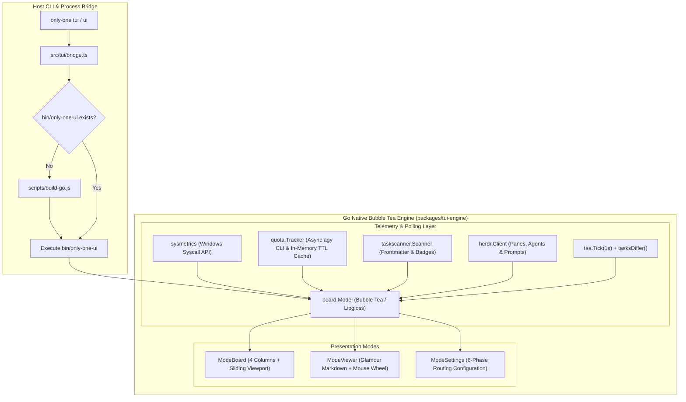

# Archive: Unified Architecture of Go Bubble Tea TUI Engine, Kanban Board, Streamlined Telemetry & Markdown Viewer

## 1. Problem & Core Value
- **Problem**:
  - Legacy React Ink TUI implementations suffered from terminal sizing constraints, render jitter, and high CPU overhead during high-frequency telemetry updates.
  - Kanban board cards lacked visual document presence indicators, causing developers to switch contexts to check document availability (`concept.md`, `plan.md`, `debug.md`, `review.md`).
  - Terminal viewports overflowed when columns held numerous tasks, truncating lower cards without a sliding window scroll mechanism.
  - Raw markdown inspection lacked syntax highlighting and diagram support, while header areas were cluttered with redundant path strings instead of actionable agent and system metrics.
  - Spawning shell processes (`wmic`, `powershell`) for system stats or blocking the UI loop on slow external agent quota CLI calls introduced perceptible UI lag.
- **Value**:
  - **Native Go Bubble Tea Engine (`packages/tui-engine`)**: Ultra-fast terminal rendering compiled to cross-platform native binaries with seamless fallback to Ink via TypeScript bridge (`src/tui/bridge.ts`).
  - **Standardized 4-Column Kanban**: Strict column lifecycle (`concept`, `plan`, `processing`, `done`) with card index badges, icon badges (`💡 [C]`, `📋 [P]`, `🐛 [D]`, `🔍 [R]`), and sliding viewport scroll with `▲`/`▼` indicators.
  - **Streamlined 3-Row Header Telemetry**:
    - *Row 1*: Title, Herdr connection status badge, and native OS metrics (CPU%, RAM%, Uptime).
    - *Row 2*: Active agent monitoring (total & busy count) alongside specialized 5-hour and Weekly Quota tracking with remaining percentage and relative reset timers.
    - *Row 3*: Document Badges legend with distinct icons.
  - **Separated Dual-Footer Layout**:
    - *Status Bar*: Realtime task operation progress and Herdr dispatch notification display.
    - *Shortcuts Bar*: Context-sensitive keyboard shortcuts (`[←/→]`, `[↑/↓]`, `[Space/m]`, `[Enter]`, `[p]`, `[a]`, `[d]`, `[c]`, `[s]`, `[q]`).
  - **Glamour Markdown Viewer (`ModeViewer`)**: High-fidelity terminal markdown rendering via `github.com/charmbracelet/glamour`, Chroma syntax highlighting, Mermaid DSL ASCII preprocessing, numeric tab switching (`1-N`), and smooth mouse wheel scrolling (`±3` lines).
  - **Zero-Lag Telemetry Architecture**: Windows native API syscalls (`GlobalMemoryStatusEx`, `GetSystemTimes`) for metrics and asynchronous background caching for Agent Quotas (`agy --output-format json --print "/usage"`).
  - **Decoupled Herdr Routing & Clean Dispatch**: Friendly pane and agent name resolution, prompt dispatching (`p`, `a`, `d`), and clean workflow routing (`c`) via Herdr agent orchestration.

## 2. Key Architecture & Decisions

### 2.1. Architectural System Diagram

### 2.2. Core Subsystems & Components

1. **Board Model & Controller (`packages/tui-engine/internal/board/model.go`)**:
   - Implements Bubble Tea's `tea.Model` lifecycle (`Init`, `Update`, `View`).
   - Manages navigation across 4 Kanban columns with sliding window viewport arithmetic (`colHeight = m.height - 13`), displaying scroll arrows `▲` and `▼` when tasks exceed column bounds.
   - Renders the streamlined 3-row Header box, Kanban grid, separated Status Bar, and Shortcuts Bar.
   - Handles mouse wheel scrolling (`tea.MouseButtonWheelUp`, `tea.MouseButtonWheelDown`) for both task list navigation and Markdown Viewer scrolling.
   - Implements `tasksDiffer()` to prevent screen redraws during 1-second ticks when task states remain unchanged.

2. **Glamour Markdown Renderer (`packages/tui-engine/internal/board/model.go`)**:
   - Integrates `github.com/charmbracelet/glamour` with dark terminal styling and word wrapping.
   - Preprocesses Mermaid code fences into styled ASCII diagrams with syntax-highlighted labels (`preprocessMermaidBlocks`).
   - Caches rendered line blocks per document tab (`viewerCache`) to guarantee instant scrolling performance.

3. **Native System Metrics (`packages/tui-engine/internal/sysmetrics/`)**:
   - `metrics_windows.go`: Leverages Windows native DLL syscalls (`kernel32.dll` -> `GlobalMemoryStatusEx`, `GetSystemTimes`) to compute instantaneous CPU and RAM usage with zero child process overhead.
   - `metrics_other.go`: Provides cross-platform fallback metrics for non-Windows hosts.

4. **Agent Quota Tracker (`packages/tui-engine/internal/quota/tracker.go`)**:
   - Asynchronously queries `agy --output-format json --print "/usage"` and parses structured JSON quota buckets.
   - Calculates remaining percentage and relative reset countdowns (`formatRelativeTime`) for both 5-hour rolling windows and weekly quota ceilings.
   - Maintains thread-safe in-memory cache with 30-second TTL to eliminate CLI blocking during interactive UI navigation.

5. **Herdr Process Orchestration (`packages/tui-engine/internal/herdr/client.go`)**:
   - Queries `herdr pane list` and `herdr tab list` to resolve human-readable tab labels (`Worker 1`, `Auto Detect`).
   - Monitors agent count and busy states via `ListAgents()`.
   - Dispatches workflow prompts (`p` for `/only-one-plan`, `a` for `/only-one-apply`, `d` for `/only-one-debug`, `c` for `/only-one-clean`) to designated agent panes without local task state corruption.

6. **Task Metadata Scanner (`packages/tui-engine/internal/taskscanner/scanner.go`)**:
   - Scans `only-one/tasks/` directories, unmarshals YAML frontmatter (`status`, `title`, `created_at`), and detects presence of `concept.md`, `plan.md`, `debug.md`, and `review.md`.
   - Robustly parses scalar string and RFC3339 timestamps for creation date display and card numbering.

7. **Configuration Management (`packages/tui-engine/internal/config/config.go`)**:
   - Persists user preferences and 6-phase routing configurations in `~/.only-one/config.json`.
   - Guarantees 100% schema parity with the Node.js CLI runtime.

## 3. Scope & Key Changes
- [packages/tui-engine/go.mod](file:///d:/Sources/PERSONAL/only-one-cli/packages/tui-engine/go.mod): Added `github.com/charmbracelet/glamour` dependency.
- [packages/tui-engine/internal/board/model.go](file:///d:/Sources/PERSONAL/only-one-cli/packages/tui-engine/internal/board/model.go): 3-row header, separated footer bars, column scrolling, Glamour viewer, Mermaid ASCII preprocessing, mouse wheel support, and realtime 1s polling.
- [packages/tui-engine/internal/board/model_test.go](file:///d:/Sources/PERSONAL/only-one-cli/packages/tui-engine/internal/board/model_test.go): Unit tests verifying header metrics, numeric tabs, pane resolution, and mouse wheel navigation.
- [packages/tui-engine/internal/sysmetrics/](file:///d:/Sources/PERSONAL/only-one-cli/packages/tui-engine/internal/sysmetrics/): Native Windows syscall metrics collection and tests.
- [packages/tui-engine/internal/quota/](file:///d:/Sources/PERSONAL/only-one-cli/packages/tui-engine/internal/quota/): Asynchronous quota extraction, relative reset formatting, and tests.
- [packages/tui-engine/internal/herdr/client.go](file:///d:/Sources/PERSONAL/only-one-cli/packages/tui-engine/internal/herdr/client.go): Bounded agent listing, friendly pane resolution, and prompt dispatching.
- [packages/tui-engine/internal/taskscanner/scanner.go](file:///d:/Sources/PERSONAL/only-one-cli/packages/tui-engine/internal/taskscanner/scanner.go): Document badge detection and task model parsing.
- [src/commands/tui/command.ts](file:///d:/Sources/PERSONAL/only-one-cli/src/commands/tui/command.ts): CLI launcher with `ui` command alias and Go binary auto-detection.
- [src/tui/bridge.ts](file:///d:/Sources/PERSONAL/only-one-cli/src/tui/bridge.ts): Process spawner for compiled Go binary.
- [scripts/build-go.js](file:///d:/Sources/PERSONAL/only-one-cli/scripts/build-go.js): Cross-compilation build runner.

## 4. Verification Evidence & PR
- **Test Status**: 100% Passed.
  - `packages/tui-engine`: `go test ./...` passed all packages:
    - `tui-engine/internal/board` (2.58s)
    - `tui-engine/internal/config` (cached)
    - `tui-engine/internal/herdr` (0.38s)
    - `tui-engine/internal/quota` (0.46s)
    - `tui-engine/internal/sysmetrics` (0.40s)
    - `tui-engine/internal/taskscanner` (cached)
  - `go build ./...`: Binary builds clean without warnings.
- **Branch**: `main`
