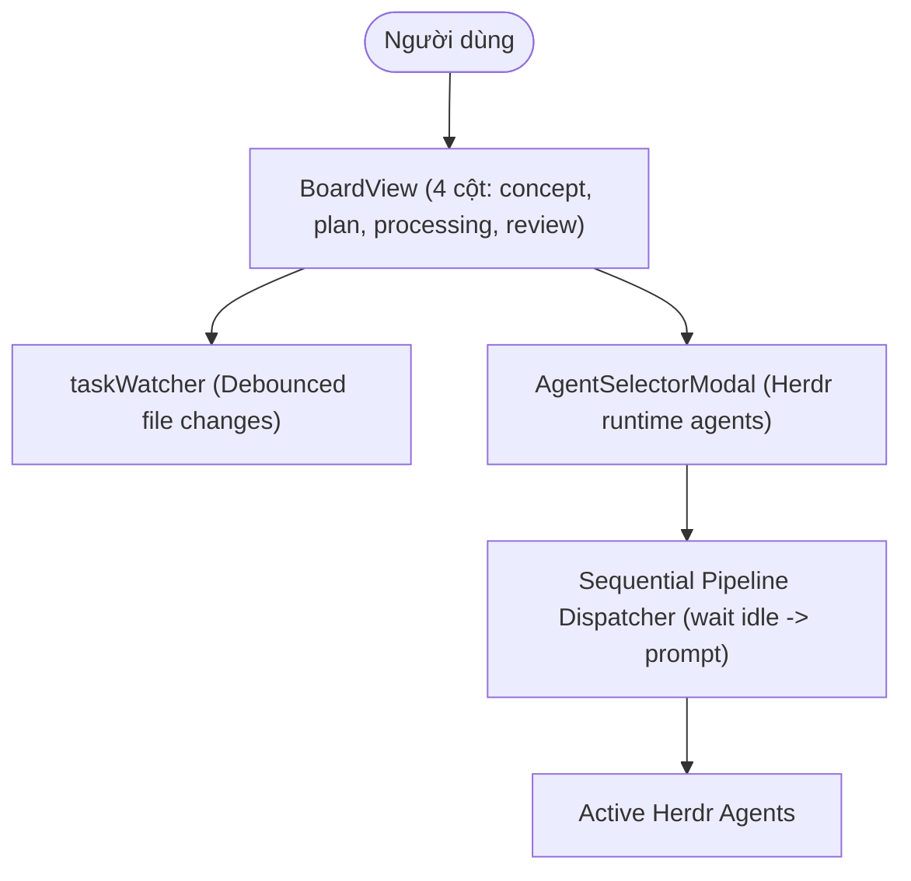

# Archive: Modernizing Only-One CLI Terminal User Interface (TUI) & Task Board

## 1. Problem & Core Value
- **Problem**: 
  - Giao diện TUI cũ phân mảnh, thiếu cơ chế theo dõi nhiệm vụ Kanban thời gian thực, điều phối Agent tĩnh gán cứng IDE/CLI gây xung đột tiến trình terminal, và lệnh init thiếu wizard trực quan.
- **Value**:
  - Xây dựng bảng Kanban 4 cột tinh gọn (`concept`, `plan`, `processing`, `review`), tự động phản chiếu thay đổi file trên đĩa qua bộ quét debounce.
  - Tích hợp trực tiếp với Herdr Process Manager: nạp danh sách agent thời gian thực (`idle` / `working`), hỗ trợ chọn nhiều agent cùng lúc và điều phối tuần tự (Pipeline Queue) an toàn.
  - Cung cấp Interactive Init Wizard (`InitWizardApp`) dạng component Ink với hỗ trợ quét workspace và phím tắt điều hướng nhanh.

## 2. Key Architecture & Decisions
- **4-Column Kanban Lifecycle**:
  - Chuẩn hóa vòng đời task: `concept` $\rightarrow$ `plan` $\rightarrow$ `processing` $\rightarrow$ `review`.
  - Task vượt qua `review` sẽ tự động kích hoạt tiến trình Clean/Archive và ẩn khỏi bảng điều khiển.
- **Herdr Runtime Agent Selector & Queue**:
  - `listHerdrAgents`: Phân tích kết quả JSON từ `herdr agent list`.
  - `waitHerdrAgent`: Chờ agent đạt trạng thái `idle` qua `herdr agent wait <target> --until idle` trước khi gửi prompt.
  - `dispatchTaskToHerdrAgents`: Hỗ trợ gán nhiều agent cho 1 task và thực thi tuần tự (Pipeline Queue) loại bỏ race condition sửa code.
- **Interactive Init Wizard App**:
  - [InitWizardApp.tsx](file:///d:/Sources/PERSONAL/only-one-cli/src/tui/init/InitWizardApp.tsx) cung cấp giao diện trực quan chọn Tool, Combo, Package, Skill, Config kèm cơ chế overwrite an toàn.

## 3. Scope & Key Changes
- **Core TUI Components**:
  - [BoardView.tsx](file:///d:/Sources/PERSONAL/only-one-cli/src/tui/components/BoardView.tsx): Bảng Kanban 4 cột tinh gọn.
  - [AgentSelectorModal.tsx](file:///d:/Sources/PERSONAL/only-one-cli/src/tui/components/AgentSelectorModal.tsx): Modal chọn multi-agent với trạng thái runtime `idle` / `working`.
  - [Header.tsx](file:///d:/Sources/PERSONAL/only-one-cli/src/tui/components/Header.tsx) & [Footer.tsx](file:///d:/Sources/PERSONAL/only-one-cli/src/tui/components/Footer.tsx): Đồng bộ biểu tượng 4 cột và phím tắt điều hướng `dispatch`.
  - [InitWizardApp.tsx](file:///d:/Sources/PERSONAL/only-one-cli/src/tui/init/InitWizardApp.tsx): Trình hướng dẫn thiết lập tương tác.
- **Services**:
  - [herdrService.ts](file:///d:/Sources/PERSONAL/only-one-cli/src/tui/services/herdrService.ts): Bổ sung `listHerdrAgents`, `waitHerdrAgent`, `dispatchTaskToHerdrAgents`.
  - [taskScanner.ts](file:///d:/Sources/PERSONAL/only-one-cli/src/tui/services/taskScanner.ts): Gom nhóm 4 cột chính quy và chuẩn hóa ánh xạ trạng thái sang `processing`.
- **Unit Tests**:
  - [test/tui/herdrService.test.ts](file:///d:/Sources/PERSONAL/only-one-cli/test/tui/herdrService.test.ts), [test/tui/taskScanner.test.ts](file:///d:/Sources/PERSONAL/only-one-cli/test/tui/taskScanner.test.ts).

## 4. Verification Evidence & PR
- **Test Status**: 100% Passed (Toàn bộ 64 test suites / 266 unit tests).
- **Branch**: `main`
