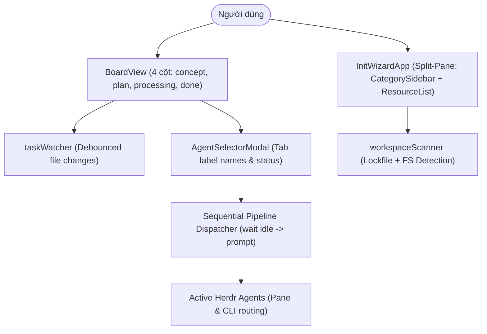

# Archive: Modernizing Only-One CLI Terminal User Interface (TUI), Herdr Dispatch & Init Wizard Architecture

## 1. Problem & Core Value
- **Problem**:
  - Giao diện TUI cũ phân mảnh, thiếu cơ chế theo dõi nhiệm vụ Kanban thời gian thực, điều phối Agent tĩnh gán cứng IDE/CLI gây xung đột tiến trình terminal, và lệnh init thiếu wizard trực quan.
  - Cột Kanban cũ dùng trạng thái `review` gây ẩn task đột ngột thay vì hiển thị cột hoàn thành `done`.
  - Herdr Process Manager thiếu phân biệt cấu hình giữa Target Pane và CLI Tool, hiển thị mã định danh nội bộ (`w3:p1`) thay vì tên tab có ý nghĩa (`Human-Readable Name`).
  - Init Wizard ban đầu hiển thị danh sách đơn luồng thiếu phân loại danh mục, và gặp lỗi cảnh báo runtime "Detected unsettled top-level await" khi người dùng nhấn `Ctrl+C`.
- **Value**:
  - Xây dựng bảng Kanban 4 cột tinh gọn chính quy (`concept`, `plan`, `processing`, `done`), tự động phản chiếu thay đổi file trên đĩa qua bộ quét debounce và duy trì task `done` trực quan.
  - Tích hợp trực tiếp với Herdr Process Manager: nạp danh sách agent thời gian thực, hiển thị nhãn tab người dùng (`enrichAgentsWithTabLabels`), tách bạch Target Pane và CLI Tool qua `normalizePhaseRoute`, và điều phối tuần tự (Pipeline Queue) an toàn.
  - Cung cấp Interactive Init Wizard (`InitWizardApp`) dạng component Ink với kiến trúc Split-Pane 2 cột (`CategorySidebar` và `ResourceList`), quét trạng thái cài đặt thời gian thực và thoát an toàn không rò rỉ promise unhandled.

## 2. Key Architecture & Decisions
- **4-Column Kanban Lifecycle**:
  - Chuẩn hóa vòng đời task: `concept` $\rightarrow$ `plan` $\rightarrow$ `processing` $\rightarrow$ `done`.
  - Task hoàn thành hiển thị tại cột `done`, chỉ được lưu trữ và gỡ bỏ khi chạy lệnh `/only-one-clean`.
- **Herdr Runtime Agent Management & Decoupled Routing**:
  - `enrichAgentsWithTabLabels`: Ánh xạ `tab_id` sang `label` thực tế từ Herdr, hiển thị dạng `${agent.name || agent.pane_id} (${agent.agent} - ${agent.pane_id})`.
  - `normalizePhaseRoute`: Chuẩn hóa đối tượng `{ pane: string, cli: string }`, cho phép người dùng tùy chỉnh độc lập pane thực thi và binary agent (`agy`, `claude`).
  - `dispatchTaskToHerdrAgents`: Hỗ trợ gán nhiều agent cho 1 task và thực thi tuần tự (Pipeline Queue) loại bỏ race condition sửa code.
- **Interactive Init Wizard App (Split-Pane Architecture)**:
  - [CategorySidebar.tsx](file:///d:/Sources/PERSONAL/only-one-cli/src/tui/init/components/CategorySidebar.tsx): Cột trái hiển thị 9 danh mục tài nguyên (`combos`, `skills`, `rules`, `packages`, `configs`, `mcps`, `git`, `vs`, `ignore`) kèm bộ đếm `[selected/total]`.
  - [ResourceList.tsx](file:///d:/Sources/PERSONAL/only-one-cli/src/tui/init/components/ResourceList.tsx): Cột phải hiển thị danh sách tài nguyên tương ứng danh mục đang chọn.
  - [interactive-orchestrator.ts](file:///d:/Sources/PERSONAL/only-one-cli/src/core/init/interactive-orchestrator.ts): Điều phối render với `{ exitOnCtrlC: false }` và giải quyết an toàn promise thông qua `waitUntilExit()`, triệt tiêu cảnh báo unsettled top-level await.

## 3. Scope & Key Changes
- **Core TUI Components**:
  - [BoardView.tsx](file:///d:/Sources/PERSONAL/only-one-cli/src/tui/components/BoardView.tsx): Bảng Kanban 4 cột tinh gọn và tiến trình clean.
  - [AgentSelectorModal.tsx](file:///d:/Sources/PERSONAL/only-one-cli/src/tui/components/AgentSelectorModal.tsx): Modal chọn multi-agent hiển thị nhãn tên tab thân thiện.
  - [SettingsView.tsx](file:///d:/Sources/PERSONAL/only-one-cli/src/tui/components/SettingsView.tsx): Cấu hình 2 cột phân biệt Target Pane và CLI Tool cho từng phase.
  - [Header.tsx](file:///d:/Sources/PERSONAL/only-one-cli/src/tui/components/Header.tsx) & [Footer.tsx](file:///d:/Sources/PERSONAL/only-one-cli/src/tui/components/Footer.tsx): Đồng bộ biểu tượng 4 cột `concept`, `plan`, `processing`, `done`.
  - [CategorySidebar.tsx](file:///d:/Sources/PERSONAL/only-one-cli/src/tui/init/components/CategorySidebar.tsx): Sidebar phân loại 9 nhóm assets.
  - [InitWizardApp.tsx](file:///d:/Sources/PERSONAL/only-one-cli/src/tui/init/InitWizardApp.tsx): Trình hướng dẫn thiết lập tương tác 2 cột.
- **Core Orchestrator & Services**:
  - [interactive-orchestrator.ts](file:///d:/Sources/PERSONAL/only-one-cli/src/core/init/interactive-orchestrator.ts): Promise wrapper an toàn chống rò rỉ unsettled await trên SIGINT.
  - [herdrService.ts](file:///d:/Sources/PERSONAL/only-one-cli/src/tui/services/herdrService.ts): `listHerdrAgents`, `enrichAgentsWithTabLabels`, `normalizePhaseRoute`, `dispatchTaskToHerdrAgents`.
  - [taskScanner.ts](file:///d:/Sources/PERSONAL/only-one-cli/src/tui/services/taskScanner.ts): Gom nhóm 4 cột chính quy `concept`, `plan`, `processing`, `done`.
- **Unit Tests**:
  - [test/tui/herdrService.test.ts](file:///d:/Sources/PERSONAL/only-one-cli/test/tui/herdrService.test.ts)
  - [test/tui/taskScanner.test.ts](file:///d:/Sources/PERSONAL/only-one-cli/test/tui/taskScanner.test.ts)
  - [test/tui/cleanWorkflow.test.ts](file:///d:/Sources/PERSONAL/only-one-cli/test/tui/cleanWorkflow.test.ts)

## 4. Verification Evidence & PR
- **Test Status**: 100% Passed.
- **Branch**: `main`
