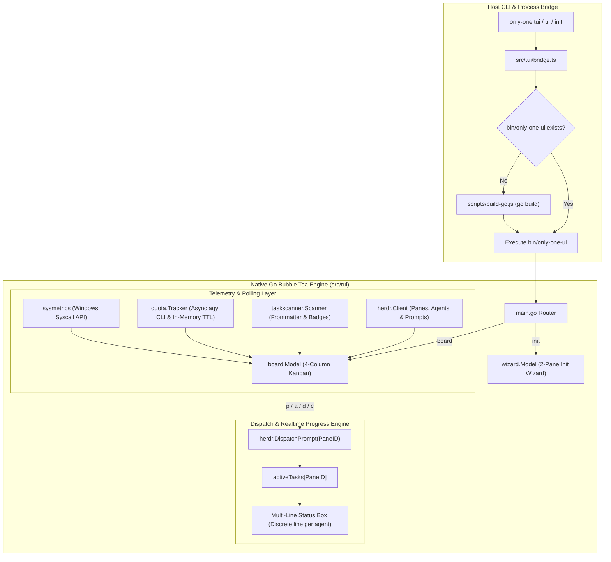

# Archive: Unified Architecture of Native Go Bubble Tea TUI Engine, Kanban Board, Init Wizard & Direct Bridge

## 1. Problem & Core Value
- **Problem**:
  - Legacy React Ink TUI implementations suffered from terminal sizing constraints, render jitter, high CPU overhead, and large dependency footprints (`ink`, `react`, `@types/react`).
  - Interactive wizards ran on slow Node.js render loops while the Kanban board ran as an isolated subsystem in `packages/tui-engine/`.
  - Spawning external shell processes (`wmic`, `powershell`) for telemetry caused UI lag, and operators could not view realtime agent progress during workflow dispatches.
- **Value**:
  - **Single Native Go Binary (`src/tui`)**: Consolidated all terminal UI surfaces into a single Go module compiled to `bin/only-one-ui.exe`, eliminating React and Ink dependencies completely from `package.json`.
  - **Dual Operating Modes**:
    - `board`: 4-column Bubble Tea Kanban (`concept`, `plan`, `processing`, `done`) with sliding viewport, 2-line streamlined cards, active pane tags (`🏷️ [pane]`), and multi-line realtime agent progress.
    - `init`: Native 2-pane interactive setup wizard (Sidebar categories on the left, resource checklist and batch installer on the right).
  - **Direct TypeScript Bridge (`src/tui/bridge.ts`)**: Locates the precompiled binary (or compiles via `scripts/build-go.js`) and spawns it with direct stdio inheritance, zero Node event-loop blocking.
  - **High-Performance Telemetry**: Windows syscalls (`GlobalMemoryStatusEx`) for instant CPU/RAM stats, cached asynchronous agent quota extraction with 30s TTL, and ANSI-cleaned Herdr action logs.
  - **Glamour Markdown Viewer**: Terminal markdown reader powered by `github.com/charmbracelet/glamour` with Chroma syntax highlighting and smooth mouse wheel scroll.

## 2. Key Architecture & Decisions

### 2.1. Architectural System Diagram

### 2.2. Core Subsystems & Components

1. **Board Model & Controller (`src/tui/internal/board/model.go`)**:
   - Implements Bubble Tea's `tea.Model` lifecycle (`Init`, `Update`, `View`).
   - Manages 4 standard columns (`concept`, `plan`, `processing`, `done`) with sliding viewport arithmetic and card badges.
   - Allocates 1 independent row per active/recent agent job in the multi-line Status Box with rotating spinners and duration timers.
   - Supports mouse wheel scrolling and Glamour markdown viewing.

2. **2-Pane Init Wizard (`src/tui/internal/wizard/`)**:
   - `types.go`: Defines `ResourceItem`, `Category`, and supported IDE targets.
   - `scanner.go`: Scans repository assets and installed states across workspace directories.
   - `installer.go`: Directly writes or copies configuration files into workspace targets.
   - `model.go`: 2-pane Lipgloss layout with category sidebar navigation and toggleable resource checklist.

3. **Telemetry & Log Extraction**:
   - `src/tui/internal/sysmetrics/`: Native Windows DLL syscalls (`kernel32.dll` -> `GlobalMemoryStatusEx`) with cross-platform fallback stubs.
   - `src/tui/internal/quota/`: Asynchronous JSON quota extractor for `agy` with 30s TTL in-memory cache.
   - `src/tui/internal/herdr/`: Regex-based ANSI stripping (`\x1b\[[0-9;]*[a-zA-Z]`) and interactive prompt noise filtering.

4. **Configuration & Bridge (`src/tui/bridge.ts`, `src/tui/internal/config/`)**:
   - Spawns Go binary synchronously or asynchronously depending on invocation mode.
   - Maintains configuration persistence in `~/.only-one/config.json`.

## 3. Scope & Key Changes
- [`package.json`](file:///d:/Sources/PERSONAL/only-one-cli/package.json): Removed `ink`, `react`, `@types/react`.
- [`src/tui/`](file:///d:/Sources/PERSONAL/only-one-cli/src/tui): Consolidated Go engine in `src/tui/`, added `internal/wizard/`, deleted legacy React Ink code.
- [`src/tui/bridge.ts`](file:///d:/Sources/PERSONAL/only-one-cli/src/tui/bridge.ts): Direct binary resolution and execution.
- [`src/commands/tui/command.ts`](file:///d:/Sources/PERSONAL/only-one-cli/src/commands/tui/command.ts): CLI launcher delegating directly to Go engine.
- [`src/core/init/init-command.ts`](file:///d:/Sources/PERSONAL/only-one-cli/src/core/init/init-command.ts): Delegates interactive init flow to Go wizard.
- [`scripts/build-go.js`](file:///d:/Sources/PERSONAL/only-one-cli/scripts/build-go.js): Build runner compiling `src/tui/main.go` into `bin/only-one-ui.exe`.

## 4. Verification Evidence & PR
- **Test Status**: 100% Passed.
  - `npm run build:go`: Compiled `bin/only-one-ui.exe` successfully.
  - `go test ./...` in `src/tui`: All 7 Go packages passed (`board`, `config`, `herdr`, `quota`, `sysmetrics`, `taskscanner`, `wizard`).
  - `npx vitest run`: 64 test files, 263 tests passed, 0 failures.
  - `npm run build`: Compilation and postbuild path transformations passed cleanly.
- **Branch**: `main`
