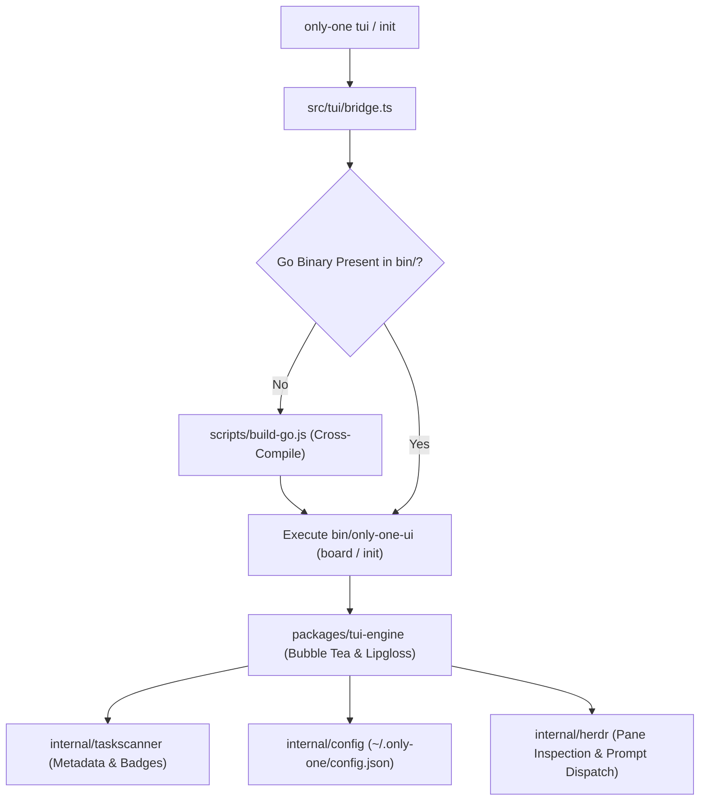

# Archive: Modernizing Only-One CLI Terminal User Interface (TUI), Go Bubble Tea Kanban Engine & Init Wizard Architecture

## 1. Problem & Core Value
- **Problem**:
  - Legacy Ink-based React TUI suffered from terminal sizing quirks, performance latency during rapid re-renders, and lacked resilient full-screen terminal capabilities.
  - Previous Kanban boards lacked real-time task file tracking, multi-document inspection, and in-place configuration adjustments.
  - Herdr Process Manager integration previously exposed technical pane IDs (`w3:p1`) instead of human-readable pane titles, and lacked clean workflow dispatch routing.
  - Task cards lacked visual hierarchy, document availability badges, and timestamp metadata.
- **Value**:
  - High-performance native Go Bubble Tea / Lipgloss TUI engine (`packages/tui-engine`) compiled into cross-platform binaries and spawned seamlessly via TypeScript bridge (`src/tui/bridge.ts`).
  - Standardized 4-column Kanban board (`concept`, `plan`, `processing`, `done`) with AltScreen support, mouse scrolling, and keyboard navigation.
  - Distinct rounded task card design featuring sequential numbering (`#01`), document badges (`[C] [P] [D] [R]`), and creation date metadata with robust fallback.
  - Full-featured Markdown Viewer (`Enter`) with multi-document tabs, syntax highlighting, and smooth keyboard scrolling.
  - Interactive Settings View (`s`) allowing live reconfiguration of 6-phase Agent Routing and Clean Policy, displaying human-friendly pane/agent names.
  - Dedicated Clean Action (`c`) dispatching `/only-one-clean` to the configured clean agent pane via Herdr without local task corruption.

## 2. Key Architecture & Decisions

### 2.1. Hybrid Architecture & Execution Bridge

### 2.2. Core Subsystems & Components
1. **Go Kanban Board Model (`packages/tui-engine/internal/board/model.go`)**:
   - Manages board navigation across 4 columns (`concept`, `plan`, `processing`, `done`).
   - Renders rounded border cards with cyan focus highlights and document presence badges (`[C]` Concept, `[P]` Plan, `[D]` Debug, `[R]` Review).
   - Implements multi-modal views: `ModeBoard`, `ModeViewer`, `ModeSettings`.
2. **Metadata Task Scanner (`packages/tui-engine/internal/taskscanner/scanner.go`)**:
   - Scans `only-one/tasks/` folders and extracts YAML frontmatter.
   - Robustly handles both `string` and `time.Time` unmarshaled scalar types from `yaml.v3`.
   - Inspects documentation file presence and calculates task status and creation dates.
3. **Decoupled Herdr Routing & Clean Dispatch (`packages/tui-engine/internal/herdr/client.go`)**:
   - Dispatches workflow commands to target panes using `herdr agent prompt <pane> "<command>"`.
   - Queries `listHerdrPanes` to resolve friendly tab titles (`Worker 1`, `Auto Detect`) for the settings modal.
   - Handles `c` shortcut to route `/only-one-clean` to `agentRouting.clean` pane.
4. **Global Configuration Manager (`packages/tui-engine/internal/config/config.go`)**:
   - Persists user preferences in `~/.only-one/config.json` adhering to 100% JSON schema parity with the Node.js CLI runtime.
   - Configures default 6-phase routing (`concept`, `plan`, `apply`, `debug`, `review`, `clean`) and automated clean thresholds.
5. **Cross-Compile Build Engine (`scripts/build-go.js`)**:
   - Automatically builds the Go binary into `bin/only-one-ui.exe` (or `bin/only-one-ui`) on host platforms.

## 3. Scope & Key Changes
- [packages/tui-engine/internal/board/model.go](file:///d:/Sources/PERSONAL/only-one-cli/packages/tui-engine/internal/board/model.go): Bubble Tea model, navigation, card rendering, and shortcuts.
- [packages/tui-engine/internal/taskscanner/scanner.go](file:///d:/Sources/PERSONAL/only-one-cli/packages/tui-engine/internal/taskscanner/scanner.go): YAML frontmatter parser, badge scanner, and column grouping.
- [packages/tui-engine/internal/config/config.go](file:///d:/Sources/PERSONAL/only-one-cli/packages/tui-engine/internal/config/config.go): Home-directory config JSON persistence.
- [packages/tui-engine/internal/herdr/client.go](file:///d:/Sources/PERSONAL/only-one-cli/packages/tui-engine/internal/herdr/client.go): Herdr CLI and IPC integration for pane listing and prompt dispatch.
- [src/tui/bridge.ts](file:///d:/Sources/PERSONAL/only-one-cli/src/tui/bridge.ts): Node.js process spawner with stdio inheritance.
- [scripts/build-go.js](file:///d:/Sources/PERSONAL/only-one-cli/scripts/build-go.js): Go compilation runner.

## 4. Verification Evidence & PR
- **Test Status**: 100% Passed.
  - `packages/tui-engine`: `go test ./...` passed all package unit tests (`board`, `config`, `herdr`, `taskscanner`).
  - TypeScript Suite: `npm test` passed 72 test files (292 tests passed).
  - Build & Style: `npm run format:check` and `npm run build` passed.
- **Branch**: `main`
