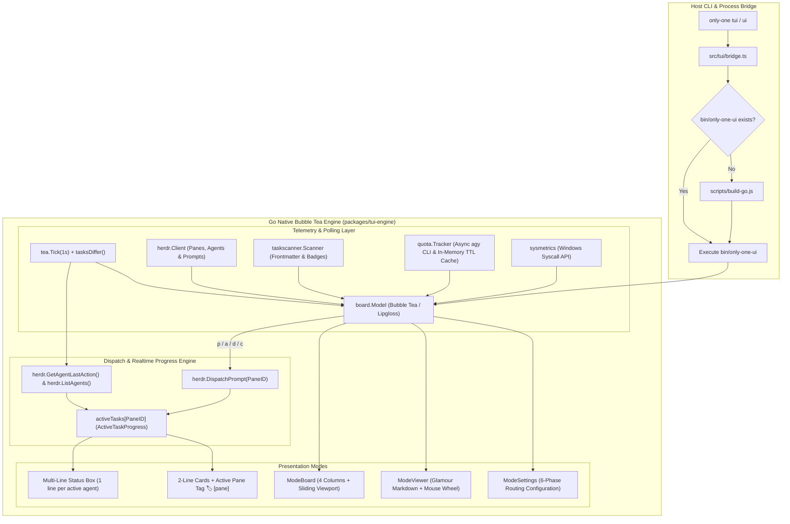

# Archive: Unified Architecture of Go Bubble Tea TUI Engine, Kanban Board, Streamlined Telemetry & Realtime Agent Progress

## 1. Problem & Core Value
- **Problem**:
  - Legacy React Ink TUI implementations suffered from terminal sizing constraints, render jitter, and high CPU overhead during high-frequency telemetry updates.
  - Previous Kanban cards displayed multi-line titles with truncated descriptions that consumed vertical terminal height, reducing the number of visible task cards per column.
  - When dispatching workflow tasks (`p`, `a`, `d`, `c`), operators could not observe which worker pane was currently executing a specific task card, nor view live action logs of running agent sub-processes.
  - Progress updates were either crammed into a single truncated string or required manual terminal switching, making parallel multi-agent executions opaque.
  - Spawning shell processes (`wmic`, `powershell`) for system stats or blocking the UI loop on slow external agent quota CLI calls introduced perceptible UI lag.
- **Value**:
  - **Native Go Bubble Tea Engine (`packages/tui-engine`)**: Ultra-fast terminal rendering compiled to cross-platform native binaries with seamless fallback to Ink via TypeScript bridge (`src/tui/bridge.ts`).
  - **Streamlined 2-Line Task Cards**: Clean layout featuring `#01 <slug>` on line 1 and document badges (`💡 [C]`, `📋 [P]`, `🐛 [D]`, `🔍 [R]`) with creation date on line 2, maximizing visible card density.
  - **Live Active Task Badging**: Cards actively undergoing workflow execution display a prominent pane tag (`🏷️ [pane]`, e.g. `🏷️ [dev]`), providing immediate visual state recognition.
  - **Dedicated Multi-Line Realtime Agent Progress Box**: The `⚡ TIẾN TRÌNH` status box renders each active agent process on its own discrete line with a rotating spinner, target pane ID, task slug, workflow phase, elapsed duration, and cleaned live terminal action log (`● Action line...`).
  - **Automated Lifecycle Completion**: When an agent finishes (`idle`), the status line transitions to `✅ [pane] ... ⏱ duration │ Hoàn tất thành công!`, retaining visibility for 10 seconds while automatically triggering task re-scanning without requiring manual refresh.
  - **ANSI-Cleaned Terminal Log Extraction**: Native terminal log extraction in `internal/herdr` strips ANSI sequences and interactive prompt noise, ensuring clean Lipgloss box alignment.
  - **Streamlined 3-Row Header Telemetry**:
    - *Row 1*: Title, Herdr connection status badge, and native OS metrics (CPU%, RAM%, Uptime).
    - *Row 2*: Active agent monitoring (total & busy count) alongside specialized 5-hour and Weekly Quota tracking with remaining percentage and relative reset timers.
    - *Row 3*: Document Badges legend with distinct icons.
  - **Separated Dual-Footer Layout**: Dedicated Status Bar and Shortcuts Bar (`[←/→]`, `[↑/↓]`, `[Space/m]`, `[Enter]`, `[p]`, `[a]`, `[d]`, `[c]`, `[s]`, `[q]`).
  - **Glamour Markdown Viewer (`ModeViewer`)**: High-fidelity terminal markdown rendering via `github.com/charmbracelet/glamour`, Chroma syntax highlighting, Mermaid DSL ASCII preprocessing, numeric tab switching (`1-N`), and smooth mouse wheel scrolling (`±3` lines).

## 2. Key Architecture & Decisions

### 2.1. Architectural System Diagram

### 2.2. Core Subsystems & Components

1. **Board Model & Controller (`packages/tui-engine/internal/board/model.go`)**:
   - Implements Bubble Tea's `tea.Model` lifecycle (`Init`, `Update`, `View`).
   - Manages navigation across 4 Kanban columns (`concept`, `plan`, `processing`, `done`) with sliding window viewport arithmetic (`colHeight = m.height - 13`), displaying scroll arrows `▲` and `▼` when tasks exceed column bounds.
   - Renders 2-line streamlined task cards: Line 1 formats `#01 <slug>` alongside `🏷️ [pane]` if actively running; Line 2 renders icons and dates.
   - Maintains `activeTasks map[string]*ActiveTaskProgress` tracking active pane executions, start times, elapsed seconds, and latest terminal action lines.
   - Renders the multi-line Status Box allocating 1 independent row per active/recent agent job.
   - Handles mouse wheel scrolling (`tea.MouseButtonWheelUp`, `tea.MouseButtonWheelDown`) for both task list navigation and Markdown Viewer scrolling.
   - Implements `tasksDiffer()` to prevent unnecessary redraws during 1-second ticks.

2. **Terminal Log & Action Cleaner (`packages/tui-engine/internal/herdr/client.go`)**:
   - `stripANSI(str)`: Uses regex `\x1b\[[0-9;]*[a-zA-Z]` to strip all ANSI escape sequences from raw terminal capture buffers.
   - `CleanActionLine(line)`: Filters prompt prefixes (`? Input:`, `Press Enter`), removes decorative bullets, and normalizes log text for clean single-line status output.
   - `GetAgentLastAction(paneID)`: Queries `herdr pane capture <paneID> --lines 10` and extracts the most recent substantive action message executed by the agent.

3. **Glamour Markdown Renderer (`packages/tui-engine/internal/board/model.go`)**:
   - Integrates `github.com/charmbracelet/glamour` with dark terminal styling and word wrapping.
   - Preprocesses Mermaid code fences into styled ASCII diagrams with syntax-highlighted labels (`preprocessMermaidBlocks`).
   - Caches rendered line blocks per document tab (`viewerCache`) to guarantee instant scrolling performance.

4. **Native System Metrics (`packages/tui-engine/internal/sysmetrics/`)**:
   - `metrics_windows.go`: Leverages Windows native DLL syscalls (`kernel32.dll` -> `GlobalMemoryStatusEx`, `GetSystemTimes`) to compute instantaneous CPU and RAM usage with zero child process overhead.
   - `metrics_other.go`: Provides cross-platform fallback metrics for non-Windows hosts.

5. **Agent Quota Tracker (`packages/tui-engine/internal/quota/tracker.go`)**:
   - Asynchronously queries `agy --output-format json --print "/usage"` and parses structured JSON quota buckets.
   - Calculates remaining percentage and relative reset countdowns (`formatRelativeTime`) for both 5-hour rolling windows and weekly quota ceilings.
   - Maintains thread-safe in-memory cache with 30-second TTL to eliminate CLI blocking during interactive UI navigation.

6. **Herdr Process Orchestration (`packages/tui-engine/internal/herdr/client.go`)**:
   - Queries `herdr pane list` and `herdr tab list` to resolve human-readable tab labels (`Worker 1`, `Auto Detect`).
   - Monitors agent count and busy states via `ListAgents()`.
   - Dispatches workflow prompts (`p` for `/only-one-plan`, `a` for `/only-one-apply`, `d` for `/only-one-debug`, `c` for `/only-one-clean`) to designated agent panes without local task state corruption.

7. **Task Metadata Scanner (`packages/tui-engine/internal/taskscanner/scanner.go`)**:
   - Scans `only-one/tasks/` directories, unmarshals YAML frontmatter (`status`, `title`, `created_at`), and detects presence of `concept.md`, `plan.md`, `debug.md`, and `review.md`.
   - Robustly parses scalar string and RFC3339 timestamps for creation date display and card numbering.

8. **Configuration Management (`packages/tui-engine/internal/config/config.go`)**:
   - Persists user preferences and 6-phase routing configurations in `~/.only-one/config.json`.
   - Guarantees 100% schema parity with the Node.js CLI runtime.

## 3. Scope & Key Changes
- [packages/tui-engine/internal/board/model.go](file:///d:/Sources/PERSONAL/only-one-cli/packages/tui-engine/internal/board/model.go): Streamlined 2-line cards, active task pane tags, multi-line progress rendering, 3-row header, separated footer bars, Glamour viewer, and mouse wheel support.
- [packages/tui-engine/internal/board/model_test.go](file:///d:/Sources/PERSONAL/only-one-cli/packages/tui-engine/internal/board/model_test.go): Unit tests for 2-line task cards, multi-line progress rendering, header metrics, and navigation.
- [packages/tui-engine/internal/herdr/client.go](file:///d:/Sources/PERSONAL/only-one-cli/packages/tui-engine/internal/herdr/client.go): ANSI stripping, terminal action line cleaner, last action extraction, and bounded prompt dispatching.
- [packages/tui-engine/internal/herdr/client_test.go](file:///d:/Sources/PERSONAL/only-one-cli/packages/tui-engine/internal/herdr/client_test.go): Unit tests verifying ANSI escape code removal and terminal action line extraction.
- [packages/tui-engine/internal/sysmetrics/](file:///d:/Sources/PERSONAL/only-one-cli/packages/tui-engine/internal/sysmetrics/): Native Windows syscall metrics collection and tests.
- [packages/tui-engine/internal/quota/](file:///d:/Sources/PERSONAL/only-one-cli/packages/tui-engine/internal/quota/): Asynchronous quota extraction, relative reset formatting, and tests.
- [packages/tui-engine/internal/taskscanner/scanner.go](file:///d:/Sources/PERSONAL/only-one-cli/packages/tui-engine/internal/taskscanner/scanner.go): Document badge detection and task model parsing.
- [src/commands/tui/command.ts](file:///d:/Sources/PERSONAL/only-one-cli/src/commands/tui/command.ts): CLI launcher with `ui` command alias and Go binary auto-detection.
- [src/tui/bridge.ts](file:///d:/Sources/PERSONAL/only-one-cli/src/tui/bridge.ts): Process spawner for compiled Go binary.
- [scripts/build-go.js](file:///d:/Sources/PERSONAL/only-one-cli/scripts/build-go.js): Cross-compilation build runner.

## 4. Verification Evidence & PR
- **Test Status**: 100% Passed.
  - `packages/tui-engine`: `go test ./...` passed all packages:
    - `tui-engine/internal/board` (PASS)
    - `tui-engine/internal/config` (PASS)
    - `tui-engine/internal/herdr` (PASS)
    - `tui-engine/internal/quota` (PASS)
    - `tui-engine/internal/sysmetrics` (PASS)
    - `tui-engine/internal/taskscanner` (PASS)
  - `go build ./...`: Binary builds clean without warnings.
- **Branch**: `main`
