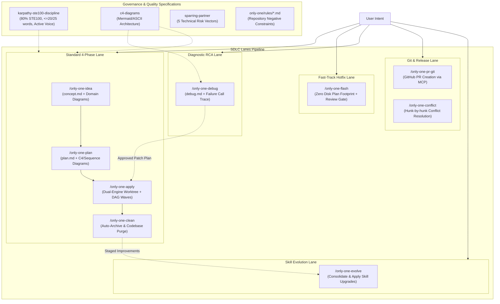

# Archive: Kiến Trúc Hợp Nhất của Hệ Thống Workflows, SDLC Lanes, DAG Sub-agents, 80% ASD-STE100 & Dual-Engine Worktree

## 1. Problem Statement & Core Value (Bài toán & Giá trị Cốt lõi)

### 1.1. Core Problems
1. **Bệnh béo phì tài liệu & Phân mảnh nguồn chân lý**: Các quy trình trước đây sinh tài liệu dài dòng, rườm rà; file `walkthrough.md` gây trùng lặp lãng phí đĩa.
2. **Kém hiệu quả khi diễn giải kiến trúc bằng văn xuôi**: Đọc khối chữ dài để hiểu tương tác đa module hay luồng lỗi dẫn tới hiểu sai và tốn token ngữ cảnh; thiếu sơ đồ trực quan.
3. **Văn phong rào đón & Bệnh nịnh bợ (AI Slop & Sycophancy)**: LLM thường dùng câu bị động, rào đón xã giao và dễ đồng thuận mù quáng trước thiết kế lỗi của con người.
4. **Chi phí thời gian lớn cho Quick Tasks**: Các tác vụ nhỏ bị bắt buộc phải chạy qua 3 giai đoạn độc lập nặng nề.
5. **Thực thi tuần tự gây nghẽn (Sequential Bottleneck)**: `/only-one-apply` chạy từng file một làm chậm tiến độ và phình to ngữ cảnh Main Agent.
6. **Vi phạm ranh giới vòng đời (Lifecycle Drift)**: Debug tự ý sửa code sản phẩm; review không có định dạng thực thi chuẩn.
7. **Báo cáo Hoàn thành Chat Tùy tiện & Khó Quét Mắt**: Khi `/only-one-apply` kết thúc, báo cáo chat quá sơ sài hoặc phân rã chi tiết từng file rườm rà.
8. **Rủi ro Ô nhiễm Nhánh Chính Khi Thực thi In-Place**: Thực thi trực tiếp các thay đổi đa file trên working directory có nguy cơ gây xung đột git hoặc làm gián đoạn trạng thái commit hiện tại.

### 1.2. Core Value & Solutions
1. **Direct Specialized Workflow Invocation**: Loại bỏ gateway router trung gian, cho phép kích hoạt trực tiếp các workflows chuyên biệt (`/only-one-idea`, `/only-one-plan`, `/only-one-apply`, `/only-one-flash`, `/only-one-debug`, `/only-one-review`, `/only-one-conflict`, `/only-one-clean`, `/only-one-pr-git`, `/only-one-evolve`).
2. **Dedicated Persona & Authority Invariant**: Mỗi workflow tự định danh rõ Persona, Mindset, Allowed Actions và Forbidden Actions ngay trong phần `Role & Collaboration Model`.
3. **Chuẩn hóa 100% Tiếng Anh Kỹ thuật**: Toàn bộ hướng dẫn, khuôn mẫu và chốt chặn trong workflow sử dụng 100% tiếng Anh chuẩn quốc tế.
4. **Kiến Trúc Bộ Nhớ Phân Tầng (Tiered Context System)**: Quản trị tri thức tinh gọn qua `only-one/INDEX.md`, `only-one/rules/<domain>.md` và `only-one/archives/`.
5. **Phân cấp 3 Làn Thực Thi SDLC**:
   - **Standard Lane (`/only-one-idea` $\rightarrow$ `/only-one-plan` $\rightarrow$ `/only-one-apply` $\rightarrow$ `/only-one-clean`)**:
     - Chuẩn hóa **4 Sections Thống nhất** cho cả `plan.md` & `debug.md`:
       + *Section 1*: Directory Structure & Diagnosis (Sơ đồ cây ASCII kèm Action Tags `[NEW]`, `[MODIFY]`, `[DELETE]`, bằng chứng RCA).
       + *Section 2*: Story Board & Defect Scenarios (Kịch bản hành vi kèm Mermaid State/Flow Diagram và danh sách `Serving Files`).
       + *Section 3*: Test Cases & Verification Matrix (Bảng danh mục test cases chi tiết `TC-XX`, liên kết tiêu chí `AC`/`Risk`, điều kiện đầu vào, assertions).
       + *Section 4*: File Changes (Khối tác vụ Git diffs theo TDD: test đỏ trước $\rightarrow$ code xanh sau, loại bỏ `Fast Test Command` cục bộ).
     - **Strict Task Invariant**: Mỗi thư mục task chỉ chứa duy nhất `concept.md`, `plan.md`/`debug.md` và tuỳ chọn `improvements.md`. Cấm tuyệt đối tạo `walkthrough.md` trên đĩa.
   - **Fast-Track Lane (`/only-one-flash`)**:
     - Xử lý tác vụ nhỏ, hotfix với **Zero Disk Plan Footprint** (không tạo thư mục task hay markdown trên đĩa).
     - Kế hoạch trình bày trực tiếp qua chat kèm Defect Scenario, có Review Gate bắt buộc ở Step 2 trước khi sửa code ở Step 3.
   - **Strict Lifecycle RCA Lane (`/only-one-debug`)**:
     - Tuân thủ 2 pha tách biệt: Pha 1 chẩn đoán lỗi, dựng Red feedback loop, lập kế hoạch vá theo chuẩn 4 sections trong `debug.md` và dừng tại Review Gate; Pha 2 giao cho `/only-one-apply` thực thi.
6. **Mẫu Báo Cáo Hoàn Thành Tinh Gọn 4 Mục (Crisp In-Chat Completion Report)**:
   - Chuẩn hóa Step 5 của `only-one-apply` với 4 mục súc tích bằng tiếng Việt:
     1. Cấu trúc source thay đổi.
     2. Các công việc đã xử lý.
     3. Nghiệm thu & Kiểm thử.
     4. Bước tiếp theo.
7. **Quy Chuẩn Viết 80% ASD-STE100 & Triệt Tiêu Thể Bị Động ([`karpathy-ste100-discipline`](file:///d:/Sources/PERSONAL/only-one-cli/assets/agents/skills/karpathy-ste100-discipline/SKILL.md))**:
   - Khống chế trần từ: Câu chỉ dẫn $\le 20$ từ, câu mô tả/ngữ cảnh $\le 25$ từ.
   - Cấm triệt để thể bị động; 100% sử dụng câu chủ động trực diện.
8. **Bắt Buộc Trực Quan Hóa Bằng Sơ Đồ ([`c4-diagrams`](file:///d:/Sources/PERSONAL/only-one-cli/assets/agents/skills/c4-diagrams/SKILL.md))**:
   - `concept.md`: Bắt buộc Mermaid Flowchart/State Diagram cho luồng dữ liệu nghiệp vụ và máy trạng thái.
   - `plan.md`: Bắt buộc C4 Component Diagram hoặc Mermaid Sequence Diagram khi có $\ge 2$ modules tương tác hoặc luồng bất đồng bộ.
   - `debug.md`: Bắt buộc Mermaid Failure Call Trace Diagram hoặc State Divergence Diagram.
9. **Cơ chế Thực thi Song song Sub-agent theo DAG trong `/only-one-apply`**:
   - Phân tích trường `Depends On` để nhóm các task độc lập thành các Execution Waves.
   - Áp dụng **Disjoint File Invariant** ngăn chặn 2 Sub-agents sửa chung 1 file cùng lúc.
   - Parallel Dispatch với 3-4 Sub-agents chạy song song và Barrier Synchronization giữa các wave.
10. **Chống Nịnh bợ & Tư duy Phản biện ([`sparring-partner`](file:///d:/Sources/PERSONAL/only-one-cli/assets/agents/skills/sparring-partner/SKILL.md))**:
    - Loại bỏ lời khen sáo rỗng, đánh giá rủi ro theo 5 trục kỹ thuật (Boundary conditions, Simplicity, Blast radius, Concurrency, Security) và đề xuất phương án thay thế tốt hơn.
11. **Kiến Trúc Dual-Engine Worktree & Rebase-First Guard ([`only-one-apply`](file:///d:/Sources/PERSONAL/only-one-cli/assets/agents/skills/only-one-apply/SKILL.md))**:
    - Hỗ trợ 2 chế độ thực thi: *Worktree Mode* (cô lập an toàn trên `.worktrees/<slug>` với junction symlinks liên kết `node_modules` và shared configs) và *In-Place Mode* (thực thi trực tiếp trên branch hiện tại).
    - Tự động hóa điều phối vòng đời worktree qua `assets/agents/skills/only-one-apply/scripts/worktree-runner.ts` và mẫu cấu hình `templates/worktreeinclude.template`.
    - Step 5b kích hoạt Rebase-First Guard tự động rebase lên upstream và chạy kiểm thử hồi quy trước khi merge thay đổi về nhánh chính.
12. **Section 1.5 Story Board & Trực Quan Hóa Từng Câu Chuyện (Visual Story Board)**:
    - Bắt buộc mỗi story trong `plan.md` phải có mục mô tả Before/After kèm theo một sơ đồ Mermaid biểu diễn sự khác biệt trạng thái hệ thống.
13. **Chu Trình Pragmatic TDD & Self-Healing Red Loop (`only-one-plan` & `only-one-apply`)**:
    - **Test-First Ordering**: Trong Section 2 của `plan.md`, các task block test bắt buộc phải xuất hiện trước task block triển khai code tương ứng.
    - **Fast Test per File**: `only-one-apply` thực thi theo cặp test-code, chạy ngay `Fast Test Command` sau khi sửa file.
    - **Self-Healing Red Loop (Retry limit: 3)**: Khi test fail, tự động phân tích stack trace và thử nghiệm chỉnh sửa tối đa 3 lần.
14. **Lá Chắn Cú Pháp Mermaid (Mermaid Lexer Shield)**:
    - Quote 100% nhãn node và subgraph, cấm dùng cú pháp trần `[/label]` để triệt tiêu lỗi token hình thang `TRAPSTART`. Thay thế ký tự `<` bằng `≤`.
15. **Hệ Thống Tiến Hóa Kỹ Năng Tự Động (`/only-one-clean` & `/only-one-evolve`)**:
    - Thu gom `improvements.md` từ task folder và lưu chuyển vào `~/.only-one/improvements/<repo>/<slug>.md`.
    - Lệnh `/only-one-evolve` thẩm định và nâng cấp trực tiếp kỹ năng đích dựa trên các đề xuất đã gom.

---

## 2. Key Architecture & Workflows Matrix

### Bảng Ma trận Workflows

| Workflow | Vai trò & Trọng trách Cốt lõi | Input & Artifacts | Sơ đồ Trực quan Bắt buộc |
| :--- | :--- | :--- | :--- |
| **[`/only-one-idea`](file:///d:/Sources/PERSONAL/only-one-cli/assets/agents/skills/only-one-idea/SKILL.md)** | Khám phá bài toán & kiến trúc giải pháp (BA & Architect) | `concept.md` (SSOT cho What & Why) | Flowchart / State Diagram |
| **[`/only-one-plan`](file:///d:/Sources/PERSONAL/only-one-cli/assets/agents/skills/only-one-plan/SKILL.md)** | Lập kế hoạch 3 sections diff-centric (Architect & Planner) | Ingest `concept.md` $\rightarrow$ `plan.md` | C4 Component / Sequence ($\ge 2$ modules) |
| **[`/only-one-apply`](file:///d:/Sources/PERSONAL/only-one-cli/assets/agents/skills/only-one-apply/SKILL.md)** | Dual-Engine Worktree & DAG Wave Execution (Dev & Lead) | Ingest `plan.md`/`debug.md` $\rightarrow$ Code | Execution Wave Graph |
| **[`/only-one-flash`](file:///d:/Sources/PERSONAL/only-one-cli/assets/agents/skills/only-one-flash/SKILL.md)** | Fast-track hotfix & quick tasks với Review Gate | Zero Disk Plan (In-chat plan & apply) | ASCII Target Structure |
| **[`/only-one-debug`](file:///d:/Sources/PERSONAL/only-one-cli/assets/agents/skills/only-one-debug/SKILL.md)** | RCA cơ học, Red feedback loop, plan vá (Investigator) | `debug.md` (Strict Lifecycle Isolation) | Mermaid Failure Call Trace |
| **[`/only-one-review`](file:///d:/Sources/PERSONAL/only-one-cli/assets/agents/skills/only-one-review/SKILL.md)** | Chuẩn hóa kết quả Open CodeReview (OCR Reviewer) | `review.md` $\rightarrow$ multi-select apply | Không |
| **[`/only-one-conflict`](file:///d:/Sources/PERSONAL/only-one-cli/assets/agents/skills/only-one-conflict/SKILL.md)** | Giải quyết xung đột git merge/rebase an toàn (Conflict Specialist) | Conflict hunks $\rightarrow$ clean resolution | Không |
| **[`/only-one-clean`](file:///d:/Sources/PERSONAL/only-one-cli/assets/agents/skills/only-one-clean/SKILL.md)** | Tự động archive task, đối soát & thanh lọc (Archivist & Auditor) | Purge task folder $\rightarrow$ Living Archives | Không |
| **[`/only-one-pr-git`](file:///d:/Sources/PERSONAL/only-one-cli/assets/agents/skills/only-one-pr-git/SKILL.md)** | Tạo GitHub PR từ Git state qua GitHub MCP (Release Engineer) | Git preflight $\rightarrow$ GitHub PR | Không |
| **[`/only-one-evolve`](file:///d:/Sources/PERSONAL/only-one-cli/assets/agents/skills/only-one-evolve/SKILL.md)** | Nâng cấp & tiến hóa kỹ năng định kỳ (Evolution Architect) | `~/.only-one/improvements/` $\rightarrow$ Skills | Không |

---

## 3. Scope & Key Changes (Phạm vi & Thay đổi Chính)

- [`assets/agents/skills/karpathy-ste100-discipline/SKILL.md`](file:///d:/Sources/PERSONAL/only-one-cli/assets/agents/skills/karpathy-ste100-discipline/SKILL.md): Nâng chuẩn 80% ASD-STE100, khống chế 20/25 từ, cấm thể bị động.
- [`assets/agents/skills/only-one-apply/SKILL.md`](file:///d:/Sources/PERSONAL/only-one-cli/assets/agents/skills/only-one-apply/SKILL.md): Tinh giản thực thi trực tiếp coder-first, tích hợp Dual-Engine Worktree Runner và Báo cáo Hoàn thành Chat tinh gọn 4 mục.
- [`assets/agents/skills/only-one-apply/scripts/worktree-runner.ts`](file:///d:/Sources/PERSONAL/only-one-cli/assets/agents/skills/only-one-apply/scripts/worktree-runner.ts): Quản lý tạo worktree và junction link.
- [`assets/agents/skills/only-one-clean/scripts/auto-archive.ts`](file:///d:/Sources/PERSONAL/only-one-cli/assets/agents/skills/only-one-clean/scripts/auto-archive.ts): Auto-archiving tasks và staging improvements.
- [`assets/agents/skills/only-one-evolve/SKILL.md`](file:///d:/Sources/PERSONAL/only-one-cli/assets/agents/skills/only-one-evolve/SKILL.md): Workflow tiến hóa kỹ năng.
- [`test/skills/applyReportTemplate.test.ts`](file:///d:/Sources/PERSONAL/only-one-cli/test/skills/applyReportTemplate.test.ts): Unit test kiểm thử cấu trúc schema báo cáo 4 mục và kiểm tra độ dài câu theo tiêu chuẩn ASD-STE100.
- [`test/skills/worktreeRunner.test.ts`](file:///d:/Sources/PERSONAL/only-one-cli/test/skills/worktreeRunner.test.ts): Unit test cho worktree runner.
- [`assets/agents/combos/index.ts`](file:///d:/Sources/PERSONAL/only-one-cli/assets/agents/combos/index.ts): Tích hợp hooks vào combo `only-one-flow`.
- Hợp nhất toàn diện các workflows vào hệ thống Agent Skills (`assets/agents/skills/only-one-*`).

---

## 4. Verification Evidence & PR (Bằng chứng Nghiệm thu)

- **Trạng thái Test**: 100% Passed (Toàn bộ test suites passed).
- **Format & Build**: `npm run format:check && npm run build` (passed, zero errors).
- **Đồng bộ**: 100% giữa `assets/agents/skills/` và `.agents/skills/`.
