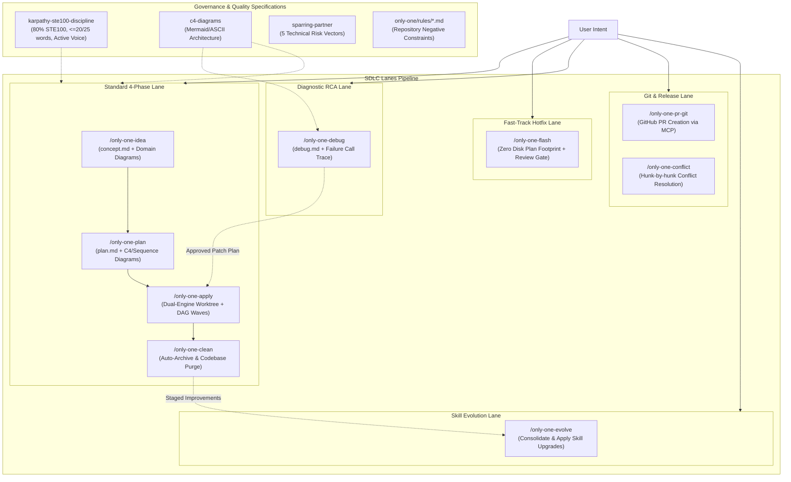

# Archive: Kiến Trúc Hợp Nhất của Hệ Thống Workflows, SDLC Lanes, DAG Sub-agents, 80% ASD-STE100 & Dual-Engine Worktree

## 1. Problem Statement & Core Value (Bài toán & Giá trị Cốt lõi)

### 1.1. Core Problems
1. **Bệnh béo phì tài liệu & Phân mảnh nguồn chân lý**: Các quy trình trước đây sinh tài liệu dài dòng, rườm rà; file `walkthrough.md` gây trùng lặp lãng phí đĩa.
2. **Kém hiệu quả khi diễn giải kiến trúc bằng văn xuôi**: Đọc khối chữ dài để hiểu tương tác đa module hay luồng lỗi dẫn tới hiểu sai và tốn token ngữ cảnh; thiếu sơ đồ trực quan.
3. **Văn phong rào đón & Bệnh nịnh bợ (AI Slop & Sycophancy)**: LLM thường dùng câu bị động, rào đón xã giao và dễ đồng thuận mù quáng trước thiết kế lỗi của con người.
4. **Chi phí thời gian lớn cho Quick Tasks**: Các tác vụ nhỏ bị bắt buộc phải chạy qua 3 giai đoạn độc lập nặng nề.
5. **Thực thi tuần tự gây nghẽn (Sequential Bottleneck)**: `/only-one-apply` chạy từng file một làm chậm tiến độ và phình to ngữ cảnh Main Agent.
6. **Vi phạm ranh giới vòng đời (Lifecycle Drift)**: Debug tự ý sửa code sản phẩm; review không có định dạng thực thi chuẩn.
7. **Báo cáo Hoàn thành Chat Cồng kềnh & Thụ động**: Khi `/only-one-apply` kết thúc, báo cáo in cây thư mục ASCII rườm rà, lặp lại mô tả công việc, in mục bước tiếp theo thừa thãi, và bỏ qua cổng tiếp nhận phản hồi cải tiến cho `/only-one-evolve`.
8. **Rủi ro Ô nhiễm Nhánh Chính Khi Thực thi In-Place**: Thực thi trực tiếp các thay đổi đa file trên working directory có nguy cơ gây xung đột git hoặc làm gián đoạn trạng thái commit hiện tại.
9. **Thiên kiến Tự kiểm tra & Rủi ro Sửa gian lận Test (Confirmation Bias & Test Tampering)**: Một agent duy nhất vừa viết code vừa tự viết bài test cho chính mình; khi test fail, agent dễ rơi vào bế tắc hoặc tự sửa code test để ép pass thay vì sửa code triển khai.
10. **Bùng nổ Token do Nạp Mã Thô Khi Khảo Sát (Context Pollution via Raw Code Dumps)**: Khi khảo sát nhiều tệp (> 2 tệp), agent chính đọc toàn bộ file và regex grep tràn lan làm đốt từ 15.000 đến 30.000 token, gây hiện tượng Lost-in-the-Middle.
11. **Ô nhiễm Context do Log Terminal, HTML DOM và API Payloads Thô**: Chạy lệnh CLI, duyệt web bằng Playwright, hoặc test API đổ hàng ngàn dòng ANSI escape, cây DOM và JSON thô trực tiếp vào transcript của Orchestrator.

### 1.2. Core Value & Solutions
1. **Direct Specialized Workflow Invocation**: Loại bỏ gateway router trung gian, cho phép kích hoạt trực tiếp các workflows chuyên biệt (`/only-one-idea`, `/only-one-plan`, `/only-one-apply`, `/only-one-flash`, `/only-one-debug`, `/only-one-review`, `/only-one-conflict`, `/only-one-clean`, `/only-one-pr-git`, `/only-one-evolve`).
2. **Dedicated Persona & Authority Invariant**: Mỗi workflow tự định danh rõ Persona, Mindset, Allowed Actions và Forbidden Actions ngay trong phần `Role & Collaboration Model`.
3. **Chuẩn hóa 100% Tiếng Anh Kỹ thuật**: Toàn bộ hướng dẫn, khuôn mẫu và chốt chặn trong workflow sử dụng 100% tiếng Anh chuẩn quốc tế.
4. **Kiến Trúc Bộ Nhớ Phân Tầng (Tiered Context System)**: Quản trị tri thức tinh gọn qua `only-one/INDEX.md`, `only-one/rules/<domain>.md` và `only-one/archives/`.
5. **Phân cấp 3 Làn Thực Thi SDLC**:
   - **Standard Lane (`/only-one-idea` $\rightarrow$ `/only-one-plan` $\rightarrow$ `/only-one-apply` $\rightarrow$ `/only-one-clean`)**:
     - Chuẩn hóa **4 Sections Thống nhất** cho cả `plan.md` & `debug.md`:
       + *Section 1*: Directory Structure & Diagnosis (Sơ đồ cây ASCII kèm Action Tags `[NEW]`, `[MODIFY]`, `[DELETE]`, bằng chứng RCA).
       + *Section 2*: Story Board & Defect Scenarios (Kịch bản hành vi kèm Mermaid State/Flow Diagram và danh sách `Serving Files`).
       + *Section 3*: Test Cases & Verification Matrix (Bảng danh mục test cases chi tiết `TC-XX`, liên kết tiêu chí `AC`/`Risk`, điều kiện đầu vào, assertions).
       + *Section 4*: File Changes (Khối tác vụ Git diffs theo TDD: test đỏ trước $\rightarrow$ code xanh sau, loại bỏ `Fast Test Command` cục bộ).
     - **Strict Task Invariant**: Mỗi thư mục task chỉ chứa duy nhất `concept.md`, `plan.md`/`debug.md` và tuỳ chọn `improvements.md`. Cấm tuyệt đối tạo `walkthrough.md` trên đĩa.
   - **Fast-Track Lane (`/only-one-flash`)**:
     - Xử lý tác vụ nhỏ, hotfix với **Zero Disk Plan Footprint** (không tạo thư mục task hay markdown trên đĩa).
     - Kế hoạch trình bày trực tiếp qua chat kèm Defect Scenario, có Review Gate bắt buộc ở Step 2 trước khi sửa code ở Step 3.
   - **Strict Lifecycle RCA Lane (`/only-one-debug`)**:
     - Tuân thủ 2 pha tách biệt: Pha 1 chẩn đoán lỗi, dựng Red feedback loop, lập kế hoạch vá theo chuẩn 4 sections trong `debug.md` và dừng tại Review Gate; Pha 2 giao cho `/only-one-apply` thực thi.
6. **Mô Hình Báo Cáo Nghiệm Thu Collapsible Hybrid & Cổng Friction Check Gate ([`only-one-apply`](file:///d:/Sources/PERSONAL/only-one-cli/assets/agents/skills/only-one-apply/SKILL.md))**:
   - Chuẩn hóa Step 5 của `only-one-apply` sang mô hình Collapsible Hybrid súc tích:
     + *High-Signal Glance*: Chỉ gồm 2 dòng hiển thị trạng thái `DONE` ✅ kèm định lượng (số file thay đổi, số test passed) và 1-2 câu tóm tắt điểm mấu chốt kỹ thuật.
     + *Deep Audit on Demand*: Gói danh sách file thay đổi và log kiểm thử chi tiết trong các thẻ `
` có thể đóng mở.
     + *Loại bỏ hoàn toàn*: Không in cây thư mục ASCII, không lặp lại mô tả task, và loại bỏ mục "Bước tiếp theo".
     + *Interactive Friction Check Gate*: Đặt câu hỏi tương tác trực tiếp ở cuối báo cáo để tiếp nhận điểm ma sát kỹ thuật; kích hoạt `assets/agents/skills/only-one-apply/scripts/record-improvement.ts` tạo `improvements.md` cho `/only-one-evolve`.
7. **Quy Chuẩn Viết 80% ASD-STE100 & Triệt Tiêu Thể Bị Động ([`karpathy-ste100-discipline`](file:///d:/Sources/PERSONAL/only-one-cli/assets/agents/skills/karpathy-ste100-discipline/SKILL.md))**:
   - Khống chế trần từ: Câu chỉ dẫn $\le 20$ từ, câu mô tả/ngữ cảnh $\le 25$ từ.
   - Cấm triệt để thể bị động; 100% sử dụng câu chủ động trực diện.
8. **Bắt Buộc Trực Quan Hóa Bằng Sơ Đồ ([`c4-diagrams`](file:///d:/Sources/PERSONAL/only-one-cli/assets/agents/skills/c4-diagrams/SKILL.md))**:
   - `concept.md`: Bắt buộc Mermaid Flowchart/State Diagram cho luồng dữ liệu nghiệp vụ và máy trạng thái.
   - `plan.md`: Bắt buộc C4 Component Diagram hoặc Mermaid Sequence Diagram khi có $\ge 2$ modules tương tác hoặc luồng bất đồng bộ.
   - `debug.md`: Bắt buộc Mermaid Failure Call Trace Diagram hoặc State Divergence Diagram.
9. **Cơ chế Thực thi Song song Sub-agent theo DAG trong `/only-one-apply`**:
   - Phân tích trường `Depends On` để nhóm các task độc lập thành các Execution Waves.
   - Áp dụng **Disjoint File Invariant** ngăn chặn 2 Sub-agents sửa chung 1 file cùng lúc.
   - Parallel Dispatch với 3-4 Sub-agents chạy song song và Barrier Synchronization giữa các wave.
10. **Chống Nịnh bợ & Tư duy Phản biện ([`sparring-partner`](file:///d:/Sources/PERSONAL/only-one-cli/assets/agents/skills/sparring-partner/SKILL.md))**:
    - Loại bỏ lời khen sáo rỗng, đánh giá rủi ro theo 5 trục kỹ thuật (Boundary conditions, Simplicity, Blast radius, Concurrency, Security) và đề xuất phương án thay thế tốt hơn.
11. **Kiến Trúc Dual-Engine Worktree & Rebase-First Guard ([`only-one-apply`](file:///d:/Sources/PERSONAL/only-one-cli/assets/agents/skills/only-one-apply/SKILL.md))**:
    - Hỗ trợ 2 chế độ thực thi: *Worktree Mode* (cô lập an toàn trên `.worktrees/<slug>` với junction symlinks liên kết `node_modules` và shared configs) và *In-Place Mode* (thực thi trực tiếp trên branch hiện tại).
    - Tự động hóa điều phối vòng đời worktree qua `assets/agents/skills/only-one-apply/scripts/worktree-runner.ts` và mẫu cấu hình `templates/worktreeinclude.template`.
    - Step 5b kích hoạt Rebase-First Guard tự động rebase lên upstream và chạy kiểm thử hồi quy trước khi merge thay đổi về nhánh chính.
12. **Section 1.5 Story Board & Trực Quan Hóa Từng Câu Chuyện (Visual Story Board)**:
    - Bắt buộc mỗi story trong `plan.md` phải có mục mô tả Before/After kèm theo một sơ đồ Mermaid biểu diễn sự khác biệt trạng thái hệ thống.
13. **Chu Trình Pragmatic TDD & Self-Healing Red Loop (`only-one-plan` & `only-one-apply`)**:
    - **Test-First Ordering**: Trong Section 2 của `plan.md`, các task block test bắt buộc phải xuất hiện trước task block triển khai code tương ứng.
    - **Fast Test per File**: `only-one-apply` thực thi theo cặp test-code, chạy ngay `Fast Test Command` sau khi sửa file.
    - **Self-Healing Red Loop (Retry limit: 3)**: Khi test fail, tự động phân tích stack trace và thử nghiệm chỉnh sửa tối đa 3 lần.
14. **Lá Chắn Cú Pháp Mermaid (Mermaid Lexer Shield)**:
    - Quote 100% nhãn node và subgraph, cấm dùng cú pháp trần `[/label]` để triệt tiêu lỗi token hình thang `TRAPSTART`. Thay thế ký tự `<` bằng `≤`.
15. **Hệ Thống Tiến Hóa Kỹ Năng Tự Động (`/only-one-clean` & `/only-one-evolve`)**:
    - Thu gom `improvements.md` từ task folder và lưu chuyển vào `~/.only-one/improvements/<repo>/<slug>.md`.
    - Lệnh `/only-one-evolve` thẩm định và nâng cấp trực tiếp kỹ năng đích dựa trên các đề xuất đã gom.
16. **Cấu Trúc Execution Waves & Phân Tách Trách Nhiệm Builder / Tester (`only-one-plan` & `only-one-debug`)**:
    - Chuẩn hóa Section 4 của `plan.md` và `debug.md` với metadata `- **Wave**: <N> (Track <Dev|QA>)`.
    - Phân vai nghiêm ngặt: `Track QA` (Tester Subagent) viết tệp test trước (`*.test.ts`) ở trạng thái RED; `Track Dev` (Coder Subagent) viết mã nguồn triển khai (`src/...`) biến test sang GREEN. Cấm tuyệt đối một agent tự viết code vừa tự viết test cho cùng một tính năng.
    - **Chốt chặn Gatekeeper, Red Feedback Loop & Circuit Breaker**: QA Subagent chạy test nghiệm thu độc lập cuối mỗi Wave. Khi test fail, QA trích xuất lỗi cô lập (tên test case, Expected vs Actual, vị trí dòng gây lỗi) gửi Coder sửa mã nguồn (cấm Coder sửa tệp test). Giới hạn tối đa 3 lần thử lại trước khi ngắt mạch (Circuit Breaker) chuyển giao cho Người dùng.
    - Bắt buộc Mermaid Sequence Diagram minh họa cả Happy Path lẫn Failure/Retry Path.
17. **Bộ Máy Điều Phối Đa Subagents (Apply Orchestrator) & Dual-Engine Mode (`only-one-apply`)**:
    - `plan-status.ts` bóc tách cấu trúc Wave, Track và phân nhóm `ParsedWave`.
    - Cơ chế chế độ kép (Dual-Engine Mode): Mặc định chạy Direct Sequential Mode siêu tốc cho plan đơn wave hoặc task nhỏ (< 3 files) để tiết kiệm token; tự động kích hoạt Orchestrator Mode khi plan có đa Wave ($\ge 2$) hoặc có cờ `--subagents`.
    - **Quyền Lực Trung Tâm SSOT**: Duy nhất Agent Orchestrator cha được cập nhật trạng thái `[x]` vào `plan.md` để triệt tiêu race condition ghi đè file.
18. **Subagent Trinh Sát Ngữ Cảnh Tách Biệt & Lá Chắn AST-Grep (`codebase-scout`)**:
    - Subagent chuyên trách trinh sát chạy trong sandbox cô lập Read-Only, giảm 75% – 85% lượng token tiêu thụ.
    - **Mô hình Two-Tier Token Shield**: Tầng 1 sử dụng CLI `ast-grep` quét cấu trúc cú pháp AST ở tầng máy tính (0 token LLM), fallback sang ripgrep; Tầng 2 cô lập context, chỉ trả về bản tóm tắt nén **Technical Digest** (đường dẫn neo dòng, chữ ký types, call-sites, invariants; cấm thân hàm > 20 dòng).
    - Cơ chế rẽ nhánh thích ứng (Adaptive Fast-Path): Tự đọc trực tiếp nếu $\le 2$ files; ủy thác cho `codebase-scout` khi $> 2$ files. Lan tỏa đồng bộ trên 6 kỹ năng (`plan`, `debug`, `review`, `idea`, `conflict`, `clean`).
19. **Bộ 3 Tác Tử Nghiệm Thu Runtime Độc Lập (Runtime Verification Suite)**:
    - **`terminal-runner`**: Thực thi shell commands, test CLI flags, khử sạch mã màu ANSI escape, tách biệt stdout/stderr và bắt exit code.
    - **`browser-tester`**: Điều hướng qua Playwright MCP, chụp ảnh màn hình lưu file ngoài đĩa, giám sát DevTools console/network, cấm in thô cây DOM.
    - **`api-tester`**: Thẩm định JSON schema, đo độ trễ P95/P99, kiểm tra Idempotency và kịch bản bắn request đồng thời (burst testing) kiểm tra race conditions.
    - Toàn bộ 3 Subagents chỉ trả về bản tóm tắt nén **Verification Digest** (Zero Raw Dump Invariant).
20. **Vòng Lặp Hoài Nghi Đối Kháng Trong Khám Phá Ý Tưởng (Doubt Cycle Gate via `doubt-driven-development`) ([WF-018](file:///d:/Sources/PERSONAL/only-one-cli/only-one/rules/workflow.md))**:
    - Tích hợp Step 1.5 vào quy trình `/only-one-idea`, kích hoạt bắt buộc đối với các đề xuất kỹ thuật phức tạp (branching logic, tích hợp ngoài, luồng bảo mật nhạy cảm, concurrency invariants, hoặc thao tác bất khả nghịch).
    - Quy trình 5 bước đối kháng (`CLAIM` -> `EXTRACT` -> `DOUBT` -> `RECONCILE` -> `STOP`), chốt chặn tối đa 3 vòng lặp để tránh tê liệt phân tích (Analysis Paralysis).
    - Triệt tiêu hội chứng nịnh bợ (Sycophancy), bẻ gãy giả định sai lầm trước khi bước vào thiết kế kiến trúc, cho phép `Collaborative Override` khi người dùng chủ động chấp nhận đánh đổi.
21. **Lá Chắn Ngữ Cảnh Bằng Phân Phối Quy Tắc Tiệm Tiến (Progressive Disclosure Context Shield) ([CORE-010](file:///d:/Sources/PERSONAL/only-one-cli/only-one/rules/core.md))**:
    - Chuyển đổi mô hình nạp toàn bộ 5 rules (~5.000 tokens) thành mô hình 2 tầng: Tier 1 Core Safety (`always_on`, < 500 tokens) nạp mặc định cho mọi prompt; Tier 2 Stack/Domain (`model_decision`, có `globs`) chỉ nạp khi thao tác trên các tệp tương ứng.
    - Ngăn ngừa xung đột tập luật giữa các stack đối kháng (Next.js vs NestJS) và tiết kiệm tài nguyên bộ nhớ đệm ngữ cảnh.

---

## 2. Key Architecture & Workflows Matrix

### Bảng Ma trận Workflows

| Workflow | Vai trò & Trọng trách Cốt lõi | Input & Artifacts | Sơ đồ Trực quan Bắt buộc |
| :--- | :--- | :--- | :--- |
| **[`/only-one-idea`](file:///d:/Sources/PERSONAL/only-one-cli/assets/agents/skills/only-one-idea/SKILL.md)** | Khám phá bài toán & kiến trúc giải pháp (BA & Architect) | `concept.md` (SSOT cho What & Why) | Flowchart / State Diagram |
| **[`/only-one-plan`](file:///d:/Sources/PERSONAL/only-one-cli/assets/agents/skills/only-one-plan/SKILL.md)** | Lập kế hoạch 3 sections diff-centric (Architect & Planner) | Ingest `concept.md` $\rightarrow$ `plan.md` | C4 Component / Sequence ($\ge 2$ modules) |
| **[`/only-one-apply`](file:///d:/Sources/PERSONAL/only-one-cli/assets/agents/skills/only-one-apply/SKILL.md)** | Dual-Engine Worktree & DAG Wave Execution (Dev & Lead) | Ingest `plan.md`/`debug.md` $\rightarrow$ Code | Execution Wave Graph |
| **[`/only-one-flash`](file:///d:/Sources/PERSONAL/only-one-cli/assets/agents/skills/only-one-flash/SKILL.md)** | Fast-track hotfix & quick tasks với Review Gate | Zero Disk Plan (In-chat plan & apply) | ASCII Target Structure |
| **[`/only-one-debug`](file:///d:/Sources/PERSONAL/only-one-cli/assets/agents/skills/only-one-debug/SKILL.md)** | RCA cơ học, Red feedback loop, plan vá (Investigator) | `debug.md` (Strict Lifecycle Isolation) | Mermaid Failure Call Trace |
| **[`/only-one-review`](file:///d:/Sources/PERSONAL/only-one-cli/assets/agents/skills/only-one-review/SKILL.md)** | Chuẩn hóa kết quả Open CodeReview (OCR Reviewer) | `review.md` $\rightarrow$ multi-select apply | Không |
| **[`/only-one-conflict`](file:///d:/Sources/PERSONAL/only-one-cli/assets/agents/skills/only-one-conflict/SKILL.md)** | Giải quyết xung đột git merge/rebase an toàn (Conflict Specialist) | Conflict hunks $\rightarrow$ clean resolution | Không |
| **[`/only-one-clean`](file:///d:/Sources/PERSONAL/only-one-cli/assets/agents/skills/only-one-clean/SKILL.md)** | Tự động archive task, đối soát & thanh lọc (Archivist & Auditor) | Purge task folder $\rightarrow$ Living Archives | Không |
| **[`/only-one-pr-git`](file:///d:/Sources/PERSONAL/only-one-cli/assets/agents/skills/only-one-pr-git/SKILL.md)** | Tạo GitHub PR từ Git state qua GitHub MCP (Release Engineer) | Git preflight $\rightarrow$ GitHub PR | Không |
| **[`/only-one-evolve`](file:///d:/Sources/PERSONAL/only-one-cli/assets/agents/skills/only-one-evolve/SKILL.md)** | Nâng cấp & tiến hóa kỹ năng định kỳ (Evolution Architect) | `~/.only-one/improvements/` $\rightarrow$ Skills | Không |

### Bảng Ma trận Subagents Chuyên Trách (Verification & Reconnaissance Suite)

| Subagent | Role & Trigger Condition | Core Mechanism & Sandbox | Invariant & Zero-Dump Contract |
| :--- | :--- | :--- | :--- |
| **[`codebase-scout`](file:///d:/Sources/PERSONAL/only-one-cli/assets/agents/subagents/codebase-scout.md)** | Khảo sát cấu trúc đa tệp (> 2 tệp) hoặc AST seam queries | Chạy `ast-grep` cục bộ ở tầng OS (0 LLM token), sandbox Read-Only | Trả về Technical Digest (neo dòng, types, call-sites; cấm thân hàm > 20 dòng) |
| **[`terminal-runner`](file:///d:/Sources/PERSONAL/only-one-cli/assets/agents/subagents/terminal-runner.md)** | Chạy lệnh CLI, test flags và kiểm thử shell commands | Shell execution, bắt exit code, tách riêng `stdout`/`stderr` | Khử sạch mã màu ANSI escape, trích xuất failure stack trace cô lập |
| **[`browser-tester`](file:///d:/Sources/PERSONAL/only-one-cli/assets/agents/subagents/browser-tester.md)** | Kiểm thử giao diện web tương tác và chụp visual screenshots | Playwright MCP navigation, giám sát DevTools console/network | Lưu ảnh màn hình ra đĩa, cấm in thô toàn bộ cây DOM HTML |
| **[`api-tester`](file:///d:/Sources/PERSONAL/only-one-cli/assets/agents/subagents/api-tester.md)** | Nghiệm thu API endpoints, đo độ trễ và concurrency race condition | HTTP client bắn burst requests đồng thời, đo P95/P99 latency | Thẩm định JSON schema, kiểm tra Idempotency, trả về Verification Digest |

---

## 3. Scope & Key Changes (Phạm vi & Thay đổi Chính)

- [`assets/agents/skills/karpathy-ste100-discipline/SKILL.md`](file:///d:/Sources/PERSONAL/only-one-cli/assets/agents/skills/karpathy-ste100-discipline/SKILL.md): Nâng chuẩn 80% ASD-STE100, khống chế 20/25 từ, cấm thể bị động.
- [`assets/agents/skills/only-one-apply/SKILL.md`](file:///d:/Sources/PERSONAL/only-one-cli/assets/agents/skills/only-one-apply/SKILL.md): Tinh giản thực thi trực tiếp coder-first, tích hợp Dual-Engine Worktree Runner, Apply Orchestrator Mode theo Wave và Báo cáo Hoàn thành Collapsible Hybrid.
- [`assets/agents/skills/only-one-apply/scripts/plan-status.ts`](file:///d:/Sources/PERSONAL/only-one-cli/assets/agents/skills/only-one-apply/scripts/plan-status.ts): Bóc tách Execution Waves, Track QA/Dev và phân nhóm ParsedWave cho Orchestrator.
- [`assets/agents/skills/only-one-apply/scripts/worktree-runner.ts`](file:///d:/Sources/PERSONAL/only-one-cli/assets/agents/skills/only-one-apply/scripts/worktree-runner.ts): Quản lý tạo worktree và junction link.
- [`assets/agents/skills/only-one-plan/scripts/validate-plan.ts`](file:///d:/Sources/PERSONAL/only-one-cli/assets/agents/skills/only-one-plan/scripts/validate-plan.ts): Kiểm tra tính toàn vẹn của đồ thị DAG Wave và Track QA/Dev trong plan.md.
- [`assets/agents/skills/only-one-debug/scripts/validate-debug.ts`](file:///d:/Sources/PERSONAL/only-one-cli/assets/agents/skills/only-one-debug/scripts/validate-debug.ts): Đồng bộ cấu trúc 4 sections và kiểm tra Wave DAG trong debug.md.
- [`assets/agents/skills/codebase-scout/SKILL.md`](file:///d:/Sources/PERSONAL/only-one-cli/assets/agents/skills/codebase-scout/SKILL.md) & [`assets/agents/subagents/codebase-scout.md`](file:///d:/Sources/PERSONAL/only-one-cli/assets/agents/subagents/codebase-scout.md): Subagent trinh sát AST cô lập ngữ cảnh.
- [`assets/agents/skills/codebase-scout/scripts/scout-contract.ts`](file:///d:/Sources/PERSONAL/only-one-cli/assets/agents/skills/codebase-scout/scripts/scout-contract.ts): Tiện ích hợp đồng trinh sát AST và kiểm tra Technical Digest.
- [`assets/agents/skills/terminal-runner/SKILL.md`](file:///d:/Sources/PERSONAL/only-one-cli/assets/agents/skills/terminal-runner/SKILL.md) & [`assets/agents/subagents/terminal-runner.md`](file:///d:/Sources/PERSONAL/only-one-cli/assets/agents/subagents/terminal-runner.md): Subagent thực thi shell và khử mã ANSI escape.
- [`assets/agents/skills/terminal-runner/scripts/terminal-contract.ts`](file:///d:/Sources/PERSONAL/only-one-cli/assets/agents/skills/terminal-runner/scripts/terminal-contract.ts): Tiện ích khử ANSI và trích xuất lỗi terminal cô lập.
- [`assets/agents/skills/browser-tester/SKILL.md`](file:///d:/Sources/PERSONAL/only-one-cli/assets/agents/skills/browser-tester/SKILL.md) & [`assets/agents/subagents/browser-tester.md`](file:///d:/Sources/PERSONAL/only-one-cli/assets/agents/subagents/browser-tester.md): Subagent kiểm thử UI qua Playwright MCP.
- [`assets/agents/skills/browser-tester/scripts/browser-contract.ts`](file:///d:/Sources/PERSONAL/only-one-cli/assets/agents/skills/browser-tester/scripts/browser-contract.ts): Tiện ích hợp đồng browser testing và giám sát console.
- [`assets/agents/skills/api-tester/SKILL.md`](file:///d:/Sources/PERSONAL/only-one-cli/assets/agents/skills/api-tester/SKILL.md) & [`assets/agents/subagents/api-tester.md`](file:///d:/Sources/PERSONAL/only-one-cli/assets/agents/subagents/api-tester.md): Subagent thẩm định API, đo latency và burst testing race condition.
- [`assets/agents/skills/api-tester/scripts/api-contract.ts`](file:///d:/Sources/PERSONAL/only-one-cli/assets/agents/skills/api-tester/scripts/api-contract.ts): Tiện ích thẩm định API contract & latency.
- [`assets/agents/skills/only-one-clean/scripts/auto-archive.ts`](file:///d:/Sources/PERSONAL/only-one-cli/assets/agents/skills/only-one-clean/scripts/auto-archive.ts): Auto-archiving tasks và staging improvements.
- [`assets/agents/skills/only-one-evolve/SKILL.md`](file:///d:/Sources/PERSONAL/only-one-cli/assets/agents/skills/only-one-evolve/SKILL.md): Workflow tiến hóa kỹ năng.
- [`test/skills/applyPlanStatusWaves.test.ts`](file:///d:/Sources/PERSONAL/only-one-cli/test/skills/applyPlanStatusWaves.test.ts): Unit tests cho module bóc tách Wave của plan-status.
- [`test/skills/validatePlanWaves.test.ts`](file:///d:/Sources/PERSONAL/only-one-cli/test/skills/validatePlanWaves.test.ts): Unit tests cho kiểm tra Wave DAG trong plan.md.
- [`test/skills/validateDebugWaves.test.ts`](file:///d:/Sources/PERSONAL/only-one-cli/test/skills/validateDebugWaves.test.ts): Unit tests cho kiểm tra Wave DAG trong debug.md.
- [`test/skills/codebaseScoutContract.test.ts`](file:///d:/Sources/PERSONAL/only-one-cli/test/skills/codebaseScoutContract.test.ts): Unit tests cho hợp đồng Technical Digest của Codebase Scout.
- [`test/skills/runtimeVerificationContracts.test.ts`](file:///d:/Sources/PERSONAL/only-one-cli/test/skills/runtimeVerificationContracts.test.ts): Unit tests cho hợp đồng Verification Digest của bộ 3 runtime subagents.
- [`test/skills/applyReportTemplate.test.ts`](file:///d:/Sources/PERSONAL/only-one-cli/test/skills/applyReportTemplate.test.ts): Unit test kiểm thử cấu trúc schema báo cáo 4 mục và kiểm tra độ dài câu theo tiêu chuẩn ASD-STE100.
- [`test/skills/worktreeRunner.test.ts`](file:///d:/Sources/PERSONAL/only-one-cli/test/skills/worktreeRunner.test.ts): Unit test cho worktree runner.
- [`test/packages/doubtDrivenDevelopmentPackage.test.ts`](file:///d:/Sources/PERSONAL/only-one-cli/test/packages/doubtDrivenDevelopmentPackage.test.ts): Unit test kiểm thử hợp đồng remote package doubt-driven-development và quy trình idea.
- [`test/rules/progressiveDisclosureContracts.test.ts`](file:///d:/Sources/PERSONAL/only-one-cli/test/rules/progressiveDisclosureContracts.test.ts): Unit test kiểm thử hợp đồng phân phối quy tắc tiệm tiến.
- [`assets/agents/combos/index.ts`](file:///d:/Sources/PERSONAL/only-one-cli/assets/agents/combos/index.ts): Tích hợp hooks vào combo `only-one-flow`.
- Hợp nhất toàn diện các workflows vào hệ thống Agent Skills (`assets/agents/skills/only-one-*`).

---

## 4. Verification Evidence & PR (Bằng chứng Nghiệm thu)

- **Trạng thái Test**: 100% Passed (Toàn bộ test suites passed).
- **Format & Build**: `npm run format:check && npm run build` (passed, zero errors).
- **Đồng bộ**: 100% giữa `assets/agents/skills/` và `.agents/skills/`.
