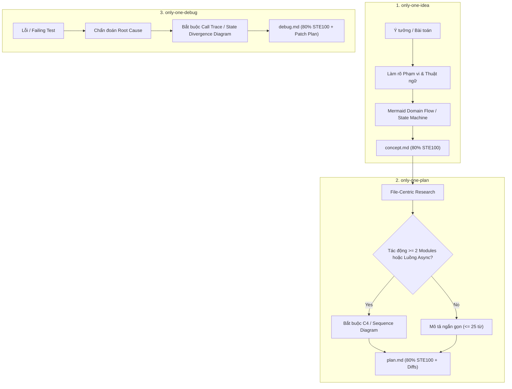

# Concept: Nâng cấp Chuẩn ASD-STE100 lên 80% và Chuẩn hóa Trực quan hóa Diagram cho Workflows

## 1. Problem & Goal (Vấn đề & Mục tiêu)

### Problem (Vấn đề & Điểm nghẽn Hiện tại)
- **Bối cảnh & Điểm kích hoạt**: Quy trình làm việc của Agent qua các workflow `only-one-idea`, `only-one-plan`, `only-one-debug` tạo ra các tài liệu đặc tả và chẩn đoán kỹ thuật.
- **Hiện tượng & Khiếm khuyết kỹ thuật**: Mật độ chữ dày đặc gây suy giảm khả năng đọc nhanh (cognitive load). Chuẩn ASD-STE100 hiện tại ở mức 70% vẫn để lọt các câu mô tả dài và cấu trúc bị động.
- **Nguyên nhân cốt lõi (Root Cause)**: Thiếu quy tắc hard-gate bắt buộc chuyển đổi cơ chế phức tạp thành trực quan hóa (Diagram/Flow), và các ràng buộc độ dài câu chưa đủ nghiêm ngặt để loại bỏ văn phong rườm rà.
- **Tác động (Impact / Blast Radius)**: Người đánh giá (PM/Tech Lead) tốn nhiều thời gian đọc hiểu tài liệu; Agent có xu hướng drifting khi sinh văn bản tự do thay vì mô hình hóa có cấu trúc.

### Goal (Mục tiêu Kỹ thuật Cần đạt)
- **Mục tiêu cốt lõi**: Nâng cấp tiêu chuẩn văn phong kỹ thuật lên 80% ASD-STE100 và thiết lập cơ chế bắt buộc dùng sơ đồ trực quan (Mermaid/ASCII) qua skill `c4-diagrams` cho cả 3 workflow chính.
- **Tiêu chí nghiệm thu (Acceptance Criteria)**:
  - Cập nhật định nghĩa và trần độ dài câu của chuẩn ASD-STE100 lên 80%: câu chỉ dẫn $\le$ 20 từ, câu mô tả $\le$ 25 từ, cấm triệt để thể bị động.
  - Bổ sung skill `c4-diagrams` vào Skills Catalog và kích hoạt bắt buộc tại các điểm nghẽn nhận thức trong `only-one-idea`, `only-one-plan`, và `only-one-debug`.
  - Thiết lập ngưỡng điều kiện (Threshold Rule): Bắt buộc vẽ sơ đồ trực quan khi tương tác $\ge 2$ modules, luồng dữ liệu bất đồng bộ, hoặc chẩn đoán luồng lỗi phân kỳ.
  - Đồng bộ nhất quán giữa định nghĩa skill và quy trình thực thi tại cả thư mục `assets/` và `.agents/`.

## 2. Scope Boundaries (Ranh giới Phạm vi)
- **In-Scope**:
  - Đặc tả nâng cấp chuẩn 80% ASD-STE100 trong skill `karpathy-ste100-discipline`.
  - Tích hợp chuẩn sơ đồ `c4-diagrams` vào quy trình `only-one-idea.md` (Domain Flow & High-level Architecture).
  - Nâng cấp yêu cầu sơ đồ trong `only-one-plan.md` thành bắt buộc (C4 Component & Sequence Diagram khi $\ge 2$ modules).
  - Tích hợp sơ đồ chẩn đoán vào `only-one-debug.md` (Call Trace & State Divergence Flow).
  - Định nghĩa cơ chế ngưỡng kích hoạt để tránh áp dụng sơ đồ máy móc cho các thay đổi đơn giản/đơn lẻ.
- **Explicit Out-of-Scope**:
  - Không tạo thêm skill diagram độc lập mới (tái sử dụng triệt để `c4-diagrams` hiện có).
  - Không sửa đổi mã nguồn hoặc kịch bản thực thi CLI ngoài các tài liệu workflow và skill liên quan.
  - Không viết code triển khai hoặc can thiệp các workflow khác ngoài bộ ba `idea`, `plan`, `debug`.

## 3. Proposed Solution & Core Mechanism (Giải pháp Đề xuất & Cơ chế)

### Core Mechanism (Cơ chế Cốt lõi)
- **80% ASD-STE100 Constraint Engine**:
  - Quy định giới hạn từ chặt hơn: Hướng dẫn/Hành động $\le$ 20 từ (trước đây 25 từ); Mô tả/Bối cảnh $\le$ 25 từ (trước đây 30 từ).
  - Controlled Vocabulary & Passive Voice Ban: Loại bỏ hoàn toàn câu bị động; chuẩn hóa danh mục Controlled Verbs mang tính cơ học rõ ràng.
- **Native Visual Standard (`c4-diagrams`)**:
  - Sử dụng chung skill `c4-diagrams` làm tiêu chuẩn trực quan hóa duy nhất cho toàn bộ chu kỳ SDLC.
  - `only-one-idea`: Bổ sung sơ đồ Mermaid/ASCII cho Domain Flow, State Machine hoặc System Context tại Section 3 thay vì đoạn văn xuôi dài.
  - `only-one-plan`: Bắt buộc cung cấp C4 Component Diagram hoặc Sequence Diagram tại Section 2 nếu thay đổi tác động $\ge 2$ modules hoặc có luồng xử lý bất đồng bộ.
  - `only-one-debug`: Bắt buộc trực quan hóa luồng lỗi (Defect Call Trace / State Divergence Flow) tại Section 1 (Diagnosis) để chứng minh Root Cause cơ học trực quan.
- **Heuristic Threshold Policy**:
  - Nếu thay đổi chỉ là 1 tệp độc lập hoặc chỉnh sửa cấu hình $\le 5$ dòng, cho phép bỏ qua sơ đồ chi tiết và dùng giải thích ngắn ngọn $\le 2$ câu để tránh lãng phí context.

### Conceptual Flow / Domain Model (Luồng Khái niệm)

## 4. Critical Risks & Edge Cases (Rủi ro & Kịch bản Biên)
- **Token Inflation Risk**: Sơ đồ Mermaid quá phức tạp có thể làm cạn kiệt context window của Agent.
  - *Mitigation*: Giới hạn cấp độ sơ đồ theo đúng chỉ dẫn của `c4-diagrams` (ưu tiên `flowchart` và `sequenceDiagram` tối giản, không vẽ chi tiết cấp code không cần thiết).
- **Over-Diagramming Friction**: Ép buộc vẽ sơ đồ ngay cả cho các bản vá 1 dòng có thể gây chậm trễ quy trình.
  - *Mitigation*: Áp dụng quy tắc Threshold (chỉ bắt buộc khi $\ge 2$ modules hoặc luồng async).
- **Agent Compliance Drift**: Agent có thể quên áp dụng mức 80% STE100 và sinh văn phong tự do.
  - *Mitigation*: Đưa quy định 80% ASD-STE100 thành chốt chặn bắt buộc tại Guardrails của từng workflow.
