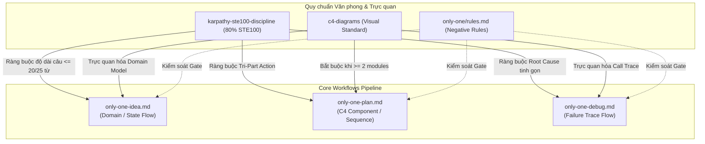

# Plan: Nâng cấp Chuẩn ASD-STE100 lên 80% và Tích hợp Bắt buộc Sơ đồ Trực quan c4-diagrams

## Section 1. Directory Structure Changes (Cấu trúc Thư mục & Tệp Thay đổi)

Sơ đồ cây ASCII thể hiện các tệp quy chuẩn kỹ năng, luật cốt lõi và workflows cần nâng cấp:

```text
only-one-cli/
├── assets/
│   ├── skills/
│   │   ├── index.ts                                        # [MODIFY] Bump version & description 80% STE100
│   │   └── karpathy-ste100-discipline/
│   │       └── SKILL.md                                    # [MODIFY] Nâng cấp trần từ (20/25 từ), cấm thể bị động
│   ├── rules/
│   │   ├── index.ts                                        # [MODIFY] Bump version rule karpathy-ste100-discipline
│   │   └── 04-karpathy-ste100-discipline.md                # [MODIFY] Nâng cấp quy chuẩn 80% ASD-STE100
│   └── workflows/
│       ├── index.ts                                        # [MODIFY] Bump versions, bổ sung c4-diagrams vào requiredSkills
│       ├── only-one-idea.md                                # [MODIFY] Tích hợp c4-diagrams, 80% STE100, sơ đồ Domain/Flow
│       ├── only-one-plan.md                                # [MODIFY] 80% STE100, bắt buộc C4 & Sequence khi >= 2 modules
│       └── only-one-debug.md                               # [MODIFY] Tích hợp c4-diagrams, 80% STE100, sơ đồ Failure Trace
├── .agents/
│   ├── skills/
│   │   └── karpathy-ste100-discipline/
│   │       └── SKILL.md                                    # [MODIFY] Đồng bộ với assets/skills/
│   └── workflows/
│       ├── only-one-idea.md                                # [MODIFY] Đồng bộ với assets/workflows/
│       ├── only-one-plan.md                                # [MODIFY] Đồng bộ với assets/workflows/
│       └── only-one-debug.md                               # [MODIFY] Đồng bộ với assets/workflows/
└── only-one/
    └── rules.md                                            # [MODIFY] Cập nhật Rule 34 (80% STE100) & luật Diagram
```

---

## Section 2. File Changes

### Kiến trúc Tương tác Đa Module (Multi-Module Interaction Diagram)



---

### 1. `[MODIFY]` `assets/skills/karpathy-ste100-discipline/SKILL.md`

- **Status**: `[x]`
- **Context**: Định nghĩa kỹ năng hiện tại áp dụng chuẩn 70% ASD-STE100 với giới hạn câu 25/30 từ.
- **Target Symbols / AST Seams**: Markdown Content (Overview, Section 2 Word Limits, Constraints).
- **Invariants**: Giữ nguyên 4 Golden Disciplines của Andrej Karpathy và cấu trúc Tri-Part Action.
- **Depends On**: None.
- **Fast Test Command**: `npx vitest run test/core/skill-registry.test.ts`.

> **Action**: Nâng cấp trần từ (chỉ dẫn <= 20 từ, mô tả <= 25 từ) và cấm triệt để thể bị động.

**Ponytail checklist**
- [ ] Required by acceptance criteria.
- [ ] Existing implementation searched; stdlib, platform/framework, and installed dependencies considered.
- [ ] No duplicate logic or speculative extension point.
- [ ] Minimum diff preserves correctness and safety.
- **Decision**: Chỉnh sửa trực tiếp file kỹ năng chuẩn để làm kim chỉ nam văn phong.
- **Rejected alternative**: Tạo thêm skill mới gây phân mảnh hệ thống quy chuẩn.

```diff
--- a/assets/skills/karpathy-ste100-discipline/SKILL.md
+++ b/assets/skills/karpathy-ste100-discipline/SKILL.md
@@ -3,3 +3,3 @@
-description: Enforce Andrej Karpathy's 4 Core Disciplines and 70% ASD-STE100 Aviation Technical Writing Specification for zero-slop Markdown documentation.
+description: Enforce Andrej Karpathy's 4 Core Disciplines and 80% ASD-STE100 Aviation Technical Writing Specification for zero-slop Markdown documentation.
 ---
 
-# Karpathy Disciplines & 70% ASD-STE100 Writing Specification
+# Karpathy Disciplines & 80% ASD-STE100 Writing Specification
@@ -12,3 +12,3 @@
-2. **70% ASD-STE100 Aviation Writing Specification**: Eliminate "AI Slop", enforce sentence length gates, and structure procedural actions into verifiable 3-part blocks.
+2. **80% ASD-STE100 Aviation Writing Specification**: Eliminate "AI Slop", enforce strict sentence length gates, prohibit passive voice, and structure procedural actions into verifiable 3-part blocks.
 
 ---
@@ -27,3 +27,3 @@
-## 2. 70% ASD-STE100 Aviation Writing Specification
+## 2. 80% ASD-STE100 Aviation Writing Specification
 
-ASD-STE100 (Simplified Technical English) originated in aerospace maintenance manuals to prevent ambiguity and human error. In this system, a relaxed 70% specification is enforced for high-density, bilingual Markdown documentation.
+ASD-STE100 (Simplified Technical English) originated in aerospace maintenance manuals to prevent ambiguity and human error. In this system, an 80% specification is enforced for high-density, bilingual Markdown documentation.
 
 ### A. Sentence Word Limits
-- **Procedural / Instruction Sentences**: Maximum **25 words**.
-- **Descriptive / Context Sentences**: Maximum **30 words**.
+- **Procedural / Instruction Sentences**: Maximum **20 words**.
+- **Descriptive / Context Sentences**: Maximum **25 words**.
 - Do not write complex multi-clause compound sentences. Break complex thoughts into structured bullet points.
+
+### B. Strict Active Voice Invariant
+- Strictly prohibit passive voice in all procedural instructions and technical narratives.
+- Always use active voice with clear subjects and direct action verbs.
```

---

### 2. `[MODIFY]` `.agents/skills/karpathy-ste100-discipline/SKILL.md`

- **Status**: `[x]`
- **Context**: Bản sao local của skill tại `.agents/skills/`.
- **Target Symbols / AST Seams**: Toàn bộ file nội dung.
- **Invariants**: Phải giống 100% với `assets/skills/karpathy-ste100-discipline/SKILL.md`.
- **Depends On**: Task 1.
- **Fast Test Command**: `npx vitest run test/core/skill-registry.test.ts`.

> **Action**: Đồng bộ nội dung nâng cấp 80% ASD-STE100 từ assets vào `.agents`.

**Ponytail checklist**
- [ ] Required by acceptance criteria.
- [ ] Existing implementation searched; stdlib, platform/framework, and installed dependencies considered.
- [ ] No duplicate logic or speculative extension point.
- [ ] Minimum diff preserves correctness and safety.
- **Decision**: Đồng bộ bản sao local để đảm bảo Agent runtime áp dụng ngay lập tức.
- **Rejected alternative**: Để lệch phiên bản giữa assets và runtime workspace.

```diff
--- a/.agents/skills/karpathy-ste100-discipline/SKILL.md
+++ b/.agents/skills/karpathy-ste100-discipline/SKILL.md
@@ -3,3 +3,3 @@
-description: Enforce Andrej Karpathy's 4 Core Disciplines and 70% ASD-STE100 Aviation Technical Writing Specification for zero-slop Markdown documentation.
+description: Enforce Andrej Karpathy's 4 Core Disciplines and 80% ASD-STE100 Aviation Technical Writing Specification for zero-slop Markdown documentation.
 ---
 
-# Karpathy Disciplines & 70% ASD-STE100 Writing Specification
+# Karpathy Disciplines & 80% ASD-STE100 Writing Specification
@@ -12,3 +12,3 @@
-2. **70% ASD-STE100 Aviation Writing Specification**: Eliminate "AI Slop", enforce sentence length gates, and structure procedural actions into verifiable 3-part blocks.
+2. **80% ASD-STE100 Aviation Writing Specification**: Eliminate "AI Slop", enforce strict sentence length gates, prohibit passive voice, and structure procedural actions into verifiable 3-part blocks.
 
 ---
@@ -27,3 +27,3 @@
-## 2. 70% ASD-STE100 Aviation Writing Specification
+## 2. 80% ASD-STE100 Aviation Writing Specification
 
-ASD-STE100 (Simplified Technical English) originated in aerospace maintenance manuals to prevent ambiguity and human error. In this system, a relaxed 70% specification is enforced for high-density, bilingual Markdown documentation.
+ASD-STE100 (Simplified Technical English) originated in aerospace maintenance manuals to prevent ambiguity and human error. In this system, an 80% specification is enforced for high-density, bilingual Markdown documentation.
 
 ### A. Sentence Word Limits
-- **Procedural / Instruction Sentences**: Maximum **25 words**.
-- **Descriptive / Context Sentences**: Maximum **30 words**.
+- **Procedural / Instruction Sentences**: Maximum **20 words**.
+- **Descriptive / Context Sentences**: Maximum **25 words**.
 - Do not write complex multi-clause compound sentences. Break complex thoughts into structured bullet points.
+
+### B. Strict Active Voice Invariant
+- Strictly prohibit passive voice in all procedural instructions and technical narratives.
+- Always use active voice with clear subjects and direct action verbs.
```

---

### 3. `[MODIFY]` `assets/rules/04-karpathy-ste100-discipline.md`

- **Status**: `[x]`
- **Context**: File template rule 04 áp dụng cho các IDE targets.
- **Target Symbols / AST Seams**: Section 2 text.
- **Invariants**: Thống nhất câu chữ với skill `karpathy-ste100-discipline`.
- **Depends On**: Task 1.
- **Fast Test Command**: `npx vitest run test/core/rule-adapters.test.ts`.

> **Action**: Nâng cấp rule template lên chuẩn 80% ASD-STE100.

**Ponytail checklist**
- [ ] Required by acceptance criteria.
- [ ] Existing implementation searched; stdlib, platform/framework, and installed dependencies considered.
- [ ] No duplicate logic or speculative extension point.
- [ ] Minimum diff preserves correctness and safety.
- **Decision**: Điều chỉnh trực tiếp file template rule 04.
- **Rejected alternative**: Không cập nhật rule dẫn đến không đồng bộ với skill.

```diff
--- a/assets/rules/04-karpathy-ste100-discipline.md
+++ b/assets/rules/04-karpathy-ste100-discipline.md
@@ -5,1 +5,1 @@
-# RULE 4: KARPATHY DISCIPLINES & 70% ASD-STE100 WRITING SPECIFICATION
+# RULE 4: KARPATHY DISCIPLINES & 80% ASD-STE100 WRITING SPECIFICATION
@@ -30,3 +30,3 @@
-## 2. 70% ASD-STE100 Aviation Technical Writing Specification
+## 2. 80% ASD-STE100 Aviation Technical Writing Specification
 
 Enforce controlled technical language adapted from aerospace maintenance manuals to prevent AI slop and ambiguity:
 
 1. **Sentence Length Limits**:
-   - **Instruction Sentences**: Maximum 25 words.
-   - **Description / Context Sentences**: Maximum 30 words.
+   - **Instruction Sentences**: Maximum 20 words.
+   - **Description / Context Sentences**: Maximum 25 words.
    - Avoid compound multi-clause sentences; break complex logic into bullet points.
+   - Prohibit passive voice; enforce direct active voice.
```

---

### 4. `[MODIFY]` `assets/skills/index.ts`

- **Status**: `[x]`
- **Context**: Manifest khai báo SKILLS và phiên bản decimal.
- **Target Symbols / AST Seams**: `karpathy-ste100-discipline` entry trong mảng `SKILLS`.
- **Invariants**: Decimal version formatting tuân thủ `verifyAllAssetsHaveValidVersions`.
- **Depends On**: Task 1.
- **Fast Test Command**: `npx vitest run test/core/assets/version-gate.test.ts`.

> **Action**: Bump version từ 0.0.1 lên 0.0.2 và cập nhật description sang 80% ASD-STE100.

**Ponytail checklist**
- [ ] Required by acceptance criteria.
- [ ] Existing implementation searched; stdlib, platform/framework, and installed dependencies considered.
- [ ] No duplicate logic or speculative extension point.
- [ ] Minimum diff preserves correctness and safety.
- **Decision**: Cập nhật manifest để bảo toàn Asset Version Gate.
- **Rejected alternative**: Bỏ qua version bump khiến CI gate thất bại.

```diff
--- a/assets/skills/index.ts
+++ b/assets/skills/index.ts
@@ -237,4 +237,4 @@ export const SKILLS: SkillManifest[] = [
         name: 'karpathy-ste100-discipline',
-        version: '0.0.1',
+        version: '0.0.2',
         description:
-            "Enforce Andrej Karpathy's 4 Core Disciplines and 70% ASD-STE100 Aviation Technical Writing Specification for zero-slop Markdown.",
+            "Enforce Andrej Karpathy's 4 Core Disciplines and 80% ASD-STE100 Aviation Technical Writing Specification for zero-slop Markdown.",
         sourceType: 'local',
```

---

### 5. `[MODIFY]` `assets/rules/index.ts`

- **Status**: `[x]`
- **Context**: Manifest khai báo RULES.
- **Target Symbols / AST Seams**: `karpathy-ste100-discipline` rule entry.
- **Invariants**: Decimal versioning chuẩn.
- **Depends On**: Task 3.
- **Fast Test Command**: `npx vitest run test/core/assets/version-gate.test.ts`.

> **Action**: Bump version rule lên 0.0.2 và cập nhật mô tả 80% ASD-STE100.

**Ponytail checklist**
- [ ] Required by acceptance criteria.
- [ ] Existing implementation searched; stdlib, platform/framework, and installed dependencies considered.
- [ ] No duplicate logic or speculative extension point.
- [ ] Minimum diff preserves correctness and safety.
- **Decision**: Bump version đúng quy tắc repository.
- **Rejected alternative**: Giữ version cũ.

```diff
--- a/assets/rules/index.ts
+++ b/assets/rules/index.ts
@@ -37,3 +37,3 @@ export const RULES: RuleManifest[] = [
         id: 'karpathy-ste100-discipline',
-        version: '0.0.1',
-        description: "Andrej Karpathy's 4 Core Disciplines and 70% ASD-STE100 Aviation Technical Writing Specification",
+        version: '0.0.2',
+        description: "Andrej Karpathy's 4 Core Disciplines and 80% ASD-STE100 Aviation Technical Writing Specification",
         sourceFile: '04-karpathy-ste100-discipline.md',
```

---

### 6. `[MODIFY]` `assets/workflows/index.ts`

- **Status**: `[x]`
- **Context**: Manifest đăng ký WORKFLOWS và `requiredSkills`.
- **Target Symbols / AST Seams**: `only-one-idea`, `only-one-plan`, `only-one-debug` entries.
- **Invariants**: Đồng bộ 100% giữa manifest `requiredSkills` và bảng `Skills Catalog` trong file markdown.
- **Depends On**: None.
- **Fast Test Command**: `npx vitest run test/core/workflow-registry.test.ts`.

> **Action**: Thêm `c4-diagrams` vào `only-one-idea` và `only-one-debug`, bump version cả 3 workflow.

**Ponytail checklist**
- [ ] Required by acceptance criteria.
- [ ] Existing implementation searched; stdlib, platform/framework, and installed dependencies considered.
- [ ] No duplicate logic or speculative extension point.
- [ ] Minimum diff preserves correctness and safety.
- **Decision**: Tích hợp trực tiếp `c4-diagrams` vào mảng `requiredSkills`.
- **Rejected alternative**: Tách thêm skill trung gian không cần thiết.

```diff
--- a/assets/workflows/index.ts
+++ b/assets/workflows/index.ts
@@ -18,3 +18,3 @@ export const WORKFLOWS: WorkflowManifest[] = [
         name: 'only-one-idea',
-        version: '0.0.8',
+        version: '0.0.9',
         description:
@@ -30,2 +30,3 @@ export const WORKFLOWS: WorkflowManifest[] = [
             'wait-what',
+            'c4-diagrams',
             'ponytail',
@@ -36,3 +37,3 @@ export const WORKFLOWS: WorkflowManifest[] = [
         name: 'only-one-plan',
-        version: '0.0.11',
+        version: '0.0.12',
         description:
@@ -71,3 +72,3 @@ export const WORKFLOWS: WorkflowManifest[] = [
         name: 'only-one-debug',
-        version: '0.0.9',
+        version: '0.0.10',
         description:
@@ -79,2 +80,3 @@ export const WORKFLOWS: WorkflowManifest[] = [
             'code-simplification',
+            'c4-diagrams',
             'ponytail',
```

---

### 7. `[MODIFY]` `assets/workflows/only-one-idea.md`

- **Status**: `[x]`
- **Context**: Workflow đặc tả ý tưởng và sinh `concept.md`.
- **Target Symbols / AST Seams**: Role model, Skills Catalog, Step 2, Step 3, Guardrails.
- **Invariants**: Giữ nguyên quy tắc One-Question-At-A-Time và không sửa code sản phẩm.
- **Depends On**: Task 6.
- **Fast Test Command**: `npx vitest run test/core/workflow-registry.test.ts`.

> **Action**: Cập nhật 80% STE100, bổ sung `c4-diagrams`, bắt buộc sơ đồ Mermaid/ASCII cho Domain Flow / Architecture.

**Ponytail checklist**
- [ ] Required by acceptance criteria.
- [ ] Existing implementation searched; stdlib, platform/framework, and installed dependencies considered.
- [ ] No duplicate logic or speculative extension point.
- [ ] Minimum diff preserves correctness and safety.
- **Decision**: Đưa sơ đồ trực quan thành tiêu chuẩn tại Section 3 của `concept.md`.
- **Rejected alternative**: Giữ mô tả văn xuôi thuần túy.

```diff
--- a/assets/workflows/only-one-idea.md
+++ b/assets/workflows/only-one-idea.md
@@ -24,3 +24,3 @@
-- Activate and follow `karpathy-ste100-discipline` for zero-slop 70% ASD-STE100 specification writing.
+- Activate and follow `karpathy-ste100-discipline` for zero-slop 80% ASD-STE100 specification writing.
 - Before the first user-visible response, read and activate `i-have-adhd`; keep it active throughout this workflow.
@@ -51,4 +51,5 @@
 | **`wait-what`** | Agent explanation is unclear or drifting | Stop immediately and re-pitch the explanation in plain, concise English using domain vocabulary. |
+| **`c4-diagrams`** | Visualizing domain models, state machines, or system boundaries | Produce clean Mermaid or ASCII diagrams to replace verbose narrative explanations. |
 | **`ponytail`** | After Phase 1 problem clarity | Remove unnecessary scope without shortening discovery or introducing code-level design. |
-| **`karpathy-ste100-discipline`** | Writing concept.md specification | Enforce 70% ASD-STE100 concise prose (instructions <= 25 words, descriptions <= 30 words) and Karpathy disciplines. |
+| **`karpathy-ste100-discipline`** | Writing concept.md specification | Enforce 80% ASD-STE100 concise prose (instructions <= 20 words, descriptions <= 25 words, no passive voice) and Karpathy disciplines. |
 
@@ -80,4 +81,4 @@
 4. **Analyze Edge Cases & Core Domain Flow**:
-   - Describe business/domain flow and state transitions conceptually.
-   - Key failure modes, concurrency, timeouts, and rollback/fallback strategies.
+   - Produce a **Mermaid / ASCII Domain Flow or State Machine Diagram** (`c4-diagrams`) to visualize interactions and state transitions. Do not rely on verbose text.
+   - Document key failure modes, concurrency, timeouts, and rollback/fallback strategies in concise bullet points.
@@ -118,3 +119,3 @@
 - **Core Mechanism**: <Conceptual solution and operating model; no source code, pseudocode, symbol signatures, file paths, or file-level implementation instructions>.
-- **Conceptual Flow / Domain Model**: <Business/domain flow and state transitions conceptually; no code-level implementation details>.
+- **Conceptual Flow / Domain Model**: <Bắt buộc sơ đồ Mermaid hoặc ASCII biểu diễn luồng dữ liệu, trạng thái hoặc tương tác hệ thống qua c4-diagrams; không dùng văn xuôi dài>.
 - *(Tùy chọn)* **UI Wireframe**: <ASCII wireframe nếu tính năng có giao diện>.
@@ -141,3 +142,4 @@
 - **Enforce Bilingual Hybrid Documentation**: Write narrative and descriptions in Vietnamese, preserving standard English technical terms.
-- **Enforce 70% ASD-STE100 Writing Standard**: Eliminate AI slop, restrict sentence length, and structure actions using Prerequisites -> Action -> Verification.
+- **Enforce 80% ASD-STE100 Writing Standard**: Eliminate AI slop, restrict sentence length (instructions <= 20 words, descriptions <= 25 words), ban passive voice, and structure actions using Prerequisites -> Action -> Verification.
+- **Enforce Visual-First Domain Modeling**: Mandatory Mermaid/ASCII diagram in Section 3 for multi-step flows; never replace diagrams with monolithic narrative blocks.
 - **Do not skip Phase 1 discovery**: Clarify problem and scope boundaries thoroughly before proposing solution options.
```

---

### 8. `[MODIFY]` `.agents/workflows/only-one-idea.md`

- **Status**: `[x]`
- **Context**: Bản sao runtime của `only-one-idea.md` trong `.agents/workflows/`.
- **Target Symbols / AST Seams**: Toàn bộ file nội dung.
- **Invariants**: Phải đồng bộ 100% với `assets/workflows/only-one-idea.md`.
- **Depends On**: Task 7.
- **Fast Test Command**: `npx vitest run test/core/workflow-registry.test.ts`.

> **Action**: Đồng bộ nội dung nâng cấp `only-one-idea.md` sang `.agents/workflows/`.

**Ponytail checklist**
- [ ] Required by acceptance criteria.
- [ ] Existing implementation searched; stdlib, platform/framework, and installed dependencies considered.
- [ ] No duplicate logic or speculative extension point.
- [ ] Minimum diff preserves correctness and safety.
- **Decision**: Đồng bộ bản sao workspace.
- **Rejected alternative**: Bỏ qua bản sao workspace.

```diff
--- a/.agents/workflows/only-one-idea.md
+++ b/.agents/workflows/only-one-idea.md
@@ -24,3 +24,3 @@
-- Activate and follow `karpathy-ste100-discipline` for zero-slop 70% ASD-STE100 specification writing.
+- Activate and follow `karpathy-ste100-discipline` for zero-slop 80% ASD-STE100 specification writing.
 - Before the first user-visible response, read and activate `i-have-adhd`; keep it active throughout this workflow.
@@ -51,4 +51,5 @@
 | **`wait-what`** | Agent explanation is unclear or drifting | Stop immediately and re-pitch the explanation in plain, concise English using domain vocabulary. |
+| **`c4-diagrams`** | Visualizing domain models, state machines, or system boundaries | Produce clean Mermaid or ASCII diagrams to replace verbose narrative explanations. |
 | **`ponytail`** | After Phase 1 problem clarity | Remove unnecessary scope without shortening discovery or introducing code-level design. |
-| **`karpathy-ste100-discipline`** | Writing concept.md specification | Enforce 70% ASD-STE100 concise prose (instructions <= 25 words, descriptions <= 30 words) and Karpathy disciplines. |
+| **`karpathy-ste100-discipline`** | Writing concept.md specification | Enforce 80% ASD-STE100 concise prose (instructions <= 20 words, descriptions <= 25 words, no passive voice) and Karpathy disciplines. |
 
@@ -80,4 +81,4 @@
 4. **Analyze Edge Cases & Core Domain Flow**:
-   - Describe business/domain flow and state transitions conceptually.
-   - Key failure modes, concurrency, timeouts, and rollback/fallback strategies.
+   - Produce a **Mermaid / ASCII Domain Flow or State Machine Diagram** (`c4-diagrams`) to visualize interactions and state transitions. Do not rely on verbose text.
+   - Document key failure modes, concurrency, timeouts, and rollback/fallback strategies in concise bullet points.
@@ -118,3 +119,3 @@
 - **Core Mechanism**: <Conceptual solution and operating model; no source code, pseudocode, symbol signatures, file paths, or file-level implementation instructions>.
-- **Conceptual Flow / Domain Model**: <Business/domain flow and state transitions conceptually; no code-level implementation details>.
+- **Conceptual Flow / Domain Model**: <Bắt buộc sơ đồ Mermaid hoặc ASCII biểu diễn luồng dữ liệu, trạng thái hoặc tương tác hệ thống qua c4-diagrams; không dùng văn xuôi dài>.
 - *(Tùy chọn)* **UI Wireframe**: <ASCII wireframe nếu tính năng có giao diện>.
@@ -141,3 +142,4 @@
 - **Enforce Bilingual Hybrid Documentation**: Write narrative and descriptions in Vietnamese, preserving standard English technical terms.
-- **Enforce 70% ASD-STE100 Writing Standard**: Eliminate AI slop, restrict sentence length, and structure actions using Prerequisites -> Action -> Verification.
+- **Enforce 80% ASD-STE100 Writing Standard**: Eliminate AI slop, restrict sentence length (instructions <= 20 words, descriptions <= 25 words), ban passive voice, and structure actions using Prerequisites -> Action -> Verification.
+- **Enforce Visual-First Domain Modeling**: Mandatory Mermaid/ASCII diagram in Section 3 for multi-step flows; never replace diagrams with monolithic narrative blocks.
 - **Do not skip Phase 1 discovery**: Clarify problem and scope boundaries thoroughly before proposing solution options.
```

---

### 9. `[MODIFY]` `assets/workflows/only-one-plan.md`

- **Status**: `[x]`
- **Context**: Workflow nghiên cứu code và thiết lập `plan.md`.
- **Target Symbols / AST Seams**: Skills Catalog, Section 2 rules, Guardrails.
- **Invariants**: Giữ nguyên định dạng machine-readable file task blocks và Unified Diffs.
- **Depends On**: Task 6.
- **Fast Test Command**: `npx vitest run test/core/workflow-registry.test.ts`.

> **Action**: Nâng cấp 80% STE100, quy định ngưỡng bắt buộc vẽ C4 Component hoặc Sequence diagram khi tác động $\ge 2$ modules.

**Ponytail checklist**
- [ ] Required by acceptance criteria.
- [ ] Existing implementation searched; stdlib, platform/framework, and installed dependencies considered.
- [ ] No duplicate logic or speculative extension point.
- [ ] Minimum diff preserves correctness and safety.
- **Decision**: Nâng cấp `c4-diagrams` từ tùy chọn thành bắt buộc có ngưỡng.
- **Rejected alternative**: Bắt buộc vẽ sơ đồ cả cho thay đổi 1 dòng (vi phạm nguyên tắc simplicity).

```diff
--- a/assets/workflows/only-one-plan.md
+++ b/assets/workflows/only-one-plan.md
@@ -96,4 +96,4 @@
-| **`c4-diagrams`** | Section 2 file changes involve multiple components, modules, or complex data flows | Produce clean Mermaid or ASCII C4 / Sequence diagrams inside Section 2 task blocks. |
+| **`c4-diagrams`** | Multi-module file changes (>= 2 modules), complex call chains, or async workflows | Produce mandatory Mermaid or ASCII C4 Component or Sequence diagrams at the top of Section 2. |
 | **`frontend-ui-engineering`** | Building or modifying user-facing frontend components | Design component architecture, state management, 5-state matrix, and accessibility in Section 2 task blocks. |
 | **`source-driven-development`** | Introducing new library APIs or framework methods | Ground all code signatures in verified official documentation in Section 2 to prevent API hallucination. |
-| **`karpathy-ste100-discipline`** | Writing Section 2 task blocks and diff boundaries | Enforce surgical changes, simplicity first, and 70% ASD-STE100 tri-part action verification. |
+| **`karpathy-ste100-discipline`** | Writing Section 2 task blocks and diff boundaries | Enforce surgical changes, simplicity first, and 80% ASD-STE100 tri-part action verification (<= 20 words for instructions, <= 25 words for context, active voice). |
@@ -143,2 +143,5 @@
+### Architectural Interaction Diagram (Bắt buộc khi có >= 2 modules hoặc luồng async)
+Khi kế hoạch thay đổi tác động $\ge 2$ modules hoặc có luồng bất đồng bộ, cung cấp sơ đồ Mermaid hoặc ASCII C4/Sequence diagram trực quan hóa luồng gọi và ranh giới trước danh sách task blocks.
+
 Mỗi file là một machine-readable task block. Giữ nguyên heading và thứ tự metadata dưới đây:
@@ -199,2 +202,3 @@
-- **Enforce 70% ASD-STE100 & Karpathy Surgical Discipline**: Restrict task block instructions to <= 25 words, eliminate prose filler, and ensure strict surgical code changes.
+- **Enforce 80% ASD-STE100 & Karpathy Surgical Discipline**: Restrict task block instructions to <= 20 words, context to <= 25 words, prohibit passive voice, eliminate prose filler, and ensure strict surgical code changes.
+- **Enforce Mandatory Multi-Module Visual Diagrams**: When changes touch >= 2 modules or async pipelines, provide a Mermaid/ASCII interaction diagram at the top of Section 2 before file blocks.
 - **🛑 Anti-Current-State-Duplication**: Never recreate Current State or high-level solution narratives in `plan.md`; `concept.md` is their authoritative Single Source of Truth when present.
```

---

### 10. `[MODIFY]` `.agents/workflows/only-one-plan.md`

- **Status**: `[x]`
- **Context**: Bản sao runtime của `only-one-plan.md` trong `.agents/workflows/`.
- **Target Symbols / AST Seams**: Toàn bộ file nội dung.
- **Invariants**: Phải đồng bộ 100% với `assets/workflows/only-one-plan.md`.
- **Depends On**: Task 9.
- **Fast Test Command**: `npx vitest run test/core/workflow-registry.test.ts`.

> **Action**: Đồng bộ nội dung nâng cấp `only-one-plan.md` sang `.agents/workflows/`.

**Ponytail checklist**
- [ ] Required by acceptance criteria.
- [ ] Existing implementation searched; stdlib, platform/framework, and installed dependencies considered.
- [ ] No duplicate logic or speculative extension point.
- [ ] Minimum diff preserves correctness and safety.
- **Decision**: Đồng bộ bản sao workspace.
- **Rejected alternative**: Bỏ qua bản sao workspace.

```diff
--- a/.agents/workflows/only-one-plan.md
+++ b/.agents/workflows/only-one-plan.md
@@ -96,4 +96,4 @@
-| **`c4-diagrams`** | Section 2 file changes involve multiple components, modules, or complex data flows | Produce clean Mermaid or ASCII C4 / Sequence diagrams inside Section 2 task blocks. |
+| **`c4-diagrams`** | Multi-module file changes (>= 2 modules), complex call chains, or async workflows | Produce mandatory Mermaid or ASCII C4 Component or Sequence diagrams at the top of Section 2. |
 | **`frontend-ui-engineering`** | Building or modifying user-facing frontend components | Design component architecture, state management, 5-state matrix, and accessibility in Section 2 task blocks. |
 | **`source-driven-development`** | Introducing new library APIs or framework methods | Ground all code signatures in verified official documentation in Section 2 to prevent API hallucination. |
-| **`karpathy-ste100-discipline`** | Writing Section 2 task blocks and diff boundaries | Enforce surgical changes, simplicity first, and 70% ASD-STE100 tri-part action verification. |
+| **`karpathy-ste100-discipline`** | Writing Section 2 task blocks and diff boundaries | Enforce surgical changes, simplicity first, and 80% ASD-STE100 tri-part action verification (<= 20 words for instructions, <= 25 words for context, active voice). |
@@ -143,2 +143,5 @@
+### Architectural Interaction Diagram (Bắt buộc khi có >= 2 modules hoặc luồng async)
+Khi kế hoạch thay đổi tác động $\ge 2$ modules hoặc có luồng bất đồng bộ, cung cấp sơ đồ Mermaid hoặc ASCII C4/Sequence diagram trực quan hóa luồng gọi và ranh giới trước danh sách task blocks.
+
 Mỗi file là một machine-readable task block. Giữ nguyên heading và thứ tự metadata dưới đây:
@@ -199,2 +202,3 @@
-- **Enforce 70% ASD-STE100 & Karpathy Surgical Discipline**: Restrict task block instructions to <= 25 words, eliminate prose filler, and ensure strict surgical code changes.
+- **Enforce 80% ASD-STE100 & Karpathy Surgical Discipline**: Restrict task block instructions to <= 20 words, context to <= 25 words, prohibit passive voice, eliminate prose filler, and ensure strict surgical code changes.
+- **Enforce Mandatory Multi-Module Visual Diagrams**: When changes touch >= 2 modules or async pipelines, provide a Mermaid/ASCII interaction diagram at the top of Section 2 before file blocks.
 - **🛑 Anti-Current-State-Duplication**: Never recreate Current State or high-level solution narratives in `plan.md`; `concept.md` is their authoritative Single Source of Truth when present.
```

---

### 11. `[MODIFY]` `assets/workflows/only-one-debug.md`

- **Status**: `[x]`
- **Context**: Workflow điều tra lỗi, xây dựng Red loop và patch blueprint.
- **Target Symbols / AST Seams**: Skills Catalog, Step 3, Section 1 Template, Guardrails.
- **Invariants**: Giữ nguyên định dạng 3 sections (`Diagnosis`, `File Changes`, `Verification`).
- **Depends On**: Task 6.
- **Fast Test Command**: `npx vitest run test/core/workflow-registry.test.ts`.

> **Action**: Nâng cấp 80% STE100, tích hợp `c4-diagrams`, bắt buộc sơ đồ trực quan hóa Failure Call Trace / State Divergence Flow.

**Ponytail checklist**
- [ ] Required by acceptance criteria.
- [ ] Existing implementation searched; stdlib, platform/framework, and installed dependencies considered.
- [ ] No duplicate logic or speculative extension point.
- [ ] Minimum diff preserves correctness and safety.
- **Decision**: Bổ sung sơ đồ trực quan vào khâu Diagnosis để lập tức nhận biết vị trí lỗi.
- **Rejected alternative**: Chỉ dùng text stack trace đơn điệu.

```diff
--- a/assets/workflows/only-one-debug.md
+++ b/assets/workflows/only-one-debug.md
@@ -48,3 +48,4 @@
 | **`ponytail`** | After root cause is proven | Select smallest root-cause fix and record per-file reuse/new-code evidence. |
-| **`karpathy-ste100-discipline`** | Documenting RCA and patch blueprint | Enforce goal-driven verification and 70% ASD-STE100 concise root cause analysis. |
+| **`c4-diagrams`** | Visualizing defect reproduction, broken call traces, or state divergence | Produce Mermaid sequence or state diagrams in Diagnosis to pinpoint broken contracts visually. |
+| **`karpathy-ste100-discipline`** | Documenting RCA and patch blueprint | Enforce goal-driven verification and 80% ASD-STE100 concise root cause analysis (<= 20 words instructions, <= 25 words context, active voice). |
 
@@ -80,2 +81,3 @@
 5. Identify violated invariants and fix constraints.
+6. Create a **Mermaid Failure Trace Diagram** (`sequenceDiagram` or `stateDiagram`) in Section 1 illustrating the exact sequence where actual state diverged from expected contract.
 
@@ -140,2 +142,6 @@
 
+### Defect Call Trace / State Divergence Flow
+```mermaid
+sequenceDiagram
+    Caller->>TargetModule: Invokes method with trigger payload
+    TargetModule--xBrokenBoundary: Contract violated / unexpected failure state
+```
+
@@ -238,3 +244,4 @@
 - **Strict Lifecycle Isolation**: Never modify product source code or execute the patch during `/only-one-debug`.
-- **Enforce 70% ASD-STE100 Writing Specification**: Sentence length <= 25 words, eliminate AI slop, and structure fixes as Prerequisites -> Action -> Verification.
+- **Enforce 80% ASD-STE100 Writing Specification**: Sentence length <= 20 words for instructions, <= 25 words for context, eliminate passive voice, and structure fixes as Prerequisites -> Action -> Verification.
+- **Enforce Mandatory Failure Trace Diagram**: Always include a Mermaid sequence or divergence diagram in Section 1 Diagnosis to prove the broken mechanical boundary visually.
 - **Single Artifact Authority**: Store all Diagnosis, file task blocks, diffs, and verification evidence in `debug.md`.
```

---

### 12. `[MODIFY]` `.agents/workflows/only-one-debug.md`

- **Status**: `[x]`
- **Context**: Bản sao runtime của `only-one-debug.md` trong `.agents/workflows/`.
- **Target Symbols / AST Seams**: Toàn bộ file nội dung.
- **Invariants**: Phải đồng bộ 100% với `assets/workflows/only-one-debug.md`.
- **Depends On**: Task 11.
- **Fast Test Command**: `npx vitest run test/core/workflow-registry.test.ts`.

> **Action**: Đồng bộ nội dung nâng cấp `only-one-debug.md` sang `.agents/workflows/`.

**Ponytail checklist**
- [ ] Required by acceptance criteria.
- [ ] Existing implementation searched; stdlib, platform/framework, and installed dependencies considered.
- [ ] No duplicate logic or speculative extension point.
- [ ] Minimum diff preserves correctness and safety.
- **Decision**: Đồng bộ bản sao workspace.
- **Rejected alternative**: Bỏ qua bản sao workspace.

```diff
--- a/.agents/workflows/only-one-debug.md
+++ b/.agents/workflows/only-one-debug.md
@@ -48,3 +48,4 @@
 | **`ponytail`** | After root cause is proven | Select smallest root-cause fix and record per-file reuse/new-code evidence. |
-| **`karpathy-ste100-discipline`** | Documenting RCA and patch blueprint | Enforce goal-driven verification and 70% ASD-STE100 concise root cause analysis. |
+| **`c4-diagrams`** | Visualizing defect reproduction, broken call traces, or state divergence | Produce Mermaid sequence or state diagrams in Diagnosis to pinpoint broken contracts visually. |
+| **`karpathy-ste100-discipline`** | Documenting RCA and patch blueprint | Enforce goal-driven verification and 80% ASD-STE100 concise root cause analysis (<= 20 words instructions, <= 25 words context, active voice). |
 
@@ -80,2 +81,3 @@
 5. Identify violated invariants and fix constraints.
+6. Create a **Mermaid Failure Trace Diagram** (`sequenceDiagram` or `stateDiagram`) in Section 1 illustrating the exact sequence where actual state diverged from expected contract.
 
@@ -140,2 +142,6 @@
 
+### Defect Call Trace / State Divergence Flow
+```mermaid
+sequenceDiagram
+    Caller->>TargetModule: Invokes method with trigger payload
+    TargetModule--xBrokenBoundary: Contract violated / unexpected failure state
+```
 
@@ -238,3 +244,4 @@
 - **Strict Lifecycle Isolation**: Never modify product source code or execute the patch during `/only-one-debug`.
-- **Enforce 70% ASD-STE100 Writing Specification**: Sentence length <= 25 words, eliminate AI slop, and structure fixes as Prerequisites -> Action -> Verification.
+- **Enforce 80% ASD-STE100 Writing Specification**: Sentence length <= 20 words for instructions, <= 25 words for context, eliminate passive voice, and structure fixes as Prerequisites -> Action -> Verification.
+- **Enforce Mandatory Failure Trace Diagram**: Always include a Mermaid sequence or divergence diagram in Section 1 Diagnosis to prove the broken mechanical boundary visually.
 - **Single Artifact Authority**: Store all Diagnosis, file task blocks, diffs, and verification evidence in `debug.md`.
```

---

### 13. `[MODIFY]` `only-one/rules.md`

- **Status**: `[x]`
- **Context**: File negative rules của repository.
- **Target Symbols / AST Seams**: Rule 34 và bổ sung Rule 40 (trực quan hóa).
- **Invariants**: Giữ nguyên các rules cấm hiện tại.
- **Depends On**: None.
- **Fast Test Command**: `npm test`.

> **Action**: Nâng cấp Rule 34 lên 80% ASD-STE100 và thêm quy tắc bắt buộc sơ đồ trực quan qua c4-diagrams.

**Ponytail checklist**
- [ ] Required by acceptance criteria.
- [ ] Existing implementation searched; stdlib, platform/framework, and installed dependencies considered.
- [ ] No duplicate logic or speculative extension point.
- [ ] Minimum diff preserves correctness and safety.
- **Decision**: Cập nhật rules.md làm chốt chặn tối cao cho Agent.
- **Rejected alternative**: Không lưu bài học vào rules.md vi phạm invariant của repo.

```diff
--- a/only-one/rules.md
+++ b/only-one/rules.md
@@ -34,1 +34,2 @@
-- **[ALWAYS]** Áp dụng quy chuẩn 70% ASD-STE100 khi sinh tài liệu Markdown (`concept.md`, `plan.md`, `debug.md`): câu chỉ dẫn <= 25 từ, câu mô tả <= 30 từ, cấu trúc 3 tầng Prerequisites -> Action -> Verification, triệt tiêu 100% văn phong rào đón xã giao (AI Slop).
+- **[ALWAYS]** Áp dụng quy chuẩn 80% ASD-STE100 khi sinh tài liệu Markdown (`concept.md`, `plan.md`, `debug.md`): câu chỉ dẫn <= 20 từ, câu mô tả <= 25 từ, cấm triệt để thể bị động, cấu trúc 3 tầng Prerequisites -> Action -> Verification, triệt tiêu 100% văn phong rào đón xã giao (AI Slop).
+- **[ALWAYS]** Bắt buộc sử dụng sơ đồ trực quan Mermaid hoặc ASCII (`c4-diagrams`) thay cho văn xuôi dài khi mô tả luồng dữ liệu đa module, máy trạng thái trong `concept.md`, luồng tương tác >= 2 modules trong `plan.md`, hoặc luồng gãy vỡ (Failure Trace) trong `debug.md`.
```

---

## Section 3. Test Cases & Verification

### Automated Tests
- **Workflow Registry Integrity Test**:
  ```bash
  npx vitest run test/core/workflow-registry.test.ts
  ```
  - **Evidence**: `PASS` (10/10 tests passed)
- **Assets Version Gate & Integrity Test**:
  ```bash
  npx vitest run test/core/assets/version-gate.test.ts
  ```
  - **Evidence**: `PASS` (2/2 tests passed)
- **Rules Integrity Test**:
  ```bash
  npx vitest run test/core/rule-adapters.test.ts
  ```
  - **Evidence**: `PASS` (3/3 tests passed)
- **Prettier Code & Markdown Format**:
  ```bash
  npm run format:check && npx tsc --noEmit
  ```
  - **Evidence**: `PASS` (All matched files use Prettier code style, zero TypeScript errors)

### Manual Checks
1. [x] Kiểm tra tính đồng bộ 100% giữa `assets/workflows/*.md` và `.agents/workflows/*.md`.
2. [x] Kiểm tra tính hợp lệ của cú pháp Mermaid trong các templates `concept.md`, `plan.md`, và `debug.md`.
3. [x] Kiểm tra độ dài câu trong các hướng dẫn mới sinh đảm bảo không vượt quá 20 từ (chỉ dẫn) và 25 từ (mô tả), cấm hoàn toàn câu bị động.
