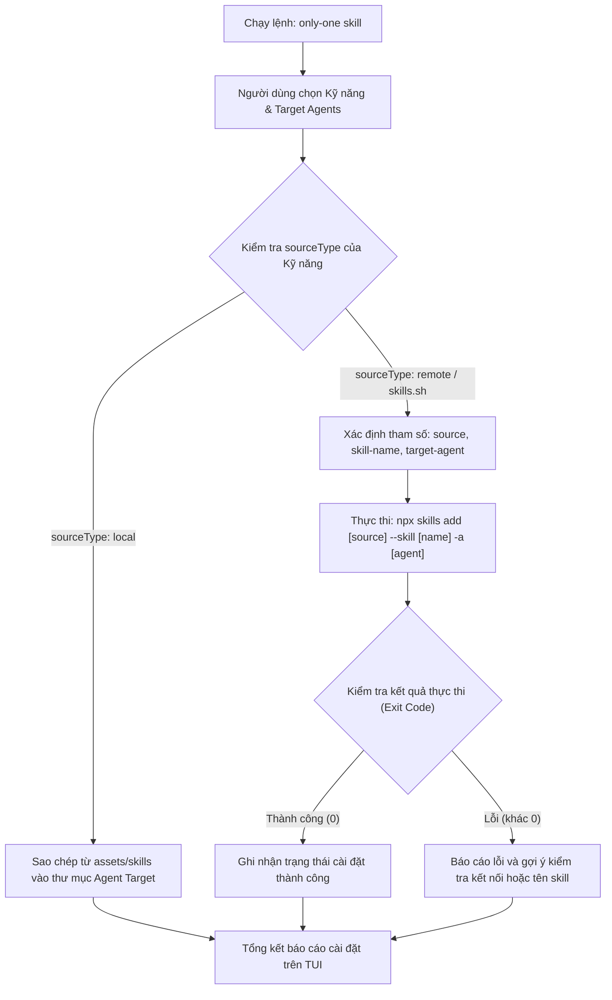

# Concept: Chuyển Đổi Cơ Chế Cài Đặt Kỹ Năng từ Git Sang skills.sh CLI

## 1. Problem & Goal (Vấn đề & Mục tiêu)

### Problem (Vấn đề & Điểm nghẽn Hiện tại)
- **Bối cảnh & Điểm kích hoạt**: Khi người dùng chạy lệnh cài đặt kỹ năng (`only-one skill`), hệ thống đọc danh mục khai báo tại `assets/skills/index.ts` và thực hiện kéo file thô từ GitHub qua hàm `fetchSkillContentFromGitHub`.
- **Hiện tượng & Khiếm khuyết kỹ thuật**:
  - Việc tải trực tiếp từ GitHub chỉ tải duy nhất tệp `SKILL.md`, bỏ sót các tài nguyên phụ trợ đi kèm (scripts, references, templates) nếu kỹ năng đó có cấu trúc phức tạp.
  - Phụ thuộc vào đường dẫn URL Git thô (`raw.githubusercontent.com`), dễ gặp lỗi khi upstream đổi nhánh, đổi tên file hoặc cấu trúc thư mục.
  - Không tận dụng được hệ sinh thái chuẩn hóa và cơ chế cài đặt của `skills.sh`.
- **Nguyên nhân cốt lõi (Root Cause)**: Triển khai cài đặt kỹ năng hiện tại là cơ chế tải Git thô (ad-hoc HTTP fetch), chưa tích hợp với package manager chuyên dụng của agent skills.
- **Tác động (Impact / Blast Radius)**: Kỹ năng cài đặt có thể thiếu tệp phụ trợ, lỗi tải khi cấu trúc repo nguồn thay đổi, và mã nguồn `only-one-cli` phải tự gánh logic phân tích Git thô.

### Goal (Mục tiêu Kỹ thuật Cần đạt)
- **Mục tiêu cốt lõi**: Chuyển đổi toàn bộ cơ chế cài đặt kỹ năng từ xa (remote skills) từ việc tải Git thô sang sử dụng công cụ chuẩn `skills.sh` (`npx skills add`).
- **Tiêu chí nghiệm thu (Acceptance Criteria)**:
  - Cập nhật manifest tại `assets/skills/index.ts`: Chuẩn hóa các kỹ năng ngoại vi để tương thích hoàn toàn với tham số gọi của `skills.sh` (`owner/repo` và `--skill <name>`).
  - Thay thế logic `fetchSkillContentFromGitHub` trong quy trình cài đặt bằng việc thực thi lệnh `npx skills add <source> --skill <name> -a <agent>`.
  - Giữ nguyên cơ chế sao chép cục bộ cho các kỹ năng nội bộ (`sourceType: 'local'`) của `only-one`.
  - Hỗ trợ đa agent (Antigravity, Claude Code, Cursor...) thông qua cờ agent của `skills.sh` hoặc điều hướng thư mục đích tương ứng.

## 2. Scope Boundaries (Ranh giới Phạm vi)
- **In-Scope**:
  - **Refactor `assets/skills/index.ts`**: Chuẩn hóa thông tin `source` và `skillPath` thành cú pháp định danh `skills.sh` (`<owner>/<repo>` và `--skill <name>`).
  - **Refactor Core Install Logic (`src/core/skill/index.ts`)**: Ủy thác việc cài đặt kỹ năng remote cho tiến trình `npx skills add`.
  - **Agent Mapping**: Ánh xạ agent target đã chọn trong `only-one` sang tham số `--agent` / `-a` của `skills.sh` CLI (hoặc ghi vào thư mục agent tương ứng).
  - **Xử lý lỗi thực thi**: Bắt các lỗi runtime khi lệnh `npx skills` thất bại (chưa cài Node, lỗi mạng, skill không tồn tại) và báo cáo rõ ràng trên TUI.
- **Explicit Out-of-Scope**:
  - Không xây dựng tính năng tìm kiếm động (Search UI) hay duyệt catalog từ xa trong turn này.
  - Không thay đổi cách thức xử lý các local skills nội bộ (`only-one-pr-git-skill`, `only-one-clockify-skill`, `karpathy-ste100-discipline`).
  - Không can thiệp vào mã nguồn nội bộ của package `vercel-labs/skills`.

## 3. Proposed Solution & Core Mechanism (Giải pháp Đề xuất & Cơ chế)

### Core Mechanism
- Khi người dùng chọn cài đặt kỹ năng:
  - Với kỹ năng **Local** (`sourceType: 'local'`): Tiếp tục sao chép trực tiếp từ `assets/skills/<skillName>` vào thư mục workspace như hiện tại.
  - Với kỹ năng **Remote** (`sourceType: 'skills.sh'` / `github`): Thay vì fetch HTTP thô, `only-one` khởi chạy subprocess:
    ```bash
    npx skills add <manifest.source> --skill <manifest.name> -a <agent-identifier>
    ```
- Cập nhật định nghĩa trong `assets/skills/index.ts` để lưu `source` dạng `<owner>/<repo>` chuẩn của `skills.sh`.

### Conceptual Flow / Domain Model


### Manifest Định dạng Mới (Minh họa Conceptual)
- Trong `assets/skills/index.ts`:
  - Kỹ năng remote chỉ cần khai báo: `name`, `description`, `source: 'owner/repo'`, `sourceType: 'skills.sh'`.
  - Không cần lưu đường dẫn lồng nhau phức tạp `skillPath: 'skills/.../SKILL.md'` của Git thô nữa vì `skills.sh` tự động định vị skill theo tên.

## 4. Critical Risks & Edge Cases (Rủi ro & Kịch bản Biên)
- **Tốc độ thực thi khi gọi npx**: Lần đầu gọi `npx skills` có thể mất vài giây để npm tải package tạm; cần hiển thị spinner trạng thái rõ ràng trên giao diện dòng lệnh.
- **Tương thích Agent ID**: Định danh agent của `only-one` (ví dụ `antigravity`, `claude`, `cursor`) cần được đối chiếu chính xác với danh sách agent mà `skills.sh` hỗ trợ (`-a <agent>`).
- **Môi trường Offline**: Khi không có mạng, `npx skills add` sẽ không tải được kỹ năng mới; cần bắt lỗi và thông báo người dùng kiểm tra kết nối mạng.
