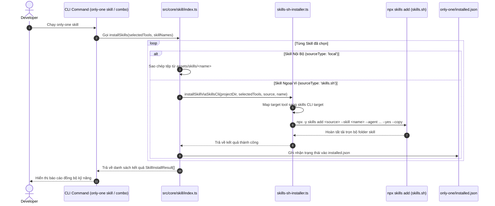

# Plan: Chuyển Đổi Cơ Chế Cài Đặt Kỹ Năng từ Git Sang skills.sh CLI

## Section 1. Directory Structure Changes (Cấu trúc Thư mục & Tệp Thay đổi)

```text
assets/
├── [MODIFY] types.ts                            # Bổ sung 'skills.sh' vào SkillManifest.sourceType
└── skills/
    └── [MODIFY] index.ts                        # Cập nhật remote skills sang sourceType 'skills.sh'
src/core/
├── skill/
│   ├── [MODIFY] index.ts                        # Điều hướng cài đặt remote skill qua skills.sh CLI
│   └── remote/
│       ├── [NEW]    skills-sh-installer.ts      # Shared runner cho npx skills add và mapping targets
│       └── [MODIFY] types.ts                    # Bổ sung 'skills.sh' vào RemoteSkillMeta.sourceType
└── combo/
    └── [MODIFY] index.ts                        # Tái sử dụng shared runner thay vì duplicate installExternalSkill
test/core/
└── [MODIFY] skill-registry.test.ts              # Cập nhật unit test theo sourceType 'skills.sh'
```

---

## Section 2. File Changes

### Architectural Interaction Diagram



---

### 1. `[NEW]` `src/core/skill/remote/skills-sh-installer.ts`

- **Status**: `[x]`
- **Context**: Shared helper to invoke the official skills.sh CLI (`npx skills add`) for remote skills.
- **Target Symbols / AST Seams**: `SKILLS_CLI_TARGETS`, `installSkillViaSkillsCli`.
- **Invariants**: Execute `npx` with `{ shell: false }` on POSIX and safe child process execution without dangling processes.
- **Depends On**: None.
- **Fast Test Command**: `npx vitest run test/core/combo.test.ts`.

> **Action**: Create a shared installer helper executing `npx skills add` with agent target mappings.

**Ponytail checklist**
- [ ] Required by acceptance criteria.
- [ ] Existing implementation searched; stdlib, platform/framework, and installed dependencies considered.
- [ ] No duplicate logic or speculative extension point.
- [ ] Minimum diff preserves correctness and safety.
- **Decision**: Extract `SKILLS_CLI_TARGETS` and command execution into a shared module to eliminate duplication with combo installer.
- **Rejected alternative**: Inline `execFileAsync` directly in both `skill/index.ts` and `combo/index.ts`.

```diff
@@ line 0 @@
+import { existsSync } from 'node:fs';
+import { join } from 'node:path';
+import { promisify } from 'node:util';
+import { execFile } from 'node:child_process';
+import type { AgentToolOption } from '@/core/agent/tools.js';
+
+const execFileAsync = promisify(execFile);
+
+export const SKILLS_CLI_TARGETS: Record<string, string> = {
+    antigravity: 'antigravity',
+    claude: 'claude-code',
+    cursor: 'cursor',
+    codex: 'codex',
+    cline: 'cline',
+    gemini: 'gemini',
+    'github-copilot': 'github-copilot',
+    opencode: 'opencode',
+    windsurf: 'windsurf',
+};
+
+export const getExternalSkillPath = (projectDir: string, tool: AgentToolOption, skillName: string): string | undefined =>
+    tool.skillsDir ? join(projectDir, tool.skillsDir, 'skills', skillName, 'SKILL.md') : undefined;
+
+export async function installSkillViaSkillsCli(params: {
+    projectDir: string;
+    source: string;
+    skillName: string;
+    selectedTools: AgentToolOption[];
+    cliVersion?: string;
+}): Promise<void> {
+    const { projectDir, source, skillName, selectedTools, cliVersion = '^1.0.0' } = params;
+    const unsupported = selectedTools.filter((tool) => !SKILLS_CLI_TARGETS[tool.value]);
+    if (unsupported.length > 0) {
+        throw new Error(`skills CLI does not support target(s): ${unsupported.map((tool) => tool.value).join(', ')}`);
+    }
+
+    const agents = selectedTools.map((tool) => SKILLS_CLI_TARGETS[tool.value]);
+    const packageSpec = cliVersion ? `skills@${cliVersion}` : 'skills';
+
+    await execFileAsync(
+        'npx',
+        [
+            '-y',
+            packageSpec,
+            'add',
+            source,
+            '--skill',
+            skillName,
+            '--agent',
+            ...agents,
+            '--yes',
+            '--copy',
+        ],
+        { cwd: projectDir, timeout: 120000, shell: process.platform === 'win32' },
+    );
+
+    const missing = selectedTools.filter((tool) => {
+        const path = getExternalSkillPath(projectDir, tool, skillName);
+        return !path || !existsSync(path);
+    });
+    if (missing.length > 0) {
+        throw new Error(
+            `External skill '${skillName}' missing after install for: ${missing.map((tool) => tool.value).join(', ')}`,
+        );
+    }
+}
```

---

### 2. `[MODIFY]` `assets/types.ts`

- **Status**: `[x]`
- **Context**: Skill manifest type definition in assets.
- **Target Symbols / AST Seams**: `SkillManifest.sourceType`.
- **Invariants**: Preserve backward compatibility with `'local'` and `'github'`.
- **Depends On**: None.
- **Fast Test Command**: `npm run build`.

> **Action**: Add `'skills.sh'` to allowed `sourceType` values in `SkillManifest`.

**Ponytail checklist**
- [ ] Required by acceptance criteria.
- [ ] Existing implementation searched; stdlib, platform/framework, and installed dependencies considered.
- [ ] No duplicate logic or speculative extension point.
- [ ] Minimum diff preserves correctness and safety.
- **Decision**: Extend string union type with `'skills.sh'`.
- **Rejected alternative**: Create new separate interface for external skills.

```diff
@@ line 57 @@
 export interface SkillManifest {
     name: string; // exact skill name, e.g. "only-one-clockify-skill"
     version: string;
     description: string;
     source?: string; // remote repository, e.g. "addyosmani/agent-skills"
-    sourceType?: 'github' | 'local';
+    sourceType?: 'github' | 'local' | 'skills.sh';
     skillPath?: string; // path in repo, e.g. "skills/performance-optimization/SKILL.md"
 }
```

---

### 3. `[MODIFY]` `src/core/skill/remote/types.ts`

- **Status**: `[x]`
- **Context**: Remote skill metadata stored in lockfile.
- **Target Symbols / AST Seams**: `RemoteSkillMeta.sourceType`.
- **Invariants**: Preserve backwards compatibility with existing installed.json files.
- **Depends On**: None.
- **Fast Test Command**: `npx vitest run test/core/skill-lockfile.test.ts`.

> **Action**: Support `'skills.sh'` in `RemoteSkillMeta.sourceType`.

**Ponytail checklist**
- [ ] Required by acceptance criteria.
- [ ] Existing implementation searched; stdlib, platform/framework, and installed dependencies considered.
- [ ] No duplicate logic or speculative extension point.
- [ ] Minimum diff preserves correctness and safety.
- **Decision**: Update union type to accept `'skills.sh'`.
- **Rejected alternative**: Leave as `'github'` only.

```diff
@@ line 6 @@
 export interface RemoteSkillMeta {
     name: string;
     description?: string;
     source: string;
-    sourceType: 'github';
+    sourceType: 'github' | 'skills.sh';
     branch?: string;
-    skillPath: string;
+    skillPath?: string;
     computedHash: string;
     installedAt?: string;
     updatedAt?: string;
 }
```

---

### 4. `[MODIFY]` `assets/skills/index.ts`

- **Status**: `[x]`
- **Context**: Catalog of skills available for installation.
- **Target Symbols / AST Seams**: `SKILLS`.
- **Invariants**: Keep names and descriptions intact; update remote items to `sourceType: 'skills.sh'`.
- **Depends On**: `assets/types.ts`.
- **Fast Test Command**: `npx vitest run test/core/skill-registry.test.ts`.

> **Action**: Update remote skill entries to use `sourceType: 'skills.sh'`.

**Ponytail checklist**
- [ ] Required by acceptance criteria.
- [ ] Existing implementation searched; stdlib, platform/framework, and installed dependencies considered.
- [ ] No duplicate logic or speculative extension point.
- [ ] Minimum diff preserves correctness and safety.
- **Decision**: Migrate remote items from `'github'` to `'skills.sh'` without modifying existing local skill entries.
- **Rejected alternative**: Delete remote skills completely.

```diff
@@ line 10 @@
     {
         name: 'i-have-adhd',
         version: '0.0.1',
         description: 'Shape agent output into action-first, bounded, progress-visible responses for readers with ADHD.',
         source: 'ayghri/i-have-adhd',
-        sourceType: 'github',
-        skillPath: 'skills/i-have-adhd/SKILL.md',
+        sourceType: 'skills.sh',
     },
 
     // --- 1. Define Phase: Discovery, Grilling & Domain Modeling ---
     {
         name: 'grill-with-docs',
         version: '0.0.1',
         description: 'Conduct a grilling session that sharpens domain terminology and updates CONTEXT.md and ADRs inline.',
         source: 'mattpocock/skills',
-        sourceType: 'github',
-        skillPath: 'skills/engineering/grill-with-docs/SKILL.md',
+        sourceType: 'skills.sh',
     },
     {
         name: 'grill-me',
         version: '0.0.1',
         description: 'Interview the user relentlessly about a plan or design until reaching shared understanding (zero file footprint).',
         source: 'mattpocock/skills',
-        sourceType: 'github',
-        skillPath: 'skills/productivity/grill-me/SKILL.md',
+        sourceType: 'skills.sh',
     },
@@ line 42 @@
     {
         name: 'interview-me',
         version: '0.0.1',
         description: 'Conduct a one-question-at-a-time interview extracting root needs until ~95% confidence.',
         source: 'addyosmani/agent-skills',
-        sourceType: 'github',
-        skillPath: 'skills/interview-me/SKILL.md',
+        sourceType: 'skills.sh',
     },
```

---

### 5. `[MODIFY]` `src/core/skill/index.ts`

- **Status**: `[x]`
- **Context**: Core installation executor for `only-one skill`.
- **Target Symbols / AST Seams**: `installSkills`.
- **Invariants**: Keep existing multi-agent destination directories and command template generators intact.
- **Depends On**: `src/core/skill/remote/skills-sh-installer.ts`.
- **Fast Test Command**: `npx vitest run test/commands/skill/skill.test.ts`.

> **Action**: Call `installSkillViaSkillsCli` when `manifest.sourceType === 'skills.sh'` instead of `fetchSkillContentFromGitHub`.

**Ponytail checklist**
- [ ] Required by acceptance criteria.
- [ ] Existing implementation searched; stdlib, platform/framework, and installed dependencies considered.
- [ ] No duplicate logic or speculative extension point.
- [ ] Minimum diff preserves correctness and safety.
- **Decision**: Route `skills.sh` skills to `installSkillViaSkillsCli`, falling back to local copy for `sourceType: 'local'`.
- **Rejected alternative**: Keep `fetchSkillContentFromGitHub` alongside CLI execution.

```diff
@@ line 13 @@
 import { SKILLS } from '@assets/skills/index.js';
 import { fetchSkillContentFromGitHub } from './remote/github-fetcher.js';
 import { saveSkillToLockfile } from './remote/lockfile.js';
 import { recordInstalledAssetsBatch } from '@/core/assets/lockfile.js';
+import { installSkillViaSkillsCli } from './remote/skills-sh-installer.js';
@@ line 102 @@
-                if (manifest?.sourceType === 'github' && manifest.source && manifest.skillPath) {
-                    // Fetch remote skill from GitHub
-                    const { content, hash } = await fetchSkillContentFromGitHub(manifest.source, manifest.skillPath);
-                    await writeFile(join(destPath, 'SKILL.md'), content, 'utf-8');
-                    await saveSkillToLockfile(projectDir, skillName, {
-                        name: skillName,
-                        description: manifest.description,
-                        source: manifest.source,
-                        sourceType: 'github',
-                        skillPath: manifest.skillPath,
-                        computedHash: hash,
-                    });
+                if (manifest?.sourceType === 'skills.sh' && manifest.source) {
+                    await installSkillViaSkillsCli({
+                        projectDir,
+                        source: manifest.source,
+                        skillName,
+                        selectedTools: [tool],
+                    });
+                    await saveSkillToLockfile(projectDir, skillName, {
+                        name: skillName,
+                        description: manifest.description,
+                        source: manifest.source,
+                        sourceType: 'skills.sh',
+                        computedHash: 'skills.sh-managed',
+                    });
```

---

### 6. `[MODIFY]` `src/core/combo/index.ts`

- **Status**: `[x]`
- **Context**: Combo installer handling packages and external skills.
- **Target Symbols / AST Seams**: `installExternalSkill`.
- **Invariants**: Preserve external skill checking logic in combo components.
- **Depends On**: `src/core/skill/remote/skills-sh-installer.ts`.
- **Fast Test Command**: `npx vitest run test/core/combo.test.ts`.

> **Action**: Re-use `installSkillViaSkillsCli` from `skills-sh-installer.ts` to eliminate duplicate implementation.

**Ponytail checklist**
- [ ] Required by acceptance criteria.
- [ ] Existing implementation searched; stdlib, platform/framework, and installed dependencies considered.
- [ ] No duplicate logic or speculative extension point.
- [ ] Minimum diff preserves correctness and safety.
- **Decision**: Delegate combo external skill installation to shared `installSkillViaSkillsCli`.
- **Rejected alternative**: Keep duplicated `SKILLS_CLI_TARGETS` and `execFileAsync` invocation in `combo/index.ts`.

```diff
@@ line 205 @@
-const SKILLS_CLI_TARGETS: Record<string, string> = {
-    antigravity: 'antigravity',
-    claude: 'claude-code',
-    cursor: 'cursor',
-    codex: 'codex',
-    cline: 'cline',
-    gemini: 'gemini',
-    'github-copilot': 'github-copilot',
-    opencode: 'opencode',
-    windsurf: 'windsurf',
-};
+import { SKILLS_CLI_TARGETS, getExternalSkillPath, installSkillViaSkillsCli } from '@/core/skill/remote/skills-sh-installer.js';
@@ line 242 @@
 export const installExternalSkill = async (
     installer: Extract<PackageManifest['installer'], { kind: 'skills' }>,
     selectedTools: AgentToolOption[],
     projectDir: string,
 ): Promise<void> => {
-    const unsupported = selectedTools.filter((tool) => !SKILLS_CLI_TARGETS[tool.value]);
-    if (unsupported.length > 0)
-        throw new Error(`Skills CLI does not support target(s): ${unsupported.map((tool) => tool.value).join(', ')}`);
-    const agents = selectedTools.map((tool) => SKILLS_CLI_TARGETS[tool.value]);
-    await execFileAsync(
-        'npx',
-        [
-            '-y',
-            `skills@${installer.cliVersion}`,
-            'add',
-            installer.source,
-            '--skill',
-            installer.skillName,
-            '--agent',
-            ...agents,
-            '--yes',
-            '--copy',
-        ],
-        { cwd: projectDir, timeout: 120000, shell: false },
-    );
-    const missing = selectedTools.filter((tool) => {
-        const path = externalSkillPath(projectDir, tool, installer.skillName);
-        return !path || !existsSync(path);
-    });
-    if (missing.length > 0)
-        throw new Error(
-            `External skill '${installer.skillName}' missing after install for: ${missing.map((tool) => tool.value).join(', ')}`,
-        );
+    await installSkillViaSkillsCli({
+        projectDir,
+        source: installer.source,
+        skillName: installer.skillName,
+        selectedTools,
+        cliVersion: installer.cliVersion,
+    });
 };
```

---

### 7. `[MODIFY]` `test/core/skill-registry.test.ts`

- **Status**: `[x]`
- **Context**: Skill registry test suite validating local and remote skill manifests.
- **Target Symbols / AST Seams**: `test/core/skill-registry.test.ts`.
- **Invariants**: Validate all remote skills have valid `source` and distinguish local vs remote manifests.
- **Depends On**: `assets/skills/index.ts`.
- **Fast Test Command**: `npx vitest run test/core/skill-registry.test.ts`.

> **Action**: Update tests to check `sourceType === 'skills.sh'` and reconcile shipped local skills.

**Ponytail checklist**
- [ ] Required by acceptance criteria.
- [ ] Existing implementation searched; stdlib, platform/framework, and installed dependencies considered.
- [ ] No duplicate logic or speculative extension point.
- [ ] Minimum diff preserves correctness and safety.
- **Decision**: Update test assertions to match `'skills.sh'` for remote skills.
- **Rejected alternative**: Disable the test.

```diff
@@ line 25 @@
-        const localSkills = SKILLS.filter((s) => s.sourceType !== 'github').map((s) => s.name);
+        const localSkills = SKILLS.filter((s) => s.sourceType === 'local').map((s) => s.name);
@@ line 35 @@
-            sourceType: 'github',
-            skillPath: 'skills/i-have-adhd/SKILL.md',
+            sourceType: 'skills.sh',
@@ line 43 @@
         for (const skill of SKILLS) {
-            if (skill.sourceType === 'github') {
+            if (skill.sourceType === 'skills.sh' || skill.sourceType === 'github') {
                 expect(skill.source).toBeDefined();
-                expect(skill.skillPath).toBeDefined();
             } else {
```

---

## Section 3. Test Cases & Verification

### Automated Tests
1. **Unit Test Registry Integrity**:
   ```bash
   npx vitest run test/core/skill-registry.test.ts
   ```
   - **Evidence**: `PASS` (6 tests passed in 308ms).
2. **Combo Installer Integration**:
   ```bash
   npx vitest run test/core/combo.test.ts
   ```
   - **Evidence**: `PASS` (15 tests passed in 1.26s).
3. **Full Test Suite & Formatting**:
   ```bash
   npm test
   npm run format:check
   ```
   - **Evidence**: `PASS` (55 test files, 242 passed, Prettier formatting verified).
4. **TypeScript Build**:
   ```bash
   npm run build
   ```
   - **Evidence**: `PASS` (dist generated without TS errors).

### Manual Checks
1. Chạy thử nghiệm lệnh cài đặt kỹ năng:
   ```bash
   tsx src/index.ts skill . i-have-adhd --tool antigravity
   ```
2. Xác minh tệp `.agents/skills/i-have-adhd/SKILL.md` được cài đặt đầy đủ từ `skills.sh`.
3. Kiểm tra tệp `only-one/installed.json` ghi nhận trạng thái đã cài đặt của `i-have-adhd`.
