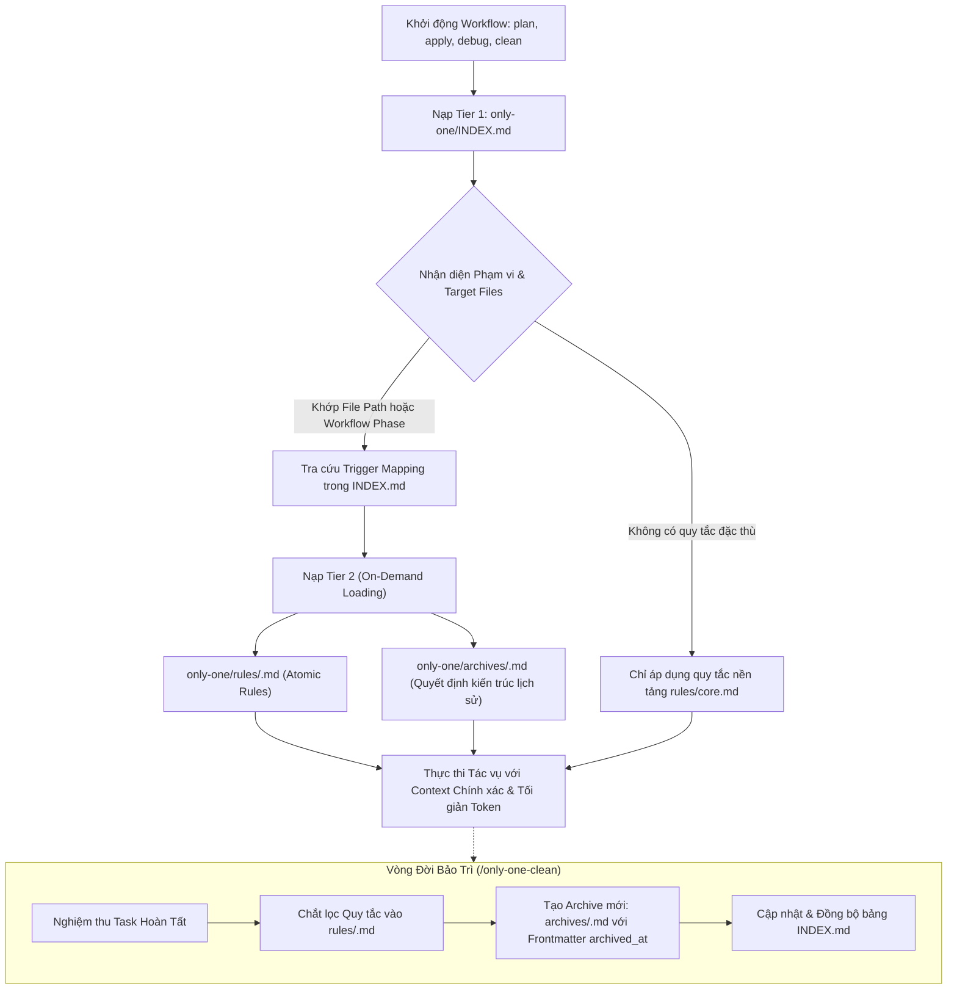

# Concept: Kiến Trúc Bộ Nhớ Phân Tầng và Chuẩn Hóa Tài Liệu Agent-Friendly

## 1. Problem & Goal (Vấn đề & Mục tiêu)

### Problem (Vấn đề & Điểm nghẽn Hiện tại)
- **Bối cảnh & Điểm kích hoạt**: Mỗi khi bắt đầu một phiên làm việc mới hoặc chạy các workflow phát triển (`/only-one-plan`, `/only-one-apply`, `/only-one-debug`, `/only-one-clean`), agent cần nạp các ràng buộc kỹ thuật và ngữ cảnh lịch sử từ `only-one/rules.md` và `only-one/archives/`.
- **Hiện tượng & Khiếm khuyết kỹ thuật**:
  - Không có bảng chỉ mục trung tâm; agent phải đọc toàn bộ tệp quy tắc hoặc đoán định tài liệu cần thiết, dẫn đến lãng phí context window và nguy cơ bỏ sót ngữ cảnh.
  - Tệp `only-one/rules.md` chứa hơn 39 quy tắc văn xuôi dồn chung, sử dụng nhiều câu phủ định kép tiếng Việt phức tạp, làm giảm khả năng phân tích cú pháp của mô hình LLM.
  - Tên tệp archive (`archives/<timestamp>-<slug>.md`) và thư mục task (`tasks/<timestamp>-<slug>/`) bị gắn cứng chuỗi thời gian cồng kềnh, khiến đường dẫn bị phân mảnh, khó liên kết chéo và làm rối mắt người dùng lẫn agent.
- **Nguyên nhân cốt lõi (Root Cause)**: Thiếu kiến trúc bộ nhớ phân tầng (Tiered Progressive Disclosure) và chưa tách bạch giữa định danh ngữ nghĩa (kebab-case slug) với thông tin thời gian (metadata timestamp).
- **Tác động (Impact / Blast Radius)**: Agent dễ vi phạm các ràng buộc tiêu cực (`[NEVER]`), tăng chi phí token đầu vào, và giảm độ tin cậy khi thực thi các tác vụ phức tạp.

### Goal (Mục tiêu Kỹ thuật Cần đạt)
- **Mục tiêu cốt lõi**: Xây dựng kiến trúc bộ nhớ phân tầng (Tiered Memory Architecture) cho thư mục `only-one/`, tái cấu trúc toàn bộ quy tắc sang định dạng máy đọc chuẩn xác lấy cảm hứng từ Hermes Agent, và chuẩn hóa quy ước đặt tên file tinh gọn (đưa toàn bộ timestamp vào frontmatter).
- **Tiêu chí nghiệm thu (Acceptance Criteria)**:
  - Thiết lập bảng chỉ mục trung tâm `only-one/INDEX.md` với dung lượng siêu nhẹ (dưới 200 tokens) ánh xạ chính xác Domain, Trigger Globs, và tài liệu liên quan.
  - Phân rã tệp monolithic `only-one/rules.md` thành các tập quy tắc chuyên biệt theo domain (`core.md`, `workflow.md`, `cli.md`, `tui.md`, `stack.md`).
  - Chuẩn hóa cấu trúc từng quy tắc thành Atomic Rule Block: sử dụng YAML Frontmatter kèm 3 trường cốt lõi `MUST_DO`, `NEVER_DO`, và `RATIONALE` viết bằng tiếng Anh kỹ thuật theo chuẩn ASD-STE100.
  - **Quy ước đặt tên tinh gọn (Clean Slug Naming Invariant)**:
    - Tên file archive: `only-one/archives/<slug>.md` (loại bỏ chuỗi timestamp ở tên file, lưu `archived_at: <ISO-8601>` trong frontmatter).
    - Tên thư mục task: `only-one/tasks/<slug>/` (lưu `created_at` trong frontmatter của `concept.md` và `plan.md`).
    - Đổi tên toàn bộ 7 file archive hiện tại sang tên slug sạch.
  - Cập nhật quy trình nạp và chắt lọc ngữ cảnh trong toàn bộ các workflow (`only-one-plan`, `only-one-apply`, `only-one-debug`, `only-one-clean`, `only-one-idea`).
  - Đồng bộ hóa 100% giữa `.agents/workflows/*.md` và `assets/workflows/*.md` kèm cập nhật version manifest (`assets/workflows/index.ts`).

## 2. Scope Boundaries (Ranh giới Phạm vi)
- **In-Scope**:
  - Xây dựng tệp chỉ mục điều hướng `only-one/INDEX.md` dựa trên File-Glob và Workflow Phase.
  - Phân tách và viết lại các quy tắc trong `only-one/rules/` theo chuẩn Atomic Rule Blocks.
  - Đổi tên và chuẩn hóa metadata frontmatter cho 7 tệp hiện có trong `only-one/archives/` sang slug thuần.
  - Cập nhật quy trình nạp tài liệu trong các tệp workflow `.agents/workflows/*.md` và `assets/workflows/*.md`.
  - Cập nhật quy trình chắt lọc quy tắc (`Step 0`) của `/only-one-clean` để tự động bảo trì `INDEX.md`, `rules/<domain>.md`, và tạo archive slug thuần.
  - Cập nhật version trong `assets/workflows/index.ts` để bảo vệ CI version gate.
- **Explicit Out-of-Scope**:
  - Không xây dựng công cụ tìm kiếm vector (Vector DB / Semantic Embeddings) cục bộ.
  - Không sửa đổi nội dung quyết định kiến trúc cốt lõi đã nghiệm thu trong các bản lưu trữ `archives/`.
  - Không thay đổi mã nguồn logic nghiệp vụ của các lệnh CLI.

## 3. Proposed Solution & Core Mechanism (Giải pháp Đề xuất & Cơ chế)

### Core Mechanism
1. **Cơ chế Phân tầng Ngữ cảnh (Two-Tier Progressive Disclosure)**:
   - **Tier 1 (Startup Index)**: Khi khởi động phiên, agent chỉ nạp bảng chỉ mục `INDEX.md`. Bảng này cung cấp bản đồ ánh xạ nhanh giữa đường dẫn tệp đang xử lý và tài liệu tương ứng.
   - **Tier 2 (On-Demand Loading)**: Agent đối chiếu đường dẫn tệp tác vụ với cột `Trigger Globs` trong `INDEX.md`. Khi phát hiện khớp phạm vi (ví dụ: làm việc với `src/tui/**`), agent mới nạp tệp chi tiết `rules/tui.md`.
2. **Quy ước Tách biệt Timestamp & Slug**:
   - Tên file trên đĩa hoàn toàn là danh từ ngữ nghĩa (semantic kebab-case slug), giúp việc trỏ link markdown [mcp-registry](file:///d:/Sources/PERSONAL/only-one-cli/only-one/archives/mcp-registry-and-servers.md) ngắn gọn, ổn định vĩnh viễn.
   - Toàn bộ thông tin thời gian (`created_at`, `archived_at`, `started_at`, `completed_at`) được quản lý chặt chẽ trong khối YAML Frontmatter đầu file.
3. **Cơ Chế Vận Hành Trong Từng Workflow**:
   - **`/only-one-plan` & `/only-one-apply` (Step 1b)**:
     1. Nạp `only-one/INDEX.md`.
     2. Đối chiếu danh sách tệp bị tác động (`target files`) với cột `Trigger Globs`.
     3. Chỉ nạp đúng tệp `only-one/rules/<domain>.md` và các bản lưu trữ `only-one/archives/<slug>.md` có liên quan.
   - **`/only-one-clean` (Step 0 & Maintenance)**:
     1. Khi hoàn tất task, trích xuất bài học và bổ sung vào đúng tệp domain trong `only-one/rules/<domain>.md`.
     2. Tạo archive mới dạng `archives/<slug>.md` kèm frontmatter `archived_at`, `triggers`, và `domain`.
     3. Đăng ký tự động bản ghi mới vào `only-one/INDEX.md`.

### Conceptual Flow / Domain Model


### Document Schema Mockup

#### 1. Bảng Chỉ Mục `only-one/INDEX.md`
```markdown
# Only-One Knowledge Index

## Domain Rules Catalog
| Domain | Trigger Globs / Workflows | Rule File | Mandatory Constraints Summary |
| :--- | :--- | :--- | :--- |
| **Core & Memory** | `*`, `/only-one-clean`, `/only-one-apply` | [rules/core.md](file:///d:/Sources/PERSONAL/only-one-cli/only-one/rules/core.md) | Single task archive invariant, clean slugs, SSOT lockfile |
| **SDLC Workflows** | `.agents/workflows/*`, `only-one/tasks/*` | [rules/workflow.md](file:///d:/Sources/PERSONAL/only-one-cli/only-one/rules/workflow.md) | Strict lifecycle isolation, ASD-STE100, 2-file task folders |
| **CLI & Runtime** | `src/commands/*`, `src/core/runtime/*` | [rules/cli.md](file:///d:/Sources/PERSONAL/only-one-cli/only-one/rules/cli.md) | Windows shell: true for .cmd/.bat, safe error propagation |
| **TUI & React** | `src/tui/*`, `src/prompts/*` | [rules/tui.md](file:///d:/Sources/PERSONAL/only-one-cli/only-one/rules/tui.md) | Router focus lock for useInput, AntD component reuse |
| **Stack & Types** | `src/types/*`, `src/**/*.service.ts` | [rules/stack.md](file:///d:/Sources/PERSONAL/only-one-cli/only-one/rules/stack.md) | Domain type contract in types/, no inline anonymous types |

## Architecture Archives Catalog
| Slug ID | Domain / Module | Key Architectural Invariant | File Reference |
| :--- | :--- | :--- | :--- |
| `mcp-registry-and-servers` | MCP, Browser | Isolated user-data-dir for playwright MCP | [archives/mcp-registry-and-servers.md](file:///d:/Sources/PERSONAL/only-one-cli/only-one/archives/mcp-registry-and-servers.md) |
| `asset-versioning-and-sync-systems` | Assets, Lockfile | Single source of truth in only-one/installed.json | [archives/asset-versioning-and-sync-systems.md](file:///d:/Sources/PERSONAL/only-one-cli/only-one/archives/asset-versioning-and-sync-systems.md) |
```

#### 2. Cấu Trúc Archive với Frontmatter Timestamp (`archives/mcp-registry-and-servers.md`)
```markdown
---
id: mcp-registry-and-servers
title: Kiến Trúc MCP Registry, Tích Hợp Playwright Browser & Chuẩn Hóa Danh Mục Built-in
domain: mcp
archived_at: 2026-09-04T14:05:00+07:00
status: active
triggers:
  - "assets/mcps/**"
  - "src/core/mcp/**"
---
```

## 4. Critical Risks & Edge Cases (Rủi ro & Kịch bản Biên)
- **Xung Đột Trùng Tên Slug**: Nếu hai task cùng xử lý một chủ đề và tạo trùng slug trong `archives/`, quy trình `/only-one-clean` sẽ hợp nhất (consolidate) nội dung thay vì ghi đè mất mát.
- **Tương Thích Tham Chiếu Cũ**: Các tài liệu hoặc archive cũ có thể trỏ tới đường dẫn có timestamp; giải pháp là cập nhật toàn bộ các link tham chiếu nội bộ trong `archives/*.md` sang đường dẫn mới.
