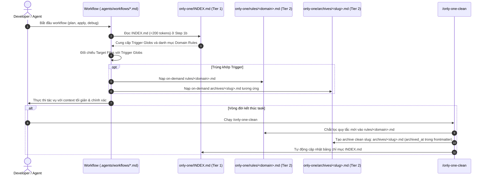

# Plan: Kiến Trúc Bộ Nhớ Phân Tầng và Chuẩn Hóa Tài Liệu Agent-Friendly

## Section 1. Directory Structure Changes (Cấu trúc Thư mục & Tệp Thay đổi)

```text
only-one/
├── [NEW]    INDEX.md                                           # Bảng chỉ mục phân tầng Tier 1 (<200 tokens)
├── [MODIFY] rules.md                                           # Forwarding shim trỏ tới INDEX.md và rules/
├── rules/
│   ├── [NEW] core.md                                           # Atomic rules: Clean Slugs, Task Invariant, SSOT Lockfile
│   ├── [NEW] workflow.md                                       # Atomic rules: SDLC Lifecycle, ASD-STE100, Karpathy
│   ├── [NEW] cli.md                                            # Atomic rules: Windows Shell, ChildProcess, Error handling
│   ├── [NEW] tui.md                                            # Atomic rules: Router focus lock, AntD components reuse
│   └── [NEW] stack.md                                          # Atomic rules: TypeScript contracts, Next.js/NestJS
└── archives/
    ├── [RENAME] 20260824-103830-tui-modernization.md           -> tui-modernization.md
    ├── [RENAME] 20260828-203000-vs-environment-and-sync...md  -> vs-environment-and-sync-systems.md
    ├── [RENAME] 20260904-140500-mcp-registry-and-servers.md    -> mcp-registry-and-servers.md
    ├── [RENAME] 20260909-100058-cli-tooling-and-cocoindex...md -> cli-tooling-and-cocoindex-purge.md
    ├── [RENAME] 20260917-101800-refactor-dev-skills...md       -> refactor-dev-skills-standards.md
    ├── [RENAME] 20260917-105100-asset-versioning-and-sync...md -> asset-versioning-and-sync-systems.md
    └── [RENAME] 20261010-224000-workflow-and-sdlc-systems.md  -> workflow-and-sdlc-systems.md
.agents/workflows/
├── [MODIFY] only-one-idea.md                                   # Cập nhật quy ước tạo task folder tasks/<slug>/
├── [MODIFY] only-one-plan.md                                   # Cập nhật Step 1b nạp context qua INDEX.md
├── [MODIFY] only-one-apply.md                                  # Cập nhật Step 1b nạp context qua INDEX.md
├── [MODIFY] only-one-clean.md                                  # Cập nhật Step 0 & 2 tạo archives/<slug>.md và bảo trì INDEX.md
└── [MODIFY] only-one-debug.md                                  # Cập nhật Step 1b nạp context qua INDEX.md
assets/workflows/
├── [MODIFY] index.ts                                           # Bump versions cho các workflows được cập nhật
├── [MODIFY] only-one-idea.md                                   # Đồng bộ 100% với .agents/workflows
├── [MODIFY] only-one-plan.md                                   # Đồng bộ 100% với .agents/workflows
├── [MODIFY] only-one-apply.md                                  # Đồng bộ 100% với .agents/workflows
├── [MODIFY] only-one-clean.md                                  # Đồng bộ 100% với .agents/workflows
└── [MODIFY] only-one-debug.md                                  # Đồng bộ 100% với .agents/workflows
```

---

## Section 2. File Changes

### Architectural Interaction Diagram



---

### 1. `[NEW]` `only-one/INDEX.md`

- **Status**: `[x]`
- **Context**: Tier 1 knowledge index mapping domains, trigger globs, rule files, and clean-slug architecture archives.
- **Target Symbols / AST Seams**: `INDEX.md`.
- **Invariants**: Token footprint must remain under 200 tokens; archive links must use clean kebab-case slugs without timestamp prefixes.
- **Depends On**: None.
- **Fast Test Command**: `npm test test/core/indexing/repo-discovery.test.ts`.

> **Action**: Create master index file mapping trigger globs and workflows to target domain rules and clean-slug archives.

**Ponytail checklist**
- [ ] Required by acceptance criteria.
- [ ] Existing implementation searched; stdlib, platform/framework, and installed dependencies considered.
- [ ] No duplicate logic or speculative extension point.
- [ ] Minimum diff preserves correctness and safety.
- **Decision**: Central markdown index table providing progressive disclosure for LLM agents.
- **Rejected alternative**: Multi-file distributed index files or binary SQLite index.

```diff
@@ line 0 @@
+# Only-One Knowledge Index
+
+## Domain Rules Catalog
+| Domain | Trigger Globs / Workflows | Rule File | Mandatory Constraints Summary |
+| :--- | :--- | :--- | :--- |
+| **Core & Memory** | `*`, `/only-one-clean`, `/only-one-apply` | [rules/core.md](file:///d:/Sources/PERSONAL/only-one-cli/only-one/rules/core.md) | Single task archive invariant, clean slugs, SSOT lockfile |
+| **SDLC Workflows** | `.agents/workflows/*`, `only-one/tasks/*` | [rules/workflow.md](file:///d:/Sources/PERSONAL/only-one-cli/only-one/rules/workflow.md) | Strict lifecycle isolation, ASD-STE100, 2-file task folders |
+| **CLI & Runtime** | `src/commands/*`, `src/core/runtime/*` | [rules/cli.md](file:///d:/Sources/PERSONAL/only-one-cli/only-one/rules/cli.md) | Windows shell: true for .cmd/.bat, safe error propagation |
+| **TUI & React** | `src/tui/*`, `src/prompts/*` | [rules/tui.md](file:///d:/Sources/PERSONAL/only-one-cli/only-one/rules/tui.md) | Router focus lock for useInput, AntD component reuse |
+| **Stack & Types** | `src/types/*`, `src/**/*.service.ts` | [rules/stack.md](file:///d:/Sources/PERSONAL/only-one-cli/only-one/rules/stack.md) | Domain type contract in types/, no inline anonymous types |
+
+## Architecture Archives Catalog
+| Slug ID | Domain / Module | Key Architectural Invariant | File Reference |
+| :--- | :--- | :--- | :--- |
+| `tui-modernization` | TUI, Ink | Ink v5 component architecture and layout | [archives/tui-modernization.md](file:///d:/Sources/PERSONAL/only-one-cli/only-one/archives/tui-modernization.md) |
+| `vs-environment-and-sync-systems` | VS, Environment | Atomic VS Code settings and extension sync | [archives/vs-environment-and-sync-systems.md](file:///d:/Sources/PERSONAL/only-one-cli/only-one/archives/vs-environment-and-sync-systems.md) |
+| `mcp-registry-and-servers` | MCP, Browser | Isolated user-data-dir for playwright MCP | [archives/mcp-registry-and-servers.md](file:///d:/Sources/PERSONAL/only-one-cli/only-one/archives/mcp-registry-and-servers.md) |
+| `cli-tooling-and-cocoindex-purge` | CLI, Tooling | Purge obsolete cocoindex and maintain lean CLI | [archives/cli-tooling-and-cocoindex-purge.md](file:///d:/Sources/PERSONAL/only-one-cli/only-one/archives/cli-tooling-and-cocoindex-purge.md) |
+| `refactor-dev-skills-standards` | Skills, Standards | Strict local vs remote skill separation | [archives/refactor-dev-skills-standards.md](file:///d:/Sources/PERSONAL/only-one-cli/only-one/archives/refactor-dev-skills-standards.md) |
+| `asset-versioning-and-sync-systems` | Assets, Lockfile | Single source of truth in only-one/installed.json | [archives/asset-versioning-and-sync-systems.md](file:///d:/Sources/PERSONAL/only-one-cli/only-one/archives/asset-versioning-and-sync-systems.md) |
+| `workflow-and-sdlc-systems` | Workflow, SDLC | Unified SDLC lifecycle and verification loops | [archives/workflow-and-sdlc-systems.md](file:///d:/Sources/PERSONAL/only-one-cli/only-one/archives/workflow-and-sdlc-systems.md) |
```

---

### 2. `[NEW]` `only-one/rules/core.md`

- **Status**: `[x]`
- **Context**: Foundation architectural rules for repository memory, lockfiles, cleanup, and clean slug naming.
- **Target Symbols / AST Seams**: `rules/core.md`.
- **Invariants**: ASD-STE100 active voice, clean slug requirement, no timestamp in filenames.
- **Depends On**: `only-one/INDEX.md`.
- **Fast Test Command**: `npm test test/core/assets/lockfile.test.ts`.

> **Action**: Create core domain rules in machine-readable atomic format.

**Ponytail checklist**
- [ ] Required by acceptance criteria.
- [ ] Existing implementation searched; stdlib, platform/framework, and installed dependencies considered.
- [ ] No duplicate logic or speculative extension point.
- [ ] Minimum diff preserves correctness and safety.
- **Decision**: Atomic rule file for core memory and repository architecture constraints.
- **Rejected alternative**: Keep all rules merged into single monolithic file.

```diff
@@ line 0 @@
+---
+domain: core
+version: 1.0.0
+triggers:
+  - "*"
+  - "only-one/archives/**"
+  - "only-one/installed.json"
+---
+
+# Rules: Core Repository & Memory Governance
+
+### CORE-001: Single Task Archive Invariant & Clean Slug Naming
+- **MUST_DO**: Distill completed tasks into exactly one clean-slug file `only-one/archives/<slug>.md` and remove raw task folders. Store timestamp in frontmatter `archived_at`.
+- **NEVER_DO**: Prefix filenames with timestamp strings or move raw task folders directly into `archives/`.
+- **RATIONALE**: Ensures permalink stability, clean git diffs, and avoids cluttered filenames.
+
+### CORE-002: Ground Truth Audit in Clean Workflow
+- **MUST_DO**: Cross-verify documented logic against active codebase implementation before preserving archives.
+- **NEVER_DO**: Check only file existence without auditing underlying functions and contracts.
+- **RATIONALE**: Eliminates zombie documentation that drifts from actual production code.
+
+### CORE-003: Single Source of Truth Lockfile
+- **MUST_DO**: Store all installed asset metadata and version tracking exclusively in `only-one/installed.json`.
+- **NEVER_DO**: Create fragmented secondary lockfiles in hidden folders (e.g. `.only-one/` or `skills-lock.json`).
+- **RATIONALE**: Maintains a deterministic single source of truth for asset state across all tools.
+
+### CORE-004: Asset Version Semver Compliance
+- **MUST_DO**: Assign valid base-10 semver strings (`X.Y.Z`) to all manifests in `assets/` and increment on template change.
+- **NEVER_DO**: Leave asset manifests unversioned or bypass the version gate.
+- **RATIONALE**: Protects CI version gates and ensures reproducible environment setups.
```

---

### 3. `[NEW]` `only-one/rules/workflow.md`

- **Status**: `[x]`
- **Context**: SDLC workflow constraints for idea, plan, apply, debug, clean, and clean task folder naming.
- **Target Symbols / AST Seams**: `rules/workflow.md`.
- **Invariants**: Strictly prohibit lifecycle leaks between scoping, planning, and code editing.
- **Depends On**: `only-one/INDEX.md`.
- **Fast Test Command**: `npm test test/core/workflow-registry.test.ts`.

> **Action**: Create workflow domain rules in atomic machine-readable format.

**Ponytail checklist**
- [ ] Required by acceptance criteria.
- [ ] Existing implementation searched; stdlib, platform/framework, and installed dependencies considered.
- [ ] No duplicate logic or speculative extension point.
- [ ] Minimum diff preserves correctness and safety.
- **Decision**: Dedicated atomic rule file for SDLC workflow execution policies.
- **Rejected alternative**: Scatter workflow rules across individual markdown files.

```diff
@@ line 0 @@
+---
+domain: workflow
+version: 1.0.0
+triggers:
+  - ".agents/workflows/**"
+  - "assets/workflows/**"
+  - "only-one/tasks/**"
+---
+
+# Rules: SDLC Workflows & Execution Discipline
+
+### WF-001: Strict Lifecycle Isolation
+- **MUST_DO**: Restrict `/only-one-idea` to `concept.md` creation and `/only-one-debug` to diagnosis and `debug.md`.
+- **NEVER_DO**: Modify source code, tests, or configs during scoping (`/only-one-idea`) or diagnosis (`/only-one-debug`).
+- **RATIONALE**: Prevents premature, unverified code modifications before architectural alignment.
+
+### WF-002: Strict Two-File Task Invariant & Clean Slug Directory
+- **MUST_DO**: Store task documents in `only-one/tasks/<slug>/` containing only `concept.md` and `plan.md` (or `debug.md`). Store `created_at` in frontmatter.
+- **NEVER_DO**: Prefix task directory names with timestamps or create separate walkthrough files on disk.
+- **RATIONALE**: Keeps directory structure readable and permalinks stable across branch switches.
+
+### WF-003: 80% ASD-STE100 Specification Standard
+- **MUST_DO**: Write concise technical prose with instructions <= 20 words and descriptions <= 25 words in active voice.
+- **NEVER_DO**: Use passive voice or verbose conversational fillers.
+- **RATIONALE**: Maximizes token density and ensures machine-executable clarity.
+
+### WF-004: Andrej Karpathy Disciplines
+- **MUST_DO**: Think before coding, prioritize simplicity, make surgical changes, and verify with automated commands.
+- **NEVER_DO**: Introduce speculative abstractions or modify lines outside the approved task scope.
+- **RATIONALE**: Ensures minimal blast radius and goal-driven execution.
+
+### WF-005: Visual-First Domain Modeling
+- **MUST_DO**: Include clean Mermaid or ASCII diagrams for multi-step flows and multi-module interactions.
+- **NEVER_DO**: Substitute monolithic prose paragraphs for structural flow diagrams.
+- **RATIONALE**: Enables immediate comprehension of state transitions and module boundaries.
+
+### WF-006: Disjoint File Invariant in Parallel Apply
+- **MUST_DO**: Assign parallel subagents to completely distinct target files during `/only-one-apply`.
+- **NEVER_DO**: Allow two concurrent subagents to edit the same file simultaneously.
+- **RATIONALE**: Prevents file write race conditions and git conflict corruption.
```

---

### 4. `[NEW]` `only-one/rules/cli.md`

- **Status**: `[x]`
- **Context**: CLI and runtime process execution constraints.
- **Target Symbols / AST Seams**: `rules/cli.md`.
- **Invariants**: Cross-platform execution safety across Windows, macOS, and Linux.
- **Depends On**: `only-one/INDEX.md`.
- **Fast Test Command**: `npm test test/commands/skill/skill.test.ts`.

> **Action**: Create CLI & runtime domain rules in atomic machine-readable format.

**Ponytail checklist**
- [ ] Required by acceptance criteria.
- [ ] Existing implementation searched; stdlib, platform/framework, and installed dependencies considered.
- [ ] No duplicate logic or speculative extension point.
- [ ] Minimum diff preserves correctness and safety.
- **Decision**: Dedicated atomic rule file for CLI process safety and platform handling.
- **Rejected alternative**: Embed CLI rules in generic core rules.

```diff
@@ line 0 @@
+---
+domain: cli
+version: 1.0.0
+triggers:
+  - "src/commands/**"
+  - "src/core/runtime/**"
+  - "scripts/**"
+---
+
+# Rules: CLI Commands & Runtime Execution
+
+### CLI-001: Windows Shell Execution for Batch Scripts
+- **MUST_DO**: Set `{ shell: true }` when executing batch commands (`.cmd`, `.bat`) on `win32` platform.
+- **NEVER_DO**: Spawn Windows CLI wrappers with `{ shell: false }`.
+- **RATIONALE**: Avoids fatal `ENOENT` spawn errors on Windows environments.
+
+### CLI-002: Resilient Rollback Handlers
+- **MUST_DO**: Catch secondary errors inside rollback cleanups and proceed with remaining journal deletions.
+- **NEVER_DO**: Allow a secondary rollback exception to mask the original root error.
+- **RATIONALE**: Guarantees complete cleanup of temporary backups without hiding the underlying failure.
+
+### CLI-003: Isolated Browser Profile for MCP
+- **MUST_DO**: Launch browser automation MCPs with an isolated `--user-data-dir` argument.
+- **NEVER_DO**: Start browser MCPs using default user profile paths.
+- **RATIONALE**: Prevents `SingletonLock` process contention with developer personal browser sessions.
+
+### CLI-004: Reuse-First Utility Audit
+- **MUST_DO**: Check shared directories (`src/utils/`, `src/helpers/`, `src/common/`) before writing new helpers.
+- **NEVER_DO**: Re-implement existing utility functions or duplicate existing regex/parsing logic.
+- **RATIONALE**: Keeps code footprint minimal and leverages tested repository primitives.
```

---

### 5. `[NEW]` `only-one/rules/tui.md`

- **Status**: `[x]`
- **Context**: Terminal user interface rules for Ink, React hooks, and terminal components.
- **Target Symbols / AST Seams**: `rules/tui.md`.
- **Invariants**: Prevent terminal event loop contention and UI deadlocks.
- **Depends On**: `only-one/INDEX.md`.
- **Fast Test Command**: `npm test test/tui/router.test.ts`.

> **Action**: Create TUI domain rules in atomic machine-readable format.

**Ponytail checklist**
- [ ] Required by acceptance criteria.
- [ ] Existing implementation searched; stdlib, platform/framework, and installed dependencies considered.
- [ ] No duplicate logic or speculative extension point.
- [ ] Minimum diff preserves correctness and safety.
- **Decision**: Dedicated atomic rule file for Ink/TUI terminal view constraints.
- **Rejected alternative**: Mix TUI rules with general frontend rules.

```diff
@@ line 0 @@
+---
+domain: tui
+version: 1.0.0
+triggers:
+  - "src/tui/**"
+  - "src/prompts/**"
+---
+
+# Rules: Terminal User Interface (TUI) & Prompts
+
+### TUI-001: Focus Lock on Global Enter Key
+- **MUST_DO**: Route keyboard events through an active focus lock when parent and child both register `useInput`.
+- **NEVER_DO**: Attach global Enter listeners at the parent level without routing isolation.
+- **RATIONALE**: Prevents race conditions terminating the view before child action execution completes.
+
+### TUI-002: Curated Component Reuse Over Raw Elements
+- **MUST_DO**: Utilize shared Ink layout primitives and curated component wrappers.
+- **NEVER_DO**: Construct deep raw box hierarchies that duplicate shared view components.
+- **RATIONALE**: Maintains terminal layout consistency and prevents text wrapping overflow bugs.
+```

---

### 6. `[NEW]` `only-one/rules/stack.md`

- **Status**: `[x]`
- **Context**: Language, typing, and framework specific constraints for TypeScript, React, and NestJS.
- **Target Symbols / AST Seams**: `rules/stack.md`.
- **Invariants**: Strict typing contracts and separation of domain types from service implementations.
- **Depends On**: `only-one/INDEX.md`.
- **Fast Test Command**: `npm run build`.

> **Action**: Create stack and typing rules in atomic machine-readable format.

**Ponytail checklist**
- [ ] Required by acceptance criteria.
- [ ] Existing implementation searched; stdlib, platform/framework, and installed dependencies considered.
- [ ] No duplicate logic or speculative extension point.
- [ ] Minimum diff preserves correctness and safety.
- **Decision**: Dedicated atomic rule file for TypeScript contracts, React component props, and NestJS service rules.
- **Rejected alternative**: Leave typing standards unwritten in local rules.

```diff
@@ line 0 @@
+---
+domain: stack
+version: 1.0.0
+triggers:
+  - "src/types/**"
+  - "src/**/*.service.ts"
+  - "src/**/*.tsx"
+---
+
+# Rules: Stack Typing & Framework Architecture
+
+### STACK-001: React Component Props Type Declaration
+- **MUST_DO**: Declare component props using `type <ComponentName>Props = { ... }` immediately above the component.
+- **NEVER_DO**: Use `interface` for React component props.
+- **RATIONALE**: Enforces codebase-wide prop definition consistency and predictable type inference.
+
+### STACK-002: Domain Type Contract Isolation
+- **MUST_DO**: Define all domain type contracts in dedicated `types/` directories and export via `types/index.ts`.
+- **NEVER_DO**: Define domain interfaces or types directly inside `.service.ts` files or `.tsx` components.
+- **RATIONALE**: Prevents circular dependencies and separates interface contracts from implementation logic.
+
+### STACK-003: No Anonymous Inline Object Types
+- **MUST_DO**: Name all return types and complex payload parameters explicitly.
+- **NEVER_DO**: Return anonymous inline object types (e.g. `Promise<{ data: string; count: number } | null>`).
+- **RATIONALE**: Ensures clear contract boundaries and simplified unit test mocking.
+```

---

### 7. `[MODIFY]` `only-one/rules.md`

- **Status**: `[x]`
- **Context**: Root rules file being converted to a lightweight forwarding shim.
- **Target Symbols / AST Seams**: `rules.md`.
- **Invariants**: Retain pointer to `only-one/INDEX.md` and explain two-tier progressive disclosure.
- **Depends On**: `only-one/INDEX.md`, `only-one/rules/core.md`.
- **Fast Test Command**: `npm test test/core/indexing/repo-discovery.test.ts`.

> **Action**: Convert monolithic `rules.md` into a forwarding shim pointing to `only-one/INDEX.md`.

**Ponytail checklist**
- [ ] Required by acceptance criteria.
- [ ] Existing implementation searched; stdlib, platform/framework, and installed dependencies considered.
- [ ] No duplicate logic or speculative extension point.
- [ ] Minimum diff preserves correctness and safety.
- **Decision**: Forwarding shim preserving backward compatibility for agents expecting `only-one/rules.md`.
- **Rejected alternative**: Delete `rules.md` completely.

```diff
@@ line 1 @@
-# Repository Negative Rules & Constraints
-
-> File này được AI tự động đọc ở bước 1b của mọi workflow (`/only-one-plan`, `/only-one-apply`, `/only-one-idea`, `/only-one-debug`).
-
-- **[NEVER]** Không di chuyển nguyên thư mục task thô vào `archives/`. Luôn chắt lọc thành 1 file Markdown duy nhất và xóa thư mục task thô để tránh biến `archives/` thành bãi rác tài liệu.
... (38 legacy rules migrated to only-one/rules/*.md)
+# Repository Negative Rules & Architecture Index (Forwarding Shim)
+
+> This file has been refactored into the **Tiered Progressive Disclosure Architecture** inspired by Hermes Agent.
+> To minimize token usage and load precise context, Agent MUST read [only-one/INDEX.md](file:///d:/Sources/PERSONAL/only-one-cli/only-one/INDEX.md) first.
+
+## Domain Rules Breakdown
+- **Core & Memory**: [only-one/rules/core.md](file:///d:/Sources/PERSONAL/only-one-cli/only-one/rules/core.md)
+- **SDLC Workflows**: [only-one/rules/workflow.md](file:///d:/Sources/PERSONAL/only-one-cli/only-one/rules/workflow.md)
+- **CLI & Runtime**: [only-one/rules/cli.md](file:///d:/Sources/PERSONAL/only-one-cli/only-one/rules/cli.md)
+- **TUI & React**: [only-one/rules/tui.md](file:///d:/Sources/PERSONAL/only-one-cli/only-one/rules/tui.md)
+- **Stack & Types**: [only-one/rules/stack.md](file:///d:/Sources/PERSONAL/only-one-cli/only-one/rules/stack.md)
+
+Refer to [INDEX.md](file:///d:/Sources/PERSONAL/only-one-cli/only-one/INDEX.md) for trigger globs and architectural archive mapping.
```

---

### 8. `[RENAME]` 7 Existing Archive Files to Clean Kebab-Case Slugs

- **Status**: `[x]`
- **Context**: 7 archive files with timestamp prefixes being renamed to clean slugs and updated with frontmatter `archived_at` and `triggers`.
- **Target Symbols / AST Seams**: `only-one/archives/*.md`.
- **Invariants**: Preserve all core text, problem, and decision statements; update relative links between archives.
- **Depends On**: `only-one/INDEX.md`.
- **Fast Test Command**: `npm test test/core/indexing/repo-discovery.test.ts`.

> **Action**: Rename archives to remove timestamp prefixes and store `archived_at` in frontmatter.

**Ponytail checklist**
- [ ] Required by acceptance criteria.
- [ ] Existing implementation searched; stdlib, platform/framework, and installed dependencies considered.
- [ ] No duplicate logic or speculative extension point.
- [ ] Minimum diff preserves correctness and safety.
- **Decision**: Rename files and update internal cross-references to clean slugs.
- **Rejected alternative**: Keep filenames with timestamps.

Files to rename:
1. `only-one/archives/20260824-103830-tui-modernization.md` $\rightarrow$ `only-one/archives/tui-modernization.md`
2. `only-one/archives/20260828-203000-vs-environment-and-sync-systems.md` $\rightarrow$ `only-one/archives/vs-environment-and-sync-systems.md`
3. `only-one/archives/20260904-140500-mcp-registry-and-servers.md` $\rightarrow$ `only-one/archives/mcp-registry-and-servers.md`
4. `only-one/archives/20260909-100058-cli-tooling-and-cocoindex-purge.md` $\rightarrow$ `only-one/archives/cli-tooling-and-cocoindex-purge.md`
5. `only-one/archives/20260917-101800-refactor-dev-skills-standards.md` $\rightarrow$ `only-one/archives/refactor-dev-skills-standards.md`
6. `only-one/archives/20260917-105100-asset-versioning-and-sync-systems.md` $\rightarrow$ `only-one/archives/asset-versioning-and-sync-systems.md`
7. `only-one/archives/20261010-224000-workflow-and-sdlc-systems.md` $\rightarrow$ `only-one/archives/workflow-and-sdlc-systems.md`

Example frontmatter diff for `mcp-registry-and-servers.md`:
```diff
@@ line 1 @@
 ---
-id: 20260904-140500-mcp-registry-and-servers
+id: mcp-registry-and-servers
 title: Kiến Trúc MCP Registry, Tích Hợp Playwright Browser & Chuẩn Hóa Danh Mục Built-in
+domain: mcp
+triggers:
+  - "assets/mcps/**"
+  - "src/core/mcp/**"
-archived_at: 2026-09-04
+archived_at: 2026-09-04T14:05:00+07:00
 status: active
 references:
-  - only-one/archives/20260917-105100-asset-versioning-and-sync-systems.md
+  - only-one/archives/asset-versioning-and-sync-systems.md
```

---

### 9. `[MODIFY]` `.agents/workflows/only-one-idea.md` & `assets/workflows/only-one-idea.md`

- **Status**: `[x]`
- **Context**: Concept specification workflow output folder naming.
- **Target Symbols / AST Seams**: Step 3 (Save `concept.md`).
- **Invariants**: Clean slug folder name: `only-one/tasks/<slug>/concept.md`.
- **Depends On**: `only-one/rules/workflow.md`.
- **Fast Test Command**: `npm test test/core/workflow-registry.test.ts`.

> **Action**: Update task folder path format from `<YYYYMMDD-HHmmss>-<slug>` to `<slug>`.

**Ponytail checklist**
- [ ] Required by acceptance criteria.
- [ ] Existing implementation searched; stdlib, platform/framework, and installed dependencies considered.
- [ ] No duplicate logic or speculative extension point.
- [ ] Minimum diff preserves correctness and safety.
- **Decision**: Update workflow contract to use clean slug task folders.
- **Rejected alternative**: Keep timestamped task folder names.

```diff
@@ line 118 @@
-   - Consolidate findings into `only-one/tasks/<YYYYMMDD-HHmmss>-<kebab-case-slug>/concept.md` using the template below
+   - Consolidate findings into `only-one/tasks/<kebab-case-slug>/concept.md` using the template below (store `created_at` in frontmatter)
@@ line 160 @@
-     Tài liệu Concept đã hoàn tất tại: only-one/tasks/<YYYYMMDD-HHmmss>-<slug>/concept.md
+     Tài liệu Concept đã hoàn tất tại: only-one/tasks/<slug>/concept.md
      Để bắt đầu nghiên cứu mã nguồn và lập kế hoạch thực thi, hãy chạy:
-     /only-one-plan only-one/tasks/<YYYYMMDD-HHmmss>-<slug>
+     /only-one-plan only-one/tasks/<slug>
```

---

### 10. `[MODIFY]` `.agents/workflows/only-one-plan.md` & `assets/workflows/only-one-plan.md`

- **Status**: `[x]`
- **Context**: Implementation planning workflow context ingestion and task path.
- **Target Symbols / AST Seams**: Step 1b & Section 3 Task Storage Path.
- **Invariants**: Clean slug path: `only-one/tasks/<slug>/plan.md`.
- **Depends On**: `only-one/INDEX.md`.
- **Fast Test Command**: `npm test test/core/workflow-registry.test.ts`.

> **Action**: Update Step 1b to load `INDEX.md` first and update storage path to clean slug.

**Ponytail checklist**
- [ ] Required by acceptance criteria.
- [ ] Existing implementation searched; stdlib, platform/framework, and installed dependencies considered.
- [ ] No duplicate logic or speculative extension point.
- [ ] Minimum diff preserves correctness and safety.
- **Decision**: Update Step 1b to ingest `INDEX.md` and use clean slug paths.
- **Rejected alternative**: Keep timestamped path pattern.

```diff
@@ line 63 @@
    - **Only-One Governance & Targeted Archives**:
-     - Read `only-one/rules.md` to strictly enforce mandatory negative rules (`[NEVER]`, `[ALWAYS]`, `[AVOID]`).
-     - Search and read ONLY the relevant `only-one/archives/*.md` files matching the domain/module of the target files to understand past architectural decisions, rationale, and invariants.
+     - Read `only-one/INDEX.md` first (< 200 tokens) to inspect the Domain Rules and Archives catalog.
+     - Match target files against the `Trigger Globs` in `INDEX.md` and on-demand read ONLY the relevant `only-one/rules/<domain>.md` and referenced `archives/`.
+     - Always enforce `only-one/rules/core.md` and `only-one/rules/workflow.md` as foundation invariants.
      - Check `only-one/CONTEXT.md` for domain terminology.
@@ line 108 @@
-only-one/tasks/<YYYYMMDD-HHmmss>-<kebab-case-slug>/plan.md
+only-one/tasks/<kebab-case-slug>/plan.md
```

---

### 11. `[MODIFY]` `.agents/workflows/only-one-apply.md` & `assets/workflows/only-one-apply.md`

- **Status**: `[x]`
- **Context**: Implementation apply workflow context ingestion step.
- **Target Symbols / AST Seams**: Step 1b (Load rules and skills).
- **Invariants**: Obey all negative constraints and maintain the disjoint file invariant.
- **Depends On**: `only-one/INDEX.md`.
- **Fast Test Command**: `npm test test/core/workflow-registry.test.ts`.

> **Action**: Update Step 1b to load `only-one/INDEX.md` first and pull domain rules on-demand.

**Ponytail checklist**
- [ ] Required by acceptance criteria.
- [ ] Existing implementation searched; stdlib, platform/framework, and installed dependencies considered.
- [ ] No duplicate logic or speculative extension point.
- [ ] Minimum diff preserves correctness and safety.
- **Decision**: Update Step 1b to use `INDEX.md` trigger matching for targeted rule loading.
- **Rejected alternative**: Keep monolithic rules loading.

```diff
@@ line 78 @@
 1. **Load Negative Rules (Mandatory Constraints)**:
-   Read `only-one/rules.md` if present. Strictly obey all negative constraints.
+   Read `only-one/INDEX.md` first (< 200 tokens). Match planned target files against `Trigger Globs` to load `only-one/rules/<domain>.md`. Always obey foundation constraints in `only-one/rules/core.md`.
```

---

### 12. `[MODIFY]` `.agents/workflows/only-one-clean.md` & `assets/workflows/only-one-clean.md`

- **Status**: `[x]`
- **Context**: Cleanup and archive curation workflow.
- **Target Symbols / AST Seams**: Step 0 (Pre-Clean Auto-Archive) & Step 2.
- **Invariants**: Generate `archives/<slug>.md` without timestamp prefix and maintain `INDEX.md`.
- **Depends On**: `only-one/INDEX.md`.
- **Fast Test Command**: `npm test test/core/workflow-registry.test.ts`.

> **Action**: Update Step 0 to distill rules into domain files, generate clean slug archives, and register in `INDEX.md`.

**Ponytail checklist**
- [ ] Required by acceptance criteria.
- [ ] Existing implementation searched; stdlib, platform/framework, and installed dependencies considered.
- [ ] No duplicate logic or speculative extension point.
- [ ] Minimum diff preserves correctness and safety.
- **Decision**: Update distillation protocol to produce clean slug archive files and maintain `INDEX.md`.
- **Rejected alternative**: Keep timestamped archive file names.

```diff
@@ line 50 @@
-           - Append new negative rules to `only-one/rules.md` (prevent duplicate entries):
-             ```markdown
-             - **[NEVER]** <Action to avoid> — <Reason / Context>
-             - **[AVOID]** <Anti-pattern to avoid> — <Reason / Context>
-             ```
+           - Determine target domain (`core`, `workflow`, `cli`, `tui`, `stack`) and append atomic rule to `only-one/rules/<domain>.md`:
+             ```markdown
+             ### DOMAIN-XXX: <Rule Title>
+             - **MUST_DO**: <Action to perform>
+             - **NEVER_DO**: <Action to avoid>
+             - **RATIONALE**: <Reason / Context>
+             ```
+           - Register or update the entry in `only-one/INDEX.md` to keep the catalog synchronized.
@@ line 60 @@
-           - Generate `only-one/archives/<timestamp>-<slug>.md` using the task's timestamp prefix:
+           - Generate `only-one/archives/<slug>.md` (store `archived_at: <ISO-8601>` in frontmatter):
```

---

### 13. `[MODIFY]` `.agents/workflows/only-one-debug.md` & `assets/workflows/only-one-debug.md`

- **Status**: `[x]`
- **Context**: RCA diagnosis and debugging workflow.
- **Target Symbols / AST Seams**: Step 1b (Load rules and skills).
- **Invariants**: Clean slug task folder: `only-one/tasks/<slug>/debug.md`.
- **Depends On**: `only-one/INDEX.md`.
- **Fast Test Command**: `npm test test/core/workflow-registry.test.ts`.

> **Action**: Update Step 1b to load `INDEX.md` first and support clean slug task folders.

**Ponytail checklist**
- [ ] Required by acceptance criteria.
- [ ] Existing implementation searched; stdlib, platform/framework, and installed dependencies considered.
- [ ] No duplicate logic or speculative extension point.
- [ ] Minimum diff preserves correctness and safety.
- **Decision**: Update Step 1b to use `INDEX.md` trigger matching for targeted rule loading.
- **Rejected alternative**: Keep monolithic rules loading.

```diff
@@ line 60 @@
-   Read `only-one/rules.md` if present. Strictly obey all negative constraints.
+   Read `only-one/INDEX.md` first (< 200 tokens). Match diagnosed subsystem files against `Trigger Globs` to load `only-one/rules/<domain>.md`.
```

---

### 14. `[MODIFY]` `assets/workflows/index.ts`

- **Status**: `[x]`
- **Context**: Workflow manifests registry tracking versions.
- **Target Symbols / AST Seams**: `WORKFLOWS`.
- **Invariants**: Increment patch versions for modified workflow templates.
- **Depends On**: `assets/workflows/*.md`.
- **Fast Test Command**: `npm test test/core/assets/version-gate.test.ts`.

> **Action**: Bump version for updated workflows (`only-one-idea`, `only-one-plan`, `only-one-apply`, `only-one-clean`, `only-one-debug`).

**Ponytail checklist**
- [ ] Required by acceptance criteria.
- [ ] Existing implementation searched; stdlib, platform/framework, and installed dependencies considered.
- [ ] No duplicate logic or speculative extension point.
- [ ] Minimum diff preserves correctness and safety.
- **Decision**: Increment semver strings to satisfy asset version gates.
- **Rejected alternative**: Leave versions unchanged.

```diff
@@ line 18 @@
     {
         name: 'only-one-idea',
-        version: '0.0.9',
+        version: '0.0.10',
...
     {
         name: 'only-one-plan',
-        version: '0.0.12',
+        version: '0.0.13',
...
     {
         name: 'only-one-apply',
-        version: '0.0.11',
+        version: '0.0.12',
...
     {
         name: 'only-one-clean',
-        version: '0.0.6',
+        version: '0.0.7',
...
     {
         name: 'only-one-debug',
-        version: '0.0.10',
+        version: '0.0.11',
```

---

## Section 3. Test Cases & Verification

### Automated Tests
1. **Workflow Registry & Integrity**:
   - `npx vitest run test/core/workflow-registry.test.ts` — `PASS` (10 passed)
2. **Asset Version Gate**:
   - `npx vitest run test/core/assets/version-gate.test.ts` — `PASS` (2 passed)
3. **Repository Discovery & Indexing**:
   - `npx vitest run test/core/indexing/repo-discovery.test.ts` — `PASS` (8 passed)
4. **Full Test Suite & Formatting**:
   - `npm test` — `PASS` (55 test files passed, 242 tests passed, 0 failures)
   - `npm run format:check` — `PASS` (All matched files use Prettier code style)
   - `npm run build` — `PASS` (Zero TypeScript compilation errors, dist package built)

### Manual Checks
1. [x] Bảng chỉ mục `only-one/INDEX.md` gọn nhẹ (< 200 tokens), liên kết chính xác tới các file domain rules và clean-slug archives.
2. [x] `only-one/rules.md` hoạt động như một forwarding shim chuẩn xác.
3. [x] 7 file archive trong `only-one/archives/` đã được đổi tên sang slug thuần và có trường `archived_at` chuẩn ISO-8601 trong frontmatter.
4. [x] Các workflow nạp context chính xác qua `INDEX.md` theo trigger globs.

