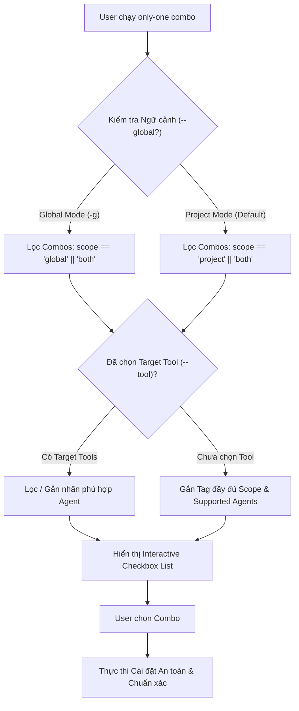

# Concept: Combo Scope & Target Agent Compatibility Architecture

## 1. Problem & Goal (Vấn đề & Mục tiêu)

### Problem (Vấn đề & Điểm nghẽn Hiện tại)
- **Bối cảnh & Điểm kích hoạt**: Khi chạy `only-one combo` ở chế độ Local (Project repository) hoặc Global (`--global`), toàn bộ danh sách combo (`frontend-flow`, `backend-flow`, `full-sdlc-flow`, `mcp-flow`) được hiển thị đồng nhất mà không phân biệt ngữ cảnh cài đặt.
- **Hiện tượng & Khiếm khuyết kỹ thuật**:
  - Không có metadata thể hiện rõ combo nào thiết kế chuyên biệt cho Global Tooling (ví dụ: `full-sdlc-flow` cài đặt các workflows/skills dùng chung) và combo nào thiết kế cho Local Project Repo (ví dụ: `frontend-flow` bao gồm Next.js config và UI/UX Pro Max CLI).
  - Không có thông tin về AI Agent / IDE tương thích (`antigravity`, `cursor`, `claude`, `codex`, `cline`...), khiến người dùng Antigravity có thể chọn nhầm combo chỉ tối ưu cho Cursor hoặc ngược lại.
- **Nguyên nhân cốt lõi (Root Cause)**: `ComboManifest` trong `assets/types.ts` thiếu hai thuộc tính khai báo: `scope` (`'global' | 'project' | 'both'`) và `supportedAgents` (`string[]`). Bộ lọc tại `selectCombosStep` chưa liên kết ngữ cảnh `isGlobal` và `selectedTools`.
- **Tác động (Impact / Blast Radius)**: Gây ô nhiễm thư mục global hoặc local của người dùng với các assets không tương thích hoặc không cần thiết; giảm tính chính xác và tự động hóa của CLI.

### Goal (Mục tiêu Kỹ thuật Cần đạt)
- **Mục tiêu cốt lõi**: Bổ sung cơ chế phân định phạm vi triển khai (`scope`) và độ tương thích agent (`supportedAgents`) trực tiếp vào `ComboManifest`, đồng thời tự động lọc danh sách và gắn nhãn trực quan trên CLI/TUI.
- **Tiêu chí nghiệm thu (Acceptance Criteria)**:
  - Cập nhật schema `ComboManifest`: hỗ trợ `scope?: 'global' | 'project' | 'both'` (mặc định `'both'`) và `supportedAgents?: string[]` (mặc định `['*']`).
  - Gắn metadata cho tất cả combo hiện có trong `assets/combos/index.ts`.
  - Bộ lọc CLI (`selectCombosStep`):
    - Khi `--global` được kích hoạt: chỉ hiển thị các combo có `scope === 'global' || scope === 'both'` (hoặc ưu tiên/phân nhóm rõ ràng).
    - Khi ở chế độ local: chỉ hiển thị combo có `scope === 'project' || scope === 'both'`.
    - Khi người dùng chọn tool (ví dụ `--tool antigravity`): lọc hoặc gắn nhãn cảnh báo nếu combo không hỗ trợ agent đó.
  - Giao diện danh sách (Checkbox/TUI): hiển thị tag nhãn rõ ràng, ví dụ: `[Global] [Antigravity, Cursor, Claude]`.

---

## 2. Scope Boundaries (Ranh giới Phạm vi)

- **In-Scope**:
  - Cập nhật interface `ComboManifest` trong `assets/types.ts`.
  - Bổ sung `scope` và `supportedAgents` vào các combo trong `assets/combos/index.ts`.
  - Cập nhật logic lọc và hiển thị trong `src/commands/combo/actions/step-3-select-combos.ts`.
  - Bổ sung helper functions kiểm tra độ tương thích: `isComboScopeMatch(combo, isGlobal)` và `isComboAgentMatch(combo, targetTools)`.
  - Bổ sung unit tests kiểm tra tính đúng đắn của bộ lọc và schema manifest.
- **Explicit Out-of-Scope**:
  - Không thay đổi logic cài đặt bên dưới của từng skill hay workflow độc lập.
  - Không bắt buộc người dùng cấu hình thủ công nếu combo để mặc định (`both` và `*`).
  - Không can thiệp vào lockfile format (lockfile đã lưu trữ `combos` schemaVersion 1).

---

## 3. Proposed Solution & Core Mechanism (Giải pháp Đề xuất & Cơ chế)

### Solution Comparison (So sánh Giải pháp)

| Vector | Option 1: Implicit Inferred Filter | Option 2: Declarative Metadata & Context Filter (Được chọn) | Option 3: Dynamic Rule Engine |
| :--- | :--- | :--- | :--- |
| **Cơ chế** | CLI tự suy đoán dựa trên sự hiện diện của `packages` hay `configs`. | Khai báo tường minh `scope` và `supportedAgents` trong từng manifest combo. | Tạo script validation động theo quy tắc phức tạp. |
| **Tính minh bạch** | Kém (người dùng và developer khó biết tại sao combo bị ẩn/hiện). | **Rất cao**: Thấy rõ trong code và tài liệu manifest. | Trung bình, khó bảo trì. |
| **Độ phức tạp** | Thấp nhưng dễ sinh lỗi biên khi thêm combo mới. | **Chuẩn mực, dễ mở rộng**, độ phức tạp thấp. | Rất cao, over-engineering. |
| **Trải nghiệm CLI** | Dễ gây bất ngờ khi suy đoán sai. | **Trực quan**: Gắn tag `[Global]` / `[Project]` và `[Agents]`. | Cồng kềnh. |

### Core Mechanism (Cơ chế Hoạt động)

1. **Schema Khai báo (`assets/types.ts`)**:
   - `scope?: 'global' | 'project' | 'both'` (mặc định `'both'`).
   - `supportedAgents?: AllowedToolId[] | ['*']` (mặc định `['*']`).
2. **Metadata Catalog (`assets/combos/index.ts`)**:
   - `full-sdlc-flow`: `scope: 'both'`, `supportedAgents: ['antigravity', 'cursor', 'claude', 'codex']`.
   - `frontend-flow`: `scope: 'project'`, `supportedAgents: ['antigravity', 'cursor', 'claude', 'windsurf']`.
   - `backend-flow`: `scope: 'project'`, `supportedAgents: ['antigravity', 'cursor', 'claude']`.
   - `mcp-flow`: `scope: 'both'`, `supportedAgents: ['antigravity', 'cursor']`.
3. **Filtering & Presentation Gate**:
   - Khi chạy ở chế độ global (`--global`): CLI lọc danh sách combo khả dụng trước khi render prompt checkbox.
   - Khi hiển thị checkbox: mỗi item có nhãn badge định dạng:
     `full-sdlc-flow — Full SDLC Universal Flow Setup [Global / Project] [All Agents]`

### Conceptual Flow (Luồng Xử lý Dữ liệu)



### CLI Visual Mockup (Giao diện Checkbox Lựa chọn)

```text
? Select combos to install for Antigravity:
❯ ( ) full-sdlc-flow — Full SDLC Universal Flow Setup [Scope: Global/Project] [Agents: All]
      Stack-agnostic end-to-end SDLC toolkit: Ideation, Dual-layer planning, review...
  ( ) frontend-flow — Frontend Flow Setup [Scope: Project] [Agents: Antigravity, Cursor, Claude]
      Next.js and React frontend development toolkit with UI/UX Pro Max...
  ( ) mcp-flow — Universal MCP Server Setup [Scope: Global/Project] [Agents: Antigravity, Cursor]
      Essential Model Context Protocol integrations for GitHub, Notion, Browser...
```

---

## 4. Critical Risks & Edge Cases (Rủi ro & Kịch bản Biên)

1. **Backward Compatibility**:
   - Các combo của bên thứ 3 hoặc combo cũ chưa khai báo `scope` hoặc `supportedAgents` phải tự động fallback về `scope: 'both'` và `supportedAgents: ['*']` để không gây breaking change.
2. **Multi-tool Selection**:
   - Khi người dùng truyền nhiều tool (ví dụ: `--tool antigravity,cursor`), combo chỉ cần tương thích với ít nhất 1 trong các tool đã chọn (hoặc cảnh báo rõ tool nào không được hỗ trợ).
3. **Positional Parameter Safety**:
   - Khi người dùng truyền trực tiếp ID qua tham số vị trí (ví dụ `only-one combo frontend-flow -g`), hệ thống sẽ kiểm tra `scope`. Nếu không khớp, hiển thị thông báo lỗi thân thiện thay vì im lặng hoặc crash.
