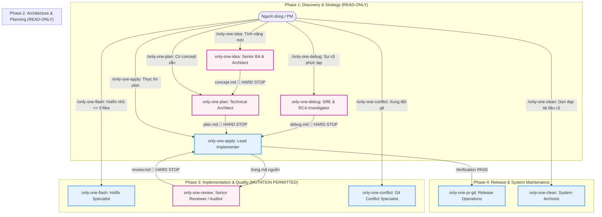

# Concept: Phân tách Vai trò & Thiết lập Ranh giới Thẩm quyền cho Bộ Workflows

## 1. Problem & Goal (Vấn đề & Mục tiêu)

### Problem (Vấn đề & Điểm nghẽn Hiện tại)
- **Bối cảnh & Điểm kích hoạt**: Khi người dùng kích hoạt các workflow trong `assets/workflows` (`only-one-idea`, `plan`, `debug`, `review`, `flash`...).
- **Hiện tượng & Khiếm khuyết kỹ thuật**:
  - Agent vi phạm ranh giới thẩm quyền (Boundary Creep): tự ý chỉnh sửa file mã nguồn ngay trong các phase chỉ có thẩm quyền nghiên cứu (`idea`, `plan`).
  - Mập mờ điều hướng: chưa phân định dứt khoát ranh giới giữa `debug` vs `plan`, `flash` vs luồng tiêu chuẩn (`idea -> plan -> apply`).
  - Thiếu Persona chuyên trách và danh sách cấm kỵ (Forbidden Actions) độc lập, dẫn đến hành vi thiếu nhất quán giữa các lượt thực thi.
- **Nguyên nhân cốt lõi (Root Cause)**: Các tài liệu workflow chưa được cấu trúc hóa theo một khung thẩm quyền thống nhất (Standard Role & Guardrail Framework) và thiếu các chốt chặn cưỡng bức dừng lại (🛑 Hard Terminal Gates).
- **Tác động (Impact / Blast Radius)**: Ô nhiễm ngữ cảnh (context pollution), tạo mã nguồn rác hoặc sửa code khi chưa đạt được sự đồng thuận của PM, phá vỡ tính toàn vẹn của quy trình SDLC.

### Goal (Mục tiêu Kỹ thuật Cần đạt)
- **Mục tiêu cốt lõi**:
  - Loại bỏ hoàn toàn workflow điều hướng trung gian `only-one.md` (router) để người dùng gọi trực tiếp các workflows chuyên trách.
  - Chuẩn hóa toàn bộ 9 workflows còn lại trong `assets/workflows` theo Phương án 1 (Inline Standardized Specification), biến mỗi workflow thành một đơn vị tác nghiệp chuyên trách có Persona, ranh giới công cụ và điểm dừng bàn giao rõ ràng.
- **Tiêu chí nghiệm thu (Acceptance Criteria)**:
  - Xóa bỏ `only-one.md` khỏi `assets/workflows/`, `assets/workflows/index.ts` và `assets/combos/index.ts`.
  - 100% workflows còn lại (9 file) khai báo rõ mục `Assigned Persona` với vai trò chuyên gia tương ứng.
  - 100% workflows có mục `Allowed Actions` và `Forbidden Actions` (cấm tuyệt đối mọi thao tác sửa mã nguồn ở các phase Discovery & Planning).
  - 100% workflows gắn chặt với một `Artifact Contract` duy nhất (`concept.md`, `plan.md`, `debug.md`, `review.md`...).
  - 100% workflows sở hữu `🛑 Mandatory Hard Stop & Handoff` in rõ lệnh workflow tiếp theo và dừng thực thi ngay lập tức.

## 2. Scope Boundaries (Ranh giới Phạm vi)

- **In-Scope**:
  - Xóa bỏ workflow `only-one.md` và gỡ bỏ reference trong `assets/workflows/index.ts` và `assets/combos/index.ts`.
  - Chuẩn hóa nội dung, ranh giới vai trò và các chốt chặn an toàn cho 9 file workflow trong `assets/workflows/`:
    `only-one-idea`, `only-one-plan`, `only-one-apply`, `only-one-debug`, `only-one-review`, `only-one-conflict`, `only-one-clean`, `only-one-flash`, `only-one-pr-git`.
  - Thiết lập quy tắc bàn giao khép kín (Handoff Protocol) trực tiếp giữa các phase.
- **Explicit Out-of-Scope**:
  - Không sửa đổi mã nguồn TypeScript của CLI engine (`src/`) hoặc cơ chế build/publish hiện tại.
  - Không triển khai hook chặn bằng shell script (`hooks.json`) trong phase này (bảo lưu mở rộng trong tương lai).
  - Không thay đổi tên thư mục gốc `.agents/` để đảm bảo tương thích tuyệt đối với Antigravity Discovery Engine.

## 3. Proposed Solution & Core Mechanism (Giải pháp Đề xuất & Cơ chế)

### Core Mechanism (Cơ chế Cốt lõi)
1. **Direct Entrypoint Model (Loại bỏ Router)**: Người dùng chủ động kích hoạt trực tiếp slash command chuyên trách tương ứng với nhu cầu (`/only-one-idea`, `/only-one-plan`, `/only-one-debug`...), không cần tầng router trung gian `only-one.md`.
2. **Khung Định danh & Thẩm quyền 4 Phần (4-Part Role & Guardrail Framework)** trực tiếp vào phần mở đầu của mỗi file markdown workflow:
   - **Assigned Persona**: Khai báo vai trò chuyên trách và phong cách tư duy (Senior BA, Solution Architect, Lead Implementer, SRE...).
   - **Authority & Guardrails**:
     - `Allowed Actions`: Danh mục công cụ và hành động được phép thực thi.
     - `Forbidden Actions`: Danh mục cấm kỵ tuyệt đối (cấm sửa file `.ts`/`.tsx`, cấm chạy test khi chưa có kế hoạch).
   - **Artifact Contract**: Định dạng, vị trí lưu trữ và schema của tài liệu đầu ra duy nhất.
   - **🛑 Mandatory Hard Stop & Handoff**: Chỉ thị cưỡng bức agent dừng vòng lặp, hiển thị thông báo bàn giao và cú pháp lệnh của bước tiếp theo cho PM.

### Conceptual Flow & State Machine (Luồng Điều phối Trực tiếp)

### Role & Authority Matrix (Ma trận Phân vai 9 Workflows)

| Workflow | Assigned Persona | Phase / Thẩm quyền | Hành vi Cấm kỵ Tuyệt đối | Artifact Handoff |
| :--- | :--- | :--- | :--- | :--- |
| **`only-one-idea`** | **Senior BA & Architect** | READ-ONLY (Đọc file, hỏi 1 câu/lần, vẽ sơ đồ) | **CẤM sửa source code**, cấm viết unified diff | `only-one/tasks/<slug>/concept.md` |
| **`only-one-plan`** | **Technical Architect** | READ-ONLY (Đọc code, grep, lập kế hoạch diff) | **CẤM sửa source code**, cấm tự apply patch | `only-one/tasks/<slug>/plan.md` |
| **`only-one-apply`** | **Lead Implementer** | MUTATION (Sửa code theo task, chạy test, fix linter) | **CẤM thay đổi kiến trúc** ngoài phạm vi `plan.md` | Code changes & verification logs |
| **`only-one-debug`** | **SRE & RCA Investigator** | READ-ONLY (Chạy test tái hiện lỗi, phân tích nguyên nhân) | **CẤM sửa source code** trước khi hoàn thành RCA | `only-one/tasks/<slug>/debug.md` |
| **`only-one-review`** | **Senior Code Reviewer** | READ-ONLY (Audit diff, rà soát bảo mật & code smell) | **CẤM tự ý sửa code** trong khi review | `only-one/tasks/<slug>/review.md` |
| **`only-one-conflict`**| **Git Conflict Specialist** | MUTATION (Giải quyết xung đột merge/rebase từng hunk) | Cấm xóa code không thuộc phạm vi conflict | Resolved git state |
| **`only-one-clean`** | **System Archivist** | MAINTENANCE (Lưu trữ task xong, purge tài liệu stale) | Cấm đụng vào active code files trong `src/` | Archive status & cleaned workspace |
| **`only-one-flash`** | **Hotfix Specialist** | MUTATION (Sửa nhanh bug nhỏ <= 3 files) | Cấm dùng cho feature lớn hoặc refactor diện rộng | Hotfix patch & verification |
| **`only-one-pr-git`** | **Release Operations** | GIT OPS (Validate git status, mở PR qua GitHub MCP) | Cấm merge không qua review, cấm force push | GitHub Pull Request URL |

## 4. Critical Risks & Edge Cases (Rủi ro & Kịch bản Biên)

1. **Rủi ro Mô hình bỏ qua chỉ dẫn (Prompt Drift / Hallucination)**:
   - *Nguy cơ*: LLM vẫn có thể vô tình gọi `write_to_file` trong phase `idea` hoặc `plan`.
   - *Giải pháp*: Đặt mục `🛑 Mandatory Hard Stop` ở cuối cùng của file với định dạng cảnh báo mạnh mẽ, yêu cầu agent kết thúc lượt trả lời ngay lập tức sau khi xuất artifact.
2. **Xung đột phạm vi giữa `only-one-flash` và luồng chuẩn**:
   - *Nguy cơ*: Lạm dụng `flash` để bỏ qua các bước thẩm định kiến trúc.
   - *Giải pháp*: Đặt ngưỡng cứng (Hard Threshold) trong `only-one-flash`: Nếu phạm vi > 3 files hoặc cần đổi API/Schema, lập tức từ chối và bắt buộc chuyển hướng sang `/only-one-idea`.
3. **Lệch pha giữa `assets/workflows` và `.agents/workflows`**:
   - *Nguy cơ*: Sửa trong `assets/` nhưng chưa đồng bộ ra `.agents/` dẫn đến agent tại chỗ vẫn chạy theo template cũ.
   - *Giải pháp*: Xác lập bước Verification trong `plan.md` để đồng bộ hoặc chạy lệnh build copy từ `assets/workflows/` sang `.agents/workflows/`.
