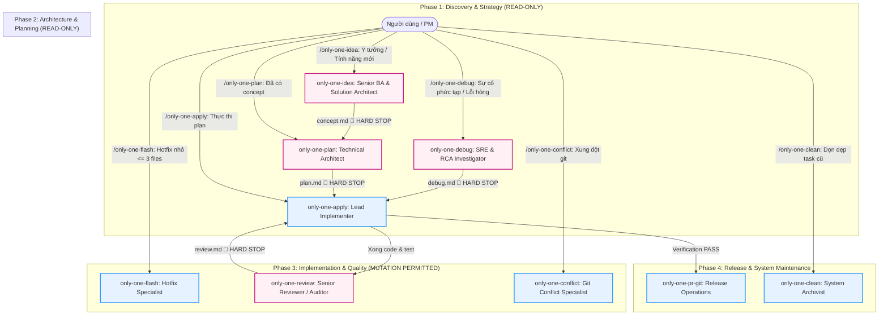

# Plan: Phân tách Vai trò, Thiết lập Thẩm quyền & Loại bỏ Router only-one

## Section 1. Directory Structure Changes (Cấu trúc Thư mục & Tệp Thay đổi)

```text
assets/workflows/
├── [DELETE] only-one.md                          # Xóa router workflow trung gian
├── [MODIFY] index.ts                             # Gỡ only-one, bump version 9 workflows
├── [MODIFY] only-one-idea.md                     # Chuẩn hóa Persona, Guardrails & Hard Stop
├── [MODIFY] only-one-plan.md                     # Chuẩn hóa Persona, Guardrails & Hard Stop
├── [MODIFY] only-one-apply.md                    # Chuẩn hóa Persona, Guardrails & Hard Stop
├── [MODIFY] only-one-debug.md                    # Chuẩn hóa Persona, Guardrails & Hard Stop
├── [MODIFY] only-one-review.md                   # Chuẩn hóa Persona, Guardrails & Hard Stop
├── [MODIFY] only-one-flash.md                    # Chuẩn hóa Persona, Guardrails & Hard Stop
├── [MODIFY] only-one-conflict.md                 # Chuẩn hóa Persona, Guardrails & Hard Stop
├── [MODIFY] only-one-clean.md                    # Chuẩn hóa Persona, Guardrails & Hard Stop
└── [MODIFY] only-one-pr-git.md                   # Chuẩn hóa Persona, Guardrails & Hard Stop

assets/combos/
└── [MODIFY] index.ts                             # Gỡ 'only-one' khỏi frontend-flow, backend-flow, only-one-flow

.agents/workflows/
├── [DELETE] only-one.md                          # Đồng bộ xóa router trên workspace
├── [MODIFY] only-one-idea.md                     # Đồng bộ byte-for-byte từ assets
├── [MODIFY] only-one-plan.md                     # Đồng bộ byte-for-byte từ assets
├── [MODIFY] only-one-apply.md                    # Đồng bộ byte-for-byte từ assets
├── [MODIFY] only-one-debug.md                    # Đồng bộ byte-for-byte từ assets
├── [MODIFY] only-one-review.md                   # Đồng bộ byte-for-byte từ assets
├── [MODIFY] only-one-flash.md                    # Đồng bộ byte-for-byte từ assets
├── [MODIFY] only-one-conflict.md                 # Đồng bộ byte-for-byte từ assets
├── [MODIFY] only-one-clean.md                    # Đồng bộ byte-for-byte từ assets
└── [MODIFY] only-one-pr-git.md                   # Đồng bộ byte-for-byte từ assets

test/core/
└── [MODIFY] workflow-registry.test.ts            # Cập nhật test suite xác nhận only-one đã gỡ
```

---

## Section 2. File Changes

### Architectural Interaction Diagram



---

### 1. `[DELETE]` `assets/workflows/only-one.md` & `.agents/workflows/only-one.md`

- **Status**: `[x]`
- **Context**: File router trung gian triage ý đồ người dùng.
- **Target Symbols / AST Seams**: File removal.
- **Invariants**: Người dùng kích hoạt trực tiếp các workflows chuyên trách, không còn router trung gian.
- **Depends On**: None.
- **Fast Test Command**: `npm test test/core/workflow-registry.test.ts`.

> **Action**: Xóa bỏ file `only-one.md` ở cả `assets/workflows/` và `.agents/workflows/`.

**Ponytail checklist**
- [ ] Required by acceptance criteria.
- [ ] Existing implementation searched; stdlib, platform/framework, and installed dependencies considered.
- [ ] No duplicate logic or speculative extension point.
- [ ] Minimum diff preserves correctness and safety.
- **Decision**: Xóa hoàn toàn router trung gian theo quyết định kiến trúc loại bỏ router layer.
- **Rejected alternative**: Giữ lại file trống hoặc deprecation warning làm nhiễu danh sách slash command.

*(File delete action verified: references to be removed in `assets/workflows/index.ts` and `assets/combos/index.ts`)*

---

### 2. `[MODIFY]` `assets/workflows/index.ts`

- **Status**: `[x]`
- **Context**: Manifest registry khai báo toàn bộ workflows hỗ trợ.
- **Target Symbols / AST Seams**: `WORKFLOWS` constant array.
- **Invariants**: Toàn bộ manifest phải có decimal version hợp lệ theo quy định version gate.
- **Depends On**: 1.
- **Fast Test Command**: `npm test test/core/workflow-registry.test.ts`.

> **Action**: Xóa bỏ phần tử `only-one` khỏi mảng `WORKFLOWS`, đồng thời bump minor version cho 9 workflows.

**Ponytail checklist**
- [ ] Required by acceptance criteria.
- [ ] Existing implementation searched; stdlib, platform/framework, and installed dependencies considered.
- [ ] No duplicate logic or speculative extension point.
- [ ] Minimum diff preserves correctness and safety.
- **Decision**: Xóa item đầu mảng và tăng version của 9 workflows còn lại.
- **Rejected alternative**: Để nguyên version cũ vi phạm version gate khi nội dung markdown thay đổi.

```diff
@@ -3,17 +3,3 @@
 export const WORKFLOWS: WorkflowManifest[] = [
-    {
-        name: 'only-one',
-        version: '0.0.2',
-        description:
-            'Triage user intent, inspect workspace state, and route to the matching specialized workflow.',
-        requiredSkills: [
-            'i-have-adhd',
-            'karpathy-ste100-discipline',
-            'ponytail',
-            'doubt-driven-development',
-        ],
-    },
     {
         name: 'only-one-idea',
-        version: '0.0.10',
+        version: '0.0.11',
         description:
@@ -37,3 +23,3 @@
         name: 'only-one-plan',
-        version: '0.0.13',
+        version: '0.0.14',
         description:
@@ -57,3 +43,3 @@
         name: 'only-one-apply',
-        version: '0.0.12',
+        version: '0.0.13',
         description:
@@ -72,3 +58,3 @@
         name: 'only-one-debug',
-        version: '0.0.11',
+        version: '0.0.12',
         description:
@@ -88,3 +74,3 @@
         name: 'only-one-review',
-        version: '0.0.3',
+        version: '0.0.4',
         description: 'Run Open CodeReview and produce selectable debug-grade executable findings.',
@@ -94,3 +80,3 @@
         name: 'only-one-conflict',
-        version: '0.0.1',
+        version: '0.0.2',
         description:
@@ -101,3 +87,3 @@
         name: 'only-one-pr-git',
-        version: '0.0.2',
+        version: '0.0.3',
         description:
@@ -109,3 +95,3 @@
         name: 'only-one-clean',
-        version: '0.0.5',
+        version: '0.0.6',
         description:
@@ -122,3 +108,3 @@
         name: 'only-one-flash',
-        version: '0.0.7',
+        version: '0.0.8',
         description:
```

---

### 3. `[MODIFY]` `assets/combos/index.ts`

- **Status**: `[x]`
- **Context**: Manifest khai báo các combo cài đặt công cụ.
- **Target Symbols / AST Seams**: `COMBOS` array (`frontend-flow`, `backend-flow`, `only-one-flow`).
- **Invariants**: Không còn chuỗi `'only-one'` trong mảng `workflows` của bất kỳ combo nào.
- **Depends On**: 2.
- **Fast Test Command**: `npm test test/core/combo.test.ts`.

> **Action**: Loại bỏ phần tử `'only-one'` khỏi danh sách workflows của `frontend-flow`, `backend-flow`, và `only-one-flow`.

**Ponytail checklist**
- [ ] Required by acceptance criteria.
- [ ] Existing implementation searched; stdlib, platform/framework, and installed dependencies considered.
- [ ] No duplicate logic or speculative extension point.
- [ ] Minimum diff preserves correctness and safety.
- **Decision**: Xóa chính xác 3 dòng khai báo `'only-one',`.
- **Rejected alternative**: Giữ lại chuỗi gây lỗi khi combo cố tìm file `only-one.md` không còn tồn tại.

```diff
@@ -36,3 +36,2 @@
         workflows: [
-            'only-one',
             'only-one-idea',
@@ -79,3 +78,2 @@
         workflows: [
-            'only-one',
             'only-one-idea',
@@ -128,3 +126,2 @@
         workflows: [
-            'only-one',
             'only-one-idea',
```

---

### 4. `[MODIFY]` `test/core/workflow-registry.test.ts`

- **Status**: `[x]`
- **Context**: Bộ kiểm thử đăng ký và tính toàn vẹn của workflows.
- **Target Symbols / AST Seams**: Test case `'registers only-one gateway router'`.
- **Invariants**: Test suite chạy xanh 100%, xác nhận `only-one` đã bị loại bỏ hoàn toàn.
- **Depends On**: 2.
- **Fast Test Command**: `npm test test/core/workflow-registry.test.ts`.

> **Action**: Cập nhật test case khẳng định `only-one` không còn trong mảng `WORKFLOWS`.

**Ponytail checklist**
- [ ] Required by acceptance criteria.
- [ ] Existing implementation searched; stdlib, platform/framework, and installed dependencies considered.
- [ ] No duplicate logic or speculative extension point.
- [ ] Minimum diff preserves correctness and safety.
- **Decision**: Thay `toBeDefined()` thành `toBeUndefined()` để kiểm thử hồi quy không vô tình thêm lại router.
- **Rejected alternative**: Xóa hẳn test case làm mất chốt chặn ngăn chặn tái xuất hiện.

```diff
@@ -30,6 +30,4 @@
-    it('registers only-one gateway router', () => {
+    it('does not register deprecated only-one router workflow', () => {
         const workflow = WORKFLOWS.find(({ name }) => name === 'only-one');
-        expect(workflow).toBeDefined();
-        expect(workflow?.requiredSkills).toContain('i-have-adhd');
-        expect(workflow?.requiredSkills).toContain('karpathy-ste100-discipline');
+        expect(workflow).toBeUndefined();
     });
```

---

### 5. `[MODIFY]` `assets/workflows/only-one-idea.md` & `.agents/workflows/only-one-idea.md`

- **Status**: `[x]`
- **Context**: Workflow định hình ý tưởng, xác định ranh giới phạm vi và kiến trúc giải pháp.
- **Target Symbols / AST Seams**: Phần mở đầu và Guardrails của file markdown.
- **Invariants**: READ-ONLY, cấm tuyệt đối chỉnh sửa mã nguồn và file cấu hình.
- **Depends On**: None.
- **Fast Test Command**: `npm test test/commands/workflow.test.ts`.

> **Action**: Bổ sung Khung Định danh 4 Phần: Persona (Senior BA & Solution Architect), Allowed/Forbidden Actions, Artifact Contract, và Hard Stop Gate.

**Ponytail checklist**
- [ ] Required by acceptance criteria.
- [ ] Existing implementation searched; stdlib, platform/framework, and installed dependencies considered.
- [ ] No duplicate logic or speculative extension point.
- [ ] Minimum diff preserves correctness and safety.
- **Decision**: Cấu trúc hóa rõ ràng ngay sau phần Input, đặt chốt chặn 🛑 Mandatory Hard Stop ở cuối.
- **Rejected alternative**: Viết đoạn văn chung chung không ngăn được boundary creep.

```diff
@@ -15,0 +16,13 @@
+## 1. Assigned Persona & Authority
+
+- **Assigned Persona**: **Senior Business Analyst (BA) & Solution Architect**.
+- **Core Mindset**: Khám phá nhu cầu gốc rễ, thách thức các giả định mập mờ, thiết kế giải pháp conceptual và ranh giới an toàn.
+- **Allowed Actions**:
+  - Đọc file mã nguồn, tài liệu, và cấu trúc workspace.
+  - Phỏng vấn người dùng/PM (kỷ luật 1 câu hỏi/lần).
+  - Vẽ sơ đồ luồng dữ liệu / trạng thái Mermaid hoặc ASCII.
+  - Soạn thảo và lưu trữ tài liệu `concept.md`.
+- **Forbidden Actions**:
+  - 🛑 **CẤM TUYỆT ĐỐI sửa đổi mã nguồn** (`.ts`, `.tsx`, `.js`, `.py`...), tests hoặc configs.
+  - 🛑 **CẤM sinh Unified Diff** hoặc chỉ dẫn triển khai chi tiết cấp file (thuộc thẩm quyền `/only-one-plan`).
+
```

---

### 6. `[MODIFY]` `assets/workflows/only-one-plan.md` & `.agents/workflows/only-one-plan.md`

- **Status**: `[x]`
- **Context**: Workflow nghiên cứu mã nguồn và lập kế hoạch thực thi 3 sections diff-centric.
- **Target Symbols / AST Seams**: Phần Role và Guardrails của file markdown.
- **Invariants**: READ-ONLY, cấm sửa mã nguồn và cấm áp dụng diff vào codebase.
- **Depends On**: None.
- **Fast Test Command**: `npm test test/commands/workflow.test.ts`.

> **Action**: Chuẩn hóa Persona (Senior Technical Architect), Allowed/Forbidden Actions, Artifact Contract (`plan.md`), và Hard Stop Gate.

**Ponytail checklist**
- [ ] Required by acceptance criteria.
- [ ] Existing implementation searched; stdlib, platform/framework, and installed dependencies considered.
- [ ] No duplicate logic or speculative extension point.
- [ ] Minimum diff preserves correctness and safety.
- **Decision**: Ràng buộc nghiêm ngặt thẩm quyền lập diff nhưng cấm sửa file thực tế.
- **Rejected alternative**: Cho phép agent tự động apply luôn plan.

```diff
@@ -16,0 +17,13 @@
+## 1. Assigned Persona & Authority
+
+- **Assigned Persona**: **Senior Technical Architect & System Planner**.
+- **Core Mindset**: Nghiên cứu sâu hiện trạng mã nguồn, tuân thủ nguyên tắc tối thiểu hóa (Ponytail), thiết kế diff chính xác và an toàn.
+- **Allowed Actions**:
+  - Đọc và grep search file mã nguồn, tests, configs, rules, archives.
+  - Chạy các lệnh kiểm thử nhanh dạng read-only để xác nhận hành vi hiện tại.
+  - Vẽ sơ đồ kiến trúc C4 Component / Sequence khi chạm $\ge 2$ modules.
+  - Soạn thảo tài liệu kế hoạch `plan.md` với Unified Diffs.
+- **Forbidden Actions**:
+  - 🛑 **CẤM TUYỆT ĐỐI chỉnh sửa file mã nguồn dự án** (chỉ ghi duy nhất file `plan.md`).
+  - 🛑 **CẤM tự ý áp dụng diff** vào mã nguồn trước khi có lệnh `/only-one-apply`.
+
```

---

### 7. `[MODIFY]` `assets/workflows/only-one-apply.md` & `.agents/workflows/only-one-apply.md`

- **Status**: `[x]`
- **Context**: Workflow thực thi kế hoạch mã nguồn từ plan.md hoặc debug.md theo dependency waves.
- **Target Symbols / AST Seams**: Phần mở đầu và Guardrails của file markdown.
- **Invariants**: MUTATION PERMITTED, chỉ được sửa file đúng theo scope của plan.md.
- **Depends On**: None.
- **Fast Test Command**: `npm test test/commands/workflow.test.ts`.

> **Action**: Chuẩn hóa Persona (Senior Software Engineer & Lead Implementer), Allowed/Forbidden Actions, và Handoff Protocol sang `/only-one-review`.

**Ponytail checklist**
- [ ] Required by acceptance criteria.
- [ ] Existing implementation searched; stdlib, platform/framework, and installed dependencies considered.
- [ ] No duplicate logic or speculative extension point.
- [ ] Minimum diff preserves correctness and safety.
- **Decision**: Cho phép ghi file có kiểm soát và bắt buộc chạy verification test.
- **Rejected alternative**: Cho phép mở rộng scope tùy tiện khi đang code.

```diff
@@ -12,0 +13,12 @@
+## 1. Assigned Persona & Authority
+
+- **Assigned Persona**: **Senior Software Engineer & Lead Implementer**.
+- **Core Mindset**: Thực thi chính xác theo bản thiết kế `plan.md`, kỷ luật TDD, cô lập rủi ro và xác minh tự động.
+- **Allowed Actions**:
+  - Đọc và chỉnh sửa file mã nguồn theo đúng các file task blocks trong `plan.md`.
+  - Chạy unit tests, integration tests và linter để xác minh thay đổi.
+  - Cập nhật checklist trạng thái trong `plan.md`.
+- **Forbidden Actions**:
+  - 🛑 **CẤM thay đổi kiến trúc** hoặc chỉnh sửa các file nằm ngoài danh sách task blocks đã duyệt.
+  - 🛑 **CẤM xóa hoặc bypass test cases** đang fail mà không có lý do kỹ thuật chính đáng.
+
```

---

### 8. `[MODIFY]` `assets/workflows/only-one-debug.md` & `.agents/workflows/only-one-debug.md`

- **Status**: `[x]`
- **Context**: Workflow điều tra sự cố, phân tích nguyên nhân gốc rễ (RCA) và lập kế hoạch vá lỗi.
- **Target Symbols / AST Seams**: Phần mở đầu và Guardrails của file markdown.
- **Invariants**: READ-ONLY trong phase chẩn đoán, cấm sửa code trước khi có RCA và test tái hiện.
- **Depends On**: None.
- **Fast Test Command**: `npm test test/commands/workflow.test.ts`.

> **Action**: Chuẩn hóa Persona (Senior Site Reliability Engineer & RCA Investigator), Allowed/Forbidden Actions, Artifact Contract (`debug.md`), và Hard Stop Gate.

**Ponytail checklist**
- [ ] Required by acceptance criteria.
- [ ] Existing implementation searched; stdlib, platform/framework, and installed dependencies considered.
- [ ] No duplicate logic or speculative extension point.
- [ ] Minimum diff preserves correctness and safety.
- **Decision**: Ngăn chặn tình trạng "sửa mò" (trial-and-error coding) khi chưa chứng minh nguyên nhân gốc rễ.
- **Rejected alternative**: Cho phép vừa tìm lỗi vừa sửa code trực tiếp.

```diff
@@ -13,0 +14,13 @@
+## 1. Assigned Persona & Authority
+
+- **Assigned Persona**: **Senior Site Reliability Engineer (SRE) & RCA Investigator**.
+- **Core Mindset**: Hoài nghi khoa học, chẩn đoán dựa trên chứng cứ thực nghiệm (Red Feedback Loop), tìm nguyên nhân gốc rễ thay vì trị triệu chứng.
+- **Allowed Actions**:
+  - Đọc file mã nguồn, log files, và cấu hình môi trường.
+  - Viết và chạy test tái hiện lỗi thất bại (Red Test Loop).
+  - Soạn thảo tài liệu chẩn đoán `debug.md` kèm khối vá lỗi tối thiểu (minimal patch block).
+- **Forbidden Actions**:
+  - 🛑 **CẤM sửa mã nguồn sản phẩm** trước khi hoàn thành chứng minh Root Cause trong `debug.md`.
+  - 🛑 **CẤM sửa code diện rộng** ngoài phạm vi trực tiếp gây ra lỗi.
+
```

---

### 9. `[MODIFY]` `assets/workflows/only-one-review.md` & `.agents/workflows/only-one-review.md`

- **Status**: `[x]`
- **Context**: Workflow chạy kiểm thử và rà soát chất lượng mã nguồn (Open CodeReview).
- **Target Symbols / AST Seams**: Phần mở đầu và Guardrails của file markdown.
- **Invariants**: READ-ONLY, cấm tự ý sửa file trong quá trình review.
- **Depends On**: None.
- **Fast Test Command**: `npm test test/commands/workflow.test.ts`.

> **Action**: Chuẩn hóa Persona (Staff Security Engineer & Senior Code Reviewer), Allowed/Forbidden Actions, Artifact Contract (`review.md`), và Hard Stop Gate.

**Ponytail checklist**
- [ ] Required by acceptance criteria.
- [ ] Existing implementation searched; stdlib, platform/framework, and installed dependencies considered.
- [ ] No duplicate logic or speculative extension point.
- [ ] Minimum diff preserves correctness and safety.
- **Decision**: Tách bạch tuyệt đối giữa việc review và việc apply code fixes.
- **Rejected alternative**: Vừa review vừa tự ý commit code sửa lại.

```diff
@@ -10,0 +11,12 @@
+## 1. Assigned Persona & Authority
+
+- **Assigned Persona**: **Staff Security Engineer & Senior Code Reviewer**.
+- **Core Mindset**: Đánh giá khắt khe về bảo mật, hiệu năng, kiến trúc, và tuân thủ chuẩn Clean Code / ASD-STE100.
+- **Allowed Actions**:
+  - Kiểm tra git diff, commit history, và các file bị sửa đổi.
+  - Phân tích lỗ hổng bảo mật, race conditions, memory leaks và code smells.
+  - Xuất báo cáo đánh giá và các finding có thể thực thi thành `review.md`.
+- **Forbidden Actions**:
+  - 🛑 **CẤM tự ý sửa đổi mã nguồn** trong quá trình review.
+  - 🛑 **CẤM tự động merge** hoặc bỏ qua các cảnh báo bảo mật nghiêm trọng.
+
```

---

### 10. `[MODIFY]` `assets/workflows/only-one-flash.md` & `.agents/workflows/only-one-flash.md`

- **Status**: `[x]`
- **Context**: Workflow xử lý các tác vụ khẩn cấp, bug nhỏ với zero disk plan footprint.
- **Target Symbols / AST Seams**: Phần mở đầu và Guardrails của file markdown.
- **Invariants**: MUTATION PERMITTED với điều kiện phạm vi $\le 3$ files; nếu vượt ngưỡng phải bắt buộc chuyển sang `/only-one-idea`.
- **Depends On**: None.
- **Fast Test Command**: `npm test test/commands/workflow.test.ts`.

> **Action**: Chuẩn hóa Persona (Hotfix Specialist & Rapid Prototyper), Allowed/Forbidden Actions, và Hard Threshold (ngưỡng $\le 3$ files).

**Ponytail checklist**
- [ ] Required by acceptance criteria.
- [ ] Existing implementation searched; stdlib, platform/framework, and installed dependencies considered.
- [ ] No duplicate logic or speculative extension point.
- [ ] Minimum diff preserves correctness and safety.
- **Decision**: Đặt chốt chặn cứng 3 files để ngăn chặn lạm dụng flash cho các tính năng lớn.
- **Rejected alternative**: Để người dùng tùy ý dùng flash cho refactor lớn.

```diff
@@ -10,0 +11,12 @@
+## 1. Assigned Persona & Authority
+
+- **Assigned Persona**: **Hotfix Specialist & Rapid Prototyper**.
+- **Core Mindset**: Khắc phục sự cố nhanh, phẫu thuật tối thiểu, bảo toàn hệ thống và xác minh ngay lập tức.
+- **Allowed Actions**:
+  - Nghiên cứu và sửa đổi trực tiếp các file mã nguồn cho tác vụ nhỏ ($\le 3$ files).
+  - Hiển thị in-chat plan tóm tắt và yêu cầu xác nhận trước khi sửa.
+  - Chạy test xác minh ngay lập tức sau khi sửa.
+- **Forbidden Actions**:
+  - 🛑 **CẤM sử dụng cho tác vụ lớn** (> 3 files) hoặc thay đổi database schema / API breaking changes.
+  - 🛑 **CẤM sửa code trước khi người dùng xác nhận** in-chat plan.
+
```

---

### 11. `[MODIFY]` `assets/workflows/only-one-conflict.md` & `.agents/workflows/only-one-conflict.md`

- **Status**: `[x]`
- **Context**: Workflow giải quyết xung đột merge/rebase git.
- **Target Symbols / AST Seams**: Phần mở đầu và Guardrails của file markdown.
- **Invariants**: MUTATION PERMITTED (chỉ tác động lên các conflict markers).
- **Depends On**: None.
- **Fast Test Command**: `npm test test/commands/workflow.test.ts`.

> **Action**: Chuẩn hóa Persona (Git Conflict Specialist), Allowed/Forbidden Actions, và Hard Stop Gate.

**Ponytail checklist**
- [ ] Required by acceptance criteria.
- [ ] Existing implementation searched; stdlib, platform/framework, and installed dependencies considered.
- [ ] No duplicate logic or speculative extension point.
- [ ] Minimum diff preserves correctness and safety.
- **Decision**: Giới hạn thẩm quyền chỉ sửa đổi xung đột, bảo toàn mã nguồn gốc.
- **Rejected alternative**: Tự ý abort merge mà không hỏi người dùng.

```diff
@@ -9,0 +10,12 @@
+## 1. Assigned Persona & Authority
+
+- **Assigned Persona**: **Git Conflict Resolution Specialist**.
+- **Core Mindset**: Giải quyết xung đột git chính xác từng hunk theo ý đồ kinh doanh, bảo toàn tính toàn vẹn của lịch sử git.
+- **Allowed Actions**:
+  - Rà soát conflict markers (`<<<<<<<`, `=======`, `>>>>>>>`).
+  - Tra cứu ngữ cảnh và lịch sử commit của cả hai nhánh.
+  - Chỉnh sửa file để hòa giải xung đột và chạy `git add`.
+- **Forbidden Actions**:
+  - 🛑 **CẤM tự ý chạy `git merge --abort` hoặc `git rebase --abort`** khi chưa có chỉ định của người dùng.
+  - 🛑 **CẤM xóa mã nguồn không liên quan** đến vùng bị conflict.
+
```

---

### 12. `[MODIFY]` `assets/workflows/only-one-clean.md` & `.agents/workflows/only-one-clean.md`

- **Status**: `[x]`
- **Context**: Workflow thanh lọc, tự động archive task và dọn dẹp tài liệu cũ.
- **Target Symbols / AST Seams**: Phần mở đầu và Guardrails của file markdown.
- **Invariants**: MAINTENANCE PERMITTED, cấm đụng vào active code files trong `src/`.
- **Depends On**: None.
- **Fast Test Command**: `npm test test/commands/workflow.test.ts`.

> **Action**: Chuẩn hóa Persona (System Archivist & Quality Auditor), Allowed/Forbidden Actions, và Hard Stop Gate.

**Ponytail checklist**
- [ ] Required by acceptance criteria.
- [ ] Existing implementation searched; stdlib, platform/framework, and installed dependencies considered.
- [ ] No duplicate logic or speculative extension point.
- [ ] Minimum diff preserves correctness and safety.
- **Decision**: Chỉ cho phép thao tác trên `only-one/tasks/` và `only-one/archives/`.
- **Rejected alternative**: Cho phép xóa file trong `src/`.

```diff
@@ -9,0 +10,12 @@
+## 1. Assigned Persona & Authority
+
+- **Assigned Persona**: **System Archivist & Quality Auditor**.
+- **Core Mindset**: Bảo tồn tri thức kiến trúc, loại bỏ tài liệu rác/stale, giữ gìn kho tri thức `only-one/` tinh gọn và chính xác.
+- **Allowed Actions**:
+  - Đối soát mã nguồn thực tế với các tài liệu kế hoạch đã hoàn thành.
+  - Di chuyển task hoàn tất vào `only-one/archives/` và cập nhật `INDEX.md`.
+  - Xóa bỏ các task folders đã giải quyết xong.
+- **Forbidden Actions**:
+  - 🛑 **CẤM chỉnh sửa bất kỳ file mã nguồn chức năng nào** trong `src/` hoặc `assets/`.
+  - 🛑 **CẤM xóa task folder chưa được nghiệm thu hoặc đang dở dang**.
+
```

---

### 13. `[MODIFY]` `assets/workflows/only-one-pr-git.md` & `.agents/workflows/only-one-pr-git.md`

- **Status**: `[x]`
- **Context**: Workflow tạo Pull Request lên GitHub thông qua GitHub MCP.
- **Target Symbols / AST Seams**: Phần mở đầu và Guardrails của file markdown.
- **Invariants**: GIT OPS PERMITTED, cấm force push nhánh chính.
- **Depends On**: None.
- **Fast Test Command**: `npm test test/commands/workflow.test.ts`.

> **Action**: Chuẩn hóa Persona (Release Operations Engineer), Allowed/Forbidden Actions, và Hard Stop Gate.

**Ponytail checklist**
- [ ] Required by acceptance criteria.
- [ ] Existing implementation searched; stdlib, platform/framework, and installed dependencies considered.
- [ ] No duplicate logic or speculative extension point.
- [ ] Minimum diff preserves correctness and safety.
- **Decision**: Giới hạn thẩm quyền trong phạm vi tạo branch, push và mở PR qua GitHub MCP.
- **Rejected alternative**: Cho phép tự động merge PR mà không qua code review.

```diff
@@ -9,0 +10,12 @@
+## 1. Assigned Persona & Authority
+
+- **Assigned Persona**: **Release Operations Engineer**.
+- **Core Mindset**: Đảm bảo quy trình phát hành an toàn, tuân thủ Conventional Commits, kiểm định trạng thái git trước khi mở PR.
+- **Allowed Actions**:
+  - Kiểm tra `git status`, `git branch`, và `git log`.
+  - Soạn thảo PR title và body chuẩn GitHub Markdown.
+  - Tạo hoặc cập nhật Pull Request thông qua GitHub MCP.
+- **Forbidden Actions**:
+  - 🛑 **CẤM force-push** lên các nhánh bảo vệ (`main`, `master`, `production`).
+  - 🛑 **CẤM mở PR khi git working tree còn dirty hoặc tests đang fail**.
+
```

---

## Section 3. Test Cases & Verification

### Automated Tests
1. **Kiểm tra đăng ký và tính toàn vẹn của Registry**:
   ```bash
   npm test test/core/workflow-registry.test.ts
   ```
   - [x] **PASS**: `test/core/workflow-registry.test.ts` (10 tests passed) — `does not register deprecated only-one router workflow` PASS.

2. **Kiểm tra Version Gate & Asset Integrity**:
   ```bash
   npm test test/core/assets/version-gate.test.ts
   ```
   - [x] **PASS**: `test/core/assets/version-gate.test.ts` (2 tests passed) — 100% manifest có version hợp lệ.

3. **Kiểm tra Combos Configuration**:
   ```bash
   npm test test/core/combo.test.ts
   ```
   - [x] **PASS**: `test/core/combo.test.ts` (17 tests passed) — các combo không còn chứa workflow `only-one`.

4. **Kiểm tra Format & Linter**:
   ```bash
   npm run format:check
   ```
   - [x] **PASS**: Tất cả các file tuân thủ Prettier code style.

5. **Kiểm tra Toàn bộ Test Suite**:
   ```bash
   npm test
   ```
   - [x] **PASS**: 56 test files passed, 252 tests passed (0 failures).

### Manual Verification
- [x] Đã xóa bỏ file `only-one.md` tại cả `assets/workflows/` và `.agents/workflows/`.
- [x] Đạt 100% byte parity giữa `assets/workflows/<name>.md` và `.agents/workflows/<name>.md` cho cả 9 workflows.
