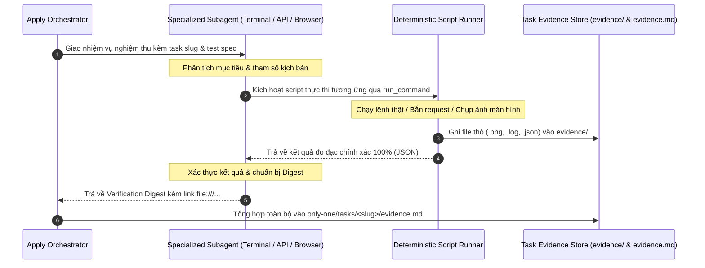

# Concept: Automated Runtime Verification & Evidence Collector

## 1. Problem & Goal

### Problem (Current Bottlenecks & Deficiencies)
- **Context & Trigger**: Khi kết thúc thực thi kế hoạch trong `/only-one-apply`, hệ thống cần thẩm định kết quả kiểm thử và nghiệm thu runtime.
- **Symptom & Defect**: Quy trình hiện tại chỉ đánh dấu checkbox thủ công (`[x] PASS`), thiếu bằng chứng khách quan; các subagents nghiệm thu hiện tại (`terminal-runner`, `browser-tester`, `api-tester`, `codebase-scout`) hoạt động rời rạc, chưa có cơ chế lưu trữ file bằng chứng (artifacts) vào task.
- **Root Cause**: System prompt của các subagents hiện tại chỉ yêu cầu in text tóm tắt thô ra chat (Zero Raw Dump) mà chưa được trang bị hợp đồng lưu vết (Persistence Invariants); thiếu bộ script thực thi tất định làm công cụ phụ trợ cho subagents.
- **Impact / Blast Radius**: Nguy cơ lọt lỗi runtime, tốn thời gian kiểm tra thủ công, và thiếu hồ sơ đối soát (audit trail) độc lập khi nghiệm thu tính năng.

### Goal (Target Technical Outcomes)
- **Core Goal**: Cải tiến toàn diện 4 Subagents kết hợp bộ Scripts tất định để tự động thực thi kiểm thử, thu thập và lưu trữ toàn bộ bằng chứng runtime (Web, CLI, Backend) cùng kết quả Test Suite vào file độc lập `evidence.md`.
- **Acceptance Criteria**:
  - Nâng cấp `assets/agents/subagents/terminal-runner.md`: Tự động chạy test suite và lệnh CLI, bắt exit code, khử ANSI, lưu toàn văn log vào `evidence/terminal/*.log`.
  - Nâng cấp `assets/agents/subagents/browser-tester.md`: Tự động mở web qua Playwright, thao tác user flow, chụp ảnh màn hình lưu vào `evidence/screenshots/*.png`, bắt lỗi console/network.
  - Nâng cấp `assets/agents/subagents/api-tester.md`: Tự động gửi request kiểm thử API, lưu payload JSON vào `evidence/api/*.json`, đo latency thực tế và kiểm tra race condition qua script hỗ trợ.
  - Nâng cấp `assets/agents/subagents/codebase-scout.md`: Tự động trích xuất các điểm neo route API, CLI entry points và component UI để cung cấp input chính xác cho 3 testing subagents.
  - Tự động kết xuất file tổng hợp `only-one/tasks/<slug>/evidence.md` liên kết trực tiếp tới các tệp bằng chứng qua định dạng `file:///...`.

## 2. Scope Boundaries

- **In-Scope**:
  - **Cải tiến 4 Subagents (`assets/agents/subagents/`)**:
    - `terminal-runner.md`: Bổ sung Invariant lưu file log ngoài đĩa và trả về đường dẫn bằng chứng.
    - `browser-tester.md`: Bổ sung Invariant lưu ảnh chụp màn hình vào thư mục task `evidence/screenshots/`.
    - `api-tester.md`: Bổ sung Invariant lưu request/response payload vào `evidence/api/`.
    - `codebase-scout.md`: Bổ sung khả năng định vị test targets (routes, CLI flags, pages) cho testing subagents.
  - **Xây dựng bộ Deterministic Scripts phụ trợ cho Subagents**:
    - Script thực thi lệnh và khử ANSI cho `terminal-runner`.
    - Script đo latency và burst concurrency cho `api-tester`.
    - Script chạy kịch bản Playwright headless cho `browser-tester`.
  - **Chuẩn hóa cấu trúc Evidence Store**:
    - Thư mục lưu trữ: `only-one/tasks/<slug>/evidence/` (chứa `screenshots/`, `terminal/`, `api/`).
    - File báo cáo chính: `only-one/tasks/<slug>/evidence.md`.
  - **Tích hợp quy trình SDLC**:
    - Cập nhật `/only-one-plan` (Section 3): Sinh ra kịch bản nghiệm thu cụ thể làm đề bài cho các Subagents.
    - Cập nhật `/only-one-apply` (Step 5): Kích hoạt Subagents thu thập bằng chứng và ghi nhận `evidence.md`.

- **Explicit Out-of-Scope**:
  - Không thay thế framework test nội bộ của dự án (Jest, Vitest, Playwright config gốc).
  - Không sửa đổi mã nguồn nghiệp vụ của dự án (`src/...`).
  - Không ghi hình video màn hình; chỉ chụp ảnh tĩnh `.png`.
  - Không yêu cầu kết nối mạng ra ngoài; chỉ kiểm thử trên môi trường local/dev server.

## 3. Proposed Solution & Core Mechanism

### 3.1. Mô hình Phối hợp: Subagent Brain + Script Muscle (Two-Tier Architecture)

Thay vì để LLM Subagent tự làm toán tính P95 hay parse text thủ công (dễ sai lệch), Subagent sẽ đóng vai trò **Nhạc trưởng điều phối (Brain)**, còn Script đóng vai trò **Cơ bắp thực thi chính xác (Muscle)**:



### 3.2. Ma trận Nâng cấp 4 Subagents

| Subagent | Vai trò mới | Công cụ / Scripts hỗ trợ | Bằng chứng tạo ra (Artifacts) |
| :--- | :--- | :--- | :--- |
| **`terminal-runner`** | Thực thi test suite (unit/integration) và test CLI commands. | Script Node.js `child_process` + Regex ANSI stripper. | File `evidence/terminal/<command>.log` + Exit code + Duration. |
| **`browser-tester`** | Điều hướng UI, kiểm tra tương tác nút bấm, form input. | Script Playwright headless + event listener console/network. | Ảnh `evidence/screenshots/<step>.png` + Bảng đếm lỗi console. |
| **`api-tester`** | Thẩm định JSON schema, đo latency P50/P95, test race conditions. | Script fetch burst + `performance.now()` + schema validator. | File `evidence/api/<endpoint>.json` chứa full request/response & metrics. |
| **`codebase-scout`** | Trinh sát mã nguồn, cung cấp danh sách API endpoints, CLI flags, URL routes cho 3 subagents trên. | CLI `ast-grep scan --json` + TypeScript AST parser. | Bản trinh sát kỹ thuật (Technical Digest) chứa danh sách targets cần test. |

### 3.3. Bố cục File Báo cáo Nghiệm thu `evidence.md`

```text
+-----------------------------------------------------------------------+
| # Runtime Verification Report: [Task Title]                           |
| Slug: <slug> | Status: VERIFIED | Timestamp: <ISO-8601>               |
+-----------------------------------------------------------------------+
| ## 1. Executive Summary                                               |
| - Overall Status: ✅ ALL PASS (X/X checks verified)                   |
| - Execution Time: 3.8s                                                |
+-----------------------------------------------------------------------+
| ## 2. Automated Test Suite Results (Thu thập bởi terminal-runner)     |
| | Suite            | Command        | Status  | Tests Pass/Fail | Dur |
| |------------------|----------------|---------|-----------------|-----|
| | Unit Tests       | npm test       | PASS    | 24/24 passed    | 1.2s|
| | Linter           | npm run lint   | PASS    | 0 errors        | 0.5s|
+-----------------------------------------------------------------------+
| ## 3. Runtime Verification Evidence                                   |
| ### 🌐 Frontend (browser-tester)                                      |
| - Action: Checkout Flow                                               |
| - Visual Evidence: [01-checkout.png](file:///...)                     |
| - Console Errors: 0 warnings, 0 errors                                |
|                                                                       |
| ### 💻 CLI Command (terminal-runner)                                  |
| - Command: only-one combo install                                     |
| - Exit Code: 0 | Output Log: [cli-run.log](file:///...)               |
|                                                                       |
| ### ⚙️ Backend API (api-tester)                                       |
| - Endpoint: POST /api/v1/orders (Status: 201 Created)                 |
| - Performance: P50: 12ms | P95: 28ms                                  |
| - Payload Evidence: [post-order.json](file:///...)                    |
+-----------------------------------------------------------------------+
| ## 4. Acceptance Criteria Traceability                                |
| - [x] Tiêu chí 1: Đã xác thực qua Unit Test                           |
| - [x] Tiêu chí 2: Đã xác thực qua Runtime Screenshot                  |
+-----------------------------------------------------------------------+
```

### 3.4. Đặc tả Vận hành Cốt lõi của Bộ Scripts (Operational Specifications)

Để đảm bảo tính tất định, ổn định và không làm gián đoạn hệ thống, toàn bộ các tác vụ của bộ Scripts được chuẩn hóa chi tiết như sau:

#### 1. Tác vụ Terminal & Kiểm thử Lệnh CLI (`run-terminal.ts`)
- **Mở Terminal & Chạy Lệnh**: Sử dụng `node:child_process.spawn` chạy trực tiếp trên shell hệ điều hành (`pwsh`/`cmd` trên Windows, `sh` trên Unix).
- **Cơ chế Chống Treo Lệnh (Anti-Hang Invariant)**: Bắt buộc gắn bộ định thời cứng (`timeout: 30s`). Nếu tiến trình không kết thúc kịp, script tự động gửi tín hiệu `SIGTERM`/`SIGKILL` và báo lỗi timeout thay vì làm đứng quy trình.
- **Tách Luồng & Khử ANSI**: Tách biệt rõ hai luồng `stdout` và `stderr`. Khử sạch các mã màu ANSI escape sequences bằng biểu thức chính quy (Regex) để đảm bảo tệp nhật ký là văn bản thuần túy.
- **Khu biệt Lỗi & Trích xuất Stack Trace**: Khi lệnh thất bại (exit code khác 0), script tự động dò tìm vị trí lỗi (dòng chứa `Error:`, `Exception:`, `FAIL:`) và cắt đúng 20 dòng stack trace quan trọng nhất để đưa vào báo cáo tóm tắt.
- **Bóc tách Chỉ số Test Suite**: Tự động parse kết quả của các framework kiểm thử (Jest/Vitest/Mocha) để lấy chính xác: tổng số test, số test passed, số test failed, và tổng thời gian chạy (duration).
- **Lưu trữ Tệp Nhật ký**: Ghi toàn văn kết quả thô ra `only-one/tasks/<slug>/evidence/terminal/<command-slug>.log`.

#### 2. Tác vụ Trình duyệt & Kiểm thử Giao diện Web (`run-browser.ts`)
- **Mở Trình duyệt (Browser Launch)**: Khởi tạo Playwright Chromium ở chế độ ngầm định **`headless: true`** (chạy ngầm trong nền, không tự động bật cửa sổ giao diện đè lên màn hình làm việc của người dùng).
- **Độ phân giải Màn hình (Viewport)**: Mặc định thiết lập chuẩn `1280x720` (Desktop) hoặc `375x812` (Mobile) tùy theo cấu hình kịch bản.
- **Điều hướng & Cơ chế Chờ Tải Trang (Auto-Wait)**: Sử dụng `page.goto(url, { waitUntil: 'networkidle' })` hoặc đợi component mục tiêu xuất hiện (`page.waitForSelector()`) trước khi tương tác.
- **Thao tác Người dùng Tự động**: Hỗ trợ điền form (`page.fill()`), click nút bấm/liên kết (`page.click()`), chọn dropdown (`page.selectOption()`), và chờ chuyển trang (`page.waitForURL()`).
- **Giám sát DevTools Console & Network**: Lắng nghe `page.on('console')` và `page.on('requestfailed')` để tự động đếm và ghi lại các cảnh báo, lỗi runtime (console errors) và các lệnh gọi mạng thất bại (HTTP 4xx/5xx).
- **Chụp ảnh Màn hình Toàn Trang (Full-Page Screenshot)**: Gọi `await page.screenshot({ path, fullPage: true })` sau mỗi bước quan trọng. Ảnh được lưu tuần tự vào `only-one/tasks/<slug>/evidence/screenshots/<step-slug>.png`.
- **Dọn dẹp Tài nguyên & Giải phóng RAM (Resource Cleanup)**: Toàn bộ quy trình trình duyệt được bọc trong `try ... finally { await browser.close(); }` để triệt tiêu nguy cơ rò rỉ bộ nhớ hoặc tiến trình Chromium chạy ngầm.

#### 3. Tác vụ Kiểm thử Backend API & Concurrency (`run-api.ts`)
- **Gửi HTTP Request Thật**: Thực hiện gọi trực tiếp bằng `fetch` native với đầy đủ Method (GET, POST, PUT, DELETE, PATCH), Headers, Query Parameters, và Request Body JSON.
- **Bắn Đồng thời Kiểm tra Đua Trạng thái (Burst Concurrency)**: Gửi đồng thời N requests (mặc định 10 requests) bằng `Promise.allSettled()` để kiểm tra Transaction Lock, Optimistic/Pessimistic Locks, và tính Idempotency của API.
- **Đo lường Độ trễ Thời gian thực**: Đo thời gian phản hồi bằng `performance.now()`, tính toán chính xác tuyệt đối các chỉ số độ trễ P50, P90, P95, P99 và tỷ lệ lỗi (Error Rate %).
- **Thẩm định Trạng thái & Schema (Schema Assertion)**: Đối soát mã trạng thái HTTP thực tế so với mã mong đợi (200, 201, 400...), kiểm tra tính đầy đủ của các trường dữ liệu bắt buộc trong JSON response.
- **Lưu trữ Bằng chứng Payload**: Ghi toàn bộ Request headers, Request body, Response headers, Response body, HTTP status và latency vào file `only-one/tasks/<slug>/evidence/api/<endpoint-slug>.json`.

#### 4. Tác vụ Trinh sát Cú pháp Mã nguồn (`run-scout.ts`)
- **Quét Cú pháp AST Tốc độ cao**: Thực thi `ast-grep scan --json -p '<pattern>'` trực tiếp ở tầng máy tính (0 token LLM), fallback sang `ripgrep` khi cần tìm chuỗi ký tự.
- **Định vị Tự động Mục tiêu Kiểm thử (Test Targets Discovery)**: Tự động trích xuất các route decorator mới sửa (e.g., `@Get()`, `@Post()`, `app.get()`), các cờ CLI mới đăng ký, hoặc các component URL routes để cung cấp danh sách kiểm thử chính xác cho 3 testing runners.
- **Trích xuất Chữ ký & Điểm Neo**: Xuất chính xác số dòng neo (`file:///path#L10-L40`), interface, exported types và invariants phục vụ đối soát.

#### 5. Tác vụ Tổng hợp Bằng chứng & Xuất Bản Báo cáo (`aggregate-evidence.ts`)
- **Khởi tạo Cây Thư mục Bằng chứng**: Tự động thực thi `mkdir -p` khởi tạo các thư mục con `evidence/screenshots/`, `evidence/terminal/`, và `evidence/api/` theo task slug.
- **Sinh Báo cáo Độc lập `evidence.md`**: Tổng hợp kết quả từ 4 tác vụ trên thành bảng đối soát hoàn chỉnh, phân nhóm rõ ràng (Executive Summary, Test Suite Results, Runtime Evidence, Acceptance Criteria Traceability).
- **Tạo Liên kết Chuẩn IDE**: Tự động chèn liên kết dạng `file:///...` tương thích với VS Code/Cursor để người dùng click mở ảnh chụp hoặc xem log ngay lập tức.
- **Cập nhật Con trỏ `plan.md`**: Tự động đánh dấu `[x]` vào Section 3 của `plan.md` và gắn đường dẫn trỏ trực tiếp sang `evidence.md`.

## 4. Critical Risks & Edge Cases (Phân tích Rủi ro & Cơ chế Phòng vệ)

- **Rủi ro 1: Server nội bộ chưa sẵn sàng khi Subagent chạy kiểm thử Web hoặc API**
  - *Mặt tiêu cực / Nguy cơ*: Subagent gửi request hoặc Playwright mở trang gặp lỗi kết nối (ECONNREFUSED), gây sập tiến trình nghiệm thu.
  - *Cơ chế phòng vệ*: Script phụ trợ thực hiện kiểm tra cổng mạng (`socket readiness check`) tối đa 5s. Nếu server chưa khởi động, Subagent ghi nhận trạng thái `SKIPPED_SERVER_UNAVAILABLE` vào `evidence.md` kèm hướng dẫn rõ ràng thay vì làm crash luồng apply.

- **Rủi ro 2: Môi trường chưa cài đặt sẵn Playwright browser binaries**
  - *Mặt tiêu cực / Nguy cơ*: `browser-tester` bị ném ngoại lệ do thiếu thư viện trình duyệt Chromium/Firefox.
  - *Cơ chế phòng vệ*: `browser-tester` kiểm tra tính khả dụng của browser trước khi kích hoạt. Nếu thiếu binary, ghi nhận cảnh báo vào `evidence.md` và kích hoạt chế độ fallback kiểm tra HTTP response tĩnh đơn thuần.

- **Rủi ro 3: Dữ liệu log hoặc payload JSON quá lớn làm phình tài liệu**
  - *Mặt tiêu cực / Nguy cơ*: Báo cáo `evidence.md` trở nên cồng kềnh, khó đọc và gây chậm IDE.
  - *Cơ chế phòng vệ*: Báo cáo `evidence.md` chỉ lưu bản trích đoạn (dưới 20 dòng) và đường dẫn liên kết; toàn văn nội dung chi tiết được các subagents lưu riêng biệt trong thư mục `evidence/`.
