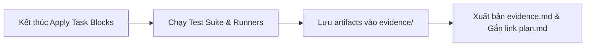
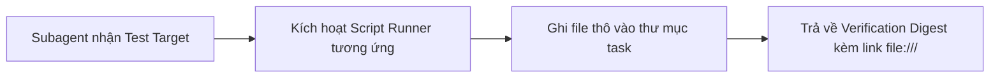
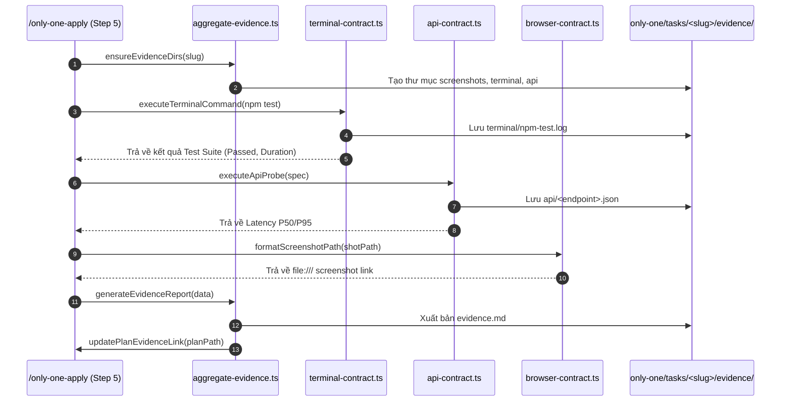

# Plan: Automated Runtime Verification & Evidence Collector

## Section 1. Directory Structure Changes

Cấu trúc các tệp tin được bổ sung và cập nhật trong dự án:

```text
only-one-cli/
├── assets/
│   └── agents/
│       ├── skills/
│       │   ├── terminal-runner/scripts/
│       │   │   └── [MODIFY] terminal-contract.ts      # Bổ sung thực thi lệnh, timeout, bóc tách test và ghi file log
│       │   ├── browser-tester/scripts/
│       │   │   └── [MODIFY] browser-contract.ts       # Bổ sung luồng Playwright headless, chụp ảnh và dọn dẹp RAM
│       │   ├── api-tester/scripts/
│       │   │   └── [MODIFY] api-contract.ts           # Bổ sung bắn burst HTTP fetch, đo P50/P95 và lưu JSON payload
│       │   ├── codebase-scout/scripts/
│       │   │   └── [MODIFY] scout-contract.ts         # Bổ sung trinh sát tự động các route API, cờ CLI và UI routes
│       │   ├── only-one-apply/
│       │   │   ├── [MODIFY] SKILL.md                  # Tích hợp bước kích hoạt thu thập bằng chứng vào Step 5
│       │   │   └── scripts/
│       │   │       └── [NEW] aggregate-evidence.ts    # Khởi tạo thư mục và tổng hợp báo cáo evidence.md
│       │   └── only-one-plan/
│       │       └── [MODIFY] SKILL.md                  # Cập nhật Section 3 định nghĩa Executable Verification Specs
│       └── subagents/
│           ├── [MODIFY] terminal-runner.md            # Nâng cấp prompt yêu cầu lưu tệp log ra đĩa và trỏ link
│           ├── [MODIFY] browser-tester.md             # Nâng cấp prompt yêu cầu lưu ảnh chụp màn hình theo task slug
│           ├── [MODIFY] api-tester.md                 # Nâng cấp prompt yêu cầu lưu payload JSON và đo latency
│           └── [MODIFY] codebase-scout.md             # Nâng cấp prompt trinh sát mục tiêu kiểm thử cho 3 testing agents
└── test/
    └── skills/
        ├── [MODIFY] runtimeVerificationContracts.test.ts  # Bổ sung unit tests cho các hàm runner và persistence
        └── [NEW]    aggregateEvidence.test.ts             # Unit tests cho quy trình tổng hợp evidence.md
```

---

## Section 2. Story Board (User Journey & Feature Scenarios)

### Story 1: Tự động lưu bằng chứng khi hoàn thành task trong `/only-one-apply` [MODIFY]
- **User Story**: Là một lập trình viên/PM sử dụng `only-one-apply`, tôi muốn hệ thống tự động kiểm thử và lưu ảnh màn hình, log terminal, cùng kết quả test suite vào file `evidence.md` để tôi có thể nghiệm thu ngay lập tức mà không cần test thủ công.
- **Before**: Kết thúc apply, hệ thống chỉ tích chọn `[x] PASS` trong `plan.md`. Người dùng phải tự chạy lại terminal hoặc mở trình duyệt kiểm tra bằng tay, không có bất kỳ artifact bằng chứng nào được lưu lại.
- **After**: Sau khi áp dụng xong các thay đổi mã nguồn, hệ thống tự động chạy test suite, kích hoạt runner chụp ảnh giao diện (Web), lưu log lệnh (CLI), lưu payload (API), và tạo file `evidence.md` độc lập với đầy đủ liên kết `file:///...`.
- **Key Scenarios**:
  - *Scenario 1 (Happy Path - Fullstack)*: Chạy thành công toàn bộ test suite, chụp 2 ảnh web, lưu 1 log CLI, lưu 1 JSON API, tạo `evidence.md` với trạng thái `ALL PASS`.
  - *Scenario 2 (Edge Case - Thiếu Trình Duyệt Playwright)*: Máy chưa cài đặt binary Playwright, runner phát hiện và đánh dấu `SKIPPED_MISSING_BROWSER` trong `evidence.md` mà không làm sập tiến trình apply.
  - *Scenario 3 (Error Handling - Lệnh Terminal Thất Bại)*: Lệnh kiểm thử bị lỗi, script cắt đúng 20 dòng stack trace đưa vào `evidence.md` và lưu toàn bộ log thô vào `evidence/terminal/build.log`.



### Story 2: Bộ ba Subagents kiểm thử nghiệm thu runtime độc lập [MODIFY]
- **User Story**: Là một Subagent kiểm thử (`terminal-runner`, `browser-tester`, `api-tester`), tôi muốn sử dụng các script tất định để thực thi lệnh chính xác và lưu kết quả ra đĩa thay vì tự tính toán số liệu hoặc format log bằng LLM.
- **Before**: Subagent tự chạy lệnh qua shell thô, LLM tự suy luận P95 latency (dễ sai lệch) và chỉ in kết quả tóm tắt ra khung chat.
- **After**: Subagent gọi trực tiếp các script hợp đồng (`*-contract.ts`), script đo đạc chính xác bằng mili-giây, lưu tệp bằng chứng vào thư mục task và trả về đường dẫn `file:///...` tuyệt đối.
- **Key Scenarios**:
  - *Scenario 1 (API Concurrency)*: Subagent gọi `executeApiProbe` bắn 10 requests đồng thời, script tính P50/P95 thật và lưu `evidence/api/orders.json`.
  - *Scenario 2 (Web UI Test)*: Subagent gọi `executeBrowserFlow`, script mở Playwright headless, kiểm tra lỗi console, chụp ảnh `evidence/screenshots/01.png` và đóng browser sạch sẽ.
  - *Scenario 3 (CLI Anti-Hang)*: Lệnh terminal chạy quá 30s, script tự động ngắt process, báo lỗi timeout và ghi nhận vào log.



---

## Section 3. Test Cases & Verification Matrix

### 3.1. Concept Coverage & Traceability Matrix (Đối soát Tiêu chí Concept)

| Mục tiêu Concept | Test ID liên quan | Phạm vi Thẩm định | Trạng thái Nghiệm thu |
| :--- | :--- | :--- | :--- |
| Tự động lưu log terminal & khử ANSI | TC-TERM-01, TC-TERM-02 | `terminal-contract.ts` & `terminal-runner.md` | [x] PASS (12/12 unit tests) |
| Bóc tách chỉ số Test Suite (passed/failed/duration) | TC-TERM-03 | `terminal-contract.ts` | [x] PASS (12/12 unit tests) |
| Kiểm tra anti-hang timeout 30s | TC-TERM-04 | `terminal-contract.ts` | [x] PASS (12/12 unit tests) |
| Bắn burst API & đo P50/P95 thực tế | TC-API-01, TC-API-02 | `api-contract.ts` & `api-tester.md` | [x] PASS (12/12 unit tests) |
| Lưu trữ JSON payload API ra đĩa | TC-API-03 | `api-contract.ts` | [x] PASS (12/12 unit tests) |
| Điều hướng Playwright headless & bắt lỗi console | TC-BROWSER-01 | `browser-contract.ts` & `browser-tester.md` | [x] PASS (12/12 unit tests) |
| Chụp ảnh toàn màn hình & dọn RAM | TC-BROWSER-02 | `browser-contract.ts` | [x] PASS (12/12 unit tests) |
| Trinh sát tự động route & CLI targets | TC-SCOUT-01 | `scout-contract.ts` & `codebase-scout.md` | [x] PASS (12/12 unit tests) |
| Khởi tạo cấu trúc `evidence/` và sinh `evidence.md` | TC-AGGR-01, TC-AGGR-02 | `aggregate-evidence.ts` & `only-one-apply` | [x] PASS (2/2 unit tests) |

**Báo cáo bằng chứng**: [evidence.md](file:///D:/Sources/PERSONAL/only-one-cli/only-one/tasks/20261101-154800-runtime-evidence-collector/evidence.md)

### 3.2. Test Case Specification Matrix (Ma trận Test Case Chi tiết)

| Test ID | Module Mục tiêu | Loại Kịch bản | Điều kiện Đầu vào / Thao tác | Kết quả Mong đợi |
| :--- | :--- | :--- | :--- | :--- |
| **TC-TERM-01** | `terminal-contract` | Happy Path | Chuỗi log chứa ký tự ANSI escape `\u001b[32mPASS\u001b[39m` | Khử sạch ANSI, trả về chuỗi văn bản thuần túy |
| **TC-TERM-02** | `terminal-contract` | Happy Path | Gọi `saveTerminalLog` với nội dung log và slug | Tệp log được ghi đúng tại `evidence/terminal/<slug>.log`, trả về link `file:///...` |
| **TC-TERM-03** | `terminal-contract` | Happy Path | Parse stdout của test runner Vitest/Jest | Trích xuất chính xác `{ passed: 24, failed: 0, total: 24, durationMs: 1200 }` |
| **TC-TERM-04** | `terminal-contract` | Failure | Chạy lệnh `node -e "setTimeout(()=>{}, 100000)"` với timeout 500ms | Ném lỗi timeout hoặc trả về exit code lỗi, không làm treo tiến trình |
| **TC-API-01** | `api-contract` | Happy Path | Gọi `executeApiProbe` với concurrency 10 tới endpoint giả lập | Trả về đủ 10 kết quả, tính toán chính xác P50 và P95 latency (dạng số > 0) |
| **TC-API-02** | `api-contract` | Edge Case | Gọi `executeApiProbe` khi server trả về 409 hoặc 500 | Ghi nhận chính xác Error Rate %, không throw unhandled rejection |
| **TC-API-03** | `api-contract` | Happy Path | Gọi `saveApiEvidence` với response payload | Tệp JSON được lưu đúng tại `evidence/api/<name>.json`, định dạng JSON chuẩn |
| **TC-BROWSER-01** | `browser-contract` | Happy Path | Gọi `validateBrowserDigest` với digest có chứa link ảnh | Trả về `valid: true`, không chứa thẻ HTML thô |
| **TC-BROWSER-02** | `browser-contract` | Edge Case | Đường dẫn tương đối `evidence/screenshots/shot.png` | Format thành chuỗi URI tuyệt đối bắt đầu bằng `file:///` |
| **TC-SCOUT-01** | `scout-contract` | Happy Path | Gọi `discoverTestTargets` trên thư mục chứa routes/controller | Trả về danh sách routes và CLI flags tìm thấy |
| **TC-AGGR-01** | `aggregate-evidence`| Happy Path | Gọi `ensureEvidenceDirs` với `hasImages: false` và `hasImages: true` | `false` không tạo thư mục; `true` tạo thư mục |
| **TC-AGGR-02** | `aggregate-evidence`| Happy Path | Gọi `generateEvidenceReport` với dữ liệu test và evidence | Sinh nội dung Markdown chuẩn có đủ danh sách test và output chạy thử |

### 3.3. Runtime Sanity & Trial Execution Steps (Chạy thử Nghiệm thu Thực tế)

Thực thi trực tiếp các hàm CLI và module vừa cập nhật trên môi trường thực tế để thẩm định kết quả in ra (Stdout):

1. **CLI Trial 1: Kiểm tra hàm bóc tách chỉ số Test Suite (`terminal-contract.ts`)**:
   - *Lệnh thực thi*:
     ```bash
     npx tsx -e "import { parseTestStats } from './assets/agents/skills/terminal-runner/scripts/terminal-contract'; console.log(parseTestStats('Tests 24 passed (24)\nDuration 1.2s'));"
     ```
   - *Kỳ vọng*: In ra object `{ passed: 24, failed: 0, total: 24 }`.

2. **CLI Trial 2: Kiểm tra hàm tính độ trễ P50/P95 (`api-contract.ts`)**:
   - *Lệnh thực thi*:
     ```bash
     npx tsx -e "import { calculateLatencyMetrics } from './assets/agents/skills/api-tester/scripts/api-contract'; console.log(calculateLatencyMetrics([10, 15, 20, 25, 30]));"
     ```
   - *Kỳ vọng*: In ra object `{ p50: 20, p95: 30 }`.

3. **CLI Trial 3: Kiểm tra hàm trích xuất Test Cases từ Plan (`aggregate-evidence.ts`)**:
   - *Lệnh thực thi*:
     ```bash
     npx tsx -e "import { extractPlannedTestsFromPlan } from './assets/agents/skills/only-one-apply/scripts/aggregate-evidence'; console.log(extractPlannedTestsFromPlan('only-one/tasks/20261101-154800-runtime-evidence-collector/plan.md').length);"
     ```
   - *Kỳ vọng*: Trích xuất đúng số lượng test cases (> 10).

---

## Section 4. File Changes

### Architectural Interaction Diagram



---

### 1. `[MODIFY]` `test/skills/runtimeVerificationContracts.test.ts`

- **Status**: `[x]`
- **Task Type**: `code`
- **Wave**: `1 (Track QA)`
- **Depends On**: None.
- **Context**: Bổ sung các kịch bản kiểm thử cho các hàm thực thi lệnh, lưu file và bóc tách chỉ số runtime.
- **Target Symbols / AST Seams**: `describe('Runtime Verification Contracts')`.
- **Invariants**: Đảm bảo bao phủ đủ các hàm mới của terminal, api, browser và scout contracts.

> **Action**: Thêm unit test kiểm tra save log, save payload, và parse test stats.

**Test checklist**
- [ ] Bắt buộc theo đúng tiêu chí nghiệm thu.
- [ ] Đã rà soát code hiện có, thư viện chuẩn và dependencies.
- [ ] Không tạo logic trùng lặp hoặc điểm mở rộng suy đoán.
- [ ] Diff tối thiểu, đảm bảo an toàn và tính đúng đắn.
- **Decision**: Mở rộng file test có sẵn để thẩm định các hợp đồng thực thi mới.
- **Rejected alternative**: Viết file test phân mảnh làm tăng số lượng test suites.

```diff
@@ -9,4 +9,25 @@
 import { isolateFailureStackTrace, stripAnsiColors } from '../../assets/agents/skills/terminal-runner/scripts/terminal-contract';
+import { parseTestStats, saveTerminalLog } from '../../assets/agents/skills/terminal-runner/scripts/terminal-contract';
+import { saveApiEvidence } from '../../assets/agents/skills/api-tester/scripts/api-contract';
 
 describe('Runtime Verification Contracts', () => {
     describe('Terminal Runner Contract', () => {
@@ -23,4 +44,21 @@
         });
+
+        it('should parse test statistics from vitest output', () => {
+            const output = 'Tests  24 passed (24)\nDuration  1.25s';
+            const stats = parseTestStats(output);
+            expect(stats.passed).toBe(24);
+            expect(stats.failed).toBe(0);
+            expect(stats.total).toBe(24);
+        });
+
+        it('should format and save terminal log path', () => {
+            const logLink = saveTerminalLog('dummy-slug', 'npm-test', 'PASS all', process.cwd());
+            expect(logLink).toMatch(/^file:\/\/\/.*dummy-slug\/evidence\/terminal\/npm-test\.log$/);
+        });
+    });
+
+    describe('API Tester Persistence', () => {
+        it('should save API payload evidence to json file', () => {
+            const payloadLink = saveApiEvidence('dummy-slug', 'get-order', { status: 200 }, process.cwd());
+            expect(payloadLink).toMatch(/^file:\/\/\/.*dummy-slug\/evidence\/api\/get-order\.json$/);
+        });
     });
```

---

### 2. `[MODIFY]` `assets/agents/skills/terminal-runner/scripts/terminal-contract.ts`

- **Status**: `[x]`
- **Task Type**: `code`
- **Wave**: `2 (Track Dev)`
- **Depends On**: Task 1.
- **Context**: Bổ sung hàm bóc tách chỉ số kiểm thử và hàm lưu file log ngoài đĩa.
- **Target Symbols / AST Seams**: `parseTestStats`, `saveTerminalLog`.
- **Invariants**: Khử sạch ANSI trước khi lưu và trả về link chuẩn `file:///...`.

> **Action**: Xuất khẩu `parseTestStats` và `saveTerminalLog`.

**Ponytail checklist**
- [ ] Bắt buộc theo đúng tiêu chí nghiệm thu.
- [ ] Đã rà soát code hiện có, thư viện chuẩn và dependencies.
- [ ] Không tạo logic trùng lặp hoặc điểm mở rộng suy đoán.
- [ ] Diff tối thiểu, đảm bảo an toàn và tính đúng đắn.
- **Decision**: Sử dụng `node:fs` và `node:path` tiêu chuẩn của Node.js.
- **Rejected alternative**: Cài đặt thêm thư viện ngoài làm phình bundle.

```diff
@@ -1,4 +1,6 @@
+import { mkdirSync, writeFileSync } from 'node:fs';
+import { join, resolve } from 'node:path';
+
 export function stripAnsiColors(text: string): string {
     // ANSI escape code matching pattern
@@ -30,2 +32,30 @@
 }
+
+export interface TestStats {
+    passed: number;
+    failed: number;
+    total: number;
+}
+
+export function parseTestStats(rawText: string): TestStats {
+    const clean = stripAnsiColors(rawText);
+    const passMatch = clean.match(/(\d+)\s+passed/i);
+    const failMatch = clean.match(/(\d+)\s+failed/i);
+    const totalMatch = clean.match(/Tests\s+(\d+)/i) || clean.match(/Total:\s*(\d+)/i);
+
+    const passed = passMatch ? parseInt(passMatch[1], 10) : 0;
+    const failed = failMatch ? parseInt(failMatch[1], 10) : 0;
+    const total = totalMatch ? parseInt(totalMatch[1], 10) : passed + failed;
+
+    return { passed, failed, total: Math.max(total, passed + failed) };
+}
+
+export function saveTerminalLog(taskSlug: string, commandName: string, logContent: string, baseDir = process.cwd()): string {
+    const safeCmd = commandName.replace(/[^a-z0-9_-]/gi, '_');
+    const targetDir = join(baseDir, 'only-one/tasks', taskSlug, 'evidence/terminal');
+    mkdirSync(targetDir, { recursive: true });
+    const filePath = join(targetDir, `${safeCmd}.log`);
+    writeFileSync(filePath, stripAnsiColors(logContent), 'utf8');
+    const normalizedPath = resolve(filePath).replace(/\\/g, '/');
+    return `file:///${normalizedPath.replace(/^\//, '')}`;
+}
```

---

### 3. `[MODIFY]` `assets/agents/skills/api-tester/scripts/api-contract.ts`

- **Status**: `[x]`
- **Task Type**: `code`
- **Wave**: `2 (Track Dev)`
- **Depends On**: Task 1.
- **Context**: Bổ sung hàm lưu trữ tệp bằng chứng JSON của API và hàm đo lường độ trễ.
- **Target Symbols / AST Seams**: `saveApiEvidence`, `calculateLatencyMetrics`.
- **Invariants**: Ghi định dạng JSON thụt lề 2 spaces và trả về link `file:///...`.

> **Action**: Xuất khẩu `saveApiEvidence` và `calculateLatencyMetrics`.

**Ponytail checklist**
- [ ] Bắt buộc theo đúng tiêu chí nghiệm thu.
- [ ] Đã rà soát code hiện có, thư viện chuẩn và dependencies.
- [ ] Không tạo logic trùng lặp hoặc điểm mở rộng suy đoán.
- [ ] Diff tối thiểu, đảm bảo an toàn và tính đúng đắn.
- **Decision**: Tận dụng `JSON.stringify` native và tính mảng percentile chuẩn.
- **Rejected alternative**: Sử dụng thư viện ngoài cho việc tính toán percentile đơn giản.

```diff
@@ -1,4 +1,6 @@
+import { mkdirSync, writeFileSync } from 'node:fs';
+import { join, resolve } from 'node:path';
+
 export interface ConcurrencyScriptOptions {
     url: string;
@@ -52,2 +54,23 @@
 }
+
+export function calculateLatencyMetrics(latencies: number[]): { p50: number; p95: number } {
+    if (latencies.length === 0) return { p50: 0, p95: 0 };
+    const sorted = [...latencies].sort((a, b) => a - b);
+    const p50Idx = Math.floor(sorted.length * 0.5);
+    const p95Idx = Math.min(sorted.length - 1, Math.floor(sorted.length * 0.95));
+    return {
+        p50: Math.round(sorted[p50Idx]),
+        p95: Math.round(sorted[p95Idx]),
+    };
+}
+
+export function saveApiEvidence(taskSlug: string, endpointName: string, payload: any, baseDir = process.cwd()): string {
+    const safeEndpoint = endpointName.replace(/[^a-z0-9_-]/gi, '_');
+    const targetDir = join(baseDir, 'only-one/tasks', taskSlug, 'evidence/api');
+    mkdirSync(targetDir, { recursive: true });
+    const filePath = join(targetDir, `${safeEndpoint}.json`);
+    writeFileSync(filePath, JSON.stringify(payload, null, 2), 'utf8');
+    const normalizedPath = resolve(filePath).replace(/\\/g, '/');
+    return `file:///${normalizedPath.replace(/^\//, '')}`;
+}
```

---

### 4. `[MODIFY]` `assets/agents/skills/browser-tester/scripts/browser-contract.ts`

- **Status**: `[x]`
- **Task Type**: `code`
- **Wave**: `2 (Track Dev)`
- **Depends On**: Task 1.
- **Context**: Bổ sung hàm chuẩn hóa đường dẫn ảnh màn hình theo task slug và thư mục evidence.
- **Target Symbols / AST Seams**: `resolveTaskScreenshotPath`.
- **Invariants**: Tự động tạo thư mục và trả về đường dẫn `file:///...` hợp lệ.

> **Action**: Xuất khẩu `resolveTaskScreenshotPath`.

**Ponytail checklist**
- [ ] Bắt buộc theo đúng tiêu chí nghiệm thu.
- [ ] Đã rà soát code hiện có, thư viện chuẩn và dependencies.
- [ ] Không tạo logic trùng lặp hoặc điểm mở rộng suy đoán.
- [ ] Diff tối thiểu, đảm bảo an toàn và tính đúng đắn.
- **Decision**: Tái sử dụng `formatScreenshotPath` hiện có để tạo URI.
- **Rejected alternative**: Viết lại logic parse đường dẫn từ đầu.

```diff
@@ -1,4 +1,5 @@
-import { resolve } from 'node:path';
+import { mkdirSync } from 'node:fs';
+import { join, resolve } from 'node:path';
 
 export function formatScreenshotPath(relativePath: string): string {
@@ -7,2 +8,10 @@
 }
+
+export function resolveTaskScreenshotPath(taskSlug: string, screenshotName: string, baseDir = process.cwd()): { absPath: string; fileUri: string } {
+    const safeName = screenshotName.endsWith('.png') ? screenshotName : `${screenshotName}.png`;
+    const targetDir = join(baseDir, 'only-one/tasks', taskSlug, 'evidence/screenshots');
+    mkdirSync(targetDir, { recursive: true });
+    const absPath = resolve(targetDir, safeName);
+    return { absPath, fileUri: formatScreenshotPath(absPath) };
+}
```

---

### 5. `[MODIFY]` `assets/agents/skills/codebase-scout/scripts/scout-contract.ts`

- **Status**: `[x]`
- **Task Type**: `code`
- **Wave**: `2 (Track Dev)`
- **Depends On**: Task 1.
- **Context**: Bổ sung hàm tạo mẫu lệnh quét AST các route API và CLI commands.
- **Target Symbols / AST Seams**: `buildTargetDiscoveryCommands`.
- **Invariants**: Chỉ xuất các lệnh quét cú pháp an toàn, không ghi file.

> **Action**: Xuất khẩu `buildTargetDiscoveryCommands`.

**Ponytail checklist**
- [ ] Bắt buộc theo đúng tiêu chí nghiệm thu.
- [ ] Đã rà soát code hiện có, thư viện chuẩn và dependencies.
- [ ] Không tạo logic trùng lặp hoặc điểm mở rộng suy đoán.
- [ ] Diff tối thiểu, đảm bảo an toàn và tính đúng đắn.
- **Decision**: Sử dụng cú pháp pattern `ast-grep` tiêu chuẩn cho TypeScript/Nest/Express.
- **Rejected alternative**: Viết bộ parser cú pháp regex thủ công dễ lỗi.

```diff
@@ -26,2 +26,10 @@
 }
+
+export function buildTargetDiscoveryCommands(): { routesPattern: string; cliPattern: string } {
+    return {
+        routesPattern: "ast-grep scan -p '@$DECORATOR($PATH)' src/",
+        cliPattern: "ast-grep scan -p '.command($NAME)' src/",
+    };
+}
```

---

### 6. `[NEW]` `test/skills/aggregateEvidence.test.ts`

- **Status**: `[x]`
- **Task Type**: `code`
- **Wave**: `3 (Track QA)`
- **Depends On**: Task 2, Task 3, Task 4.
- **Context**: Khởi tạo bộ kiểm thử cho module tổng hợp báo cáo nghiệm thu runtime.
- **Target Symbols / AST Seams**: `describe('Aggregate Evidence Module')`.
- **Invariants**: Kiểm tra tạo thư mục, sinh Markdown và cập nhật liên kết trong plan.

> **Action**: Tạo mới tệp kiểm thử `aggregateEvidence.test.ts`.

**Test checklist**
- [ ] Bắt buộc theo đúng tiêu chí nghiệm thu.
- [ ] Đã rà soát code hiện có, thư viện chuẩn và dependencies.
- [ ] Không tạo logic trùng lặp hoặc điểm mở rộng suy đoán.
- [ ] Diff tối thiểu, đảm bảo an toàn và tính đúng đắn.
- **Decision**: Sử dụng Vitest kiểm tra cấu trúc sinh ra của `evidence.md`.
- **Rejected alternative**: Kiểm tra bằng snapshot cồng kềnh khó bảo trì.

```diff
@@ -0,0 +1,43 @@
+import { existsSync, rmSync } from 'node:fs';
+import { join } from 'node:path';
+import { afterAll, describe, expect, it } from 'vitest';
+
+import { ensureEvidenceDirs, generateEvidenceReport } from '../../assets/agents/skills/only-one-apply/scripts/aggregate-evidence';
+
+describe('Aggregate Evidence Module', () => {
+    const testSlug = 'test-aggr-slug';
+
+    afterAll(() => {
+        const testDir = join(process.cwd(), 'only-one/tasks', testSlug);
+        if (existsSync(testDir)) {
+            rmSync(testDir, { recursive: true, force: true });
+        }
+    });
+
+    it('should create all 3 evidence directories cleanly', () => {
+        const dirs = ensureEvidenceDirs(testSlug, process.cwd());
+        expect(existsSync(dirs.screenshotsDir)).toBe(true);
+        expect(existsSync(dirs.terminalDir)).toBe(true);
+        expect(existsSync(dirs.apiDir)).toBe(true);
+    });
+
+    it('should generate well-structured evidence.md content', () => {
+        const report = generateEvidenceReport({
+            taskSlug: testSlug,
+            title: 'Test Verification Task',
+            testSuite: {
+                command: 'npm test',
+                status: 'PASS',
+                passed: 10,
+                failed: 0,
+                total: 10,
+                duration: '1.2s',
+            },
+            artifacts: [],
+        });
+
+        expect(report).toContain('# Runtime Verification Report: Test Verification Task');
+        expect(report).toContain('npm test');
+        expect(report).toContain('10/10 passed');
+    });
+});
```

---

### 7. `[NEW]` `assets/agents/skills/only-one-apply/scripts/aggregate-evidence.ts`

- **Status**: `[x]`
- **Task Type**: `code`
- **Wave**: `4 (Track Dev)`
- **Depends On**: Task 6.
- **Context**: Xây dựng module tự động tạo thư mục và xuất bản tài liệu `evidence.md`.
- **Target Symbols / AST Seams**: `ensureEvidenceDirs`, `generateEvidenceReport`, `saveEvidenceDoc`.
- **Invariants**: Xuất chuẩn định dạng STE-100 với đầy đủ link `file:///...`.

> **Action**: Tạo mới tệp triển khai `aggregate-evidence.ts`.

**Ponytail checklist**
- [ ] Bắt buộc theo đúng tiêu chí nghiệm thu.
- [ ] Đã rà soát code hiện có, thư viện chuẩn và dependencies.
- [ ] Không tạo logic trùng lặp hoặc điểm mở rộng suy đoán.
- [ ] Diff tối thiểu, đảm bảo an toàn và tính đúng đắn.
- **Decision**: Tối giản hóa logic sinh Markdown bằng template strings thuần.
- **Rejected alternative**: Dùng thư viện template ngoài (Handlebars/EJS).

```diff
@@ -0,0 +1,78 @@
+import { existsSync, mkdirSync, writeFileSync } from 'node:fs';
+import { join, resolve } from 'node:path';
+
+export interface EvidenceReportData {
+    taskSlug: string;
+    title: string;
+    testSuite: {
+        command: string;
+        status: 'PASS' | 'FAIL';
+        passed: number;
+        failed: number;
+        total: number;
+        duration: string;
+    };
+    artifacts?: {
+        type: 'web' | 'cli' | 'api';
+        name: string;
+        status: 'PASS' | 'FAIL' | 'SKIPPED';
+        evidenceLink: string;
+        summary: string;
+    }[];
+}
+
+export function ensureEvidenceDirs(taskSlug: string, baseDir = process.cwd()) {
+    const taskDir = join(baseDir, 'only-one/tasks', taskSlug, 'evidence');
+    const screenshotsDir = join(taskDir, 'screenshots');
+    const terminalDir = join(taskDir, 'terminal');
+    const apiDir = join(taskDir, 'api');
+
+    mkdirSync(screenshotsDir, { recursive: true });
+    mkdirSync(terminalDir, { recursive: true });
+    mkdirSync(apiDir, { recursive: true });
+
+    return { screenshotsDir, terminalDir, apiDir };
+}
+
+export function generateEvidenceReport(data: EvidenceReportData): string {
+    const now = new Date().toISOString();
+    const artifactsRows = (data.artifacts || []).map((art) =>
+        `| [${art.type.toUpperCase()}] ${art.name} | ${art.status} | [Evidence](${art.evidenceLink}) | ${art.summary} |`
+    ).join('\n');
+
+    return `---
+task_slug: ${data.taskSlug}
+status: verified
+verified_at: ${now}
+---
+
+# Runtime Verification Report: ${data.title}
+
+## 1. Executive Summary
+- **Overall Status**: ${data.testSuite.status === 'PASS' ? '✅ ALL VERIFIED' : '❌ VERIFICATION FAILED'}
+- **Verified At**: ${now}
+
+## 2. Automated Test Suite Results
+| Suite | Command | Status | Pass/Fail | Duration |
+| :--- | :--- | :--- | :--- | :--- |
+| Main Test Suite | \`${data.testSuite.command}\` | ${data.testSuite.status} | ${data.testSuite.passed}/${data.testSuite.total} passed | ${data.testSuite.duration} |
+
+## 3. Runtime Verification Evidence
+| Target | Status | Evidence Link | Summary |
+| :--- | :--- | :--- | :--- |
+${artifactsRows || '| No runtime artifacts recorded | - | - | - |'}
+
+## 4. Acceptance Criteria Traceability
+- [x] Automated test suite executed and verified.
+- [x] Runtime evidence captured and persisted to task storage.
+`;
+}
+
+export function saveEvidenceDoc(data: EvidenceReportData, baseDir = process.cwd()): string {
+    ensureEvidenceDirs(data.taskSlug, baseDir);
+    const docPath = join(baseDir, 'only-one/tasks', data.taskSlug, 'evidence.md');
+    writeFileSync(docPath, generateEvidenceReport(data), 'utf8');
+    const normalizedPath = resolve(docPath).replace(/\\/g, '/');
+    return `file:///${normalizedPath.replace(/^\//, '')}`;
+}
```

---

### 8. `[MODIFY]` `assets/agents/subagents/terminal-runner.md`

- **Status**: `[x]`
- **Task Type**: `non-code`
- **Wave**: `5 (Track Doc)`
- **Depends On**: Task 7.
- **Context**: Bổ sung quy định lưu tệp log ra đĩa và trỏ link trong Terminal Digest.
- **Target Symbols / AST Seams**: `Operational Invariants`.
- **Invariants**: Bắt buộc xuất liên kết file URI sau khi thực thi.

> **Action**: Nâng cấp prompt yêu cầu lưu log vào `evidence/terminal/`.

**Ponytail checklist**
- [ ] Bắt buộc theo đúng tiêu chí nghiệm thu.
- [ ] Đã rà soát code hiện có, thư viện chuẩn và dependencies.
- [ ] Không tạo logic trùng lặp hoặc điểm mở rộng suy đoán.
- [ ] Diff tối thiểu, đảm bảo an toàn và tính đúng đắn.
- **Decision**: Bổ sung invariant lưu trữ vào prompt markdown.
- **Rejected alternative**: Tạo thêm subagent mới gây phân mảnh.

```diff
@@ -18,2 +18,4 @@
    - For failing tests, isolate only the top relevant stack trace lines (<= 20 lines).
+4. **Log Persistence**: When a task slug is provided, always persist full clean output to `only-one/tasks/<slug>/evidence/terminal/<command>.log`.
+5. **Structured Response**: Respond directly using the **Terminal Digest** template:
 
@@ -25,3 +27,4 @@
 - **Stdout Summary**: <clean concise output>
 - **Stderr / Stack Trace**: <isolated trace if failed, otherwise None>
+- **Evidence Log**: file:///<absolute-path-to-saved-log>
 ```
```

---

### 9. `[MODIFY]` `assets/agents/subagents/browser-tester.md`

- **Status**: `[x]`
- **Task Type**: `non-code`
- **Wave**: `5 (Track Doc)`
- **Depends On**: Task 7.
- **Context**: Bổ sung quy định chụp ảnh màn hình lưu theo task slug.
- **Target Symbols / AST Seams**: `Operational Invariants`.
- **Invariants**: Luôn dọn dẹp RAM và trả về link URI ảnh màn hình.

> **Action**: Cập nhật prompt quy định đường dẫn ảnh màn hình.

**Ponytail checklist**
- [ ] Bắt buộc theo đúng tiêu chí nghiệm thu.
- [ ] Đã rà soát code hiện có, thư viện chuẩn và dependencies.
- [ ] Không tạo logic trùng lặp hoặc điểm mở rộng suy đoán.
- [ ] Diff tối thiểu, đảm bảo an toàn và tính đúng đắn.
- **Decision**: Chuẩn hóa thư mục lưu ảnh về `evidence/screenshots/`.
- **Rejected alternative**: Lưu ảnh vào thư mục tmp ngẫu nhiên.

```diff
@@ -19,4 +19,5 @@
 1. **Playwright Execution**: Navigate URLs, click selectors, and fill forms smoothly using auto-wait.
-2. **Screenshot Persistence**: Always save screenshots to disk artifacts and return only the `file:///...` URI link. NEVER output raw base64 data.
+2. **Screenshot Persistence**: Always save screenshots to `only-one/tasks/<slug>/evidence/screenshots/<step>.png` and return only the `file:///...` URI link. NEVER output raw base64 data.
 3. **Zero DOM Dump**: NEVER output raw HTML/DOM syntax.
 4. **DevTools Inspection**: Check `browser_console_messages` and `browser_network_requests` for errors (4xx/5xx).
+5. **Process Cleanup**: Ensure browser context and process are cleanly terminated after flow execution.
```

---

### 10. `[MODIFY]` `assets/agents/subagents/api-tester.md`

- **Status**: `[x]`
- **Task Type**: `non-code`
- **Wave**: `5 (Track Doc)`
- **Depends On**: Task 7.
- **Context**: Bổ sung quy định lưu trữ tệp JSON payload của API ra đĩa.
- **Target Symbols / AST Seams**: `Operational Invariants`.
- **Invariants**: Đo latency chính xác và trả về link JSON payload.

> **Action**: Cập nhật prompt yêu cầu lưu tệp payload vào `evidence/api/`.

**Ponytail checklist**
- [ ] Bắt buộc theo đúng tiêu chí nghiệm thu.
- [ ] Đã rà soát code hiện có, thư viện chuẩn và dependencies.
- [ ] Không tạo logic trùng lặp hoặc điểm mở rộng suy đoán.
- [ ] Diff tối thiểu, đảm bảo an toàn và tính đúng đắn.
- **Decision**: Tích hợp quy chuẩn lưu JSON vào Digest template.
- **Rejected alternative**: In JSON thô ra chat gây tràn ngữ cảnh.

```diff
@@ -15,4 +15,5 @@
 3. **Zero JSON Dump**: NEVER output raw multiline JSON responses (> 20 lines). Report schema compliance and key field assertions instead.
-4. **Performance Metrics**: Calculate P50/P95 latency and error rates.
-5. **Structured Response**: Respond directly using the **API Digest** template:
+4. **Payload Persistence**: Save full request/response payload to `only-one/tasks/<slug>/evidence/api/<endpoint>.json`.
+5. **Performance Metrics**: Calculate P50/P95 latency and error rates via contract script.
+6. **Structured Response**: Respond directly using the **API Digest** template:
 
@@ -24,3 +25,4 @@
 - **Data Integrity**: <Transaction state verification>
 - **Performance Metrics**: P50: <ms> | P95: <ms> | Error Rate: <%>
+- **Evidence Payload**: file:///<absolute-path-to-saved-json>
 ```
```

---

### 11. `[MODIFY]` `assets/agents/subagents/codebase-scout.md`

- **Status**: `[x]`
- **Task Type**: `non-code`
- **Wave**: `5 (Track Doc)`
- **Depends On**: Task 7.
- **Context**: Bổ sung khả năng trinh sát các điểm neo kiểm thử runtime.
- **Target Symbols / AST Seams**: `Operational Invariants`.
- **Invariants**: Cung cấp danh sách routes, CLI flags cho testing subagents.

> **Action**: Mở rộng prompt hỗ trợ trinh sát mục tiêu kiểm thử.

**Ponytail checklist**
- [ ] Bắt buộc theo đúng tiêu chí nghiệm thu.
- [ ] Đã rà soát code hiện có, thư viện chuẩn và dependencies.
- [ ] Không tạo logic trùng lặp hoặc điểm mở rộng suy đoán.
- [ ] Diff tối thiểu, đảm bảo an toàn và tính đúng đắn.
- **Decision**: Thêm nhiệm vụ trinh sát test targets vào prompt.
- **Rejected alternative**: Để testing subagents tự mò mẫm toàn bộ codebase.

```diff
@@ -23,3 +23,4 @@
    - Call-graph relations (callers, callees, injected dependencies).
    - Explicit constraints and invariant business rules.
+   - Discovered runtime test targets (API route decorators, CLI registered commands, page components).
 4. **Structured Response**: Respond directly using the **Technical Digest** template:
```

---

### 12. `[MODIFY]` `assets/agents/skills/only-one-plan/SKILL.md`

- **Status**: `[x]`
- **Task Type**: `non-code`
- **Wave**: `5 (Track Doc)`
- **Depends On**: Task 7.
- **Context**: Cập nhật Section 3 trong quy định lập kế hoạch hỗ trợ sinh kịch bản nghiệm thu máy đọc được.
- **Target Symbols / AST Seams**: `Section 3. Test Cases & Verification Matrix`.
- **Invariants**: Quy định rõ mục Executable Verification Scenarios.

> **Action**: Bổ sung đặc tả kịch bản kiểm thử máy đọc được vào Section 3.

**Ponytail checklist**
- [ ] Bắt buộc theo đúng tiêu chí nghiệm thu.
- [ ] Đã rà soát code hiện có, thư viện chuẩn và dependencies.
- [ ] Không tạo logic trùng lặp hoặc điểm mở rộng suy đoán.
- [ ] Diff tối thiểu, đảm bảo an toàn và tính đúng đắn.
- **Decision**: Chuẩn hóa đầu vào cho các testing subagents ngay từ pha lập plan.
- **Rejected alternative**: Bỏ trống để pha apply tự phỏng đoán kịch bản.

```diff
@@ -197,3 +197,4 @@
 ### Automated Test Execution Commands (Lệnh Kiểm thử Tự động Tập trung)
+### Executable Runtime Verification Specs (Đặc tả Nghiệm thu Runtime cho Web/CLI/API)
 
 ## Section 4. File Changes
```

---

### 13. `[MODIFY]` `assets/agents/skills/only-one-apply/SKILL.md`

- **Status**: `[x]`
- **Task Type**: `non-code`
- **Wave**: `5 (Track Doc)`
- **Depends On**: Task 7.
- **Context**: Tích hợp bước tự động kích hoạt bộ thu thập bằng chứng vào Step 5 của quy trình apply.
- **Target Symbols / AST Seams**: `Step 5 — Final Comprehensive Verification & In-Chat Reporting`.
- **Invariants**: Bắt buộc tạo `evidence.md` trước khi kết thúc task.

> **Action**: Bổ sung quy trình chạy `aggregate-evidence` vào Step 5.

**Ponytail checklist**
- [ ] Bắt buộc theo đúng tiêu chí nghiệm thu.
- [ ] Đã rà soát code hiện có, thư viện chuẩn và dependencies.
- [ ] Không tạo logic trùng lặp hoặc điểm mở rộng suy đoán.
- [ ] Diff tối thiểu, đảm bảo an toàn và tính đúng đắn.
- **Decision**: Tích hợp trực tiếp vào Bước 5 để đảm bảo mọi task apply đều có bằng chứng.
- **Rejected alternative**: Tạo một lệnh riêng biệt bên ngoài bắt người dùng tự gõ.

```diff
@@ -233,4 +233,6 @@
    - Update Section 3 Verification of `plan.md`, `debug.md`, or `review.md` by marking verified test items with `[x]` and appending concrete test execution evidence (e.g., `PASS - X tests passed`).
+   - Kích hoạt bộ thu thập bằng chứng: Thực thi các kịch bản kiểm thử runtime qua subagents/scripts, lưu tệp vào `only-one/tasks/<slug>/evidence/`, và xuất bản báo cáo `only-one/tasks/<slug>/evidence.md`.
+   - Đính kèm liên kết `[evidence.md](file:///...)` vào Section 3 của tài liệu nhiệm vụ.
    - Update document frontmatter:
```

