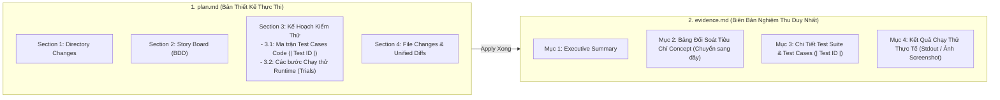

# Concept: Tích Hợp Kỹ Năng Kiểm Thử Toàn Diện & Tinh Giản Phân Định Kế Hoạch - Nghiệm Thu (/only-one-plan)

## 1. Problem & Goal

### Problem (Current Bottlenecks & Deficiencies)
- **Context & Trigger**: Khi thiết kế kế hoạch thực thi trong `/only-one-plan` và thẩm định nghiệm thu trong `/only-one-apply`, hệ thống sử dụng `plan.md` và `evidence.md`.
- **Symptom & Defect**:
  - **Lệch pha thời điểm & Trùng lặp**: Bảng *"Concept Coverage & Traceability Matrix"* hiện đang nằm ở Section 3.1 của `plan.md`. Khi vừa lập plan xong, code chưa viết và test chưa chạy nhưng bảng này đã có cột *"Trạng thái Nghiệm thu"*, bắt buộc phải để trống hoặc quay lại tick `[x] PASS` sau khi apply xong. Việc này vừa gây phân mảnh vừa làm trùng lặp với `evidence.md`.
  - **Thiếu kỹ năng kiểm thử ở Section 3.1 mới (Test Matrix)**: Các test cases tầng code sinh ra hời hợt, thiếu cấu trúc BDD và dễ sinh test rác (tautological tests).
  - **Thiếu phương pháp luận dịch chuyển nghiệp vụ ở Section 3.2 mới (Runtime Sanity)**: Agent tự do viết lệnh chạy thử ngẫu nhiên không bám sát Tiêu chí Nghiệm thu của `concept.md`, thiếu thông số kỹ thuật (Exit Code, Timeout, Output pattern, HTTP status) hoặc bỏ quên không viết.
- **Root Cause**: Chưa phân định ranh giới trách nhiệm (Separation of Concerns): `plan.md` là Bản Thiết Kế Thực Thi (Execution Blueprint), còn `evidence.md` mới là Biên Bản Nghiệm Thu (Acceptance Report); chưa kết nối `gherkin-authoring` làm ngôn ngữ BDD xuyên suốt.
- **Impact / Blast Radius**: `plan.md` bị cồng kềnh, phải sửa đi sửa lại sau apply; thiếu quy chuẩn kiểm thử chặt chẽ dẫn đến lọt lỗi sang môi trường thật.

### Goal (Target Technical Outcomes)
- **Core Goal**: Tinh giản phân định trách nhiệm: chuyển toàn bộ bảng đối soát tiêu chí Concept sang `evidence.md`, tái cấu trúc Section 3 của `plan.md` thành 2 mục tinh gọn (Ma trận Test Case Code & Các bước Chạy thử Runtime) được chi phối bởi bộ kỹ năng kiểm thử chuẩn hóa (`test-driven-development`, `anti-tautology-testing`, `gherkin-authoring`).
- **Acceptance Criteria**:
  - **Tái cấu trúc Section 3 của `plan.md` (Chỉ còn 2 mục tinh gọn)**:
    - `3.1. Test Case Specification Matrix` (Tầng Code - Hộp trắng): Chuẩn hóa bằng BDD (`Given - When - Then`), bao phủ 3 trục (Happy / Boundary / Failure), assert phản nghiệm (Falsifiability via `anti-tautology-testing`).
    - `3.2. Runtime Sanity & Trial Execution Steps` (Tầng Runtime - Hộp đen): Chuẩn hóa bằng BDD (`Given - When - Then`), dịch chuyển 1:1 từ Concept Acceptance Criteria, có đủ `Command/Target`, `Expected Exit Code/Status`, `Output Pattern/Visual Evidence`, và `Timeout`.
  - **Chuyển bảng Đối soát sang `evidence.md` (Single Source of Truth for Acceptance)**:
    - Bảng *"Concept Coverage & Traceability Matrix"* trở thành Mục 2 chính thức của `evidence.md`, đối soát từng tiêu chí của Concept với kết quả kiểm thử và link bằng chứng.
  - **Cập nhật `validate-plan.ts`**: Thẩm định tính hiện diện của bảng Test Case Matrix (Mục 3.1) và các khối Trial Execution (Mục 3.2).

## 2. Scope Boundaries

- **In-Scope**:
  - Cập nhật `assets/agents/skills/only-one-plan/SKILL.md`:
    - Đưa 6 kỹ năng kiểm thử vào *Skills Catalog*.
    - Tái cấu trúc Section 3: Bỏ bảng Concept Coverage, chỉ giữ `3.1. Test Case Specification Matrix` và `3.2. Runtime Sanity & Trial Execution Steps`.
  - Cập nhật `assets/agents/skills/only-one-apply/scripts/aggregate-evidence.ts` & `only-one-apply/SKILL.md`:
    - Tích hợp bảng Concept Coverage & Traceability vào `evidence.md`.
  - Nâng cấp `assets/agents/skills/only-one-plan/scripts/validate-plan.ts`:
    - Thẩm định cấu trúc Section 3 mới (3.1 và 3.2).
  - Cập nhật `only-one/rules/workflow.md` đồng bộ quy tắc phân định này.

- **Explicit Out-of-Scope**:
  - Không thay đổi cú pháp Jest/Vitest trong dự án.
  - Không tự động thực thi các lệnh chạy thử ở pha Plan.

## 3. Proposed Solution & Core Mechanism

### 3.1. Phân Định Ranh Giới: Bản Thiết Kế (Plan) vs Biên Bản Nghiệm Thu (Evidence)



### 3.2. Cấu Trúc Tinh Gọn Cho Section 3 Trong `plan.md`

Section 3 của `plan.md` được tái cấu trúc thành 2 mục rõ ràng:

#### Mục 3.1. Test Case Specification Matrix (Tầng Code - Hộp trắng qua BDD & Anti-Tautology)
```markdown
| Test ID | Module Mục tiêu | Nhóm Kịch bản | Kịch bản BDD (Given - When - Then) | Kết quả Mong đợi (Falsifiable Assertion) |
| :--- | :--- | :--- | :--- | :--- |
| **TC-01** | `terminal-contract` | Happy Path | Given chuỗi log chứa ANSI, When gọi `stripAnsiColors()`, Then trả về văn bản sạch | `expect(stripAnsiColors('\u001b[32mPASS\u001b[39m')).toBe('PASS')` |
| **TC-02** | `api-contract` | Boundary | Given mảng rỗng latencies, When gọi `calculateLatencyMetrics()`, Then trả về p50/p95 = 0 | `expect(calculateLatencyMetrics([])).toEqual({ p50: 0, p95: 0 })` |
| **TC-03** | `terminal-contract` | Failure | Given lệnh chạy quá 500ms, When chạy với timeout, Then ném lỗi Timeout | `expect(runWithTimeout(cmd, 500)).rejects.toThrow('Timeout')` |
```

#### Mục 3.2. Runtime Sanity & Trial Execution Steps (Tầng Runtime - Hộp đen qua BDD)

Mỗi kịch bản chạy thử nghiệm thu thực tế bắt buộc tuân theo định dạng:

```markdown
#### Trial 1: [CLI] Cài đặt combo toàn cục thành công
- **Traceability**: Nghiệm thu Tiêu chí 1 trong `concept.md`.
- **Given (Tiền đề)**: Môi trường Node.js đã sẵn sàng và manifest combo hợp lệ.
- **When (Lệnh thực thi)**: `npx tsx src/index.ts combo install --yes`
- **Then (Kết quả quan sát được)**:
  - Expected Exit Code: `0`
  - Expected Output Pattern: `✔ Combo installed successfully`
- **Timeout**: `30s`
```

---

### 3.3. Cấu Trúc Bảng Đối Soát Chuyển Sang `evidence.md`

Trong `evidence.md`, Mục 2 sẽ chính thức hiển thị bảng đối soát tiêu chí Concept:

```markdown
## 2. Concept Traceability & Acceptance Matrix

| Tiêu chí Nghiệm thu (Concept) | Test Cases / Trials Thực thi | Bằng chứng Xác thực | Trạng thái |
| :--- | :--- | :--- | :--- |
| 1. Cài đặt combo thành công | TC-01, Trial 1 [CLI] | Stdout Log: `✔ Combo installed successfully` | ✅ PASS |
| 2. Luồng checkout giỏ hàng | TC-02, Trial 2 [WEB] | Visual Evidence: `screenshots/01-checkout.png` | ✅ PASS |
```

---

## 4. Critical Risks & Edge Cases (Phân tích Rủi ro & Cơ chế Phòng vệ)

- **Rủi ro 1: Lệnh CLI trong Section 3.2 làm thay đổi trạng thái dữ liệu (Side Effects)**
  - *Mặt tiêu cực / Nguy cơ*: Chạy thử lệnh xóa hoặc ghi đè làm hỏng môi trường phát triển cục bộ.
  - *Cơ chế phòng vệ*: Bắt buộc chỉ định cờ an toàn (`--dry-run`, `--help`, hoặc chạy trên dữ liệu fixture tạm) trong đặc tả Section 3.2.

- **Rủi ro 2: Khắt khe quá mức làm gãy các task thuần tài liệu (non-code tasks)**
  - *Mặt tiêu cực / Nguy cơ*: Các task chỉ sửa doc hay config bị `validate-plan.ts` báo lỗi vì thiếu Section 3.2.
  - *Cơ chế phòng vệ*: Trong `validate-plan.ts`, chỉ kích hoạt kiểm tra bắt buộc Section 3.2 nếu trong plan có ít nhất một task block mang `Task Type: code`. Đối với các task `Task Type: non-code`, mục này là tùy chọn.
