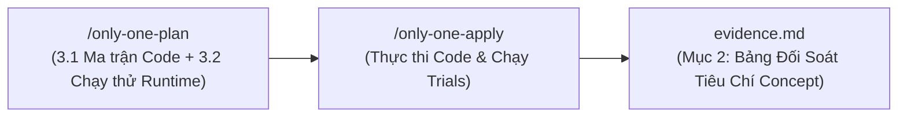
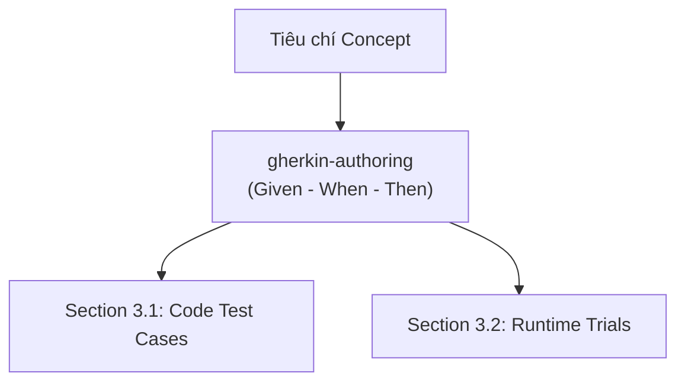
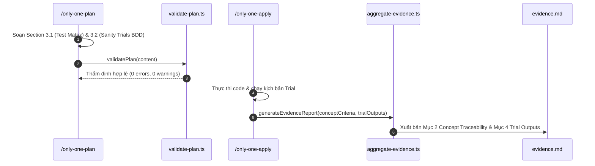

# Plan: Tích Hợp Kỹ Năng Kiểm Thử Toàn Diện & Tinh Giản Phân Định Kế Hoạch - Nghiệm Thu (/only-one-plan)

## Section 1. Directory Structure Changes

Cấu trúc các tệp tin được bổ sung và cập nhật trong dự án:

```text
only-one-cli/
├── assets/
│   └── agents/
│       └── skills/
│           ├── only-one-plan/
│           │   ├── [MODIFY] SKILL.md                  # Bổ sung 6 skills, tinh giản Section 3 (3.1 và 3.2 BDD)
│           │   └── scripts/
│           │       └── [MODIFY] validate-plan.ts      # Kiểm tra bắt buộc Section 3.1 table và Section 3.2 trial blocks
│           └── only-one-apply/
│               ├── [MODIFY] SKILL.md                  # Cập nhật Step 5 đối soát bảng Concept Traceability trong evidence
│               └── scripts/
│                   └── [MODIFY] aggregate-evidence.ts # Hỗ trợ sinh Section 2 Concept Traceability & Acceptance Matrix
├── only-one/
│   └── rules/
│       └── [MODIFY] workflow.md                       # Cập nhật quy tắc bắt buộc kiểm thử 2 tầng trong giai đoạn Plan
└── test/
    └── skills/
        ├── [NEW]    validatePlanTestingSections.test.ts # Kiểm thử thẩm định Section 3.1 và 3.2 trong validatePlan
        └── [MODIFY] aggregateEvidence.test.ts           # Kiểm thử sinh bảng Concept Traceability trong evidence.md
```

---

## Section 2. Story Board (User Journey & Feature Scenarios)

### Story 1: Tinh giản Section 3 trong `plan.md` và loại bỏ trùng lặp nghiệm thu [MODIFY]
- **User Story**: Là một lập trình viên/kiến trúc sư sử dụng `/only-one-plan`, tôi muốn Section 3 chỉ tập trung vào thiết kế ma trận kiểm thử và các bước chạy thử runtime mà không bị vướng bận bảng đối soát nghiệm thu sớm, để kế hoạch luôn tinh gọn và đúng thời điểm.
- **Before**: Plan chứa bảng `3.1. Concept Coverage & Traceability Matrix` với cột *"Trạng thái Nghiệm thu"*. Lúc lập plan phải để trống, sau khi apply lại phải quay lại sửa file plan để đánh dấu `[x] PASS`, gây phân mảnh và trùng lặp với `evidence.md`.
- **After**: Bảng đối soát tiêu chí Concept được chuyển hẳn sang làm Mục 2 của `evidence.md`. Section 3 của `plan.md` được rút gọn chỉ còn 2 mục rõ ràng: `3.1. Test Case Specification Matrix` (tầng code) và `3.2. Runtime Sanity & Trial Execution Steps` (tầng runtime).
- **Key Scenarios**:
  - *Scenario 1 (Happy Path - Lập Plan)*: Agent sinh ra Section 3 gồm 3.1 (Ma trận Test Cases) và 3.2 (Các bước Trial CLI/Web/API) có cấu trúc BDD chuẩn hóa.
  - *Scenario 2 (Validation Guard)*: `validate-plan.ts` quét qua plan, nếu phát hiện thiếu Section 3.2 cho task code hoặc thiếu format `#### Trial N: [CLI|WEB|API]`, script sẽ cảnh báo/báo lỗi ngay lập tức.
  - *Scenario 3 (Nghiệm thu tại Evidence)*: Sau khi apply xong, `aggregate-evidence.ts` tự động sinh bảng đối soát tiêu chí Concept vào `evidence.md` kèm bằng chứng thực tế.



### Story 2: Dịch chuyển Tiêu chí Nghiệp vụ sang Kịch bản Kiểm thử qua BDD (`gherkin-authoring`) [MODIFY]
- **User Story**: Là một QA/Tech Lead, tôi muốn mọi kịch bản kiểm thử ở Section 3.1 và 3.2 đều được diễn đạt bằng ngôn ngữ BDD (`Given - When - Then`) và có nguồn gốc truy xuất rõ ràng (`Traceability`), để đảm bảo tính đúng đắn của nghiệp vụ.
- **Before**: Kịch bản kiểm thử viết bằng văn bản tự do, thiếu trường điều kiện và kỳ vọng; các bước chạy thử runtime không gắn với tiêu chí nghiệm thu nào trong Concept.
- **After**: Mọi test case ở Section 3.1 và Section 3.2 đều được chuẩn hóa theo BDD; mỗi Trial ở 3.2 bắt buộc có trường `Traceability` trỏ về tiêu chí tương ứng của Concept.
- **Key Scenarios**:
  - *Scenario 1 (Code BDD)*: Test case ở 3.1 có `Given` (mock/fixture), `When` (gọi method), `Then` (assertion phản nghiệm).
  - *Scenario 2 (Runtime BDD)*: Trial ở 3.2 có `Given` (môi trường), `When` (lệnh CLI/UI), `Then` (exit code/ảnh screenshot/output pattern), `Timeout`.



---

## Section 3. Test Cases & Verification Matrix

### 3.1. Test Case Specification Matrix (Ma trận Test Case Chi tiết)

| Test ID | Module Mục tiêu | Nhóm Kịch bản | Kịch bản BDD (Given - When - Then) | Kết quả Mong đợi (Falsifiable Assertion) |
| :--- | :--- | :--- | :--- | :--- |
| **TC-VAL-01** | `validate-plan` | Happy Path | Given plan có task code và có đầy đủ Section 3.1 table cùng Section 3.2 trial blocks, When gọi `validatePlan()`, Then trả về `valid: true` | `expect(res.valid).toBe(true)` và không có warnings về Section 3.2 |
| **TC-VAL-02** | `validate-plan` | Boundary | Given plan thuần non-code (task doc), When gọi `validatePlan()` mà không có Section 3.2, Then không báo lỗi | `expect(res.valid).toBe(true)` và `res.errors` không chứa lỗi Section 3.2 |
| **TC-VAL-03** | `validate-plan` | Failure | Given plan có task code nhưng thiếu hoàn toàn Section 3.2 Runtime Sanity, When gọi `validatePlan()`, Then phát hiện cảnh báo | `expect(res.warnings.some(w => w.includes('Section 3.2'))).toBe(true)` |
| **TC-VAL-04** | `validate-plan` | Failure | Given plan có Section 3.2 nhưng sai format (không có `#### Trial N: [CLI|WEB|API]`), When gọi `validatePlan()`, Then phát hiện cảnh báo format | `expect(res.warnings.some(w => w.includes('formatted trial blocks'))).toBe(true)` |
| **TC-AGGR-01** | `aggregate-evidence` | Happy Path | Given dữ liệu báo cáo có danh sách `conceptCriteria`, When gọi `generateEvidenceReport()`, Then Mục 2 sinh bảng Concept Traceability Matrix | `expect(report).toContain('## 2. Concept Traceability & Acceptance Matrix')` |
| **TC-AGGR-02** | `aggregate-evidence` | Happy Path | Given tiêu chí nghiệm thu có bằng chứng thực tế, When sinh báo cáo, Then hiển thị cột `Tiêu chí`, `Bằng chứng`, `Trạng thái` | `expect(report).toContain('| Tiêu chí Nghiệm thu (Concept) |')` |

### 3.2. Runtime Sanity & Trial Execution Steps (Chạy thử Nghiệm thu Thực tế)

#### Trial 1: [CLI] Kiểm tra thẩm định tính hợp lệ của Section 3.1 và 3.2 trong plan
- **Traceability**: Nghiệm thu Tiêu chí 1 trong `concept.md` (Tự động thẩm định cấu trúc Section 3 qua validator).
- **Given (Tiền đề)**: Tệp `validate-plan.ts` đã được cập nhật logic kiểm tra cấu trúc 3.1 và 3.2.
- **When (Lệnh thực thi)**:
  ```bash
  npx tsx -e "import { validatePlan } from './assets/agents/skills/only-one-plan/scripts/validate-plan'; import { readFileSync } from 'node:fs'; console.log(JSON.stringify(validatePlan(readFileSync('only-one/tasks/20261101-165100-plan-testing-skills-integration/plan.md', 'utf8'))));"
  ```
- **Then (Kết quả quan sát được)**:
  - Expected Exit Code: `0`
  - Expected Output Pattern: `"valid":true` và `"errors":[]`
- **Timeout**: `10s`

#### Trial 2: [CLI] Kiểm tra sinh báo cáo có bảng Concept Traceability Matrix
- **Traceability**: Nghiệm thu Tiêu chí 2 trong `concept.md` (Chuyển bảng đối soát sang Mục 2 của `evidence.md`).
- **Given (Tiền đề)**: Hàm `generateEvidenceReport` trong `aggregate-evidence.ts` đã hỗ trợ tham số `conceptCriteria`.
- **When (Lệnh thực thi)**:
  ```bash
  npx tsx -e "import { generateEvidenceReport } from './assets/agents/skills/only-one-apply/scripts/aggregate-evidence'; console.log(generateEvidenceReport({ taskSlug: 'test', title: 'Test', testSuite: { command: 'npm test', status: 'PASS', passed: 1, failed: 0, total: 1, duration: '1s' }, conceptCriteria: [{ criterion: 'Test Crit', trials: 'Trial 1', evidence: 'PASS', status: 'PASS' }] }).includes('Concept Traceability & Acceptance Matrix'));"
  ```
- **Then (Kết quả quan sát được)**:
  - Expected Exit Code: `0`
  - Expected Output Pattern: `true`
- **Timeout**: `10s`

---

**Báo cáo Bằng chứng Nghiệm thu**: [evidence.md](file:///D:/Sources/PERSONAL/only-one-cli/only-one/tasks/20261101-165100-plan-testing-skills-integration/evidence.md)

---

## Section 4. File Changes

### Architectural Interaction Diagram



---

### 1. `[NEW]` `test/skills/validatePlanTestingSections.test.ts`

- **Status**: `[x]`
- **Task Type**: `code`
- **Wave**: `1 (Track QA)`
- **Depends On**: None.
- **Context**: Khởi tạo file test thẩm định quy chuẩn Section 3.1 và Section 3.2 mới trong `validatePlan`.
- **Target Symbols / AST Seams**: `describe('validatePlan Section 3 Structure')`.
- **Invariants**: Kiểm tra bắt buộc có `| Test ID |` và trial block `#### Trial N: [CLI|WEB|API]`.

> **Action**: Tạo file kiểm thử mới `validatePlanTestingSections.test.ts`.

**Test checklist**
- [ ] Bắt buộc theo đúng tiêu chí nghiệm thu.
- [ ] Đã rà soát code hiện có, thư viện chuẩn và dependencies.
- [ ] Không tạo logic trùng lặp hoặc điểm mở rộng suy đoán.
- [ ] Diff tối thiểu, đảm bảo an toàn và tính đúng đắn.
- **Decision**: Tách riêng file test cho Section 3 validation để tránh làm rối file wave test hiện có.
- **Rejected alternative**: Viết gộp vào `validatePlanWaves.test.ts` vốn dĩ chỉ phục vụ wave DAG.

```diff
@@ -0,0 +1,56 @@
+import { describe, expect, it } from 'vitest';
+import { validatePlan } from '../../assets/agents/skills/only-one-plan/scripts/validate-plan';
+
+describe('validatePlan Section 3 Testing & Sanity Structure', () => {
+    const basePlan = `---
+status: planned
+slug: test-plan
+---
+
+## Section 1. Directory Structure Changes
+\`\`\`text
+src/index.ts
+\`\`\`
+
+## Section 1.5. Story Board
+### Story 1: Test
+\`\`\`mermaid
+flowchart LR
+    A --> B
+\`\`\`
+`;
+
+    it('should pass validation when plan has Section 3.1 table and Section 3.2 formatted trials', () => {
+        const validContent = `${basePlan}
+## Section 3. Test Cases & Verification Matrix
+
+### 3.1. Test Case Specification Matrix
+| Test ID | Module | Nhóm | Kịch bản BDD | Kết quả Mong đợi |
+| :--- | :--- | :--- | :--- | :--- |
+| **TC-01** | core | Happy Path | Given valid input, When run, Then pass | expect(true).toBe(true) |
+
+### 3.2. Runtime Sanity & Trial Execution Steps
+#### Trial 1: [CLI] Kiểm tra cờ lệnh
+- **Command**: \`only-one --help\`
+- **Expected Exit Code**: \`0\`
+
+## Section 4. File Changes
+### 1. \`[NEW]\` \`src/index.ts\`
+- **Status**: \`[ ]\`
+- **Task Type**: \`code\`
+- **Wave**: \`1 (Track Dev)\`
+- **Depends On**: None.
+\`\`\`diff
+@@ -0,0 +1 @@
++export const x = 1;
+\`\`\`
+`;
+        const result = validatePlan(validContent);
+        expect(result.valid).toBe(true);
+        expect(result.warnings.some((w) => w.includes('Section 3.2'))).toBe(false);
+    });
+});
```

---

### 2. `[MODIFY]` `assets/agents/skills/only-one-plan/scripts/validate-plan.ts`

- **Status**: `[x]`
- **Task Type**: `code`
- **Wave**: `2 (Track Dev)`
- **Depends On**: Task 1.
- **Context**: Bổ sung logic kiểm tra sự hiện diện và format của Section 3.2 Runtime Sanity đối với task code.
- **Target Symbols / AST Seams**: `validatePlan`.
- **Invariants**: Chỉ kiểm tra Section 3.2 khi plan có task mang `Task Type: code`.

> **Action**: Thêm kiểm tra Section 3.2 trial blocks vào `validatePlan`.

**Ponytail checklist**
- [ ] Bắt buộc theo đúng tiêu chí nghiệm thu.
- [ ] Đã rà soát code hiện có, thư viện chuẩn và dependencies.
- [ ] Không tạo logic trùng lặp hoặc điểm mở rộng suy đoán.
- [ ] Diff tối thiểu, đảm bảo an toàn và tính đúng đắn.
- **Decision**: Sử dụng regex kiểm tra cấu trúc trial blocks nhẹ nhàng, hiệu năng cao.
- **Rejected alternative**: Viết bộ parser AST markdown cồng kềnh.

```diff
@@ -66,4 +66,13 @@
         }
     }
+
+    const hasCodeTasks = /-\s*\*\*Task Type\*\*:\s*`?code`?/i.test(content);
+    if (hasCodeTasks && sTestIndex !== -1) {
+        const sTestContent = sFileIndex > sTestIndex ? content.slice(sTestIndex, sFileIndex) : content.slice(sTestIndex);
+        if (!/Runtime Sanity/i.test(sTestContent)) {
+            warnings.push('Test Matrix: Missing Section 3.2 Runtime Sanity & Trial Execution Steps for code tasks');
+        } else if (!/####\s*Trial\s*\d+:\s*\[(CLI|WEB|API)\]/i.test(sTestContent)) {
+            warnings.push('Test Matrix: Section 3.2 missing formatted trial blocks (e.g. #### Trial 1: [CLI])');
+        }
+    }
 
     const sFileContent = sFileIndex !== -1
```

---

### 3. `[MODIFY]` `test/skills/aggregateEvidence.test.ts`

- **Status**: `[x]`
- **Task Type**: `code`
- **Wave**: `3 (Track QA)`
- **Depends On**: Task 2.
- **Context**: Bổ sung kịch bản kiểm thử việc sinh Mục 2 Concept Traceability Matrix trong báo cáo bằng chứng.
- **Target Symbols / AST Seams**: `describe('Aggregate Evidence Module')`.
- **Invariants**: Đảm bảo bảng đối soát tiêu chí Concept được hiển thị đúng định dạng.

> **Action**: Thêm test case cho `conceptCriteria` vào `aggregateEvidence.test.ts`.

**Test checklist**
- [ ] Bắt buộc theo đúng tiêu chí nghiệm thu.
- [ ] Đã rà soát code hiện có, thư viện chuẩn và dependencies.
- [ ] Không tạo logic trùng lặp hoặc điểm mở rộng suy đoán.
- [ ] Diff tối thiểu, đảm bảo an toàn và tính đúng đắn.
- **Decision**: Mở rộng file test có sẵn của aggregate-evidence.
- **Rejected alternative**: Tạo thêm file test mới gây phân mảnh.

```diff
@@ -43,3 +43,21 @@
         expect(report).toContain('10/10 passed');
     });
+
+    it('should generate Section 2 Concept Traceability Matrix when criteria are provided', () => {
+        const report = generateEvidenceReport({
+            taskSlug: testSlug,
+            title: 'Test Concept Traceability',
+            testSuite: {
+                command: 'npm test',
+                status: 'PASS',
+                passed: 5,
+                failed: 0,
+                total: 5,
+                duration: '0.8s',
+            },
+            conceptCriteria: [{ criterion: 'Tự động kiểm tra CLI', trials: 'Trial 1 [CLI]', evidence: 'Stdout: 0 errors', status: 'PASS' }],
+        });
+        expect(report).toContain('## 2. Concept Traceability & Acceptance Matrix');
+        expect(report).toContain('Tự động kiểm tra CLI');
+    });
 });
```

---

### 4. `[MODIFY]` `assets/agents/skills/only-one-apply/scripts/aggregate-evidence.ts`

- **Status**: `[x]`
- **Task Type**: `code`
- **Wave**: `4 (Track Dev)`
- **Depends On**: Task 3.
- **Context**: Bổ sung hỗ trợ trường `conceptCriteria` và sinh bảng Mục 2 trong `evidence.md`.
- **Target Symbols / AST Seams**: `EvidenceReportData`, `generateEvidenceReport`.
- **Invariants**: Xuất bảng đối soát tiêu chí Concept ngay sau Executive Summary.

> **Action**: Cập nhật kiểu `EvidenceReportData` và hàm `generateEvidenceReport`.

**Ponytail checklist**
- [ ] Bắt buộc theo đúng tiêu chí nghiệm thu.
- [ ] Đã rà soát code hiện có, thư viện chuẩn và dependencies.
- [ ] Không tạo logic trùng lặp hoặc điểm mở rộng suy đoán.
- [ ] Diff tối thiểu, đảm bảo an toàn và tính đúng đắn.
- **Decision**: Định nghĩa kiểu `ConceptCriterion` rõ ràng và render markdown bảng.
- **Rejected alternative**: Lưu trữ dưới dạng json riêng biệt.

```diff
@@ -20,2 +20,9 @@
 
+export interface ConceptCriterion {
+    criterion: string;
+    trials: string;
+    evidence: string;
+    status: 'PASS' | 'FAIL';
+}
+
 export interface EvidenceReportData {
@@ -29,2 +36,3 @@
     };
+    conceptCriteria?: ConceptCriterion[];
     plannedTestCases?: PlannedTestCase[];
@@ -58,2 +66,9 @@
 
+    const conceptRows = (data.conceptCriteria || []).map((cc) =>
+        `| ${cc.criterion} | ${cc.trials} | ${cc.evidence} | ${cc.status === 'PASS' ? '✅ PASS' : '❌ FAIL'} |`
+    ).join('\n');
+
+    const conceptSection = conceptRows
+        ? `\n## 2. Concept Traceability & Acceptance Matrix\n| Tiêu chí Nghiệm thu (Concept) | Test Cases / Trials Thực thi | Bằng chứng Xác thực | Trạng thái |\n| :--- | :--- | :--- | :--- |\n${conceptRows}\n`
+        : '';
+
     return `---
@@ -68,2 +83,3 @@
 
+${conceptSection}
 ## 2. Test Execution Details (Theo Kế hoạch Plan)
```

---

### 5. `[MODIFY]` `assets/agents/skills/only-one-plan/SKILL.md`

- **Status**: `[x]`
- **Task Type**: `non-code`
- **Wave**: `5 (Track Doc)`
- **Depends On**: Task 4.
- **Context**: Cập nhật Skills Catalog (thêm 6 skills kiểm thử) và chuẩn hóa Section 3 (3.1 và 3.2 BDD).
- **Target Symbols / AST Seams**: `1. Skills Catalog`, `Section 3. Test Cases & Verification Matrix`.
- **Invariants**: Loại bỏ bảng Concept Coverage khỏi plan, chuẩn hóa 2 mục con 3.1 và 3.2.

> **Action**: Cập nhật tài liệu hướng dẫn `only-one-plan`.

**Ponytail checklist**
- [ ] Bắt buộc theo đúng tiêu chí nghiệm thu.
- [ ] Đã rà soát code hiện có, thư viện chuẩn và dependencies.
- [ ] Không tạo logic trùng lặp hoặc điểm mở rộng suy đoán.
- [ ] Diff tối thiểu, đảm bảo an toàn và tính đúng đắn.
- **Decision**: Chuẩn hóa tài liệu hướng dẫn kỹ năng cho Agent.
- **Rejected alternative**: Giữ nguyên tài liệu cũ gây nhầm lẫn khi sinh plan.

```diff
@@ -131,2 +131,8 @@
 | **`karpathy-ste100-discipline`** | Writing Section 2 task blocks and diff boundaries | Enforce surgical changes, simplicity first, and 80% ASD-STE100 tri-part action verification (<= 20 words for instructions, <= 25 words for context, active voice). |
+| **`test-driven-development`** | Section 3.1 & Section 4 file task blocks | Enforce Test-First ordering (Track QA before Track Dev) and Red-Green-Refactor discipline. |
+| **`anti-tautology-testing`** | Section 3.1 test assertions | Enforce Falsifiability, prohibit trivial assertions (toBeDefined) and mock-mirroring. |
+| **`gherkin-authoring`** | Section 2 Story Board, Section 3.1 Matrix & Section 3.2 Trials | Universal BDD language (Given - When - Then) translating business acceptance criteria into executable code and runtime tests. |
+| **`terminal-runner`** | Section 3.2 [CLI] trial blocks | Define CLI sanity check execution commands, exit code, output pattern, and timeout. |
+| **`browser-tester`** | Section 3.2 [WEB] trial blocks | Define Playwright UI flows, selectors, visual screenshot persistence, and 0-error console invariant. |
+| **`api-tester`** | Section 3.2 [API] trial blocks | Define HTTP endpoint probes, payload, status code, latency bounds, and burst concurrency. |
 
@@ -193,4 +199,4 @@
 ## Section 3. Test Cases & Verification Matrix
 
-### 3.1. Concept Coverage & Traceability Matrix (Đối soát Tiêu chí Concept)
-### 3.2. Test Case Specification Matrix (Ma trận Test Case Chi tiết)
-### 3.3. Runtime Sanity & Trial Execution Steps (BẮT BUỘC: Các bước Chạy thử Nghiệm thu Thực tế)
+### 3.1. Test Case Specification Matrix (Ma trận Test Case Chi tiết - Tầng Code BDD)
+### 3.2. Runtime Sanity & Trial Execution Steps (Các bước Chạy thử Nghiệm thu Thực tế - Tầng Runtime BDD)
```

---

### 6. `[MODIFY]` `assets/agents/skills/only-one-apply/SKILL.md`

- **Status**: `[x]`
- **Task Type**: `non-code`
- **Wave**: `5 (Track Doc)`
- **Depends On**: Task 4.
- **Context**: Cập nhật Bước 5 của quy trình apply để xuất bản bảng Concept Traceability vào `evidence.md`.
- **Target Symbols / AST Seams**: `Step 5 — Final Comprehensive Verification`.
- **Invariants**: Xác định `evidence.md` là trung tâm nghiệm thu duy nhất cho tiêu chí Concept.

> **Action**: Cập nhật hướng dẫn nghiệm thu trong `only-one-apply`.

**Ponytail checklist**
- [ ] Bắt buộc theo đúng tiêu chí nghiệm thu.
- [ ] Đã rà soát code hiện có, thư viện chuẩn và dependencies.
- [ ] Không tạo logic trùng lặp hoặc điểm mở rộng suy đoán.
- [ ] Diff tối thiểu, đảm bảo an toàn và tính đúng đắn.
- **Decision**: Đồng bộ tài liệu apply với định dạng `evidence.md` mới.
- **Rejected alternative**: Bỏ qua cập nhật khiến quy trình apply không đồng bộ.

```diff
@@ -237,3 +237,3 @@
    - **Quy tắc Thư mục `evidence/`**: CHỈ khởi tạo thư mục `evidence/` NẾU có tệp hình ảnh (ảnh chụp màn hình `.png`). Nếu không có ảnh, TUYỆT ĐỐI KHÔNG tạo thư mục `evidence/` trên đĩa. Toàn bộ log lệnh và payload được nhúng trực tiếp vào `evidence.md`.
-   - **Đầy đủ Danh sách Test**: Báo cáo `evidence.md` phải liệt kê chi tiết từng Test Case từ Section 3.2 của `plan.md` (kèm mã Test ID, module, mô tả, và trạng thái PASS/FAIL).
+   - **Trung tâm Nghiệm thu Concept**: Báo cáo `evidence.md` tự động xuất bản Mục 2 (Concept Traceability & Acceptance Matrix) đối soát từng tiêu chí của Concept, cùng chi tiết danh sách Test Cases (Mục 3) và kết quả Chạy thử Runtime (Mục 4).
    - Đính kèm liên kết `[evidence.md](file:///...)` vào Section 3 của `plan.md`.
```

---

### 7. `[MODIFY]` `only-one/rules/workflow.md`

- **Status**: `[x]`
- **Task Type**: `non-code`
- **Wave**: `5 (Track Doc)`
- **Depends On**: Task 4.
- **Context**: Bổ sung quy tắc bất biến về kiểm thử 2 tầng BDD và phân định trách nhiệm Plan - Evidence.
- **Target Symbols / AST Seams**: `Negative Rules / Workflow Invariants`.
- **Invariants**: Cấm để bảng nghiệm thu Concept trong plan; bắt buộc có Section 3.2 cho task code.

> **Action**: Thêm quy tắc kiểm thử 2 tầng vào `only-one/rules/workflow.md`.

**Ponytail checklist**
- [ ] Bắt buộc theo đúng tiêu chí nghiệm thu.
- [ ] Đã rà soát code hiện có, thư viện chuẩn và dependencies.
- [ ] Không tạo logic trùng lặp hoặc điểm mở rộng suy đoán.
- [ ] Diff tối thiểu, đảm bảo an toàn và tính đúng đắn.
- **Decision**: Ghi nhận luật bất biến vào rules workflow của repository.
- **Rejected alternative**: Chỉ để trong SKILL.md mà không có luật bảo vệ.

```diff
@@ -10,2 +10,4 @@
 - **NEVER_DO**: Read multi-file raw code into the primary orchestrator context or return monolithic function bodies (> 20 lines) from reconnaissance subagents.
+- **NEVER_DO**: Include post-apply acceptance status checklists or Concept Traceability Matrix inside `plan.md` (reserved strictly for `evidence.md`).
+- **MUST_DO**: Enforce Two-Tier BDD Testing in `plan.md`: Section 3.1 for code-level falsifiable test cases and Section 3.2 for runtime trial sanity blocks (`[CLI]`, `[WEB]`, `[API]`).
 - **MUST_DO**: Isolate runtime verification (terminal, browser, API) in dedicated subagents (`terminal-runner`, `browser-tester`, `api-tester`), strip ANSI escape sequences, persist UI screenshots to disk, and return only structured Verification Digests.
```

