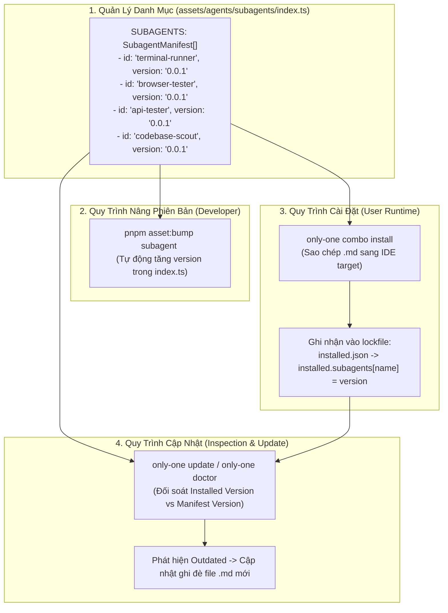

# Concept: Quản Lý Danh Mục & Cơ Chế Phiên Bản Tự Động Cho Subagents

## 1. Problem & Goal

### Problem (Current Bottlenecks & Deficiencies)
- **Context & Trigger**: Trong hệ sinh thái `only-one-cli`, các tài nguyên toàn cục (skills, rules, mcps, combos) đều được quản lý phiên bản qua lockfile và lệnh `only-one update`.
- **Symptom & Defect**: Thư mục `assets/agents/subagents/` chỉ chứa 4 tệp markdown thô (`terminal-runner.md`, `browser-tester.md`, `api-tester.md`, `codebase-scout.md`), hoàn toàn không có tệp manifest quản lý; lệnh `pnpm asset:bump subagent <name>` văng lỗi `Unknown asset type`; khi cài đặt qua combo, subagents bị copy thô mà không được lưu vết phiên bản vào lockfile (`installed.json`).
- **Root Cause**: `subagents` chưa được đăng ký làm First-Class Asset trong hệ thống: thiếu `SubagentManifest` trong `assets/types.ts`, thiếu `assets/agents/subagents/index.ts`, và thiếu `'subagents'` trong kiểu `AssetType`.
- **Impact / Blast Radius**: Khi nhà phát triển cập nhật logic mới cho subagent (ví dụ cải tiến script runner, thêm invariants), người dùng không thể biết subagent trên máy mình đã lỗi thời (`outdated`); lệnh `only-one update` và `only-one doctor` hoàn toàn bỏ qua subagents, dẫn đến sự lệch pha phiên bản giữa các môi trường.

### Goal (Target Technical Outcomes)
- **Core Goal**: Nâng cấp `subagents` thành **First-Class Asset Citizen** hoàn chỉnh trong `only-one-cli`, có file manifest tập trung quản lý version, hỗ trợ tăng phiên bản tự động (`bump-asset`), ghi nhận vào lockfile (`installed.json`), và tự động phát hiện/cập nhật qua `only-one update`.
- **Acceptance Criteria**:
  - Tạo mới `assets/agents/subagents/index.ts` xuất bản danh mục `SUBAGENTS: SubagentManifest[]` với đầy đủ `id`, `version`, `description`, `sourceFile`, và `supportedTargets`.
  - Khai báo kiểu `SubagentManifest` trong `assets/types.ts` và bổ sung `'subagents'` vào `AssetType` trong `src/core/assets/types.ts`.
  - Hỗ trợ lệnh nâng version: `npx tsx scripts/bump-asset.ts subagent <id>` tự động tăng version thập phân (ví dụ `0.0.1` -> `0.0.2`) trong `subagents/index.ts`.
  - Ghi nhận phiên bản subagent khi cài đặt combo vào `only-one/installed.json` (hoặc `.only-one/installed.json` ở chế độ global) qua `recordInstalledAssetsBatch`.
  - Tích hợp kiểm tra phiên bản trong `only-one update` và `only-one doctor`: hiển thị trạng thái `up-to-date`, `outdated`, hoặc `missing` cho từng subagent và cho phép cập nhật đè khi có version mới.

## 2. Scope Boundaries

- **In-Scope**:
  - Định nghĩa kiểu `SubagentManifest` tại `assets/types.ts`.
  - Tạo tệp quản lý danh mục `assets/agents/subagents/index.ts`.
  - Đăng ký `subagents` vào `src/core/assets/types.ts` và `src/core/assets/bump.ts`.
  - Cập nhật quy trình cài đặt combo tại `src/core/combo/index.ts` để lưu vết subagent vào lockfile `installed.json`.
  - Mở rộng bộ máy kiểm tra cập nhật (`inspection.ts` / `update.ts` / `step-1-inspect-assets.ts`) để đối soát version của subagents đã cài.
  - Viết unit tests kiểm tra toàn diện: bump version subagent, lockfile persistence, và update detection.

- **Explicit Out-of-Scope**:
  - Không thay đổi nội dung logic prompt bên trong các file markdown `assets/agents/subagents/*.md`.
  - Không thay đổi đường dẫn cài đặt đích (`~/.gemini/config/agents/`, `~/.claude/agents/`, `~/.cursor/agents/`).
  - Không tạo lệnh cài đặt subagent đơn lẻ độc lập (subagents vẫn được phân phối tự nhiên qua `combos`).

## 3. Proposed Solution & Core Mechanism

### 3.1. Kiến Trúc Vòng Đời Phiên Bản Subagents (Subagent Asset Lifecycle Architecture)



### 3.2. Cấu Trúc Khai Báo Manifest Mẫu (`assets/agents/subagents/index.ts`)

```typescript
import { AllowedToolId } from '@/constants/allowed-tools.js';
import type { SubagentManifest } from '../../types.js';

export const SUBAGENTS: SubagentManifest[] = [
    {
        id: 'terminal-runner',
        version: '0.0.1',
        description: 'Isolated terminal execution, CLI feature test, and ANSI-stripped log isolation agent.',
        sourceFile: 'terminal-runner.md',
        supportedTargets: [AllowedToolId.Antigravity, AllowedToolId.Claude, AllowedToolId.Cursor],
        tools: ['run_command'],
    },
    {
        id: 'browser-tester',
        version: '0.0.1',
        description: 'Isolated Playwright browser testing, UI visual screenshot, and DevTools monitoring agent.',
        sourceFile: 'browser-tester.md',
        supportedTargets: [AllowedToolId.Antigravity, AllowedToolId.Claude, AllowedToolId.Cursor],
        tools: ['browser_navigate', 'browser_click', 'browser_type', 'browser_take_screenshot'],
    },
    {
        id: 'api-tester',
        version: '0.0.1',
        description: 'Isolated backend API validation, concurrency race condition testing, and latency audit agent.',
        sourceFile: 'api-tester.md',
        supportedTargets: [AllowedToolId.Antigravity, AllowedToolId.Claude, AllowedToolId.Cursor],
        tools: ['run_command'],
    },
    {
        id: 'codebase-scout',
        version: '0.0.1',
        description: 'Isolated read-only codebase explorer and AST-grep reconnaissance agent.',
        sourceFile: 'codebase-scout.md',
        supportedTargets: [AllowedToolId.Antigravity, AllowedToolId.Claude, AllowedToolId.Cursor],
        tools: ['read_file', 'search_files', 'run_command'],
        disallowedTools: ['write_file', 'edit_file'],
    },
];
```

### 3.3. Định Dạng Lưu Trữ Trong Lockfile (`installed.json`)

Khi người dùng chạy cài đặt combo (`only-one-flow`, `frontend-flow`, hoặc `backend-flow`), tệp `installed.json` sẽ lưu lại vết phiên bản:

```json
{
  "schemaVersion": 1,
  "updatedAt": "2026-11-01T17:35:00.000Z",
  "installed": {
    "combos": {
      "only-one-flow": {
        "version": "0.0.2",
        "installedAt": "2026-11-01T17:35:00.000Z"
      }
    },
    "subagents": {
      "terminal-runner": {
        "version": "0.0.1",
        "installedAt": "2026-11-01T17:35:00.000Z"
      },
      "codebase-scout": {
        "version": "0.0.1",
        "installedAt": "2026-11-01T17:35:00.000Z"
      }
    }
  }
}
```

---

## 4. Critical Risks & Edge Cases (Phân tích Rủi ro & Cơ chế Phòng vệ)

- **Rủi ro 1: Lỗi đường dẫn khi bump version (`bump-asset.ts`)**
  - *Mặt tiêu cực / Nguy cơ*: Subagents nằm ở `assets/agents/subagents/index.ts` thay vì `assets/subagents/index.ts` (lệch cấu trúc so với `assets/rules/` hay `assets/skills/` nếu hàm resolve hardcode sai).
  - *Cơ chế phòng vệ*: Trong hàm `resolveAssetManifestFilePath`, map rõ ràng đường dẫn `assets/agents/subagents/index.ts` cho asset type `subagents`.

- **Rủi ro 2: Xung đột đè file khi subagent được tùy chỉnh cục bộ (User Customization Overwrite)**
  - *Mặt tiêu cực / Nguy cơ*: Khi chạy `only-one update`, nếu người dùng đã tự sửa file `.md` trong thư mục cấu hình của IDE thì việc tự động ghi đè có thể làm mất tùy chỉnh của họ.
  - *Cơ chế phòng vệ*: Áp dụng cơ chế kiểm tra `smartOverwriteSync`: nếu phát hiện file đích có thay đổi so với bản gốc đã cài, cảnh báo trước khi ghi đè hoặc hỏi xác nhận.

- **Rủi ro 3: Lockfile cũ thiếu khóa `subagents`**
  - *Mặt tiêu cực / Nguy cơ*: Đọc các tệp `installed.json` được tạo từ các phiên bản CLI trước bị ném ngoại lệ do thiếu trường `subagents`.
  - *Cơ chế phòng vệ*: Khởi tạo fallback an toàn `installed.subagents = installed.subagents || {}` trong `readInstalledLockfile`.
