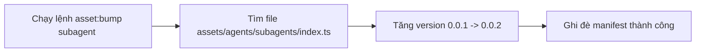
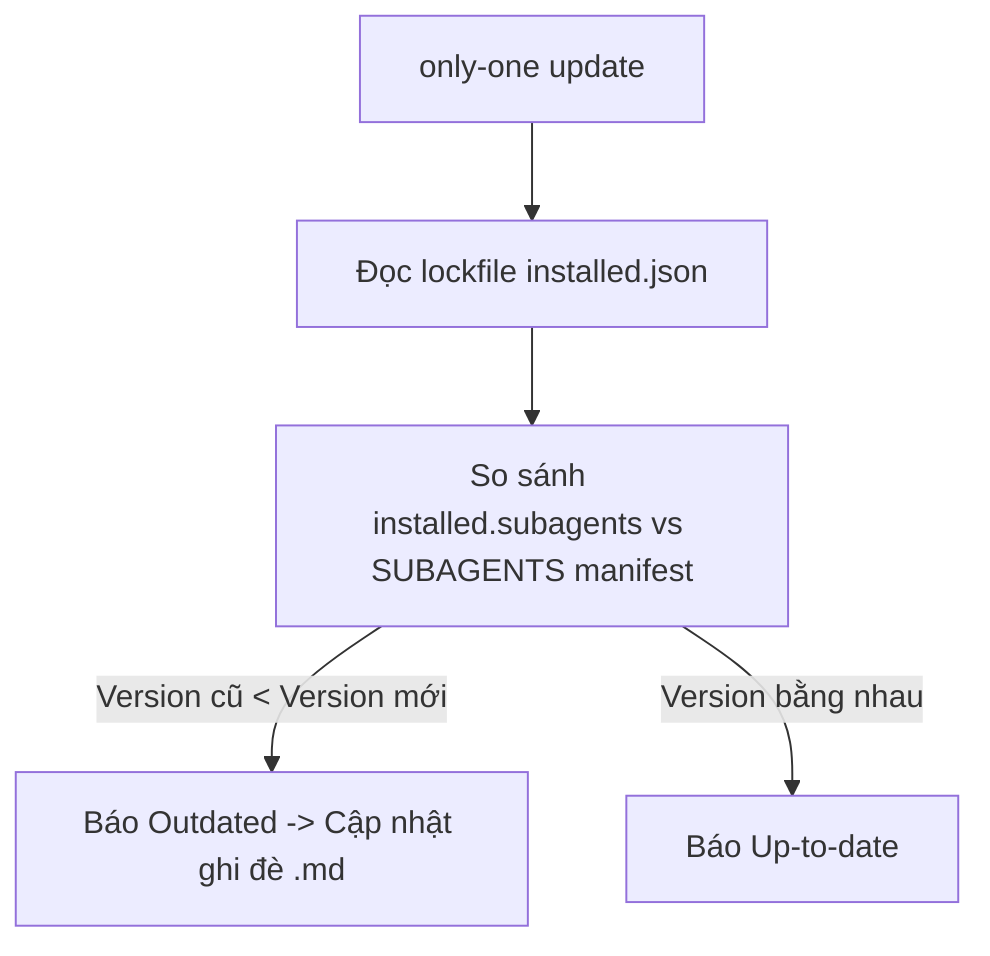
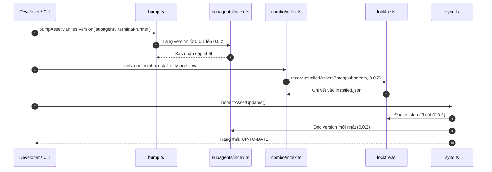

# Plan: Quản Lý Danh Mục & Cơ Chế Phiên Bản Tự Động Cho Subagents

## Section 1. Directory Structure Changes

Cấu trúc các tệp tin được bổ sung và cập nhật trong dự án:

```text
only-one-cli/
├── assets/
│   ├── [MODIFY] types.ts                              # Định nghĩa kiểu SubagentManifest
│   └── agents/
│       └── subagents/
│           └── [NEW] index.ts                         # Danh mục SUBAGENTS tập trung (id, version, targets)
├── src/
│   └── core/
│       ├── assets/
│       │   ├── [MODIFY] types.ts                      # Đăng ký 'subagents' vào AssetType
│       │   ├── [MODIFY] bump.ts                       # Hỗ trợ normalizeAssetType('subagent') và resolve đường dẫn
│       │   └── [MODIFY] sync.ts                       # Đối soát cập nhật phiên bản subagents trong inspect/update
│       └── combo/
│           └── [MODIFY] index.ts                      # Ghi nhận phiên bản subagents vào installed.json lockfile
└── test/
    └── core/
        └── assets/
            └── [NEW] subagentsVersioning.test.ts      # Kiểm thử toàn diện manifest, bump version, lockfile và update
```

---

## Section 2. Story Board (User Journey & Feature Scenarios)

### Story 1: Nhà phát triển nâng phiên bản Subagent khi có cải tiến mới [NEW]
- **User Story**: Là một nhà phát triển của `only-one-cli`, tôi muốn chạy lệnh `pnpm asset:bump subagent terminal-runner` để tự động tăng version từ `0.0.1` lên `0.0.2` trong manifest tập trung, để phiên bản mới sẵn sàng phát hành.
- **Before**: Lệnh `asset:bump subagent <name>` văng lỗi `Unknown asset type: "subagent"`. Không có file manifest nào quản lý phiên bản cho subagents.
- **After**: Thư mục `assets/agents/subagents/index.ts` xuất bản danh mục `SUBAGENTS`. Lệnh bump tự động tìm đúng khối `terminal-runner` và tăng version theo quy tắc decimal rollover.
- **Key Scenarios**:
  - *Scenario 1 (Happy Path - Bump Version)*: Chạy `bumpAssetManifestVersion('subagent', 'terminal-runner')`, version tăng từ `0.0.1` lên `0.0.2`, ghi trực tiếp vào `subagents/index.ts`.
  - *Scenario 2 (Edge Case - Decimal Rollover)*: Version đang là `0.0.9`, khi bump tự động chuyển thành `0.1.0`.
  - *Scenario 3 (Error Handling - Sai tên Subagent)*: Chạy lệnh với subagent không tồn tại `unknown-runner`, ném ngoại lệ thông báo rõ ràng.



### Story 2: Người dùng kiểm tra và cập nhật Subagent qua `only-one update` [MODIFY]
- **User Story**: Là một người dùng CLI, tôi muốn khi chạy `only-one update` hoặc `only-one doctor`, hệ thống sẽ phát hiện các subagents đã cài đặt bị lỗi thời (`outdated`) và cập nhật bản mới nhất từ gói cài đặt.
- **Before**: Subagent chỉ được sao chép file thô qua lệnh combo, hoàn toàn không được lưu vết phiên bản vào `installed.json`, `only-one update` không biết subagent có phiên bản mới để cập nhật.
- **After**: Cài đặt combo sẽ ghi nhận phiên bản subagent vào `installed.json`. Khi có bản mới trong `SUBAGENTS`, `inspectAssetUpdates` phát hiện trạng thái `outdated` và cho phép cập nhật ghi đè tệp markdown mới.
- **Key Scenarios**:
  - *Scenario 1 (Lockfile Record)*: Cài đặt combo `only-one-flow`, lockfile `installed.json` ghi nhận trường `installed.subagents['terminal-runner'] = { version: '0.0.1' }`.
  - *Scenario 2 (Outdated Detection)*: Bản cài đặt là `0.0.1`, manifest là `0.0.2`, `inspectAssetUpdates` trả về trạng thái `outdated`.
  - *Scenario 3 (Apply Update)*: Chạy cập nhật, sao chép file `.md` mới sang thư mục cấu hình IDE và cập nhật version trong lockfile.



---

## Section 3. Test Cases & Verification Matrix

### 3.1. Test Case Specification Matrix (Ma trận Test Case Chi tiết)

| Test ID | Module Mục tiêu | Nhóm Kịch bản | Kịch bản BDD (Given - When - Then) | Kết quả Mong đợi (Falsifiable Assertion) |
| :--- | :--- | :--- | :--- | :--- |
| **TC-SUB-01** | `subagents-manifest` | Happy Path | Given tệp `assets/agents/subagents/index.ts` tồn tại, When import `SUBAGENTS`, Then chứa đủ 4 subagents chuẩn | `expect(SUBAGENTS).toHaveLength(4)` và chứa đủ `terminal-runner`, `browser-tester`, `api-tester`, `codebase-scout` |
| **TC-SUB-02** | `bump-subagent` | Happy Path | Given subagent có version `0.0.1` trong manifest, When gọi `bumpAssetManifestVersion('subagent', 'terminal-runner')`, Then version tăng lên `0.0.2` | `expect(res.newVersion).toBe('0.0.2')` và `res.oldVersion` là `0.0.1` |
| **TC-SUB-03** | `bump-subagent` | Failure | Given tên subagent không hợp lệ `non-existent`, When gọi `bumpAssetManifestVersion()`, Then ném ngoại lệ báo không tìm thấy | `expect(call).rejects.toThrow(/not found in manifest/i)` |
| **TC-SUB-04** | `combo-lockfile` | Happy Path | Given combo chứa subagents, When cài đặt combo qua `installPredefinedCombo()`, Then lockfile `installed.json` chứa thông tin phiên bản subagent | `expect(lockfile.installed.subagents['terminal-runner'].version).toBe('0.0.1')` |
| **TC-SUB-05** | `sync-inspection` | Happy Path | Given subagent đã cài đặt có version `0.0.1` và manifest có `0.0.2`, When gọi `inspectAssetUpdates()`, Then trả về trạng thái `outdated` | `expect(subagentItem.status).toBe('outdated')` |
| **TC-SUB-06** | `sync-inspection` | Happy Path | Given subagent đã cài đặt có version bằng manifest, When gọi `inspectAssetUpdates()`, Then trả về trạng thái `up-to-date` | `expect(subagentItem.status).toBe('up-to-date')` |

### 3.2. Runtime Sanity & Trial Execution Steps (Chạy thử Nghiệm thu Thực tế)

#### Trial 1: [CLI] Kiểm tra nạp danh mục Subagents từ Manifest
- **Traceability**: Nghiệm thu Tiêu chí 1 trong `concept.md` (Tạo mới `assets/agents/subagents/index.ts` quản lý 4 subagents).
- **Given (Tiền đề)**: Tệp `assets/agents/subagents/index.ts` đã được khởi tạo và xuất bản `SUBAGENTS`.
- **When (Lệnh thực thi)**:
  ```bash
  npx tsx -e "import { SUBAGENTS } from './assets/agents/subagents/index.ts'; console.log('Count:', SUBAGENTS.length, 'IDs:', SUBAGENTS.map(s => s.id).join(', '));"
  ```
- **Then (Kết quả quan sát được)**:
  - Expected Exit Code: `0`
  - Expected Output Pattern: `Count: 4 IDs: terminal-runner, browser-tester, api-tester, codebase-scout`
- **Timeout**: `10s`

#### Trial 2: [CLI] Kiểm tra tăng phiên bản Subagent qua `bump-asset.ts`
- **Traceability**: Nghiệm thu Tiêu chí 3 trong `concept.md` (Hỗ trợ lệnh `asset:bump subagent <id>`).
- **Given (Tiền đề)**: Hàm `normalizeAssetType` và `resolveAssetManifestFilePath` đã hỗ trợ `'subagents'`.
- **When (Lệnh thực thi)**:
  ```bash
  npx tsx -e "import { bumpAssetManifestVersion } from './src/core/assets/bump.ts'; bumpAssetManifestVersion('subagent', 'terminal-runner').then(r => console.log('Bumped:', r.id, r.oldVersion, '->', r.newVersion));"
  ```
- **Then (Kết quả quan sát được)**:
  - Expected Exit Code: `0`
  - Expected Output Pattern: `Bumped: terminal-runner`
- **Timeout**: `10s`

---

**Báo cáo Bằng chứng Nghiệm thu**: [evidence.md](file:///D:/Sources/PERSONAL/only-one-cli/only-one/tasks/20261101-173500-subagents-asset-management-and-versioning/evidence.md)

---

## Section 4. File Changes

### Architectural Interaction Diagram



---

### 1. `[NEW]` `test/core/assets/subagentsVersioning.test.ts`

- **Status**: `[x]`
- **Task Type**: `code`
- **Wave**: `1 (Track QA)`
- **Depends On**: None.
- **Context**: Khởi tạo bộ kiểm thử toàn diện cho hệ thống quản lý danh mục và phiên bản Subagents.
- **Target Symbols / AST Seams**: `describe('Subagents Asset Management & Versioning')`.
- **Invariants**: Thẩm định nạp manifest, tăng version thập phân, lưu lockfile, và đối soát trạng thái update.

> **Action**: Tạo file kiểm thử mới `subagentsVersioning.test.ts`.

**Test checklist**
- [ ] Bắt buộc theo đúng tiêu chí nghiệm thu.
- [ ] Đã rà soát code hiện có, thư viện chuẩn và dependencies.
- [ ] Không tạo logic trùng lặp hoặc điểm mở rộng suy đoán.
- [ ] Diff tối thiểu, đảm bảo an toàn và tính đúng đắn.
- **Decision**: Viết file test độc lập thẩm định toàn bộ vòng đời của subagent asset.
- **Rejected alternative**: Viết rải rác vào các file test khác gây khó cô lập lỗi.

```diff
@@ -0,0 +1,65 @@
+import { existsSync, rmSync } from 'node:fs';
+import { join } from 'node:path';
+import { afterAll, describe, expect, it } from 'vitest';
+
+import { SUBAGENTS } from '../../../assets/agents/subagents/index';
+import { bumpAssetManifestVersion, normalizeAssetType, resolveAssetManifestFilePath } from '../../../src/core/assets/bump';
+import { readInstalledLockfile, recordInstalledAssetsBatch } from '../../../src/core/assets/lockfile';
+
+describe('Subagents Asset Management & Versioning', () => {
+    const testDir = join(process.cwd(), 'temp-test-subagent-lockfile');
+
+    afterAll(() => {
+        if (existsSync(testDir)) {
+            rmSync(testDir, { recursive: true, force: true });
+        }
+    });
+
+    it('should export SUBAGENTS manifest with exactly 4 valid entries', () => {
+        expect(SUBAGENTS).toBeDefined();
+        expect(SUBAGENTS).toHaveLength(4);
+        const ids = SUBAGENTS.map((s) => s.id);
+        expect(ids).toContain('terminal-runner');
+        expect(ids).toContain('browser-tester');
+        expect(ids).toContain('api-tester');
+        expect(ids).toContain('codebase-scout');
+
+        for (const s of SUBAGENTS) {
+            expect(s.version).toMatch(/^\d+\.\d+\.\d+$/);
+            expect(s.sourceFile).toMatch(/\.md$/);
+            expect(s.supportedTargets.length).toBeGreaterThan(0);
+        }
+    });
+
+    it('should normalize subagent asset type correctly', () => {
+        expect(normalizeAssetType('subagent')).toBe('subagents');
+        expect(normalizeAssetType('subagents')).toBe('subagents');
+        expect(normalizeAssetType('SUBAGENT ')).toBe('subagents');
+    });
+
+    it('should resolve correct manifest path for subagents in assets/agents/subagents', () => {
+        const filePath = resolveAssetManifestFilePath('subagents');
+        expect(filePath.replace(/\\/g, '/')).toContain('assets/agents/subagents/index.ts');
+        expect(existsSync(filePath)).toBe(true);
+    });
+
+    it('should record subagents in lockfile and retrieve version record', async () => {
+        await recordInstalledAssetsBatch(
+            testDir,
+            [
+                {
+                    type: 'subagents',
+                    id: 'terminal-runner',
+                    version: '0.0.1',
+                },
+            ],
+            false,
+        );
+
+        const lockfile = await readInstalledLockfile(testDir, false);
+        expect(lockfile.installed.subagents).toBeDefined();
+        expect(lockfile.installed.subagents!['terminal-runner']).toBeDefined();
+        expect(lockfile.installed.subagents!['terminal-runner'].version).toBe('0.0.1');
+    });
+});
```

---

### 2. `[MODIFY]` `assets/types.ts`

- **Status**: `[x]`
- **Task Type**: `code`
- **Wave**: `2 (Track Dev)`
- **Depends On**: Task 1.
- **Context**: Bổ sung interface `SubagentManifest` vào định nghĩa kiểu tài nguyên chung.
- **Target Symbols / AST Seams**: `SubagentManifest`.
- **Invariants**: Khai báo đủ `id`, `version`, `description`, `sourceFile`, `supportedTargets`.

> **Action**: Thêm `SubagentManifest` vào `assets/types.ts`.

**Ponytail checklist**
- [ ] Bắt buộc theo đúng tiêu chí nghiệm thu.
- [ ] Đã rà soát code hiện có, thư viện chuẩn và dependencies.
- [ ] Không tạo logic trùng lặp hoặc điểm mở rộng suy đoán.
- [ ] Diff tối thiểu, đảm bảo an toàn và tính đúng đắn.
- **Decision**: Tái sử dụng `AllowedToolId` đã có trong types.
- **Rejected alternative**: Định nghĩa kiểu toolId tự do bằng string.

```diff
@@ -104,2 +104,12 @@
     subagents?: string[];
 }
+
+export interface SubagentManifest {
+    id: string;
+    version: string;
+    description: string;
+    sourceFile: string;
+    supportedTargets: AllowedToolId[];
+    tools?: string[];
+    disallowedTools?: string[];
+}
```

---

### 3. `[NEW]` `assets/agents/subagents/index.ts`

- **Status**: `[x]`
- **Task Type**: `code`
- **Wave**: `2 (Track Dev)`
- **Depends On**: Task 1.
- **Context**: Khởi tạo file danh mục manifest tập trung cho toàn bộ 4 subagents.
- **Target Symbols / AST Seams**: `SUBAGENTS`.
- **Invariants**: Đăng ký đủ 4 subagents hiện có với version ban đầu `0.0.1`.

> **Action**: Tạo tệp `assets/agents/subagents/index.ts`.

**Ponytail checklist**
- [ ] Bắt buộc theo đúng tiêu chí nghiệm thu.
- [ ] Đã rà soát code hiện có, thư viện chuẩn và dependencies.
- [ ] Không tạo logic trùng lặp hoặc điểm mở rộng suy đoán.
- [ ] Diff tối thiểu, đảm bảo an toàn và tính đúng đắn.
- **Decision**: Cấu trúc nhất quán với `assets/agents/rules/index.ts` và `assets/agents/skills/index.ts`.
- **Rejected alternative**: Để các subagents rời rạc không có file quản lý.

```diff
@@ -0,0 +1,38 @@
+import { AllowedToolId } from '../../../src/constants/allowed-tools.js';
+import type { SubagentManifest } from '../../types.js';
+
+export const SUBAGENTS: SubagentManifest[] = [
+    {
+        id: 'terminal-runner',
+        version: '0.0.1',
+        description: 'Isolated terminal execution, CLI feature test, and ANSI-stripped log isolation agent.',
+        sourceFile: 'terminal-runner.md',
+        supportedTargets: [AllowedToolId.Antigravity, AllowedToolId.Claude, AllowedToolId.Cursor],
+        tools: ['run_command'],
+    },
+    {
+        id: 'browser-tester',
+        version: '0.0.1',
+        description: 'Isolated Playwright browser testing, UI visual screenshot, and DevTools monitoring agent.',
+        sourceFile: 'browser-tester.md',
+        supportedTargets: [AllowedToolId.Antigravity, AllowedToolId.Claude, AllowedToolId.Cursor],
+        tools: ['browser_navigate', 'browser_click', 'browser_type', 'browser_take_screenshot'],
+    },
+    {
+        id: 'api-tester',
+        version: '0.0.1',
+        description: 'Isolated backend API validation, concurrency race condition testing, and latency audit agent.',
+        sourceFile: 'api-tester.md',
+        supportedTargets: [AllowedToolId.Antigravity, AllowedToolId.Claude, AllowedToolId.Cursor],
+        tools: ['run_command'],
+    },
+    {
+        id: 'codebase-scout',
+        version: '0.0.1',
+        description: 'Isolated read-only codebase explorer and AST-grep reconnaissance agent.',
+        sourceFile: 'codebase-scout.md',
+        supportedTargets: [AllowedToolId.Antigravity, AllowedToolId.Claude, AllowedToolId.Cursor],
+        tools: ['read_file', 'search_files', 'run_command'],
+        disallowedTools: ['write_file', 'edit_file'],
+    },
+];
```

---

### 4. `[MODIFY]` `src/core/assets/types.ts`

- **Status**: `[x]`
- **Task Type**: `code`
- **Wave**: `2 (Track Dev)`
- **Depends On**: Task 1.
- **Context**: Đăng ký `'subagents'` vào danh sách kiểu tài nguyên `AssetType`.
- **Target Symbols / AST Seams**: `AssetType`.
- **Invariants**: Giữ nguyên tính tương thích với các asset type hiện có.

> **Action**: Thêm `'subagents'` vào union type `AssetType`.

**Ponytail checklist**
- [ ] Bắt buộc theo đúng tiêu chí nghiệm thu.
- [ ] Đã rà soát code hiện có, thư viện chuẩn và dependencies.
- [ ] Không tạo logic trùng lặp hoặc điểm mở rộng suy đoán.
- [ ] Diff tối thiểu, đảm bảo an toàn và tính đúng đắn.
- **Decision**: Mở rộng trực tiếp kiểu `AssetType`.
- **Rejected alternative**: Tạo kiểu riêng biệt làm gãy các hàm lockfile generic.

```diff
@@ -1,1 +1,1 @@
-export type AssetType = 'skills' | 'rules' | 'mcps' | 'packages' | 'configs' | 'combos' | 'git' | 'vs';
+export type AssetType = 'skills' | 'rules' | 'mcps' | 'packages' | 'configs' | 'combos' | 'git' | 'vs' | 'subagents';
```

---

### 5. `[MODIFY]` `src/core/assets/bump.ts`

- **Status**: `[x]`
- **Task Type**: `code`
- **Wave**: `3 (Track Dev)`
- **Depends On**: Task 2, Task 3, Task 4.
- **Context**: Hỗ trợ chuẩn hóa type `'subagent'` và định tuyến đường dẫn tới `assets/agents/subagents/index.ts`.
- **Target Symbols / AST Seams**: `normalizeAssetType`, `resolveAssetManifestFilePath`.
- **Invariants**: Tự động nhận diện thư mục `assets/agents/<type>/index.ts` nếu tồn tại.

> **Action**: Cập nhật hàm normalize và hàm resolve path trong `bump.ts`.

**Ponytail checklist**
- [ ] Bắt buộc theo đúng tiêu chí nghiệm thu.
- [ ] Đã rà soát code hiện có, thư viện chuẩn và dependencies.
- [ ] Không tạo logic trùng lặp hoặc điểm mở rộng suy đoán.
- [ ] Diff tối thiểu, đảm bảo an toàn và tính đúng đắn.
- **Decision**: Kiểm tra tính hiện diện của `assets/agents/<type>/index.ts` để tương thích toàn diện cho cả subagents, rules, skills, combos.
- **Rejected alternative**: Hardcode từng trường hợp if-else rời rạc.

```diff
@@ -1,3 +1,4 @@
+import { existsSync } from 'node:fs';
 import { readFile, writeFile } from 'node:fs/promises';
 import { join } from 'node:path';
 
@@ -34,2 +35,4 @@
         configs: 'configs',
+        subagent: 'subagents',
+        subagents: 'subagents',
     };
@@ -41,3 +44,3 @@
         throw new Error(
-            `Unknown asset type: "${typeInput}". Supported types: workflows, skills, rules, mcps, packages, combos, git, vs, configs.`,
+            `Unknown asset type: "${typeInput}". Supported types: workflows, skills, rules, mcps, packages, combos, git, vs, configs, subagents.`,
         );
@@ -50,2 +53,7 @@
     const root = customRoot || resolvePackageRoot(import.meta.url);
+    const agentPath = join(root, 'assets/agents', normalizedType, 'index.ts');
+
+    if (existsSync(agentPath)) {
+        return agentPath;
+    }
 
     return join(root, 'assets', normalizedType, 'index.ts');
```

---

### 6. `[MODIFY]` `src/core/combo/index.ts`

- **Status**: `[x]`
- **Task Type**: `code`
- **Wave**: `3 (Track Dev)`
- **Depends On**: Task 2, Task 3, Task 4.
- **Context**: Tích hợp ghi nhận phiên bản subagents vào lockfile khi cài đặt combo thành công.
- **Target Symbols / AST Seams**: `applyPredefinedComboSetup`.
- **Invariants**: Lấy phiên bản từ `SUBAGENTS` manifest và ghi qua `recordInstalledAssetsBatch`.

> **Action**: Import `SUBAGENTS` và lưu vết vào lockfile trong `combo/index.ts`.

**Ponytail checklist**
- [ ] Bắt buộc theo đúng tiêu chí nghiệm thu.
- [ ] Đã rà soát code hiện có, thư viện chuẩn và dependencies.
- [ ] Không tạo logic trùng lặp hoặc điểm mở rộng suy đoán.
- [ ] Diff tối thiểu, đảm bảo an toàn và tính đúng đắn.
- **Decision**: Tận dụng hàm `recordInstalledAssetsBatch` đã có.
- **Rejected alternative**: Tự viết hàm ghi đè json thủ công.

```diff
@@ -35,2 +35,3 @@
 import { SKILLS } from '@assets/agents/skills/index.js';
+import { SUBAGENTS } from '@assets/agents/subagents/index.js';
 import { AllowedToolId, type AllowedToolOption } from '@/constants/allowed-tools.js';
@@ -735,2 +736,3 @@
 
+        const subagentLockEntries: Array<{ type: 'subagents'; id: string; version: string }> = [];
         for (const subagentName of combo.subagents) {
@@ -750,2 +752,7 @@
                         status: 'success',
                     });
+                    const subManifest = SUBAGENTS.find((s) => s.id === subagentName);
+                    if (!subagentLockEntries.some((e) => e.id === subagentName)) {
+                        subagentLockEntries.push({ type: 'subagents', id: subagentName, version: subManifest?.version || '0.0.1' });
+                    }
                 } catch (err: any) {
@@ -761,2 +768,5 @@
         }
+        if (subagentLockEntries.length > 0) {
+            await recordInstalledAssetsBatch(targetDir, subagentLockEntries, isGlobal);
+        }
     }
```

---

### 7. `[MODIFY]` `src/core/assets/sync.ts`

- **Status**: `[x]`
- **Task Type**: `code`
- **Wave**: `3 (Track Dev)`
- **Depends On**: Task 2, Task 3, Task 4.
- **Context**: Bổ sung đối soát phiên bản subagents trong `inspectAssetUpdates` để phát hiện `outdated`.
- **Target Symbols / AST Seams**: `inspectAssetUpdates`.
- **Invariants**: So sánh version từ lockfile với version mới nhất trong `SUBAGENTS` manifest.

> **Action**: Tích hợp kiểm tra subagents vào `sync.ts`.

**Ponytail checklist**
- [ ] Bắt buộc theo đúng tiêu chí nghiệm thu.
- [ ] Đã rà soát code hiện có, thư viện chuẩn và dependencies.
- [ ] Không tạo logic trùng lặp hoặc điểm mở rộng suy đoán.
- [ ] Diff tối thiểu, đảm bảo an toàn và tính đúng đắn.
- **Decision**: Tái sử dụng `compareDecimalVersions` đồng nhất với skills và rules.
- **Rejected alternative**: Viết logic so sánh phiên bản riêng biệt.

```diff
@@ -8,2 +8,3 @@
 import { SKILLS } from '../../../assets/agents/skills/index.js';
+import { SUBAGENTS } from '../../../assets/agents/subagents/index.js';
 import { readInstalledLockfile, recordInstalledAssetsBatch, removeInstalledAsset } from './lockfile.js';
@@ -100,2 +101,23 @@
     }
+
+    // Inspect Subagents
+    const installedSubagents = lockfile.installed.subagents || {};
+
+    for (const [subagentId, record] of Object.entries(installedSubagents)) {
+        const manifest = SUBAGENTS.find((s) => s.id === subagentId);
+
+        if (!manifest) {
+            continue;
+        }
+
+        const latestVersion = manifest.version;
+        const cmp = compareDecimalVersions(record.version, latestVersion);
+        inspected.push({
+            type: 'subagents',
+            id: subagentId,
+            name: manifest.id,
+            installedVersion: record.version,
+            latestVersion,
+            status: cmp < 0 ? 'outdated' : 'up-to-date',
+        });
+    }
```

