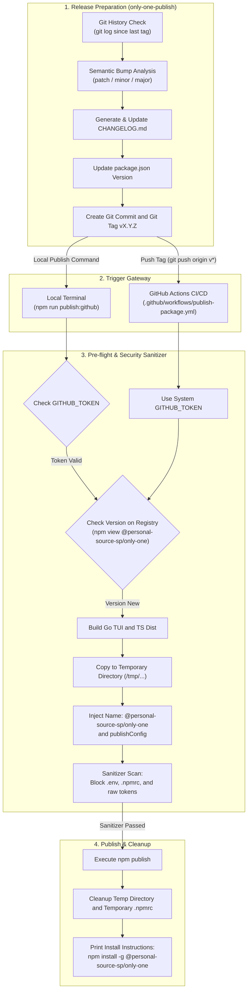

# Concept: Triển khai Private Package lên GitHub Packages và Xây dựng Skill Only-One Publish

## 1. Problem & Goal

### Problem (Điểm nghẽn & Thiếu sót hiện tại)
- **Context & Trigger**: Nhóm phát triển muốn phát hành gói CLI nội bộ dưới dạng private package qua GitHub Packages (`npm.pkg.github.com`).
- **Symptom & Defect**: Script `scripts/publish.js` hiện tại chỉ hỗ trợ `--access public` lên npmjs.org. Hệ thống thiếu cơ chế tự động nâng version, không tự tạo `CHANGELOG.md`, và không hỗ trợ scoped package `@personal-source-sp/only-one`.
- **Root Cause**: Thiếu skill chuyên trách tự động hoá quy trình release (`only-one-publish`) và thiếu script publish chuyên biệt cho GitHub Packages với cơ chế auth token an toàn.
- **Impact / Blast Radius**: Thao tác bump version và viết changelog thủ công dễ gây sai sót. Nguy cơ rò rỉ token bí mật vào repository hoặc tarball phát hành.

### Goal (Kết quả kỹ thuật mục tiêu)
- **Core Goal**: Tự động hoá toàn diện chu trình chuẩn bị release (nâng version, cập nhật changelog, gắn git tag) và xuất bản private package `@personal-source-sp/only-one` lên GitHub Packages thông qua cả terminal local và GitHub Actions CI/CD.
- **Acceptance Criteria**:
  - Xây dựng skill `only-one-publish` hỗ trợ phân tích commit, tự động tăng semantic version (patch/minor/major), cập nhật `CHANGELOG.md` và gắn tag `v*`.
  - Nâng cấp hoặc bổ sung script publish chuyên dụng hỗ trợ GitHub Packages (registry `https://npm.pkg.github.com`, scope `@personal-source-sp/only-one`).
  - Thiết lập cơ chế kiểm tra an toàn (pre-flight checks): kiểm tra token hợp lệ, kiểm tra trạng thái git clean, kiểm tra trùng lặp version trên registry trước khi build.
  - Tích hợp bộ lọc bảo mật (sanitizer): loại bỏ hoàn toàn các file cấu hình nhạy cảm (`.env`, `.npmrc`, token secrets) khỏi thư mục đóng gói.
  - Cấu hình workflow GitHub Actions (`.github/workflows/publish-package.yml`) tự động build và publish khi phát hiện tag `v*`.

---

## 2. Scope Boundaries

- **In-Scope**:
  - Định nghĩa skill `only-one-publish` trong `assets/agents/skills/only-one-publish/SKILL.md` và đăng ký vào `assets/agents/skills/index.ts`.
  - Script tự động hoá release: phân tích commit history, nâng semantic version trong `package.json`, sinh nội dung `CHANGELOG.md` theo chuẩn Keep a Changelog.
  - Script publish chuyên biệt: hỗ trợ cờ `--target github`, `--dry-run`, đóng gói trong thư mục tạm, inject scope `@personal-source-sp/only-one`, kiểm tra token và dọn dẹp an toàn.
  - GitHub Actions workflow: tự động kích hoạt khi push tag `v*`, sử dụng biến môi trường chuẩn `secrets.GITHUB_TOKEN` để publish.
  - Tài liệu hướng dẫn cấu hình `.npmrc` cho máy trạm developer khi cài đặt package (`npm install -g @personal-source-sp/only-one`).
- **Explicit Out-of-Scope**:
  - Không thay đổi tên `name` vĩnh viễn trong `package.json` gốc của repo (giữ `only-one` ở local; script publish tự động đổi thành `@personal-source-sp/only-one` trong thư mục đóng gói tạm thời).
  - Không triển khai registry tự lưu trữ (Verdaccio, Nexus, Artifactory).
  - Không xuất bản lên npmjs.org công cộng.
  - Không tự động tạo Personal Access Token (PAT) trên GitHub cho người dùng.

---

## 3. Proposed Solution & Core Mechanism

### Core Mechanism
Hệ thống vận hành theo mô hình phân tách 2 giai đoạn rõ ràng:

1. **Giai đoạn Chuẩn bị Phát hành (Skill `only-one-publish`)**:
   - Phân tích danh sách git commit từ tag gần nhất.
   - Xác định mức tăng version: `patch` (fix/refactor), `minor` (feat), `major` (breaking changes).
   - Tự động ghi chép thay đổi vào `CHANGELOG.md` với định dạng ngày giờ chuẩn.
   - Cập nhật số version trong `package.json`.
   - Tạo commit git đánh dấu release và tạo lightweight git tag `vX.Y.Z`.

2. **Giai đoạn Xuất bản Gói (Publishing Pipeline)**:
   - **Local Mode (`npm run publish:github`)**:
     - Pre-flight check: Kiểm tra `GITHUB_TOKEN` trong biến môi trường hoặc keychain, kiểm tra version đã tồn tại trên GitHub Packages chưa.
     - Build artifacts: Biên dịch Go TUI Engine (`npm run build:go`) và TypeScript bundle (`npm run build`).
     - Đóng gói tạm: Sao chép file cần thiết vào thư mục tạm, đổi tên thành `@personal-source-sp/only-one`, xoá bỏ `devDependencies` và các file nhạy cảm.
     - Xuất bản: Tạo `.npmrc` tạm chứa auth token, thực thi `npm publish`, sau đó dọn dẹp và xoá thư mục tạm trong khối `finally`.
   - **Remote CI Mode (GitHub Actions)**:
     - Kích hoạt khi developer đẩy tag `v*` lên repository (`git push origin vX.Y.Z`).
     - Runner khởi tạo môi trường sạch, chạy build và sử dụng quyền `packages: write` của GitHub Actions để tự động publish mà không cần lưu token trên máy cá nhân.

### Conceptual Flow / Domain Model



### CLI Wireframe (Giao diện Tương tác Terminal của Skill `only-one-publish`)

```text
+-----------------------------------------------------------------------+
|  ONLY-ONE RELEASE AUTOMATION ENGINE                                   |
+-----------------------------------------------------------------------+
|  Current Version : 1.2.3                                              |
|  Latest Tag      : v1.2.3                                             |
|  Unreleased Commits: 5 commits found                                  |
|                                                                       |
|  Suggested Bump  : [ ] Patch (1.2.4)                                  |
|                    [*] Minor (1.3.0)  <- Recommended (2 new features) |
|                    [ ] Major (2.0.0)                                  |
|                                                                       |
|  Changelog Preview:                                                   |
|    ### [1.3.0] - 2026-11-01                                           |
|    #### Added                                                         |
|    - feat: support subagents asset synchronization                   |
|    - feat: add runtime evidence collector                            |
|    #### Fixed                                                         |
|    - fix: resolve race condition in Go TUI stream handler             |
|                                                                       |
|  Target Registry : GitHub Packages (https://npm.pkg.github.com)       |
|  Package Scope   : @personal-source-sp/only-one                       |
|                                                                       |
|  Select Action:                                                       |
|    [1] Prepare Release Only (Bump package.json, CHANGELOG.md, Tag)   |
|    [2] Prepare Release & Publish via Local Script                     |
|    [3] Prepare Release & Push Tag for GitHub Actions CI/CD            |
+-----------------------------------------------------------------------+
```

---

## 4. Critical Risks & Edge Cases (Phân tích Rủi ro & Cơ chế Phòng vệ)

- **Rủi ro 1: Rò rỉ Personal Access Token (PAT) vào kho mã nguồn hoặc tarball đóng gói**
  - *Mặt tiêu cực / Nguy cơ*: Token có quyền `write:packages` hoặc `repo` bị lưu vào file `.npmrc` nằm trong project, vô tình được commit lên git hoặc đóng gói vào tarball phát hành cho người khác tải về.
  - *Cơ chế phòng vệ*: Không bao giờ tạo file `.npmrc` trong thư mục gốc của repository. Script chỉ tạo `.npmrc` tạm thời bên trong thư mục ngẫu nhiên của hệ điều hành (`os.tmpdir()`), và đảm bảo thực thi lệnh xoá file/thư mục tạm trong khối lệnh `finally`. Bộ quét an toàn `checkSensitive` sẽ quét đệ quy thư mục đóng gói và ném lỗi dừng ngay lập tức nếu phát hiện token hoặc file nhạy cảm.

- **Rủi ro 2: GitHub Packages từ chối xuất bản do trùng lặp version (HTTP 400 / 409)**
  - *Mặt tiêu cực / Nguy cơ*: Quá trình build tốn thời gian nhưng thất bại ở bước cuối cùng vì version trong `package.json` đã được publish trước đó.
  - *Cơ chế phòng vệ*: Bổ sung bước kiểm tra sớm (Pre-flight check) bằng cách gọi `npm view @personal-source-sp/only-one@<version> version --registry=https://npm.pkg.github.com`. Nếu version đã tồn tại, dừng script ngay lập tức trước khi thực hiện bước biên dịch tốn tài nguyên.

- **Rủi ro 3: Push Git Tag lên remote nhưng GitHub Actions build thất bại**
  - *Mặt tiêu cực / Nguy cơ*: Git tag `vX.Y.Z` đã tồn tại trên GitHub remote nhưng package tương ứng không được publish lên GitHub Packages, gây mất đồng bộ giữa mã nguồn và registry.
  - *Cơ chế phòng vệ*: Skill `only-one-publish` chạy kiểm tra toàn bộ unit test (`npm test`) và build thử nghiệm (`npm run build`) ở local trước khi cho phép tạo git tag. File GitHub Actions workflow bổ sung bước thông báo lỗi rõ ràng nếu build CI thất bại.

- **Rủi ro 4: Thành viên trong tổ chức không cài đặt được package private**
  - *Mặt tiêu cực / Nguy cơ*: Người dùng chạy lệnh `npm install -g @personal-source-sp/only-one` gặp lỗi `404 Not Found` hoặc `401 Unauthorized` do npm trỏ nhầm về `registry.npmjs.org` hoặc thiếu token đọc.
  - *Cơ chế phòng vệ*: Script in ra chỉ dẫn cấu hình 2 dòng ngắn gọn cho người dùng vào file `~/.npmrc` cá nhân:
    ```bash
    @personal-source-sp:registry=https://npm.pkg.github.com
    //npm.pkg.github.com/:_authToken=${GITHUB_TOKEN}
    ```
    Kèm theo yêu cầu token cần có tối thiểu quyền `read:packages`.
