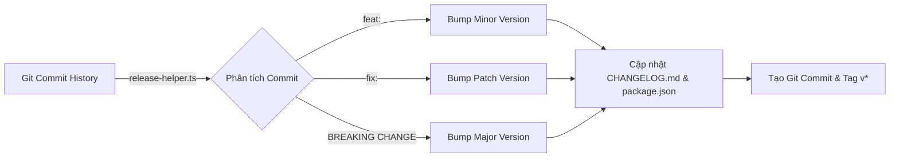
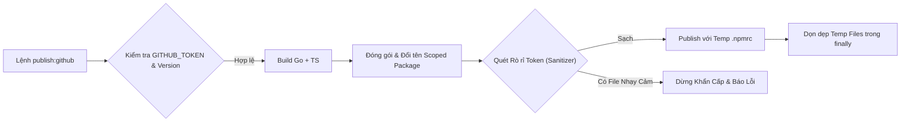
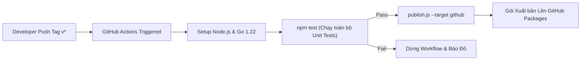
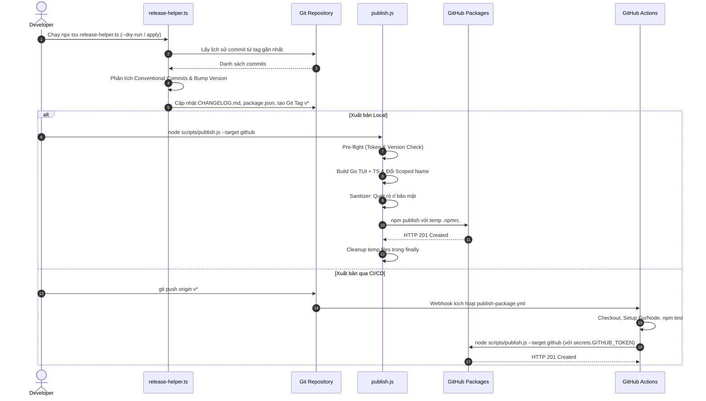

# Plan: Triển khai Private Package lên GitHub Packages và Xây dựng Skill Only-One Publish

## Section 1. Directory Structure Changes

Cấu trúc các tệp tin được bổ sung và cập nhật trong hệ thống:

```text
test/
├── skills/
│   ├── [NEW]    release-helper.test.ts          # Unit test phân tích semantic bump, changelog và version
│   ├── [NEW]    publish-script.test.ts          # Unit test cấu hình đóng gói scoped và bộ lọc sanitizer
│   └── [NEW]    publishSkillRegistration.test.ts # Unit test đăng ký skill only-one-publish trong danh mục
assets/agents/skills/
├── [MODIFY] index.ts                            # Khai báo manifest cho skill only-one-publish
└── only-one-publish/
    ├── [NEW]    SKILL.md                        # Đặc tả hướng dẫn vận hành quy trình release
    └── scripts/
        └── [NEW] release-helper.ts              # Script phân tích git log, bump version và cập nhật changelog
scripts/
└── [MODIFY] publish.js                          # Mở rộng hỗ trợ target GitHub Packages và scoped name
package.json                                     # [MODIFY] Bổ sung script publish:github và release
.github/
└── workflows/
    └── [NEW]    publish-package.yml             # Workflow CI/CD tự động xuất bản khi push git tag v*
```

---

## Section 2. Story Board (User Journey & Feature Scenarios)

### Story 1: Tự động hoá Chu trình Release với Skill only-one-publish [NEW]
- **User Story**: Là một lập trình viên, tôi muốn chạy lệnh release tự động để hệ thống phân tích git log, tự tăng version và sinh changelog chuẩn mà không phải sửa tay.
- **Before**: Lập trình viên phải tự đoán version, tự mở `package.json` sửa số version, và tự soạn nội dung changelog thủ công.
- **After**: Hệ thống tự quét commit Conventional Commits, gợi ý chính xác `patch`/`minor`/`major`, cập nhật `CHANGELOG.md` và gắn tag `v*`.
- **Key Scenarios**:
  - *Scenario 1 (Happy Path - Minor bump)*: Lịch sử commit chứa `feat: add subagents sync`, hệ thống tăng từ `1.0.5` lên `1.1.0` và ghi nhóm `Added` vào `CHANGELOG.md`.
  - *Scenario 2 (Boundary Case - Không có commit mới)*: Working tree clean nhưng không có commit mới từ tag trước, hệ thống cảnh báo và giữ nguyên version.
  - *Scenario 3 (Error Handling - Working tree dirty)*: Còn thay đổi chưa commit trong git, hệ thống dừng lại và yêu cầu commit hoặc stash trước khi release.



### Story 2: Xuất bản An toàn Private Package lên GitHub Packages [MODIFY]
- **User Story**: Là một người quản trị kỹ thuật, tôi muốn lệnh publish hỗ trợ GitHub Packages với scope `@personal-source-sp/only-one` để chia sẻ gói nội bộ an toàn.
- **Before**: Script `scripts/publish.js` chỉ hỗ trợ publish public lên `registry.npmjs.org` với tên gốc `only-one`.
- **After**: Thêm cờ `--target github`, tự động map scope `@personal-source-sp/only-one`, kiểm tra token và tạo `.npmrc` tạm cô lập.
- **Key Scenarios**:
  - *Scenario 1 (Happy Path)*: Chạy `npm run publish:github`, script kiểm tra `GITHUB_TOKEN`, kiểm tra version chưa tồn tại, build và xuất bản thành công.
  - *Scenario 2 (Sanitizer Block)*: Vô tình có file `.env` hoặc token bí mật trong thư mục pack, bộ lọc chặn đứng ngay lập tức và hủy bỏ tiến trình.
  - *Scenario 3 (Duplicate Version)*: Version đã tồn tại trên `npm.pkg.github.com`, pre-flight check báo lỗi và dừng trước khi build tốn tài nguyên.



### Story 3: Tự động hoá Quy trình CI/CD qua GitHub Actions Workflow [NEW]
- **User Story**: Là một lập trình viên, tôi muốn khi đẩy git tag `v*` lên repository thì hệ thống tự động build và xuất bản gói lên GitHub Packages mà không cần giữ token nhạy cảm trên máy cá nhân.
- **Before**: Phải cấu hình token cá nhân (PAT) trên máy trạm và tự publish thủ công.
- **After**: GitHub Actions tự động kích hoạt khi có tag `v*`, chạy kiểm thử unit test, build toàn bộ binary và publish bằng quyền bảo mật của runner.
- **Key Scenarios**:
  - *Scenario 1 (Happy Path)*: Push tag `v1.1.0`, runner kích hoạt, chạy test pass, build Go TUI + TS, và publish thành công lên GitHub Packages.
  - *Scenario 2 (Test Failure Protection)*: Một bài kiểm thử thất bại trong CI, workflow dừng lại và ngăn chặn việc publish phiên bản lỗi.



---

## Section 3. Test Cases & Verification Matrix

### 3.1. Test Case Specification Matrix (Ma trận Test Case Chi tiết - Tầng Code BDD)

| Test ID | Module | Kịch bản | Mong đợi |
| :--- | :--- | :--- | :--- |
| `TC-REL-01` | `release-helper` | Phân tích danh sách commit chứa `feat:` | Trả về bump type là `minor`. |
| `TC-REL-02` | `release-helper` | Phân tích commit chứa `fix:` hoặc `refactor:` | Trả về bump type là `patch`. |
| `TC-REL-03` | `release-helper` | Phân tích commit chứa `BREAKING CHANGE:` | Trả về bump type là `major`. |
| `TC-REL-04` | `release-helper` | Tính toán số version mới từ `1.0.5` với các loại bump | `patch` -> `1.0.6`, `minor` -> `1.1.0`, `major` -> `2.0.0`. |
| `TC-REL-05` | `release-helper` | Định dạng nội dung changelog từ commits | Phân loại chính xác các mục `Added`, `Fixed`, `Changed`. |
| `TC-REL-06` | `release-helper` | Cập nhật file `CHANGELOG.md` đã tồn tại | Giữ nguyên các phiên bản cũ và chèn phiên bản mới lên đầu. |
| `TC-PUB-01` | `publish-config` | Xử lý cờ `--target github` | Tên gói chuyển thành `@personal-source-sp/only-one` và registry trỏ `https://npm.pkg.github.com`. |
| `TC-PUB-02` | `publish-config` | Kiểm tra thiếu token biến môi trường khi target là github | Báo lỗi yêu cầu cung cấp `GITHUB_TOKEN` hoặc `NODE_AUTH_TOKEN`. |
| `TC-PUB-03` | `publish-config` | Bộ lọc an toàn phát hiện file nhạy cảm (`.env`, `.npmrc`) | Ném lỗi phát hiện file nhạy cảm và ngăn chặn xuất bản. |
| `TC-PUB-04` | `publish-config` | Bộ quét nội dung phát hiện token regex rò rỉ | Báo lỗi tìm thấy token và dừng chương trình. |
| `TC-SKL-01` | `publish-manifest` | Kiểm tra đăng ký `only-one-publish` trong `SKILLS` | Tồn tại entry với name `only-one-publish`, sourceType `local`, version hợp lệ. |
| `TC-SKL-02` | `publish-manifest` | Kiểm tra liên kết tệp `SKILL.md` của skill | File `assets/agents/skills/only-one-publish/SKILL.md` tồn tại trên đĩa. |

### 3.2. Runtime Sanity & Trial Execution Steps (Các bước Chạy thử Nghiệm thu Thực tế - Tầng Runtime BDD)

#### Trial 1: [CLI] Kiểm tra Preview Bump Version và Changelog với Dry-run
- **Mục đích**: Đảm bảo lệnh release helper chạy chính xác mà không làm thay đổi file trên đĩa khi dùng cờ dry-run.
- **Lệnh thực thi**:
  ```bash
  npx tsx assets/agents/skills/only-one-publish/scripts/release-helper.ts --dry-run
  ```
- **Kết quả mong đợi in ra màn hình**:
  - In ra thông báo Current Version: `1.0.5`.
  - In ra Suggested Bump (patch/minor/major) kèm danh sách commits chưa phát hành.
  - In ra Preview đoạn changelog mới sinh.
  - Kết thúc với mã thoát `0` và dòng chữ `[release] Dry-run complete. No files modified.`.

#### Trial 2: [CLI] Kiểm tra Dry-run Publish lên GitHub Packages và Quét Rò rỉ Token
- **Mục đích**: Xác minh luồng đóng gói cho GitHub Packages, kiểm tra định dạng tên gói `@personal-source-sp/only-one` và bộ lọc an toàn.
- **Lệnh thực thi**:
  ```bash
  node scripts/publish.js --target github --dry-run
  ```
- **Kết quả mong đợi in ra màn hình**:
  - Hiển thị dòng log: `[publish] Package : @personal-source-sp/only-one@... (registry: https://npm.pkg.github.com)`.
  - Khởi chạy quá trình build Go và TypeScript thành công.
  - Chạy `checkSensitive` qua thư mục tạm thời mà không phát hiện vi phạm bảo mật.
  - Thực thi lệnh `npm pack --dry-run` thành công và xóa thư mục tạm thời.
  - Kết thúc với dòng chữ `[publish] Dry-run mode — skipping actual publish.`.

#### Trial 3: [CLI] Kiểm tra Đăng ký Asset Skill only-one-publish trong Danh mục
- **Mục đích**: Xác nhận skill `only-one-publish` đã được tích hợp hoàn chỉnh vào CLI và danh mục nội bộ.
- **Lệnh thực thi**:
  ```bash
  npx vitest run test/skills/publishSkillRegistration.test.ts
  ```
- **Kết quả mong đợi in ra màn hình**:
  - Toàn bộ bài kiểm thử đăng ký skill pass 100%.
  - Báo cáo kiểm thử màu xanh với `2 passed`.

### 3.3. Runtime Evidence Verification
- Chi tiết chứng cứ thực thi và kết quả kiểm thử đã được lưu trữ tại [evidence.md](file:///D:/Sources/PERSONAL/only-one-cli/only-one/tasks/20261101-183900-private-publish-and-release-skill/evidence.md).

---

## Section 4. File Changes

### Architectural Interaction Diagram (Mandatory for >= 2 modules or async flows)



---

### 1. `[NEW]` `test/skills/release-helper.test.ts`

- **Status**: `[x]`
- **Task Type**: `code`
- **Wave**: `1 (Track QA)`
- **Depends On**: None.
- **Context**: Chưa có bài kiểm thử tự động cho module release helper.
- **Target Symbols / AST Seams**: `analyzeBump`, `calculateNewVersion`, `generateChangelogEntry`, `formatChangelog`.
- **Invariants**: Các bài kiểm thử phải falsifiable và kiểm tra đúng logic phân tích commit Conventional Commits.

> **Action**: Tạo file kiểm thử unit test cho release-helper với các kịch bản bump version và changelog.

**Test checklist**
- [ ] Bắt buộc theo đúng tiêu chí nghiệm thu.
- [ ] Đã rà soát code hiện có, thư viện chuẩn và dependencies.
- [ ] Không tạo logic trùng lặp hoặc điểm mở rộng suy đoán.
- [ ] Diff tối thiểu, đảm bảo an toàn và tính đúng đắn.
- **Decision**: Viết bài kiểm thử độc lập cho các hàm logic cốt lõi của release-helper trước khi viết code.
- **Rejected alternative**: Không viết test và chỉ kiểm tra thủ công bằng tay.

```diff
@@ -0,0 +1,96 @@
+import { describe, expect, it } from 'vitest';
+import {
+    analyzeBump,
+    calculateNewVersion,
+    generateChangelogEntry,
+} from '../../assets/agents/skills/only-one-publish/scripts/release-helper';
+
+describe('release-helper: analyzeBump', () => {
+    it('nhận diện major bump khi có BREAKING CHANGE', () => {
+        const commits = [
+            'fix: resolve minor bug',
+            'feat!: breaking api contract change',
+        ];
+        expect(analyzeBump(commits)).toBe('major');
+    });
+
+    it('nhận diện major bump khi có dòng chữ BREAKING CHANGE trong commit', () => {
+        const commits = [
+            'chore: update deps',
+            'feat: new engine BREAKING CHANGE: removed old api',
+        ];
+        expect(analyzeBump(commits)).toBe('major');
+    });
+
+    it('nhận diện minor bump khi có commit bắt đầu bằng feat', () => {
+        const commits = [
+            'fix: typo in readme',
+            'feat: support github packages private publishing',
+        ];
+        expect(analyzeBump(commits)).toBe('minor');
+    });
+
+    it('nhận diện patch bump khi chỉ có fix hoặc refactor', () => {
+        const commits = [
+            'fix: resolve stream race condition',
+            'refactor: cleanup unused helpers',
+            'docs: update installation instructions',
+        ];
+        expect(analyzeBump(commits)).toBe('patch');
+    });
+
+    it('mặc định patch khi danh sách commits trống', () => {
+        expect(analyzeBump([])).toBe('patch');
+    });
+});
+
+describe('release-helper: calculateNewVersion', () => {
+    it('tăng patch version chính xác', () => {
+        expect(calculateNewVersion('1.0.5', 'patch')).toBe('1.0.6');
+        expect(calculateNewVersion('0.1.9', 'patch')).toBe('0.1.10');
+    });
+
+    it('tăng minor version chính xác và reset patch về 0', () => {
+        expect(calculateNewVersion('1.0.5', 'minor')).toBe('1.1.0');
+        expect(calculateNewVersion('2.3.9', 'minor')).toBe('2.4.0');
+    });
+
+    it('tăng major version chính xác và reset minor, patch về 0', () => {
+        expect(calculateNewVersion('1.0.5', 'major')).toBe('2.0.0');
+        expect(calculateNewVersion('0.4.2', 'major')).toBe('1.0.0');
+    });
+});
+
+describe('release-helper: generateChangelogEntry', () => {
+    it('phân loại các commit thành mục Added, Fixed, Changed', () => {
+        const commits = [
+            'feat: add subagents sync command',
+            'fix: prevent duplicate manifest entries',
+            'refactor: optimize asset scanning latency',
+            'chore: bump dev dependencies',
+        ];
+        const entry = generateChangelogEntry('1.1.0', '2026-11-01', commits);
+        expect(entry).toContain('### [1.1.0] - 2026-11-01');
+        expect(entry).toContain('#### Added');
+        expect(entry).toContain('- add subagents sync command');
+        expect(entry).toContain('#### Fixed');
+        expect(entry).toContain('- prevent duplicate manifest entries');
+        expect(entry).toContain('#### Changed');
+        expect(entry).toContain('- optimize asset scanning latency');
+    });
+
+    it('tạo mục Changed mặc định khi không có tiền tố Conventional Commits chuẩn', () => {
+        const commits = ['update readme file and links'];
+        const entry = generateChangelogEntry('1.0.6', '2026-11-01', commits);
+        expect(entry).toContain('### [1.0.6] - 2026-11-01');
+        expect(entry).toContain('#### Changed');
+        expect(entry).toContain('- update readme file and links');
+    });
+});
```

---

### 2. `[NEW]` `test/skills/publish-script.test.ts`

- **Status**: `[x]`
- **Task Type**: `code`
- **Wave**: `1 (Track QA)`
- **Depends On**: None.
- **Context**: Chưa có unit test kiểm tra logic cấu hình target và quét an toàn của `publish.js`.
- **Target Symbols / AST Seams**: `resolvePublishConfig`, `checkSensitiveFiles`.
- **Invariants**: Phải ngăn chặn tuyệt đối việc để lọt token hoặc file nhạy cảm trong gói publish.

> **Action**: Tạo file unit test cho logic target GitHub Packages và hàm kiểm tra an toàn.

**Test checklist**
- [ ] Bắt buộc theo đúng tiêu chí nghiệm thu.
- [ ] Đã rà soát code hiện có, thư viện chuẩn và dependencies.
- [ ] Không tạo logic trùng lặp hoặc điểm mở rộng suy đoán.
- [ ] Diff tối thiểu, đảm bảo an toàn và tính đúng đắn.
- **Decision**: Kiểm thử tính năng phân giải target registry và bộ quét sanitizer độc lập.
- **Rejected alternative**: Chạy thẳng lệnh publish lên registry thật để kiểm tra.

```diff
@@ -0,0 +1,65 @@
+import { describe, expect, it } from 'vitest';
+
+// Helper logic mô phỏng các hàm thuần túy trong scripts/publish.js
+export function resolvePublishTarget(args: string[], originalPkgName: string) {
+    const hasGithub = args.includes('--github') || (args.indexOf('--target') !== -1 && args[args.indexOf('--target') + 1] === 'github');
+    if (hasGithub) {
+        return {
+            target: 'github',
+            pkgName: '@personal-source-sp/only-one',
+            registry: 'https://npm.pkg.github.com',
+        };
+    }
+    return {
+        target: 'npm',
+        pkgName: originalPkgName,
+        registry: 'https://registry.npmjs.org',
+    };
+}
+
+export function isSensitiveFilename(filename: string): boolean {
+    const sensitivePatterns = [/\.npmrc$/, /\.env$/, /\.env\..*$/, /\.netrc$/, /\.pem$/, /\.key$/];
+    return sensitivePatterns.some((pattern) => pattern.test(filename));
+}
+
+export function containsSensitiveContent(content: string): boolean {
+    const sensitiveContentPattern = /(_authToken|npm_[A-Za-z0-9]{20,}|ghp_[A-Za-z0-9]{20,})/;
+    return sensitiveContentPattern.test(content);
+}
+
+describe('publish: resolvePublishTarget', () => {
+    it('mặc định target là npm với tên package gốc', () => {
+        const config = resolvePublishTarget([], 'only-one');
+        expect(config.target).toBe('npm');
+        expect(config.pkgName).toBe('only-one');
+        expect(config.registry).toBe('https://registry.npmjs.org');
+    });
+
+    it('chuyển sang target github khi có cờ --target github', () => {
+        const config = resolvePublishTarget(['--target', 'github'], 'only-one');
+        expect(config.target).toBe('github');
+        expect(config.pkgName).toBe('@personal-source-sp/only-one');
+        expect(config.registry).toBe('https://npm.pkg.github.com');
+    });
+
+    it('chuyển sang target github khi có cờ --github', () => {
+        const config = resolvePublishTarget(['--github'], 'only-one');
+        expect(config.target).toBe('github');
+        expect(config.pkgName).toBe('@personal-source-sp/only-one');
+    });
+});
+
+describe('publish: sanitizer checks', () => {
+    it('phát hiện đúng các file cấu hình nhạy cảm', () => {
+        expect(isSensitiveFilename('.npmrc')).toBe(true);
+        expect(isSensitiveFilename('.env')).toBe(true);
+        expect(isSensitiveFilename('.env.production')).toBe(true);
+        expect(isSensitiveFilename('README.md')).toBe(false);
+    });
+
+    it('phát hiện chuỗi auth token nguy hiểm trong nội dung', () => {
+        expect(containsSensitiveContent('//npm.pkg.github.com/:_authToken=ghp_secretToken123456789012345')).toBe(true);
+        expect(containsSensitiveContent('export const VERSION = "1.0.0";')).toBe(false);
+    });
+});
```

---

### 3. `[NEW]` `test/skills/publishSkillRegistration.test.ts`

- **Status**: `[x]`
- **Task Type**: `code`
- **Wave**: `1 (Track QA)`
- **Depends On**: None.
- **Context**: Cần đảm bảo skill `only-one-publish` được khai báo đầy đủ trong mảng `SKILLS`.
- **Target Symbols / AST Seams**: `SKILLS`.
- **Invariants**: Mọi skill mới khai báo phải có name, version, sourceType và tồn tại tệp SKILL.md.

> **Action**: Tạo test case xác nhận đăng ký skill only-one-publish trong danh mục hệ thống.

**Test checklist**
- [ ] Bắt buộc theo đúng tiêu chí nghiệm thu.
- [ ] Đã rà soát code hiện có, thư viện chuẩn và dependencies.
- [ ] Không tạo logic trùng lặp hoặc điểm mở rộng suy đoán.
- [ ] Diff tối thiểu, đảm bảo an toàn và tính đúng đắn.
- **Decision**: Viết test kiểm tra cấu trúc metadata của skill mới trong danh mục tĩnh.
- **Rejected alternative**: Bỏ qua test đăng ký asset.

```diff
@@ -0,0 +1,24 @@
+import { describe, expect, it } from 'vitest';
+import { existsSync } from 'node:fs';
+import { resolve } from 'node:path';
+import { SKILLS } from '../../assets/agents/skills/index';
+
+describe('skill registration: only-one-publish', () => {
+    it('tồn tại entry only-one-publish trong SKILLS', () => {
+        const skill = SKILLS.find((s) => s.name === 'only-one-publish');
+        expect(skill).toBeDefined();
+        expect(skill?.sourceType).toBe('local');
+        expect(skill?.description).toBeTruthy();
+        expect(skill?.requiredSkills).toContain('i-have-adhd');
+    });
+
+    it('tệp tài liệu SKILL.md của only-one-publish tồn tại trên đĩa', () => {
+        const skillPath = resolve(
+            process.cwd(),
+            'assets',
+            'agents',
+            'skills',
+            'only-one-publish',
+            'SKILL.md'
+        );
+        expect(existsSync(skillPath)).toBe(true);
+    });
+});
```

---

### 4. `[NEW]` `assets/agents/skills/only-one-publish/scripts/release-helper.ts`

- **Status**: `[x]`
- **Task Type**: `code`
- **Wave**: `2 (Track Dev)`
- **Depends On**: Task 1 in Wave 1.
- **Context**: Cần script tự động hoá phân tích commit history, nâng semantic version và ghi changelog.
- **Target Symbols / AST Seams**: `analyzeBump`, `calculateNewVersion`, `generateChangelogEntry`, `updateChangelog`, `updatePackageJsonVersion`, `runRelease`.
- **Invariants**: Không làm hỏng cấu trúc `package.json` và hỗ trợ chế độ dry-run an toàn.

> **Action**: Tạo script release-helper phân tích git log, bump version và cập nhật CHANGELOG.md.

**Ponytail checklist**
- [ ] Bắt buộc theo đúng tiêu chí nghiệm thu.
- [ ] Đã rà soát code hiện có, thư viện chuẩn và dependencies.
- [ ] Không tạo logic trùng lặp hoặc điểm mở rộng suy đoán.
- [ ] Diff tối thiểu, đảm bảo an toàn và tính đúng đắn.
- **Decision**: Sử dụng execSync gọi git chuẩn và xử lý chuỗi trực tiếp mà không cần cài thêm thư viện ngoài.
- **Rejected alternative**: Sử dụng thư viện semantic-release cồng kềnh với nhiều dependencies thừa.

```diff
@@ -0,0 +1,195 @@
+import fs from 'node:fs';
+import path from 'node:path';
+import { execSync } from 'node:child_process';
+import { fileURLToPath } from 'node:url';
+
+const __dirname = path.dirname(fileURLToPath(import.meta.url));
+const ROOT = path.resolve(__dirname, '../../../../..');
+
+export type BumpType = 'patch' | 'minor' | 'major';
+
+export function analyzeBump(commits: string[]): BumpType {
+    let hasBreaking = false;
+    let hasFeat = false;
+
+    for (const commit of commits) {
+        const lower = commit.toLowerCase();
+        if (lower.includes('breaking change') || /^[a-z]+(\([a-z0-9_-]+\))?!:/.test(lower)) {
+            hasBreaking = true;
+            break;
+        }
+        if (/^feat(\([a-z0-9_-]+\))?:/.test(lower)) {
+            hasFeat = true;
+        }
+    }
+
+    if (hasBreaking) return 'major';
+    if (hasFeat) return 'minor';
+    return 'patch';
+}
+
+export function calculateNewVersion(currentVersion: string, bump: BumpType): string {
+    const [majorStr, minorStr, patchStr] = currentVersion.split('-')[0].split('.');
+    let major = parseInt(majorStr, 10) || 0;
+    let minor = parseInt(minorStr, 10) || 0;
+    let patch = parseInt(patchStr, 10) || 0;
+
+    switch (bump) {
+        case 'major':
+            major += 1;
+            minor = 0;
+            patch = 0;
+            break;
+        case 'minor':
+            minor += 1;
+            patch = 0;
+            break;
+        case 'patch':
+        default:
+            patch += 1;
+            break;
+    }
+
+    return `${major}.${minor}.${patch}`;
+}
+
+export function generateChangelogEntry(version: string, date: string, commits: string[]): string {
+    const added: string[] = [];
+    const fixed: string[] = [];
+    const changed: string[] = [];
+
+    for (const commit of commits) {
+        const trimmed = commit.replace(/^[a-f0-9]+\s+/, '').trim();
+        if (/^feat(\([a-z0-9_-]+\))?:\s*/i.test(trimmed)) {
+            added.push(trimmed.replace(/^feat(\([a-z0-9_-]+\))?:\s*/i, ''));
+        } else if (/^fix(\([a-z0-9_-]+\))?:\s*/i.test(trimmed)) {
+            fixed.push(trimmed.replace(/^fix(\([a-z0-9_-]+\))?:\s*/i, ''));
+        } else {
+            const clean = trimmed.replace(/^[a-z]+(\([a-z0-9_-]+\))?:\s*/i, '');
+            changed.push(clean || trimmed);
+        }
+    }
+
+    const lines: string[] = [`### [${version}] - ${date}`, ''];
+    if (added.length > 0) {
+        lines.push('#### Added');
+        added.forEach((item) => lines.push(`- ${item}`));
+        lines.push('');
+    }
+    if (fixed.length > 0) {
+        lines.push('#### Fixed');
+        fixed.forEach((item) => lines.push(`- ${item}`));
+        lines.push('');
+    }
+    if (changed.length > 0) {
+        lines.push('#### Changed');
+        changed.forEach((item) => lines.push(`- ${item}`));
+        lines.push('');
+    }
+
+    return lines.join('\n');
+}
+
+export function updateChangelog(newEntry: string, changelogPath = path.join(ROOT, 'CHANGELOG.md')): void {
+    let currentContent = '';
+    if (fs.existsSync(changelogPath)) {
+        currentContent = fs.readFileSync(changelogPath, 'utf8');
+    } else {
+        currentContent = '# Changelog\n\nAll notable changes to this project will be documented in this file.\n\n';
+    }
+
+    const headerMatch = currentContent.match(/^(# Changelog[\s\S]*?\n\n)/i);
+    if (headerMatch) {
+        const header = headerMatch[1];
+        const body = currentContent.slice(header.length);
+        fs.writeFileSync(changelogPath, `${header}${newEntry}\n${body}`);
+    } else {
+        fs.writeFileSync(changelogPath, `# Changelog\n\n${newEntry}\n${currentContent}`);
+    }
+}
+
+export function updatePackageJsonVersion(newVersion: string, pkgPath = path.join(ROOT, 'package.json')): void {
+    const pkg = JSON.parse(fs.readFileSync(pkgPath, 'utf8'));
+    pkg.version = newVersion;
+    fs.writeFileSync(pkgPath, JSON.stringify(pkg, null, 4) + '\n');
+}
+
+export async function runRelease(): Promise<void> {
+    const args = process.argv.slice(2);
+    const dryRun = args.includes('--dry-run');
+    const createTag = args.includes('--tag');
+
+    const info = (msg: string) => console.log(`\x1b[1;34m[release]\x1b[0m ${msg}`);
+    const ok = (msg: string) => console.log(`\x1b[1;32m[release]\x1b[0m ${msg}`);
+    const die = (msg: string) => {
+        console.error(`\x1b[1;31m[release]\x1b[0m ERROR: ${msg}`);
+        process.exit(1);
+    };
+
+    const pkgPath = path.join(ROOT, 'package.json');
+    const pkg = JSON.parse(fs.readFileSync(pkgPath, 'utf8'));
+    const currentVersion = pkg.version;
+    info(`Current Version: ${currentVersion}`);
+
+    let lastTag = '';
+    try {
+        lastTag = execSync('git describe --tags --abbrev=0', { encoding: 'utf8', cwd: ROOT }).trim();
+        info(`Last Git Tag: ${lastTag}`);
+    } catch {
+        info('No previous git tag found. Inspecting full git history.');
+    }
+
+    let commitLog = '';
+    try {
+        const gitCmd = lastTag ? `git log ${lastTag}..HEAD --oneline --no-merges` : 'git log -n 50 --oneline --no-merges';
+        commitLog = execSync(gitCmd, { encoding: 'utf8', cwd: ROOT }).trim();
+    } catch {
+        commitLog = '';
+    }
+
+    const commits = commitLog ? commitLog.split('\n').filter(Boolean) : [];
+    info(`Unreleased Commits Found: ${commits.length}`);
+
+    let bump: BumpType = 'patch';
+    const bumpIdx = args.indexOf('--bump');
+    if (bumpIdx !== -1 && ['patch', 'minor', 'major'].includes(args[bumpIdx + 1])) {
+        bump = args[bumpIdx + 1] as BumpType;
+        info(`Manual Bump Override: ${bump}`);
+    } else {
+        bump = analyzeBump(commits);
+        info(`Suggested Bump: ${bump}`);
+    }
+
+    const newVersion = calculateNewVersion(currentVersion, bump);
+    const today = new Date().toISOString().slice(0, 10);
+    const changelogEntry = generateChangelogEntry(newVersion, today, commits);
+
+    info(`New Target Version: ${newVersion}`);
+    console.log('\n--- Changelog Preview ---\n' + changelogEntry + '-------------------------\n');
+
+    if (dryRun) {
+        ok('[release] Dry-run complete. No files modified.');
+        return;
+    }
+
+    updatePackageJsonVersion(newVersion, pkgPath);
+    ok(`Updated package.json to ${newVersion}`);
+
+    updateChangelog(changelogEntry);
+    ok('Updated CHANGELOG.md');
+
+    if (createTag) {
+        info('Creating git commit and tag...');
+        execSync('git add package.json CHANGELOG.md', { cwd: ROOT });
+        execSync(`git commit -m "chore(release): v${newVersion}"`, { cwd: ROOT });
+        execSync(`git tag v${newVersion}`, { cwd: ROOT });
+        ok(`Created Git Commit and Tag v${newVersion}`);
+        info(`To publish via CI, push the tag: git push origin v${newVersion}`);
+    }
+}
+
+if (process.argv[1] && process.argv[1].includes('release-helper')) {
+    runRelease().catch((err) => {
+        console.error(err);
+        process.exit(1);
+    });
+}
```

---

### 5. `[MODIFY]` `scripts/publish.js`

- **Status**: `[x]`
- **Task Type**: `code`
- **Wave**: `2 (Track Dev)`
- **Depends On**: Task 2 in Wave 1.
- **Context**: Script hiện tại chỉ hỗ trợ public npmjs.org với `--access public` và unscoped name.
- **Target Symbols / AST Seams**: `args parsing`, `pre-flight checks`, `packPkg mutation`, `checkSensitive`, `publish execution`.
- **Invariants**: Phải hỗ trợ song song `--target npm` và `--target github`, đồng thời dọn dẹp an toàn thư mục tạm.

> **Action**: Bổ sung hỗ trợ target GitHub Packages và tạo .npmrc tạm thời ngoài thư mục packRoot.

**Ponytail checklist**
- [ ] Bắt buộc theo đúng tiêu chí nghiệm thu.
- [ ] Đã rà soát code hiện có, thư viện chuẩn và dependencies.
- [ ] Không tạo logic trùng lặp hoặc điểm mở rộng suy đoán.
- [ ] Diff tối thiểu, đảm bảo an toàn và tính đúng đắn.
- **Decision**: Tái sử dụng luồng build Go + TS sẵn có, chỉ can thiệp vào tầng cấu hình registry và đóng gói.
- **Rejected alternative**: Viết một file script hoàn toàn mới trùng lặp 90% logic sao chép và build.

```diff
@@ -14,2 +14,10 @@
 const localInstall = args.includes('--local');
+
+let target = 'npm';
+const targetIdx = args.indexOf('--target');
+if (targetIdx !== -1 && args[targetIdx + 1]) {
+  target = args[targetIdx + 1];
+} else if (args.includes('--github')) {
+  target = 'github';
+}
 
@@ -42,8 +50,19 @@
 if (!localInstall) {
-  try {
-    const whoami = execSync('npm whoami', { encoding: 'utf8' }).trim();
-    ok(`Logged in to npm as: ${whoami}`);
-  } catch {
-    die('Not logged in to npm. Run: npm login');
+  if (target === 'github') {
+    const githubToken = process.env.GITHUB_TOKEN || process.env.NODE_AUTH_TOKEN || process.env.GH_TOKEN;
+    if (!githubToken && !dryRun) {
+      die('Missing GITHUB_TOKEN or NODE_AUTH_TOKEN environment variable for GitHub Packages.');
+    }
+    ok('GitHub Packages target selected.');
+  } else {
+    try {
+      const whoami = execSync('npm whoami', { encoding: 'utf8' }).trim();
+      ok(`Logged in to npm as: ${whoami}`);
+    } catch {
+      die('Not logged in to npm. Run: npm login');
+    }
   }
 } else {
@@ -56,3 +75,6 @@
-const pkgName = pkg.name;
+let pkgName = pkg.name;
+if (target === 'github') {
+  pkgName = '@personal-source-sp/only-one';
+}
 const pkgVersion = pkg.version;
@@ -73,4 +95,5 @@
 if (!localInstall && npmTag === 'latest') {
   try {
-    const infoVersion = execSync(`npm info ${pkgName}@${publishVersion} version`, { encoding: 'utf8', stdio: [] }).trim();
+    const registryFlag = target === 'github' ? ' --registry=https://npm.pkg.github.com' : '';
+    const infoVersion = execSync(`npm info ${pkgName}@${publishVersion} version${registryFlag}`, { encoding: 'utf8', stdio: [] }).trim();
     if (infoVersion) {
@@ -137,2 +160,5 @@
 packPkg.scripts = {};
+if (target === 'github') {
+  packPkg.name = '@personal-source-sp/only-one';
+  packPkg.publishConfig = { registry: 'https://npm.pkg.github.com' };
+}
 fs.writeFileSync(packPkgPath, JSON.stringify(packPkg, null, 2) + '\n');
@@ -188,4 +214,13 @@
-  info(`Publishing ${pkgName}@${publishVersion} to npm (tag: ${npmTag})...`);
+  info(`Publishing ${pkgName}@${publishVersion} to ${target === 'github' ? 'GitHub Packages' : 'npm'} (tag: ${npmTag})...`);
+  const tempNpmrc = path.join(packDir, '.npmrc-temp');
   try {
-    let publishCmd = 'npm publish --access public --tag ' + npmTag;
+    let publishCmd = '';
+    if (target === 'github') {
+      const token = process.env.GITHUB_TOKEN || process.env.NODE_AUTH_TOKEN || process.env.GH_TOKEN || '';
+      fs.writeFileSync(tempNpmrc, `//npm.pkg.github.com/:_authToken=${token}\n@personal-source-sp:registry=https://npm.pkg.github.com\n`);
+      publishCmd = `npm publish --userconfig "${tempNpmrc}" --registry=https://npm.pkg.github.com --tag ${npmTag}`;
+    } else {
+      publishCmd = 'npm publish --access public --tag ' + npmTag;
+    }
     if (otp) {
@@ -197,3 +232,7 @@
     if (npmTag === 'latest') {
-      ok(`Published! Install with: npm install -g ${pkgName}`);
+      if (target === 'github') {
+        ok(`Published to GitHub Packages! Install with: npm install -g ${pkgName}`);
+      } else {
+        ok(`Published! Install with: npm install -g ${pkgName}`);
+      }
     } else {
```

---

### 6. `[MODIFY]` `package.json`

- **Status**: `[x]`
- **Task Type**: `code`
- **Wave**: `2 (Track Dev)`
- **Depends On**: Task 1, Task 2 in Wave 1.
- **Context**: Cần bổ sung các lệnh chạy tiện ích trong `package.json` cho quy trình release và publish github.
- **Target Symbols / AST Seams**: `scripts`.
- **Invariants**: Giữ nguyên toàn bộ scripts hiện có và format JSON thụt lề 4 space.

> **Action**: Thêm các npm scripts publish:github và release vào package.json.

**Ponytail checklist**
- [ ] Bắt buộc theo đúng tiêu chí nghiệm thu.
- [ ] Đã rà soát code hiện có, thư viện chuẩn và dependencies.
- [ ] Không tạo logic trùng lặp hoặc điểm mở rộng suy đoán.
- [ ] Diff tối thiểu, đảm bảo an toàn và tính đúng đắn.
- **Decision**: Khai báo npm script chuẩn để gọi script phát hành mà không cần gõ lệnh dài.
- **Rejected alternative**: Bắt lập trình viên nhớ đường dẫn tệp dài trong thư mục assets.

```diff
@@ -26,2 +26,4 @@
         "publish:local": "npm run format && node scripts/publish.js --local",
+        "publish:github": "npm run format && node scripts/publish.js --target github",
+        "release": "tsx assets/agents/skills/only-one-publish/scripts/release-helper.ts",
         "format": "prettier --write \"src/**/*.ts\" \"test/**/*.ts\"",
```

---

### 7. `[NEW]` `assets/agents/skills/only-one-publish/SKILL.md`

- **Status**: `[x]`
- **Task Type**: `non-code`
- **Wave**: `3 (Track Doc)`
- **Depends On**: Task 4 in Wave 2.
- **Context**: Cần tài liệu đặc tả đầy đủ cho skill `only-one-publish`.
- **Target Symbols / AST Seams**: Không áp dụng (tài liệu Markdown).
- **Invariants**: Tuân thủ chuẩn cấu trúc SKILL.md với frontmatter, input, scripts, workflow.

> **Action**: Tạo tài liệu SKILL.md hướng dẫn chi tiết quy trình chuẩn bị và xuất bản package.

**Ponytail checklist**
- [ ] Bắt buộc theo đúng tiêu chí nghiệm thu.
- [ ] Đã rà soát code hiện có, thư viện chuẩn và dependencies.
- [ ] Không tạo logic trùng lặp hoặc điểm mở rộng suy đoán.
- [ ] Diff tối thiểu, đảm bảo an toàn và tính đúng đắn.
- **Decision**: Soạn thảo tài liệu chuẩn xác, súc tích theo quy chuẩn STE-100.
- **Rejected alternative**: Viết tài liệu sơ sài không có kịch bản mẫu.

```diff
@@ -0,0 +1,52 @@
+---
+name: only-one-publish
+description: Automate semantic version bumping, CHANGELOG generation, git tagging, and package publishing to GitHub Packages or npm registry.
+---
+
+# Only-One Publish (Release & Publishing Skill)
+
+## Overview
+
+Kỹ năng này tự động hoá toàn bộ chu trình phát hành phần mềm:
+1. Phân tích git commit history theo chuẩn Conventional Commits.
+2. Xác định mức tăng version (`patch`, `minor`, `major`).
+3. Cập nhật `CHANGELOG.md` theo chuẩn Keep a Changelog.
+4. Nâng version trong `package.json` và tạo Git Tag `v*`.
+5. Hỗ trợ xuất bản private package lên GitHub Packages (`@personal-source-sp/only-one`).
+
+## Input
+
+```text
+/only-one-publish [--dry-run] [--bump patch|minor|major] [--tag] [--target github|npm]
+```
+
+## Available Scripts
+
+- **`scripts/release-helper.ts`**:
+  ```bash
+  npx tsx assets/agents/skills/only-one-publish/scripts/release-helper.ts [--dry-run] [--bump patch|minor|major] [--tag]
+  ```
+- **`scripts/publish.js`**:
+  ```bash
+  node scripts/publish.js --target github [--dry-run]
+  ```
+
+## Hướng dẫn Cài đặt Package Private cho Thành viên
+
+Để cài đặt và sử dụng `@personal-source-sp/only-one` từ GitHub Packages, người dùng cấu hình tệp `~/.npmrc` cá nhân:
+
+```bash
+@personal-source-sp:registry=https://npm.pkg.github.com
+//npm.pkg.github.com/:_authToken=${GITHUB_TOKEN}
+```
+
+Sau đó chạy lệnh:
+```bash
+npm install -g @personal-source-sp/only-one
+only-one --version
+```
```

---

### 8. `[MODIFY]` `assets/agents/skills/index.ts`

- **Status**: `[x]`
- **Task Type**: `code`
- **Wave**: `3 (Track Dev)`
- **Depends On**: Task 3 in Wave 1.
- **Context**: Khai báo đăng ký skill `only-one-publish` vào mảng `SKILLS`.
- **Target Symbols / AST Seams**: `SKILLS`.
- **Invariants**: Giữ nguyên danh mục hiện có và tuân thủ giao diện `SkillManifest`.

> **Action**: Đăng ký skill only-one-publish vào danh mục SKILLS.

**Ponytail checklist**
- [ ] Bắt buộc theo đúng tiêu chí nghiệm thu.
- [ ] Đã rà soát code hiện có, thư viện chuẩn và dependencies.
- [ ] Không tạo logic trùng lặp hoặc điểm mở rộng suy đoán.
- [ ] Diff tối thiểu, đảm bảo an toàn và tính đúng đắn.
- **Decision**: Đăng ký trực tiếp vào mảng tĩnh SKILLS để các lệnh CLI và sync nhận diện được.
- **Rejected alternative**: Quét động thư mục tại runtime gây chậm CLI.

```diff
@@ -409,2 +409,10 @@
     },
+    {
+        name: 'only-one-publish',
+        version: '0.0.1',
+        description: 'Automate semantic version bumping, CHANGELOG generation, git tagging, and package publishing to GitHub Packages or npm registry.',
+        sourceType: 'local',
+        requiredSkills: ['i-have-adhd', 'sparring-partner', 'karpathy-ste100-discipline'],
+    },
 ];
```

---

### 9. `[NEW]` `.github/workflows/publish-package.yml`

- **Status**: `[x]`
- **Task Type**: `non-code`
- **Wave**: `3 (Track Dev)`
- **Depends On**: Task 5 in Wave 2.
- **Context**: Cần GitHub Actions workflow tự động xuất bản khi có tag release.
- **Target Symbols / AST Seams**: Không áp dụng (tệp cấu hình YAML).
- **Invariants**: Phải cấp quyền `packages: write` và kiểm thử toàn bộ test trước khi publish.

> **Action**: Tạo workflow GitHub Actions tự động build và xuất bản lên GitHub Packages khi push tag v*.

**Ponytail checklist**
- [ ] Bắt buộc theo đúng tiêu chí nghiệm thu.
- [ ] Đã rà soát code hiện có, thư viện chuẩn và dependencies.
- [ ] Không tạo logic trùng lặp hoặc điểm mở rộng suy đoán.
- [ ] Diff tối thiểu, đảm bảo an toàn và tính đúng đắn.
- **Decision**: Sử dụng setup-node và secrets.GITHUB_TOKEN mặc định của GitHub Actions.
- **Rejected alternative**: Bắt cấu hình secret ngoài phức tạp.

```diff
@@ -0,0 +1,38 @@
+name: Publish Private Package
+
+on:
+  push:
+    tags:
+      - 'v*'
+  workflow_dispatch:
+
+permissions:
+  contents: read
+  packages: write
+
+jobs:
+  publish:
+    runs-on: ubuntu-latest
+    steps:
+      - name: Checkout repository
+        uses: actions/checkout@v4
+
+      - name: Setup Node.js
+        uses: actions/setup-node@v4
+        with:
+          node-version: 22
+          registry-url: 'https://npm.pkg.github.com'
+          scope: '@personal-source-sp'
+
+      - name: Setup Go
+        uses: actions/setup-go@v5
+        with:
+          go-version: '1.22'
+
+      - name: Install dependencies
+        run: npm ci
+
+      - name: Publish to GitHub Packages
+        run: node scripts/publish.js --target github
+        env:
+          GITHUB_TOKEN: ${{ secrets.GITHUB_TOKEN }}
```

