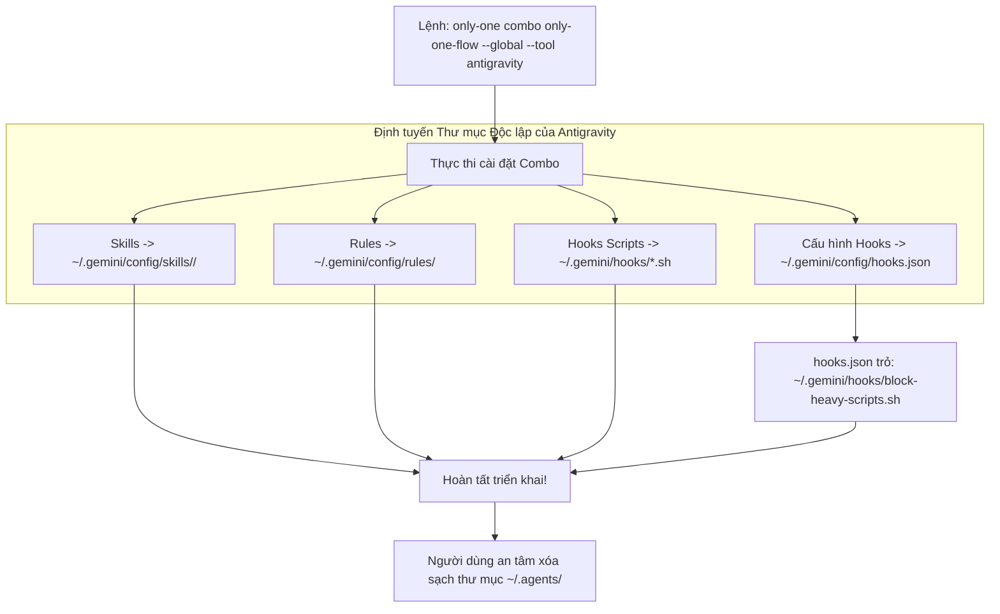

# Concept: Chuẩn hóa Thư mục Triển khai Độc lập cho Antigravity & Hooks (Triệt tiêu Hoàn toàn .agents)

## 1. Problem & Goal

### Problem (Điểm nghẽn & Thiếu sót hiện tại)
- **Context & Trigger**: Người dùng muốn loại bỏ hoàn toàn thư mục dùng chung `~/.agents/` và triển khai tài sản toàn cục (`--global`) trực tiếp vào đúng thư mục cấu hình riêng của từng IDE được chọn (đặc biệt là Antigravity).
- **Symptom & Defect**:
  1. Khi cài đặt Antigravity toàn cục, skills và rules vẫn bị đưa vào `~/.agents/skills/` và `~/.agents/rules/` thay vì thư mục cấu hình chính thức của Antigravity là `~/.gemini/config/`.
  2. Khi cài đặt hooks (`installHooks`), mã nguồn vẫn hardcode ghi script vào `~/.agents/hooks/` bất kể đang cài cho Antigravity hay Claude Code.
  3. Cấu hình `hooks.json` của Antigravity và `settings.json` của Claude Code vẫn trỏ lệnh command tĩnh tới `.agents/hooks/*.sh`. Nếu người dùng xóa thư mục `~/.agents/`, toàn bộ hooks sẽ đứt gãy do không tìm thấy file thực thi.
- **Root Cause**:
  - `src/core/agent/tools.ts`: Trong `AI_TOOLS`, công cụ `antigravity` đang được cấu hình `skillsDir: '.agents'` và `rulesDir: '.agents/rules'`.
  - `src/core/hook/installer.ts`: Hardcode `baseDir = isGlobal ? join(homedir(), '.agents') : join(projectDir, '.agents')`.
  - `assets/agents/hooks/hooks.json` và `claude-settings.json`: Hardcode đường dẫn lệnh trỏ vào `.agents/hooks/...`.
- **Impact / Blast Radius**:
  - Trải nghiệm Antigravity bị phân mảnh giữa `~/.gemini/config/` và `~/.agents/`.
  - Người dùng không thể dọn dẹp xóa bỏ thư mục `~/.agents/` như mong muốn vì hooks phụ thuộc vào đó.

### Goal (Kết quả kỹ thuật mục tiêu)
- **Core Goal**: Định tuyến toàn bộ skills, rules và hooks của Antigravity vào chính xác thư mục cấu hình chuẩn của Antigravity (`~/.gemini/config/` và `~/.gemini/hooks/`), đồng thời cách ly thư mục hooks cho từng IDE, cho phép người dùng xóa hoàn toàn `~/.agents/` mà hệ thống vẫn hoạt động trơn tru 100%.
- **Acceptance Criteria**:
  - **`AC-1` (Cấu hình Toàn cục Chuẩn của Antigravity)**:
    - Khi `isGlobal = true`, Antigravity triển khai skills vào `~/.gemini/config/skills/` và rules vào `~/.gemini/config/rules/`.
    - Hỗ trợ trường `globalSkillsDir: '.gemini/config'` và `globalRulesDir: '.gemini/config/rules'` trong `AI_TOOLS` (hoặc fallback thông minh).
  - **`AC-2` (Phân lập Thư mục Hook Scripts theo IDE)**:
    - Khi cài hooks cho Antigravity: Script được chép vào `~/.gemini/hooks/` (global) hoặc `.gemini/hooks/` (local).
    - Khi cài hooks cho Claude Code: Script được chép vào `~/.claude/hooks/` (global) hoặc `.claude/hooks/` (local).
  - **`AC-3` (Cấu hình Đường dẫn Command Động trong Hooks Config)**:
    - File `hooks.json` của Antigravity trỏ lệnh command tới `~/.gemini/hooks/<script-name>` (global) hoặc `.gemini/hooks/<script-name>` (local).
    - File `settings.json` của Claude Code trỏ lệnh command tới `~/.claude/hooks/<script-name>` (global) hoặc `.claude/hooks/<script-name>` (local).
  - **`AC-4` (Độc lập 100% Khỏi `.agents`)**: Sau khi triển khai, người dùng có thể xóa sổ hoàn toàn thư mục `~/.agents/` mà Antigravity và Claude Code vẫn nạp đầy đủ skills, rules và hooks mà không gặp bất kỳ lỗi nào.

---

## 2. Scope Boundaries

- **In-Scope**:
  - Bổ sung hỗ trợ đường dẫn toàn cục riêng biệt (`globalSkillsDir`, `globalRulesDir`) cho các công cụ có cấu trúc thư mục global khác local (cụ thể là Antigravity) trong `src/core/agent/tools.ts`.
  - Tái cấu trúc `src/core/hook/installer.ts`: Thay vì ghi vào một thư mục `.agents/hooks` chung, triển khai hook scripts vào từng thư mục riêng của IDE (`.gemini/hooks/`, `.claude/hooks/`).
  - Sinh nội dung file cấu hình hooks (`hooks.json`, `settings.json`) với đường dẫn động tương ứng với vị trí script thực tế của IDE đó.
  - Cập nhật toàn bộ unit tests, integration tests liên quan đến phân giải đường dẫn và cài đặt hooks.
- **Explicit Out-of-Scope**:
  - Không tự ý xóa thư mục `~/.agents/` trên máy người dùng (người dùng sẽ chủ động xóa sau khi nghiệm thu).
  - Không thay đổi chức năng logic bên trong các script `.sh` (giữ nguyên logic chặn scripts nặng, bảo vệ secrets, v.v.).

---

## 3. Proposed Solution & Core Mechanism

### Đánh giá Các Phương án Kỹ thuật (Architectural Options)

| Tiêu chí So sánh | Phương án 1: Bổ sung `globalSkillsDir` & Tách Hooks theo IDE (Khuyến nghị) | Phương án 2: Giữ nguyên `.agents` làm thư mục phụ của Antigravity |
| :--- | :--- | :--- |
| **Cơ chế** | 1. `AI_TOOLS` có thêm `globalSkillsDir: '.gemini/config'`.<br>2. `installHooks` sao chép scripts vào `<ideDir>/hooks/` và tạo file cấu hình với đường dẫn command tương ứng. | Giữ nguyên Antigravity dùng `.agents/` và tạo symlink từ `.gemini` sang `.agents`. |
| **Ưu điểm** | Sạch sẽ, độc lập 100%, đúng chuẩn kiến trúc của từng IDE, đáp ứng hoàn toàn mong muốn xóa bỏ `.agents`. | Ít sửa code hơn. |
| **Nhược điểm / Đánh đổi** | Cần cập nhật logic sinh cấu hình hooks trong `installer.ts`. | Không giải quyết được gốc rễ; Windows thường gặp lỗi phân quyền khi tạo symlink; vẫn phụ thuộc `.agents`. |
| **Độ phức tạp** | Trung bình (Medium) | Thấp (Low) nhưng rủi ro cao |
| **Quyết định** | **Chọn Phương án 1**: Triệt tiêu hoàn toàn sự lệ thuộc vào `.agents`. | Loại bỏ (Rejected). |

---

### Core Mechanism (Cơ chế Hoạt động Cốt lõi)

#### 1. Định tuyến Tài sản (Skills & Rules)
Trong `src/core/agent/tools.ts`:
```typescript
export function resolveToolDestinationPaths(
    tool: AgentToolOption,
    assetType: 'skills' | 'workflows' | 'rules',
    targetDir: string,
    isGlobal = false,
): string {
    const skillsDir = isGlobal && tool.globalSkillsDir ? tool.globalSkillsDir : tool.skillsDir || '.agents';
    const rulesDir = isGlobal && tool.globalRulesDir ? tool.globalRulesDir : tool.rulesDir || (tool.skillsDir ? join(tool.skillsDir, 'rules') : '.agents/rules');

    if (assetType === 'skills') return join(targetDir, skillsDir, 'skills');
    if (assetType === 'workflows') return join(targetDir, skillsDir, 'workflows');
    return join(targetDir, rulesDir);
}
```
Với `antigravity`:
- `skillsDir`: `'.gemini'` (hoặc `'.agents'` khi ở local nếu muốn tương thích, hoặc `'.gemini'`).
- `globalSkillsDir`: `'.gemini/config'`.
- `globalRulesDir`: `'.gemini/config/rules'`.

#### 2. Định tuyến và Sinh Cấu hình Hooks theo IDE
Khi `installHooks` chạy cho danh sách công cụ:
- **Với Antigravity**:
  - Thư mục script: `targetDir/.gemini/hooks/` (Global: `~/.gemini/hooks/`, Local: `<project>/.gemini/hooks/`).
  - Thư mục config: `targetDir/.gemini/config/hooks.json` (Global) hoặc `<project>/.gemini/hooks.json` (Local).
  - Lệnh trong `hooks.json`:
    - Global: `~/.gemini/hooks/<script-name>`
    - Local: `.gemini/hooks/<script-name>`
- **Với Claude Code**:
  - Thư mục script: `targetDir/.claude/hooks/` (Global: `~/.claude/hooks/`, Local: `<project>/.claude/hooks/`).
  - Thư mục config: `targetDir/.claude/settings.json`.
  - Lệnh trong `settings.json`:
    - Global: `~/.claude/hooks/<script-name>`
    - Local: `.claude/hooks/<script-name>`

---

### Conceptual Flow (Sơ đồ Luồng Định tuyến Tài nguyên Mới)



---

### CLI Output Wireframe (Khung Báo cáo Cài đặt)

```text
+-----------------------------------------------------------------------+
|                   COMBO 'ONLY-ONE-FLOW' GLOBAL REPORT                 |
+-----------------------------------------------------------------------+
| Scope: GLOBAL (User Home: C:\Users\ADMIN)                             |
| Target: Antigravity (~/.gemini/config/)                               |
+-----------------------------------------------------------------------+
| Skills Deployed:                                                      |
|   ✓ only-one-idea       -> ~/.gemini/config/skills/only-one-idea      |
|   ✓ only-one-plan       -> ~/.gemini/config/skills/only-one-plan      |
|   ✓ only-one-debug      -> ~/.gemini/config/skills/only-one-debug     |
+-----------------------------------------------------------------------+
| Rules Deployed:                                                       |
|   ✓ 01-context-and-tools -> ~/.gemini/config/rules/                   |
+-----------------------------------------------------------------------+
| Hooks Deployed:                                                       |
|   ✓ Scripts copied to:   ~/.gemini/hooks/                             |
|   ✓ Config generated at: ~/.gemini/config/hooks.json                 |
|   ✓ Command references:  ~/.gemini/hooks/*.sh                         |
+-----------------------------------------------------------------------+
| Status: No dependencies on ~/.agents! Ready for ~/.agents deletion.  |
+-----------------------------------------------------------------------+
```

---

## 4. Critical Risks & Edge Cases (Phân tích Rủi ro & Cơ chế Phòng vệ)

- **`Risk-1` (Mở rộng Ký tự Ngã `~` Trên Windows)**
  - *Mặt tiêu cực / Nguy cơ*: Trên Windows `cmd /c`, ký tự `~` đôi khi không được shell mở rộng tự động nếu công cụ thực thi không xử lý expansion, dẫn đến lỗi không tìm thấy file script.
  - *Cơ chế phòng vệ*: Antigravity runtime đã được tài liệu hóa chính thức (`docs/hooks.md` dòng 130): `"~ is expanded to the home directory"`. Ngoài ra, đối với Windows, có thể hỗ trợ chuẩn hóa đường dẫn hoặc dùng đường dẫn tương đối từ vị trí file cấu hình nếu cần thiết.
- **`Risk-2` (Phân mảnh File Cấu hình giữa Global và Local)**
  - *Mặt tiêu cực / Nguy cơ*: Khi chạy local (`isGlobal = false`), cấu hình trỏ vào `~` sẽ làm đứt gãy tính portable của dự án khi commit lên git.
  - *Cơ chế phòng vệ*:
    - Khi `isGlobal = true`: dùng `~/.gemini/hooks/...` hoặc `~/.claude/hooks/...`.
    - Khi `isGlobal = false`: dùng relative path từ project root `.gemini/hooks/...` hoặc `.claude/hooks/...`.
- **`Risk-3` (Xung đột với Lockfile Hiện Tại)**
  - *Mặt tiêu cực / Nguy cơ*: Lockfile toàn cục cũ tại `~/.agents/.skill-lock.json` có thể không theo dõi được các skill mới tại `~/.gemini/config/`.
  - *Cơ chế phòng vệ*: Khởi tạo lockfile tương ứng tại thư mục đích chuẩn (`~/.gemini/config/.skill-lock.json` hoặc thư mục cấu hình của IDE).

