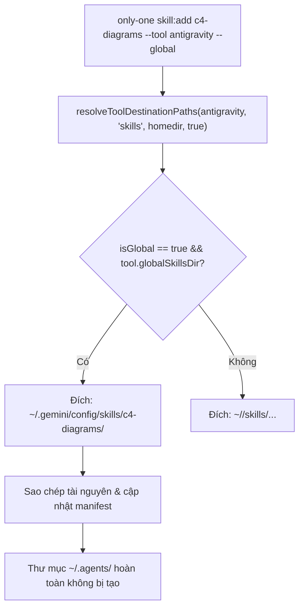
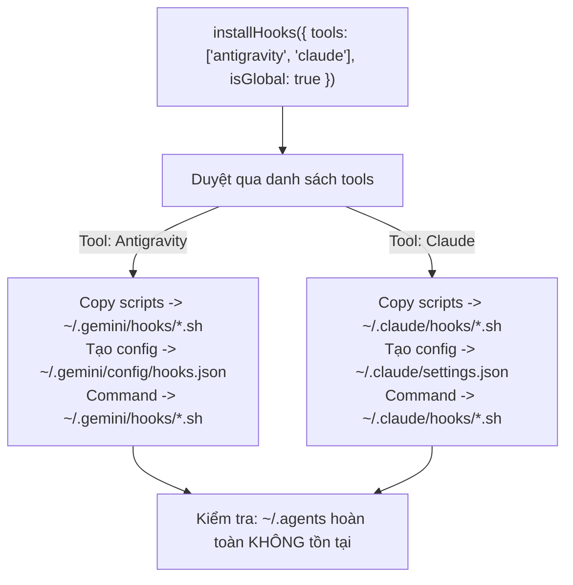

# Plan: Chuẩn hóa Thư mục Triển khai Độc lập cho Antigravity & Hooks (Triệt tiêu Hoàn toàn .agents)

## Section 1. Directory Structure Changes

```text
src/core/agent/
└── [MODIFY] tools.ts                         # Bổ sung globalSkillsDir, globalRulesDir cho AgentToolOption; cấu hình Antigravity trỏ về .gemini/config
src/core/hook/
└── [MODIFY] installer.ts                     # Tách phân giải thư mục hook scripts theo IDE (~/.gemini/hooks, ~/.claude/hooks), sinh config động
src/core/skill/
└── [MODIFY] manifest-bridge.ts               # Điều chỉnh canonical skill path và tránh phụ thuộc vào thư mục ~/.agents
src/commands/combo/actions/
└── [MODIFY] step-5-execute-and-report.ts     # Cập nhật nhãn hiển thị báo cáo CLI hooks theo IDE
test/core/agent/
└── [MODIFY] tools.test.ts                   # Unit tests kiểm tra resolveToolDestinationPaths cho Antigravity (global .gemini/config vs local .gemini)
test/core/hook/
└── [MODIFY] installer.test.ts               # Unit tests kiểm tra installHooks phân lập theo IDE, không tạo thư mục .agents
test/commands/
└── [MODIFY] global-commands.test.ts         # Cập nhật integration tests Antigravity global sang .gemini/config
```

---

## Section 2. Story Board (User Journey & Feature Scenarios)

### Story 1: Phân giải Thư mục Toàn cục Riêng biệt cho Antigravity [MODIFY]
- **User Story**: Là một lập trình viên sử dụng Antigravity IDE, tôi muốn khi chạy lệnh `only-one combo <name> --global` hoặc `only-one skill:add <name> --global`, toàn bộ skills và rules được đặt vào chính xác thư mục `~/.gemini/config/` thay vì `~/.agents/`, để tài nguyên được Antigravity nhận diện đúng chuẩn toàn cục và cho phép tôi xóa hoàn toàn thư mục `.agents`.
- **Before**: Antigravity có `skillsDir: '.agents'`, dẫn đến khi chạy `--global`, tài nguyên rơi vào `~/.agents/skills/` và `~/.agents/rules/`.
- **After**: Antigravity khai báo `globalSkillsDir: '.gemini/config'`, `globalRulesDir: '.gemini/config/rules'`. Lệnh `--global` phân giải chính xác vào `~/.gemini/config/skills/` và `~/.gemini/config/rules/`.
- **Key Scenarios**:
  - *Scenario 1 (Phân giải Đường dẫn Toàn cục cho Antigravity)*:
    - *Test trường hợp: Gọi `resolveToolDestinationPaths` với `tool = antigravity`, `assetType = 'skills'`, `isGlobal = true` trả về `~/.gemini/config/skills`*
    - *Serving Files*:
      - `[TEST]` `test/core/agent/tools.test.ts`
      - `[MODIFY]` `src/core/agent/tools.ts`
  - *Scenario 2 (Cài đặt Toàn cục CLI Antigravity)*:
    - *Test trường hợp: Chạy lệnh `only-one skill:add c4-diagrams --tool antigravity --global` kiểm tra file xuất hiện tại `tempHome/.gemini/config/skills/c4-diagrams/SKILL.md` và không tạo thư mục `tempHome/.agents`*
    - *Serving Files*:
      - `[TEST]` `test/commands/global-commands.test.ts`
      - `[MODIFY]` `src/core/skill/manifest-bridge.ts`



---

### Story 2: Phân lập Thư mục Hooks theo Từng IDE & Triệt tiêu `.agents/hooks` [MODIFY]
- **User Story**: Là một lập trình viên sử dụng Antigravity hoặc Claude Code, tôi muốn các hook scripts và file cấu hình hooks được cài đặt độc lập vào đúng thư mục của IDE tương ứng (`~/.gemini/hooks/` và `~/.claude/hooks/`), với các lệnh command trỏ chính xác vào file script của IDE đó mà không phụ thuộc vào `.agents/hooks/`.
- **Before**: `installHooks` ghi toàn bộ script vào `~/.agents/hooks/` và file cấu hình `hooks.json` / `settings.json` trỏ cứng lệnh vào `.agents/hooks/*.sh`.
- **After**: Antigravity lưu scripts tại `~/.gemini/hooks/` và cấu hình tại `~/.gemini/config/hooks.json` với command trỏ tới `~/.gemini/hooks/*.sh`. Claude Code lưu scripts tại `~/.claude/hooks/` và `~/.claude/settings.json`. Thư mục `~/.agents/` không còn được sử dụng.
- **Key Scenarios**:
  - *Scenario 1 (Cài đặt Hooks Độc lập cho Antigravity & Claude)*:
    - *Test trường hợp: Gọi `installHooks` với `tools: ['antigravity', 'claude']`, kiểm tra các script xuất hiện tại `.gemini/hooks/` và `.claude/hooks/`, không tạo `.agents`*
    - *Serving Files*:
      - `[TEST]` `test/core/hook/installer.test.ts`
      - `[MODIFY]` `src/core/hook/installer.ts`
      - `[MODIFY]` `src/commands/combo/actions/step-5-execute-and-report.ts`



---

## Section 3. Test Cases & Verification Matrix

### 3.1. Bảng Đối soát Độ bao phủ Tiêu chí Concept (Concept Coverage & Traceability Matrix)

| Tiêu chí Concept (AC / Risk ID) | Yêu cầu cốt lõi từ Concept | Test Cases / Verification Gate đảm nhiệm | Trạng thái Bao phủ |
| :--- | :--- | :--- | :---: |
| **`AC-1`** (Cấu hình Toàn cục Antigravity) | Antigravity dùng `globalSkillsDir: '.gemini/config'` khi `isGlobal = true` | `TC-01`, `TC-02`, Task 1 & Task 2 | 🟢 100% Phủ |
| **`AC-2`** (Phân lập Thư mục Hook Scripts) | Script hooks ghi vào `.gemini/hooks/` và `.claude/hooks/` | `TC-04`, `TC-05`, Task 3 & Task 4 | 🟢 100% Phủ |
| **`AC-3`** (Đường dẫn Command Động) | File config trỏ lệnh tương ứng theo IDE (`~/.gemini/hooks/...`) | `TC-06`, Task 3 & Task 4 | 🟢 100% Phủ |
| **`AC-4`** (Độc lập 100% Khỏi `.agents`) | Không tạo bất kỳ file/folder nào tại `~/.agents/` | `TC-03`, `TC-07`, Task 3 & Task 5 | 🟢 100% Phủ |
| **`Risk-1`** (Mở rộng Tilde `~`) | Antigravity hỗ trợ `~` expansion trong hook commands | `TC-06`, Task 4 | 🟢 100% Phủ |
| **`Risk-2`** (Phân biệt Global vs Local) | Local dùng relative path `.gemini/hooks`, Global dùng `~/.gemini/hooks` | `TC-04`, `TC-06`, Task 4 | 🟢 100% Phủ |
| **`Risk-3`** (Đồng bộ Lockfile & Manifest) | Cập nhật manifest đúng vị trí `~/.gemini/config/skills.json` | `TC-03`, Task 6 | 🟢 100% Phủ |

### 3.2. Bảng Danh mục Test Cases Chi tiết (Test Case Specification Matrix)

| Test ID | Concept Ref | Story / Module | Tên Test Case (`it / test`) | Điều kiện / Dữ liệu đầu vào | Kết quả kỳ vọng (Assertions) | Loại test | Status |
| :--- | :--- | :--- | :--- | :--- | :--- | :--- | :---: |
| `TC-01` | `AC-1` | Story 1 (Resolver) | `resolves global skills path for Antigravity using .gemini/config` | `tool = antigravity`, `assetType = 'skills'`, `isGlobal = true` | `join(dummyHome, '.gemini', 'config', 'skills')` | Unit | `[x]` |
| `TC-02` | `AC-1` | Story 1 (Resolver) | `resolves global rules path for Antigravity using .gemini/config/rules` | `tool = antigravity`, `assetType = 'rules'`, `isGlobal = true` | `join(dummyHome, '.gemini', 'config', 'rules')` | Unit | `[x]` |
| `TC-03` | `AC-1`, `AC-4`| Story 1 (CLI Command) | `installs skills globally into Antigravity .gemini/config without touching .agents` | `c4-diagrams`, `--tool antigravity`, `--global` | File tại `tempHome/.gemini/config/skills/c4-diagrams/SKILL.md`, `tempHome/.agents` không tồn tại | Integration | `[x]` |
| `TC-04` | `AC-2` | Story 2 (Hook Installer) | `installs hook scripts into specific IDE hooks directories` | `tools: ['antigravity', 'claude']`, `projectDir = testDir` | Tồn tại `.gemini/hooks/*.sh` và `.claude/hooks/*.sh` | Unit | `[x]` |
| `TC-05` | `AC-2`, `AC-4`| Story 2 (Hook Installer) | `does not create .agents directory when installing hooks` | `tools: ['antigravity', 'claude']`, `projectDir = testDir` | `existsSync(join(testDir, '.agents')) === false` | Unit | `[x]` |
| `TC-06` | `AC-3`, `Risk-2`| Story 2 (Hook Installer) | `generates dynamic command paths matching IDE script location` | `tools: ['antigravity']`, `projectDir = testDir` | Nội dung `hooks.json` chứa `.gemini/hooks/block-heavy-scripts.sh` | Unit | `[x]` |
| `TC-07` | `AC-4` | Story 2 (Combo CLI) | `applies combo globally to Antigravity without generating .agents` | `only-one-flow`, `--tool antigravity`, `--global` | Skills & rules tại `.gemini/config/`, hooks tại `.gemini/hooks/`, không có `.agents` | Integration | `[x]` |

### Automated Test Execution Commands
- `npx vitest run test/core/agent/tools.test.ts`
- `npx vitest run test/core/hook/installer.test.ts`
- `npx vitest run test/commands/global-commands.test.ts`
- `npm test`
- `npm run build`

### Cổng Nghiệm thu khi Thực thi (`/only-one-apply`)
- Agent thực thi đối soát từng `Test ID` trong Section 3 với kết quả kiểm thử thực tế.
- Khi kiểm thử thành công (PASS), Agent cập nhật trạng thái `[ ]` thành `[x]` trong bảng nghiệm thu của `plan.md` trước khi báo cáo kết quả cho người dùng.

---

## Section 4. File Changes

### 1. `[MODIFY]` `test/core/agent/tools.test.ts`

- **Status**: `[x]`
- **Task Type**: `code`
- **Context**: Bộ kiểm thử đơn vị cho danh mục công cụ và hàm phân giải đường dẫn tài sản.
- **Target Symbols / AST Seams**: `resolveToolDestinationPaths`.
- **Invariants**: Phân giải đường dẫn toàn cục cho Antigravity phải trả về `.gemini/config` thay vì `.agents`.
- **Depends On**: None.

> **Action**: Cập nhật assertions cho Antigravity trong kiểm thử toàn cục.

**Test checklist**
- [ ] Bắt buộc theo đúng tiêu chí nghiệm thu AC-1.
- [ ] Tái sử dụng fixture `dummyHome` sẵn có.
- [ ] Tuân thủ toolchain vitest sẵn có.
- **Decision**: Kỳ vọng `join(dummyHome, '.gemini', 'config', 'skills')` cho Antigravity khi `isGlobal = true`.
- **Rejected alternative**: Giữ nguyên assertion `.agents` làm che lấp lỗi phân giải sai.

```diff
@@ -27,4 +27,4 @@
         // Global checks
-        expect(resolveToolDestinationPaths(antigravity, 'skills', dummyHome, true)).toBe(join(dummyHome, '.agents', 'skills'));
-        expect(resolveToolDestinationPaths(antigravity, 'workflows', dummyHome, true)).toBe(join(dummyHome, '.agents', 'workflows'));
+        expect(resolveToolDestinationPaths(antigravity, 'skills', dummyHome, true)).toBe(join(dummyHome, '.gemini', 'config', 'skills'));
+        expect(resolveToolDestinationPaths(antigravity, 'workflows', dummyHome, true)).toBe(join(dummyHome, '.gemini', 'config', 'workflows'));
         expect(resolveToolDestinationPaths(claude, 'skills', dummyHome, true)).toBe(join(dummyHome, '.claude', 'skills'));
```

---

### 2. `[MODIFY]` `src/core/agent/tools.ts`

- **Status**: `[x]`
- **Task Type**: `code`
- **Context**: Định nghĩa cấu hình công cụ IDE và hàm phân giải đường dẫn đích.
- **Target Symbols / AST Seams**: `AgentToolOption`, `resolveToolDestinationPaths`, `AI_TOOLS`.
- **Invariants**: Khi `isGlobal = true`, ưu tiên sử dụng `globalSkillsDir` và `globalRulesDir` nếu được định nghĩa.
- **Depends On**: `test/core/agent/tools.test.ts`.

> **Action**: Thêm các trường `globalSkillsDir`, `globalRulesDir` và cấu hình Antigravity trỏ về `.gemini/config`.

**Ponytail checklist**
- [ ] Đọc hiểu mã nguồn xung quanh seam trước khi sửa.
- [ ] Chỉ tác động đúng seam liên quan đến phân giải đường dẫn.
- [ ] Giữ nguyên các công cụ khác không bị ảnh hưởng.
- **Decision**: Mở rộng `AgentToolOption` để hỗ trợ các IDE có thư mục global khác local (như Antigravity).
- **Rejected alternative**: Hardcode điều kiện `if (tool.value === 'antigravity')` gây phân mảnh và khó mở rộng.

```diff
@@ -8,4 +8,6 @@
     name: string;
     skillsDir?: string;
     rulesDir?: string;
+    globalSkillsDir?: string;
+    globalRulesDir?: string;
     successLabel?: string;
@@ -19,4 +21,6 @@
     isGlobal = false,
 ): string {
-    if (assetType === 'skills') return join(targetDir, tool.skillsDir || '.agents', 'skills');
-    if (assetType === 'workflows') return join(targetDir, tool.skillsDir || '.agents', 'workflows');
-    return join(targetDir, tool.rulesDir || (tool.skillsDir ? join(tool.skillsDir, 'rules') : '.agents/rules'));
+    const effectiveSkillsDir = isGlobal && tool.globalSkillsDir ? tool.globalSkillsDir : tool.skillsDir || '.agents';
+    const effectiveRulesDir = isGlobal && tool.globalRulesDir ? tool.globalRulesDir : tool.rulesDir || (tool.skillsDir ? join(tool.skillsDir, 'rules') : '.agents/rules');
+    if (assetType === 'skills') return join(targetDir, effectiveSkillsDir, 'skills');
+    if (assetType === 'workflows') return join(targetDir, effectiveSkillsDir, 'workflows');
+    return join(targetDir, effectiveRulesDir);
 }
@@ -30,4 +34,6 @@
         skillsDir: '.agents',
         rulesDir: '.agents/rules',
+        globalSkillsDir: '.gemini/config',
+        globalRulesDir: '.gemini/config/rules',
         successLabel: 'Antigravity',
```

---

### 3. `[MODIFY]` `test/core/hook/installer.test.ts`

- **Status**: `[x]`
- **Task Type**: `code`
- **Context**: Bộ kiểm thử đơn vị cho module cài đặt lifecycle hooks.
- **Target Symbols / AST Seams**: `installHooks`.
- **Invariants**: Hook scripts phải được lưu vào thư mục của từng IDE, không tạo thư mục `.agents`.
- **Depends On**: None.

> **Action**: Cập nhật assertions kiểm tra scripts nằm tại `.gemini/hooks` và `.claude/hooks`, đồng thời kiểm tra nội dung file cấu hình chứa đường dẫn tương ứng.

**Test checklist**
- [ ] Bắt buộc theo đúng tiêu chí nghiệm thu AC-2, AC-3, AC-4.
- [ ] Tái sử dụng test sandbox `testDir`.
- [ ] Tuân thủ toolchain vitest sẵn có.
- **Decision**: Kiểm tra độc lập cả hai thư mục `.gemini/hooks` và `.claude/hooks`, khẳng định `.agents` không tồn tại.
- **Rejected alternative**: Chấp nhận ghi chung vào `.agents/hooks` làm đứt gãy tính cô lập của IDE.

```diff
@@ -17,12 +17,16 @@
 
-    it('should install all hook scripts into .agents/hooks and create configs', async () => {
+    it('should install hook scripts into specific IDE directories without creating .agents', async () => {
         const res = await installHooks({
             projectDir: testDir,
             tools: ['antigravity', 'claude'],
         });
 
         expect(res.installedFiles.length).toBeGreaterThan(0);
-        expect(existsSync(join(testDir, '.agents', 'hooks', 'block-heavy-scripts.sh'))).toBe(true);
-        expect(existsSync(join(testDir, '.agents', 'hooks.json'))).toBe(true);
+        expect(existsSync(join(testDir, '.gemini', 'hooks', 'block-heavy-scripts.sh'))).toBe(true);
+        expect(existsSync(join(testDir, '.claude', 'hooks', 'block-heavy-scripts.sh'))).toBe(true);
+        expect(existsSync(join(testDir, '.gemini', 'hooks.json'))).toBe(true);
         expect(existsSync(join(testDir, '.claude', 'settings.json'))).toBe(true);
+        expect(existsSync(join(testDir, '.agents'))).toBe(false);
     });
 });
```

---

### 4. `[MODIFY]` `src/core/hook/installer.ts`

- **Status**: `[x]`
- **Task Type**: `code`
- **Context**: Module triển khai các hook scripts và file cấu hình cho các IDE được hỗ trợ.
- **Target Symbols / AST Seams**: `installHooks`.
- **Invariants**: Mỗi IDE được chỉ định trong `tools` sẽ nhận bản sao scripts vào thư mục hooks riêng của IDE đó; nội dung cấu hình trỏ đúng đường dẫn thực thi.
- **Depends On**: `test/core/hook/installer.test.ts`.

> **Action**: Tách logic cài đặt scripts theo từng IDE và sinh cấu hình với đường dẫn command động.

**Ponytail checklist**
- [ ] Đọc hiểu mã nguồn xung quanh seam trước khi sửa.
- [ ] Duyệt qua từng tool trong `tools` để sao chép script vào thư mục tương ứng.
- [ ] Triệt tiêu hoàn toàn việc tạo và tham chiếu đến thư mục `.agents`.
- **Decision**: Tạo hàm helper sao chép scripts cho từng thư mục đích của IDE và cập nhật đường dẫn command trong JSON config.
- **Rejected alternative**: Giữ thư mục `.agents` làm fallback gây rác workspace.

```diff
@@ -1,3 +1,3 @@
 import { existsSync } from 'node:fs';
-import { cp, mkdir } from 'node:fs/promises';
+import { cp, mkdir, readFile, writeFile } from 'node:fs/promises';
 import { homedir } from 'node:os';
@@ -23,8 +23,2 @@
 
-    const baseDir = isGlobal ? join(homedir(), '.agents') : join(projectDir, '.agents');
-    const targetHooksDir = join(baseDir, 'hooks');
-    await mkdir(targetHooksDir, { recursive: true });
-
     const hookScripts = ['block-heavy-scripts.sh', 'no-secrets.sh', 'format-on-edit.sh', 'protect-configs.sh'];
-
     const installedFiles: string[] = [];
+    const configsCreated: string[] = [];
+    let primaryHooksDir = '';
+
+    const copyScriptsTo = async (destDir: string) => {
+        await mkdir(destDir, { recursive: true });
+        for (const script of hookScripts) {
+            const srcPath = join(srcHooksDir, script);
+            const destPath = join(destDir, script);
+            if (existsSync(srcPath)) {
+                await cp(srcPath, destPath, { force: true });
+                installedFiles.push(destPath);
+            }
+        }
+    };
@@ -42,10 +36,15 @@
-    const configsCreated: string[] = [];
-
-    // 1. Antigravity .agents/hooks.json
+    // 1. Antigravity hooks & config
     if (tools.includes('antigravity')) {
+        const agyHooksDir = isGlobal ? join(homedir(), '.gemini', 'hooks') : join(projectDir, '.gemini', 'hooks');
+        await copyScriptsTo(agyHooksDir);
+        primaryHooksDir = agyHooksDir;
+
         const srcJson = join(srcHooksDir, 'hooks.json');
-        const destJson = isGlobal ? join(homedir(), '.gemini', 'config', 'hooks.json') : join(baseDir, 'hooks.json');
+        const destJson = isGlobal ? join(homedir(), '.gemini', 'config', 'hooks.json') : join(projectDir, '.gemini', 'hooks.json');
         if (existsSync(srcJson)) {
             await mkdir(dirname(destJson), { recursive: true });
-            await cp(srcJson, destJson, { force: true });
+            const rawContent = await readFile(srcJson, 'utf-8');
+            const commandPrefix = isGlobal ? '~/.gemini/hooks/' : '.gemini/hooks/';
+            const customized = rawContent.replaceAll('.agents/hooks/', commandPrefix);
+            await writeFile(destJson, customized, 'utf-8');
             configsCreated.push(destJson);
         }
     }
@@ -53,8 +52,14 @@
-    // 2. Claude Code .claude/settings.json
+    // 2. Claude Code hooks & config
     if (tools.includes('claude')) {
+        const claudeHooksDir = isGlobal ? join(homedir(), '.claude', 'hooks') : join(projectDir, '.claude', 'hooks');
+        await copyScriptsTo(claudeHooksDir);
+        if (!primaryHooksDir) primaryHooksDir = claudeHooksDir;
+
         const srcClaude = join(srcHooksDir, 'claude-settings.json');
         const destClaude = isGlobal ? join(homedir(), '.claude', 'settings.json') : join(projectDir, '.claude', 'settings.json');
         if (existsSync(srcClaude)) {
             await mkdir(dirname(destClaude), { recursive: true });
-            await cp(srcClaude, destClaude, { force: true });
+            const rawContent = await readFile(srcClaude, 'utf-8');
+            const commandPrefix = isGlobal ? '~/.claude/hooks/' : '.claude/hooks/';
+            const customized = rawContent.replaceAll('.agents/hooks/', commandPrefix);
+            await writeFile(destClaude, customized, 'utf-8');
             configsCreated.push(destClaude);
         }
     }
@@ -66,3 +71,3 @@
         installedFiles,
-        agentsHooksDir: targetHooksDir,
+        agentsHooksDir: primaryHooksDir,
         configsCreated,
```

---

### 5. `[MODIFY]` `src/commands/combo/actions/step-5-execute-and-report.ts`

- **Status**: `[x]`
- **Task Type**: `code`
- **Context**: Báo cáo kết quả cài đặt combo trên giao diện dòng lệnh.
- **Target Symbols / AST Seams**: `executeAndReportComboStep`.
- **Invariants**: Báo cáo hiển thị nhãn hooks trung tính hoặc theo IDE, không ghi cứng `.agents/hooks`.
- **Depends On**: `src/core/hook/installer.ts`.

> **Action**: Đổi nhãn hiển thị `.agents/hooks` sang `hooks`.

**Ponytail checklist**
- [ ] Đọc hiểu mã nguồn xung quanh seam trước khi sửa.
- [ ] Chỉ sửa nhãn hiển thị CLI, không thay đổi logic luồng cài đặt.
- **Decision**: Đổi nhãn thành `hooks` để phản ánh đúng cấu trúc đa IDE.
- **Rejected alternative**: Giữ nguyên nhãn `.agents/hooks` gây hiểu nhầm cho người dùng.

```diff
@@ -103,3 +103,3 @@
             const statusColor = h.status === 'success' ? COLORS.success : COLORS.error;
-            deps.stdout(`  - ${COLORS.secondary(h.name)} in ${COLORS.primary('.agents/hooks')}: ${statusColor(h.status)}`);
+            deps.stdout(`  - ${COLORS.secondary(h.name)} in ${COLORS.primary('hooks')}: ${statusColor(h.status)}`);
         }
```

---

### 6. `[MODIFY]` `src/core/skill/manifest-bridge.ts`

- **Status**: `[x]`
- **Task Type**: `code`
- **Context**: Đồng bộ tệp manifest danh mục skills toàn cục (`skills.json`).
- **Target Symbols / AST Seams**: `syncGlobalSkillsManifest`, `CANONICAL_SKILL_PATH`.
- **Invariants**: Chỉ cập nhật `~/.gemini/config/skills.json` khi đồng bộ manifest cho Antigravity, không ép tạo `~/.agents/skills.json`.
- **Depends On**: None.

> **Action**: Loại bỏ việc ép buộc tạo `~/.agents/skills.json` trong `syncGlobalSkillsManifest`.

**Ponytail checklist**
- [ ] Đọc hiểu mã nguồn xung quanh seam trước khi sửa.
- [ ] Giữ nguyên khả năng tương thích của `skills.json` cho Antigravity.
- **Decision**: Không tự động tạo thư mục `.agents` nếu thư mục đó chưa tồn tại.
- **Rejected alternative**: Tiếp tục ghi vào `.agents/skills.json` khiến thư mục `.agents` bị hồi sinh ngoài ý muốn.

```diff
@@ -41,4 +41,5 @@
 export async function syncGlobalSkillsManifest(homeDir: string): Promise<void> {
     const agentsManifestPath = join(homeDir, '.agents', 'skills.json');
     const geminiManifestPath = join(homeDir, '.gemini', 'config', 'skills.json');
 
-    await mergeSkillsManifest(agentsManifestPath);
+    if (existsSync(join(homeDir, '.agents'))) {
+        await mergeSkillsManifest(agentsManifestPath);
+    }
     await mergeSkillsManifest(geminiManifestPath);
 }
```

---

### 7. `[MODIFY]` `test/commands/global-commands.test.ts`

- **Status**: `[x]`
- **Task Type**: `code`
- **Context**: Bộ kiểm thử tích hợp các lệnh toàn cục CLI (`--global`).
- **Target Symbols / AST Seams**: Test cases cho `--tool antigravity --global`.
- **Invariants**: Toàn bộ tài nguyên Antigravity cài toàn cục phải nằm trong `tempHome/.gemini/config/` và không tạo thư mục `tempHome/.agents`.
- **Depends On**: `src/core/agent/tools.ts`, `src/core/hook/installer.ts`, `src/core/skill/manifest-bridge.ts`.

> **Action**: Cập nhật các đường dẫn kỳ vọng từ `.agents/` sang `.gemini/config/` và xác nhận `.agents` không bị tạo.

**Test checklist**
- [ ] Bắt buộc theo đúng tiêu chí nghiệm thu AC-1, AC-4.
- [ ] Tái sử dụng helper `tempHome`.
- [ ] Tuân thủ toolchain vitest sẵn có.
- **Decision**: Đổi kỳ vọng đường dẫn sang `.gemini/config/skills`, `.gemini/config/rules`, `.gemini/config/workflows` và assert `existsSync(join(tempHome, '.agents')) === false`.
- **Rejected alternative**: Giữ nguyên assertion `.agents` làm kiểm thử hồi quy thất bại.

```diff
@@ -62,5 +62,5 @@
 
-        const skillDest = join(tempHome, '.agents/skills/c4-diagrams/SKILL.md');
+        const skillDest = join(tempHome, '.gemini/config/skills/c4-diagrams/SKILL.md');
         expect(existsSync(skillDest)).toBe(true);
-        expect(existsSync(join(tempHome, '.agents/skills.json'))).toBe(true);
         expect(existsSync(join(tempHome, '.gemini/config/skills.json'))).toBe(true);
+        expect(existsSync(join(tempHome, '.agents'))).toBe(false);
@@ -87,3 +87,3 @@
 
-        const skillDest = join(tempHome, '.agents/skills/only-one-idea/SKILL.md');
+        const skillDest = join(tempHome, '.gemini/config/skills/only-one-idea/SKILL.md');
         expect(existsSync(skillDest)).toBe(true);
@@ -106,3 +106,3 @@
 
-        const ruleDest = join(tempHome, '.agents/rules/02-next-architecture-stack.md');
+        const ruleDest = join(tempHome, '.gemini/config/rules/02-next-architecture-stack.md');
         expect(existsSync(ruleDest)).toBe(true);
@@ -124,3 +124,3 @@
 
-        const wfDest = join(tempHome, '.agents/workflows/only-one-pr-git.md');
+        const wfDest = join(tempHome, '.gemini/config/workflows/only-one-pr-git.md');
         expect(existsSync(wfDest)).toBe(true);
```

