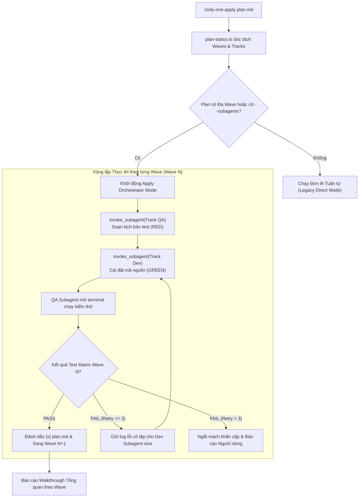

# Concept: Điều phối Đa Subagents (Orchestrator) trong Only-One Apply

## 1. Problem & Goal (Vấn đề & Mục tiêu)

### Problem (Điểm nghẽn & Thiếu sót hiện tại)
- **Context & Trigger**: Khi chạy `/only-one-apply` để thực thi bản kế hoạch `plan.md` đã được thiết kế sẵn cấu trúc Waves và phân tách Track QA/Dev.
- **Symptom & Defect**: `only-one-apply` hiện tại thực thi tuần tự từ trên xuống dưới; chỉ một Agent duy nhất vừa sửa code vừa tự chạy test.
- **Root Cause**: `only-one-apply` chưa có module điều phối Orchestrator, chưa tận dụng công cụ `invoke_subagent` và chưa đọc metadata `Wave` / `Track` từ `plan.md`.
- **Impact / Blast Radius**: Cấu trúc Execution Waves bị vô hiệu hóa khi thi công; logs kiểm thử dài dòng làm ô nhiễm context của Agent chính; vi phạm nguyên tắc tách biệt Builder/Tester.

### Goal (Kết quả kỹ thuật mục tiêu)
- **Core Goal**: Nâng cấp `/only-one-apply` thành **Bộ máy Điều phối Đa Subagents (Apply Orchestrator)**, tự động phân luồng theo Wave và vận hành mô hình Builder / Tester Separation.
- **Acceptance Criteria**:
  - Nâng cấp `plan-status.ts` để bóc tách chính xác các task theo `Wave`, `Track` (`Track QA`, `Track Dev`) và thứ tự phụ thuộc DAG.
  - **Cơ chế Chế độ Kép (Dual-Engine Mode)**:
    - Mặc định: Chạy đơn lẻ tuần tự nếu plan chỉ có 1 Wave hoặc task nhỏ (< 3 file) để tiết kiệm token.
    - Kích hoạt Orchestrator Mode: Tự động kích hoạt khi plan có đa Wave ($\ge 2$) hoặc khi người dùng truyền cờ `--subagents`.
  - **Điều phối Phân vai Subagents**:
    - Giao các task `Track QA` cho **QA Subagent** (`invoke_subagent` role Tester) viết file test `*.test.ts`.
    - Giao các task `Track Dev` cho **Coder Subagent** (`invoke_subagent` role Developer) viết file code `src/...`.
  - **Chốt chặn Gatekeeper & Red Feedback Loop**:
    - Ở cuối mỗi Wave, QA Subagent mở terminal chạy test nghiệm thu độc lập.
    - Nếu test fail: gửi log cô lập cho Coder Subagent sửa (cấm sửa test). Ngắt mạch Circuit Breaker nếu thử lại quá 3 lần.
  - **Quyền lực Trung tâm SSOT**:
    - Duy nhất Agent Orchestrator cha được cập nhật trạng thái `[x]` vào `plan.md` để triệt tiêu hoàn toàn race condition ghi đè tệp.
  - Báo cáo In-Chat Walkthrough hiển thị trực quan tiến độ theo từng Wave và trạng thái nghiệm thu của QA Gatekeeper.

## 2. Scope Boundaries (Ranh giới phạm vi)

- **In-Scope**:
  - Nâng cấp `plan-status.ts` để phân tích cấu trúc Wave, Track và tính toán các đợt chạy song song.
  - Chuẩn hóa quy trình điều phối Orchestrator trong tài liệu kỹ năng `only-one-apply/SKILL.md`.
  - Thiết lập giao thức gọi `invoke_subagent` và giao tiếp qua `send_message` giữa Orchestrator, QA Subagent và Dev Subagent.
  - Cài đặt cơ chế Red Feedback Loop và Circuit Breaker (tối đa 3 lần retries).
  - Cập nhật định dạng báo cáo Walkthrough phân tầng theo Wave.
  - Viết test suites kiểm tra logic phân tách Wave và Track của `plan-status.ts`.
- **Explicit Out-of-Scope**:
  - Không thay đổi cú pháp `plan.md` (đã được chuẩn hóa ở task `plan-execution-waves`).
  - Không can thiệp vào các công cụ môi trường bên ngoài Antigravity.

## 3. Proposed Solution & Core Mechanism (Giải pháp đề xuất & Cơ chế cốt lõi)

- **Core Mechanism**:
  - Khi nhận lệnh `/only-one-apply`, Agent chính đóng vai trò **Orchestrator**:
    1. Đọc `plan.md` qua `plan-status.ts` để lập ma trận thực thi theo từng Wave.
    2. Duyệt qua từng Wave:
       - Kích hoạt song song các Subagents trong cùng Wave (độc lập tệp tuyệt đối).
       - Nhận kết quả hoàn thành từ Subagents, cập nhật mã nguồn.
       - Kích hoạt QA Subagent chạy kiểm thử chốt chặn Wave.
       - Xử lý Red Feedback Loop nếu test fail.
    3. Cập nhật `plan.md` (`[x]`) và xuất trình báo cáo nghiệm thu Wave-based Walkthrough.

- **Sơ đồ Kiến trúc Điều phối Apply Orchestrator (Orchestration Architecture Flow)**:


- **Mô phỏng Giao diện Báo cáo Walkthrough Phân Wave (In-Chat Wireframe)**:
```text
======================================================================
🚀 ONLY-ONE APPLY ORCHESTRATOR REPORT: plan-execution-waves
======================================================================
Wave 1: Chuẩn bị Kiểm thử & Đặc tả [COMPLETED]
  ├── [x] test/skills/validatePlanWaves.test.ts (Track QA: Subagent Tester)
  └── [x] assets/agents/skills/only-one-plan/SKILL.md (Track Doc: Subagent Doc)
  └── 🛡️ Gatekeeper: 5/5 unit tests PASS (12ms)

Wave 2: Cài đặt Mã nguồn Triển khai [COMPLETED]
  └── [x] assets/agents/skills/only-one-plan/scripts/validate-plan.ts (Track Dev: Subagent Coder)
  └── 🛡️ Gatekeeper: 5/5 unit tests PASS (Red Feedback Loop: 0 retries)

🎉 TỔNG KẾT: 3/3 tasks hoàn thành qua 2 Waves. 0 regression.
💬 Cổng cải tiến (only-one-evolve): Bạn có gặp khó khăn hay điểm ma sát nào không?
======================================================================
```

## 4. Critical Risks & Edge Cases (Phân tích Rủi ro & Cơ chế Phòng vệ)

- **Rủi ro 1: Lạm dụng Subagents gây lãng phí Token và tăng độ trễ với task nhỏ**
  - *Mặt tiêu cực / Nguy cơ*: Gọi Subagents cho một sửa đổi 10 dòng code làm tốn gấp 3 lần token và mất thêm thời gian chờ đợi.
  - *Cơ chế phòng vệ*: Dual-Engine Invariant: Chỉ kích hoạt Orchestrator Mode khi plan có $\ge 2$ Waves hoặc khi người dùng truyền rõ cờ `--subagents`. Các task 1 Wave mặc định chạy Direct Sequential Mode siêu tốc.
- **Rủi ro 2: Race Condition ghi đè tệp `plan.md` khi nhiều Subagents cùng báo cáo**
  - *Mặt tiêu cực / Nguy cơ*: Các Subagents chạy song song cùng cố tình cập nhật trạng thái `[x]` vào `plan.md`, gây mất dữ liệu.
  - *Cơ chế phòng vệ*: Quyền lực ghi duy nhất (Single-Writer Invariant): Subagents tuyệt đối cấm chỉnh sửa `plan.md`. Chỉ có Agent Orchestrator cha được phép cập nhật checklist và trạng thái `plan.md`.
- **Rủi ro 3: Vòng lặp sửa lỗi vô tận giữa QA và Coder (Ping-Pong Trap)**
  - *Mặt tiêu cực / Nguy cơ*: Coder sửa sai logic, QA test lại fail, liên tục lặp lại làm cạn kiệt tài nguyên.
  - *Cơ chế phòng vệ*: Cài đặt bộ đếm Circuit Breaker cứng (`maxRetries = 3`). Khi chạm ngưỡng 3 lần, Orchestrator lập tức ngắt mạch, phát tín hiệu cảnh báo và yêu cầu Người dùng can thiệp.
- **Rủi ro 4: Xung đột tài nguyên kiểm thử giữa các tiến trình chạy ngầm**
  - *Mặt tiêu cực / Nguy cơ*: Nhiều tiến trình test chạy đồng thời trên terminal gây chiếm dụng cổng mạng hoặc khóa tệp.
  - *Cơ chế phòng vệ*: Tuần tự hóa chốt chặn kiểm thử: Trong mỗi Wave, việc chạy kiểm thử terminal chỉ được thực hiện bởi duy nhất một QA Subagent sau khi các Coder Subagents đã hoàn thành việc ghi mã nguồn.
