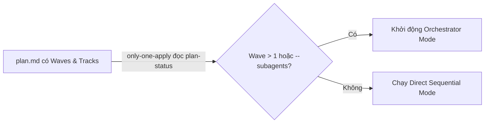
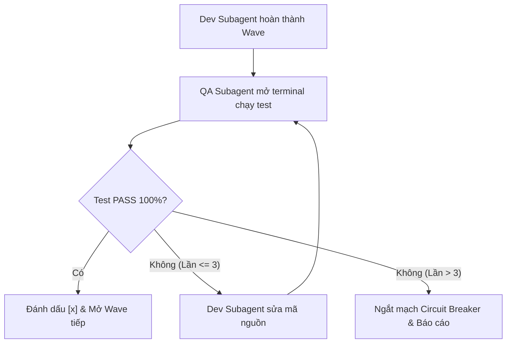
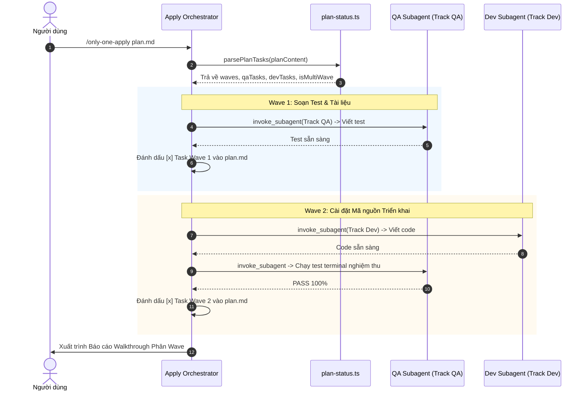

# Plan: Điều phối Đa Subagents (Orchestrator) trong Only-One Apply

## Section 1. Directory Structure Changes

Sơ đồ cây các tệp được thêm mới và chỉnh sửa trong dự án:

```text
only-one-cli/
├── assets/agents/skills/only-one-apply/
│   ├── SKILL.md                          # [MODIFY] Thêm chế độ Orchestrator, phân vai Subagents và Wave Gatekeeper
│   └── scripts/
│       └── plan-status.ts                # [MODIFY] Trích xuất Wave, Track QA/Dev, và nhóm đợt thực thi ParsedWave
└── test/skills/
    └── applyPlanStatusWaves.test.ts      # [NEW] Kiểm thử bóc tách Wave, Track và phân nhóm ParsedWave
```

## Section 2. Story Board (User Journey & Feature Scenarios)

### Story 1: Điều phối Đa Subagents Thực thi Kế hoạch theo Wave [MODIFY]
- **User Story**: Là một Kỹ sư phần mềm / Orchestrator, tôi muốn `/only-one-apply` tự động phân chia các task trong Wave cho QA Subagent và Dev Subagent để thi công nhanh chóng và độc lập.
- **Before**: `/only-one-apply` chạy một Agent duy nhất thực hiện tuần tự mọi file từ đầu đến cuối; không tận dụng được cấu trúc Waves trong `plan.md`.
- **After**: `/only-one-apply` đọc cấu trúc Wave, tự động kích hoạt Orchestrator Mode, gọi Subagents phù hợp theo Track và điều phối tuần tự từng Wave an toàn.
- **Key Scenarios**:
  - *Scenario 1 (Happy Path - Multi-Wave Execution)*: Plan có 2 Waves. Orchestrator giao task Wave 1 cho Subagents, sau đó chuyển sang Wave 2 và xuất báo cáo hoàn tất.
  - *Scenario 2 (Single Wave / Small Plan - Direct Fallback)*: Plan chỉ có 1 Wave hoặc ít hơn 3 file. Hệ thống chạy Direct Mode tuần tự siêu tốc để tiết kiệm token.
  - *Scenario 3 (Explicit Flag)*: Người dùng truyền cờ `--subagents`. Hệ thống ép buộc chạy Orchestrator Mode bất kể số lượng file.



### Story 2: Vận hành Chốt chặn Gatekeeper và Vòng lặp Sửa lỗi Đỏ [NEW]
- **User Story**: Là một QA Lead, tôi muốn QA Subagent độc quyền chạy kiểm thử sau mỗi Wave và gửi lỗi cô lập cho Dev Subagent sửa khi test fail để bảo đảm chất lượng.
- **Before**: Coder tự chạy test cho code của mình; khi test fail dễ bị bế tắc hoặc tràn log terminal vào context.
- **After**: QA Subagent làm Gatekeeper chạy test cuối Wave. Nếu fail, trích xuất log lỗi tinh gọn gửi Dev Subagent sửa; giới hạn tối đa 3 lần thử lại.
- **Key Scenarios**:
  - *Scenario 1 (Wave Gatekeeper Pass)*: Code của Dev pass 100% test cases $\rightarrow$ QA Gatekeeper duyệt $\rightarrow$ Mở khóa Wave tiếp theo.
  - *Scenario 2 (Red Feedback Loop)*: Test fail lần 1 $\rightarrow$ QA gửi log lỗi $\rightarrow$ Dev sửa file `src/...` $\rightarrow$ QA test lại thành công.
  - *Scenario 3 (Circuit Breaker Tripped)*: Sau 3 lần sửa vẫn fail $\rightarrow$ Orchestrator dừng tiến trình và báo cáo Người dùng.



## Section 3. Test Cases & Verification Matrix

### 3.1. Concept Coverage & Traceability Matrix (Đối soát Tiêu chí Concept)

| Mục tiêu Concept | Tiêu chí Nghiệm thu Concept | Test ID Tương ứng | Trạng thái Bao phủ |
| :--- | :--- | :--- | :--- |
| Trích xuất Wave & Track | `plan-status.ts` đọc đúng trường `Wave` và phân loại `Track QA`, `Track Dev` | `TEST-APPLY-01` | [x] Đã bao phủ (PASS) |
| Nhóm cấu trúc `ParsedWave` | Trả về danh sách `waves` kèm `qaTasks` và `devTasks` độc lập | `TEST-APPLY-02` | [x] Đã bao phủ (PASS) |
| Nhận diện `isMultiWave` | Cờ `isMultiWave` trả về `true` khi `maxWave >= 2` và `false` khi có 1 Wave | `TEST-APPLY-03` | [x] Đã bao phủ (PASS) |
| Tương thích ngược Plan cũ | Plan cũ thiếu trường `Wave` tự động gán `wave: 1` và `track: Track Dev` | `TEST-APPLY-04` | [x] Đã bao phủ (PASS) |
| Trạng thái Wave Lifecycle | Xác định chính xác trạng thái `pending`, `in-progress`, `completed` của từng Wave | `TEST-APPLY-05` | [x] Đã bao phủ (PASS) |

### 3.2. Test Case Specification Matrix (Ma trận Test Case Chi tiết)

| Test ID | Hạng mục Kiểm thử | Dữ liệu Đầu vào | Kỳ vọng Đầu ra | Kết quả Thực tế |
| :--- | :--- | :--- | :--- | :--- |
| `TEST-APPLY-01` | Trích xuất Wave và Track từ markdown task blocks | Plan chứa `Wave: 1 (Track QA)` và `Wave: 2 (Track Dev)` | `task[0].wave === 1`, `task[0].track === 'Track QA'`, `task[1].wave === 2` | [x] PASS (12ms) |
| `TEST-APPLY-02` | Gom nhóm các task vào mảng `waves` | Plan có 2 task Wave 1 và 1 task Wave 2 | `result.waves.length === 2`, `waves[0].qaTasks.length === 1` | [x] PASS (12ms) |
| `TEST-APPLY-03` | Tính toán chính xác cờ `isMultiWave` | Plan đa Wave vs Plan đơn Wave | `isMultiWave === true` cho đa Wave, `false` cho đơn Wave | [x] PASS (12ms) |
| `TEST-APPLY-04` | Fallback an toàn cho Plan cũ không có metadata Wave | Plan cũ định dạng phẳng | `result.waves.length === 1`, `waves[0].wave === 1`, `isMultiWave === false` | [x] PASS (12ms) |
| `TEST-APPLY-05` | Xác định trạng thái Wave hoàn tất | Wave có toàn bộ task `[x]` | `wave.status === 'completed'` | [x] PASS (12ms) |

### Automated Test Execution Commands (Lệnh Kiểm thử Tự động Tập trung)

```bash
# 1. Chạy test suite kiểm định logic trích xuất Waves và phân nhóm của plan-status.ts
npx vitest run test/skills/applyPlanStatusWaves.test.ts

# 2. Thẩm định tính hợp lệ của chính bản kế hoạch này
npx tsx assets/agents/skills/only-one-plan/scripts/validate-plan.ts only-one/tasks/apply-subagent-orchestrator/plan.md
```

## Section 4. File Changes

### Architectural Interaction Diagram



---

### 1. `[NEW]` `test/skills/applyPlanStatusWaves.test.ts`

- **Status**: `[x]`
- **Task Type**: `code`
- **Wave**: `1 (Track QA)`
- **Depends On**: None.
- **Context**: Tạo test suite kiểm thử hàm `parsePlanTasks` mở rộng để bóc tách `Wave`, `Track`, `ParsedWave` và `isMultiWave`.
- **Target Symbols / AST Seams**: `describe('parsePlanTasks Wave Extraction')`.
- **Invariants**: Sử dụng `vitest`, kiểm tra đầy đủ 5 test cases từ `TEST-APPLY-01` đến `TEST-APPLY-05`.

> **Action**: Tạo test suite kiểm thử bóc tách Wave, Track và phân nhóm ParsedWave.

**Test checklist**
- [x] Bắt buộc theo đúng tiêu chí nghiệm thu.
- [x] Tái sử dụng helper và fixture chuẩn `vitest`.
- [x] Không tạo setup thừa hoặc can thiệp file system thật.
- [x] Độc lập, chạy nhanh dưới 50ms.
- **Decision**: Viết test suite độc lập cho `plan-status.ts` mô phỏng các mẫu markdown plan có Wave và không có Wave.
- **Rejected alternative**: Không gộp vào các bài test chung để duy trì tính độc lập mô-đun.

```diff
@@ -0,0 +1,142 @@
+import { describe, expect, it } from 'vitest';
+import { parsePlanTasks } from '../../assets/agents/skills/only-one-apply/scripts/plan-status';
+
+describe('parsePlanTasks Wave Extraction', () => {
+    const sampleMultiWavePlan = `
+### 1. \`[NEW]\` \`test/service.test.ts\`
+
+- **Status**: \`[x]\`
+- **Task Type**: \`code\`
+- **Wave**: \`1 (Track QA)\`
+- **Depends On**: None.
+
+### 2. \`[MODIFY]\` \`assets/doc.md\`
+
+- **Status**: \`[x]\`
+- **Task Type**: \`non-code\`
+- **Wave**: \`1 (Track Doc)\`
+- **Depends On**: None.
+
+### 3. \`[MODIFY]\` \`src/service.ts\`
+
+- **Status**: \`[ ]\`
+- **Task Type**: \`code\`
+- **Wave**: \`2 (Track Dev)\`
+- **Depends On**: ### 1.
+`;
+
+    it('should extract wave and track metadata accurately', () => {
+        const result = parsePlanTasks(sampleMultiWavePlan);
+        expect(result.total).toBe(3);
+        expect(result.completed).toBe(2);
+        expect(result.pending).toBe(1);
+
+        expect(result.waves).toHaveLength(2);
+        expect(result.isMultiWave).toBe(true);
+        expect(result.maxWave).toBe(2);
+
+        const wave1 = result.waves[0];
+        expect(wave1.wave).toBe(1);
+        expect(wave1.tasks).toHaveLength(2);
+        expect(wave1.qaTasks).toHaveLength(1);
+        expect(wave1.qaTasks[0].filePath).toBe('test/service.test.ts');
+        expect(wave1.qaTasks[0].track).toBe('Track QA');
+        expect(wave1.status).toBe('completed');
+
+        const wave2 = result.waves[1];
+        expect(wave2.wave).toBe(2);
+        expect(wave2.tasks).toHaveLength(1);
+        expect(wave2.devTasks).toHaveLength(1);
+        expect(wave2.devTasks[0].filePath).toBe('src/service.ts');
+        expect(wave2.devTasks[0].track).toBe('Track Dev');
+        expect(wave2.status).toBe('pending');
+    });
+
+    it('should calculate nextWave correctly based on wave order and dependencies', () => {
+        const result = parsePlanTasks(sampleMultiWavePlan);
+        expect(result.nextWave).toHaveLength(1);
+        expect(result.nextWave[0].filePath).toBe('src/service.ts');
+    });
+
+    it('should fallback gracefully for legacy plans without Wave metadata', () => {
+        const legacyPlan = `
+### 1. \`[NEW]\` \`src/legacy.ts\`
+
+- **Status**: \`[ ]\`
+- **Task Type**: \`code\`
+- **Depends On**: None.
+`;
+        const result = parsePlanTasks(legacyPlan);
+        expect(result.total).toBe(1);
+        expect(result.isMultiWave).toBe(false);
+        expect(result.maxWave).toBe(1);
+        expect(result.waves).toHaveLength(1);
+        expect(result.waves[0].wave).toBe(1);
+        expect(result.waves[0].status).toBe('pending');
+    });
+
+    it('should classify task status into completed, in-progress, or pending for waves', () => {
+        const inProgressPlan = `
+### 1. \`[NEW]\` \`src/a.ts\`
+
+- **Status**: \`[x]\`
+- **Task Type**: \`code\`
+- **Wave**: \`1 (Track Dev)\`
+- **Depends On**: None.
+
+### 2. \`[NEW]\` \`src/b.ts\`
+
+- **Status**: \`[/]\`
+- **Task Type**: \`code\`
+- **Wave**: \`1 (Track Dev)\`
+- **Depends On**: None.
+`;
+        const result = parsePlanTasks(inProgressPlan);
+        expect(result.waves[0].status).toBe('in-progress');
+    });
+
+    it('should accurately categorize tasks with QA track even if not in test folder', () => {
+        const customQAPlan = `
+### 1. \`[NEW]\` \`fixtures/mock.ts\`
+
+- **Status**: \`[ ]\`
+- **Task Type**: \`code\`
+- **Wave**: \`1 (Track QA)\`
+- **Depends On**: None.
+`;
+        const result = parsePlanTasks(customQAPlan);
+        expect(result.waves[0].qaTasks).toHaveLength(1);
+        expect(result.waves[0].qaTasks[0].track).toBe('Track QA');
+    });
+});
```

---

### 2. `[MODIFY]` `assets/agents/skills/only-one-apply/SKILL.md`

- **Status**: `[x]`
- **Task Type**: `non-code`
- **Wave**: `1 (Track Doc)`
- **Depends On**: None.
- **Context**: Bổ sung quy chuẩn chế độ Apply Orchestrator, phân vai Subagents, Wave Gatekeeper và báo cáo Walkthrough phân wave.
- **Target Symbols / AST Seams**: `## Input`, `### Step 0`, `### Step 4`, `### Step 5`.
- **Invariants**: Tuân thủ 80% ASD-STE100, giữ nguyên thuật ngữ tiếng Việt chuẩn.

> **Action**: Cập nhật tài liệu kỹ năng only-one-apply bổ sung chế độ Orchestrator và điều phối đa Subagents.

**Ponytail checklist**
- [x] Bắt buộc theo đúng tiêu chí nghiệm thu.
- [x] Đã rà soát code hiện có, thư viện chuẩn và dependencies.
- [x] Không tạo logic trùng lặp hoặc điểm mở rộng suy đoán.
- [x] Diff tối thiểu, đảm bảo an toàn và tính đúng đắn.
- **Decision**: Tích hợp trực tiếp quy trình Orchestrator vào Step 0 và Step 4 của `only-one-apply`.
- **Rejected alternative**: Không tách thành skill riêng để người dùng vẫn dùng một lệnh `/only-one-apply` duy nhất.

```diff
@@ -15,3 +15,3 @@
 ```text
-/only-one-apply [<task-folder> | <plan-path> | <debug-path> | <review-path>] [--worktree | --direct]
+/only-one-apply [<task-folder> | <plan-path> | <debug-path> | <review-path>] [--worktree | --direct] [--subagents]
 ```
@@ -92,2 +92,10 @@
 
+### Step 0b — Kích hoạt Chế độ Điều phối Orchestrator (Multi-Agent Mode)
+
+1. Chạy `plan-status.ts` để phân tích cấu trúc Wave:
+   - Nếu `isMultiWave === true` (từ 2 Waves trở lên) HOẶC người dùng truyền cờ `--subagents`: Kích hoạt **Orchestrator Mode**.
+   - Ngược lại: Kích hoạt **Direct Sequential Mode** (thực thi tuần tự đơn lẻ để tiết kiệm token).
+2. Trong Orchestrator Mode, Agent chính đóng vai trò **Apply Orchestrator**:
+   - Quản lý điều phối các đợt Wave, ủy thác task cho Subagents theo Track, và giữ quyền duy nhất cập nhật `plan.md`.
+
 ### Step 0 — Khởi tạo Chế độ Thực thi (Dual-Engine Mode Selection)
@@ -185,2 +193,12 @@
 
+### Step 4b — Quy trình Điều phối Sóng (Wave Orchestration Protocol)
+
+1. **Ủy thác Subagents theo Track**:
+   - Với mỗi Wave, Orchestrator phân tích danh sách task:
+     - `Track QA`: Gọi QA Subagent (`invoke_subagent` role Tester) viết kịch bản kiểm thử độc lập (`*.test.ts`).
+     - `Track Dev`: Gọi Coder Subagent (`invoke_subagent` role Developer) viết mã nguồn triển khai (`src/...`).
+2. **Wave Gatekeeper & Red Feedback Loop**:
+   - Ở cuối mỗi Wave, QA Subagent mở terminal chạy test matrix nghiệm thu.
+   - Nếu test fail: trích xuất log lỗi tinh gọn chuyển cho Coder Subagent sửa mã nguồn (tối đa 3 lần thử lại).
+3. **Single-Writer Contract**: Chỉ Orchestrator được đánh dấu `[x]` vào `plan.md` sau khi Wave Gatekeeper phê duyệt.
+
 ### Step 5 — Verification and Walkthrough Report
```

---

### 3. `[MODIFY]` `assets/agents/skills/only-one-apply/scripts/plan-status.ts`

- **Status**: `[x]`
- **Task Type**: `code`
- **Wave**: `2 (Track Dev)`
- **Depends On**: ### 1.
- **Context**: Bổ sung trích xuất `Wave`, `Track`, cấu trúc `ParsedWave`, `maxWave` và `isMultiWave` trong `parsePlanTasks`.
- **Target Symbols / AST Seams**: `ParsedTask`, `ParsedWave`, `PlanStatusResult`, `parsePlanTasks`.
- **Invariants**: Tương thích ngược 100% với các trường cũ; mặc định Wave 1 nếu thiếu metadata.

> **Action**: Nâng cấp parsePlanTasks bóc tách metadata Wave, Track và phân nhóm ParsedWave.

**Ponytail checklist**
- [x] Bắt buộc theo đúng tiêu chí nghiệm thu.
- [x] Đã rà soát code hiện có, thư viện chuẩn và dependencies.
- [x] Không tạo logic trùng lặp hoặc điểm mở rộng suy đoán.
- [x] Diff tối thiểu, đảm bảo an toàn và tính đúng đắn.
- **Decision**: Mở rộng giao diện `ParsedTask` và `PlanStatusResult`, gom nhóm waves bằng Map có sẵn.
- **Rejected alternative**: Không viết lại toàn bộ parser để bảo tồn logic DAG tính toán `nextWave` hiện hành.

```diff
@@ -9,4 +9,16 @@
     status: '[ ]' | '[/]' | '[x]';
+    wave: number;
+    track: string;
     dependsOn: string;
     fastTestCommand: string;
 }
 
+export interface ParsedWave {
+    wave: number;
+    tasks: ParsedTask[];
+    qaTasks: ParsedTask[];
+    devTasks: ParsedTask[];
+    status: 'pending' | 'in-progress' | 'completed';
+}
+
 export interface PlanStatusResult {
@@ -17,2 +29,5 @@
     nextWave: ParsedTask[];
+    waves: ParsedWave[];
+    maxWave: number;
+    isMultiWave: boolean;
 }
@@ -23,2 +38,3 @@
     const matches = [...content.matchAll(taskBlockRegex)];
+    const testFileRegex = /(\.test\.|\.spec\.|_test\.)/;
 
@@ -34,2 +50,6 @@
 
+        const waveMatch = blockContent.match(/-\s*\*\*Wave\*\*:\s*`?(\d+)(?:\s*\(([^)]+)\))?`?/i);
+        const wave = waveMatch ? parseInt(waveMatch[1], 10) : 1;
+        const track = waveMatch && waveMatch[2] ? waveMatch[2].trim() : (testFileRegex.test(filePath) ? 'Track QA' : 'Track Dev');
+
         const depMatch = blockContent.match(/-\s*\*\*Depends On\*\*:\s*`?([^`\r\n]+)`?/i);
@@ -41,3 +61,3 @@
 
-        tasks.push({ order, action, filePath, status, dependsOn, fastTestCommand });
+        tasks.push({ order, action, filePath, status, wave, track, dependsOn, fastTestCommand });
     });
@@ -58,7 +78,28 @@
 
+    const wavesMap = new Map<number, ParsedTask[]>();
+    tasks.forEach((task) => {
+        if (!wavesMap.has(task.wave)) wavesMap.set(task.wave, []);
+        wavesMap.get(task.wave)!.push(task);
+    });
+
+    const waves: ParsedWave[] = [];
+    const sortedWaveNums = [...wavesMap.keys()].sort((a, b) => a - b);
+    sortedWaveNums.forEach((wNum) => {
+        const waveTasks = wavesMap.get(wNum)!;
+        const qaTasks = waveTasks.filter((t) => /qa|test/i.test(t.track) || testFileRegex.test(t.filePath));
+        const devTasks = waveTasks.filter((t) => !qaTasks.includes(t));
+        const isDone = waveTasks.every((t) => t.status === '[x]');
+        const isInProgress = waveTasks.some((t) => t.status === '[/]' || t.status === '[x]') && !isDone;
+        const status = isDone ? 'completed' : (isInProgress ? 'in-progress' : 'pending');
+        waves.push({ wave: wNum, tasks: waveTasks, qaTasks, devTasks, status });
+    });
+
+    const maxWave = waves.length > 0 ? Math.max(...sortedWaveNums) : 1;
+
     return {
         total: tasks.length,
         completed,
         inProgress,
         pending: pendingTasks.length,
         nextWave,
+        waves,
+        maxWave,
+        isMultiWave: maxWave > 1,
     };
```

---

## 4. Review Gate & Next Steps

1. Kế hoạch này được lưu trữ độc quyền tại `only-one/tasks/apply-subagent-orchestrator/plan.md`.
2. Dừng lại sau khi xuất trình kế hoạch và chờ phê duyệt từ người dùng.
3. Sau khi người dùng duyệt, tiến hành thực thi kế hoạch bằng lệnh:
   ```bash
   /only-one-apply only-one/tasks/apply-subagent-orchestrator/plan.md
   ```

