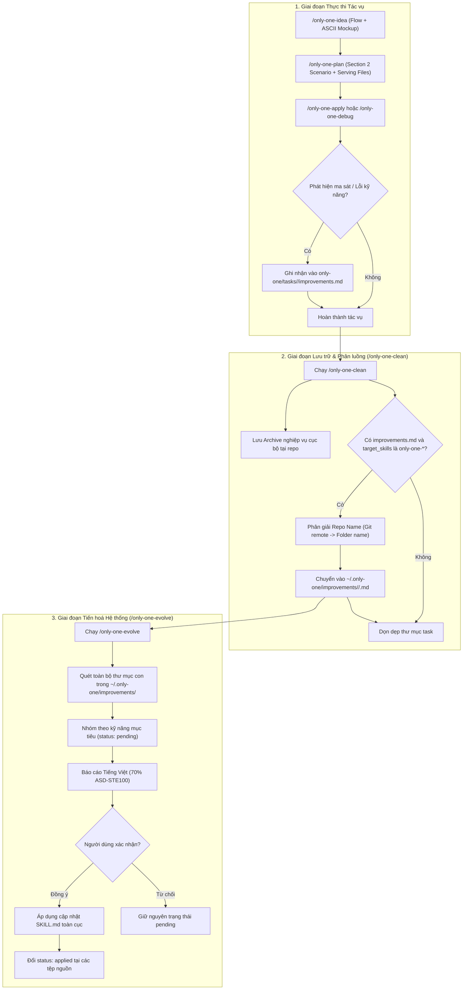

# Concept: Nâng Cấp Toàn Diện Hệ Sinh Thái Only-One & Tập Trung Hoá Tri Thức Cải Tiến Toàn Cục

## 1. Problem & Goal (Vấn đề & Mục tiêu)

### Problem (Điểm nghẽn & Thiếu sót hiện tại)
- **Context & Trigger**: Trong toàn bộ vòng đời tác vụ (Lên ý tưởng $\rightarrow$ Lập kế hoạch $\rightarrow$ Triển khai $\rightarrow$ Sửa lỗi $\rightarrow$ Dọn dẹp), các kỹ năng `only-one-*` bộc lộ nhiều điểm nghẽn về cấu trúc tài liệu và quy trình tự hoàn thiện.
- **Symptom & Defect**:
  - **`/only-one-idea`**: Trình bày quá nhiều văn xuôi, thiếu sơ đồ luồng dữ liệu (Flow Diagram) và khung giao diện trực quan (ASCII UI Wireframe). Tồn tại sự trùng lặp nội dung giữa Tiêu chí chấp nhận (Mục 1) và Xử lý ngoại lệ (Mục 4).
  - **`/only-one-plan`**: Cấu trúc đánh số mục chắp vá (`Section 1.5. Story Board`). Kịch bản người dùng (User Story / Scenario) tách rời hoàn toàn với danh sách tệp thay đổi bên dưới, gây khó khăn cho việc nghiệm thu (Verification).
  - **`/only-one-debug` & `/only-one-flash`**: Thiếu góc nhìn kịch bản người dùng (User Story / Defect Scenario), nhảy thẳng vào mổ xẻ mã nguồn khiến việc tái hiện và xác nhận sau sửa chữa thiếu chuẩn mực hành vi.
  - **Thu thập & Tiến hoá (`clean` & `evolve`)**: Không có cơ chế ghi nhận chủ động trong tác vụ. Tệp bài học cải tiến bị cô lập tại từng repository riêng lẻ (`only-one/improvements/`). Lệnh `evolve` không thể tổng hợp tri thức chéo giữa các dự án để nâng cấp hệ thống kỹ năng dùng chung trên máy tính.
- **Root Cause**: Thiếu quy chuẩn liên kết hai chiều giữa kịch bản hành vi và tệp mã nguồn; thiếu quy định bắt buộc về mô hình hóa trực quan; thiếu kho lưu trữ tri thức cải tiến tập trung cấp người dùng (`~/.only-one/`).
- **Impact / Blast Radius**: Tài liệu khó theo dõi, việc kiểm thử tốn thời gian tra cứu ngược xuôi, các lỗi hướng dẫn và quy tắc an toàn lặp lại qua nhiều dự án mà không được tự động tiến hoá.

### Goal (Kết quả kỹ thuật mục tiêu)
- **Core Goal**: Tái cấu trúc chuẩn hoá trải nghiệm tài liệu cho toàn bộ kỹ năng Only-One và thiết lập chu trình tự tiến hoá khép kín 3 chặng trên phạm vi toàn máy tính.
- **Acceptance Criteria**:
  - **`AC-1` (Chuẩn hoá `/only-one-idea`)**:
    - Bắt buộc có sơ đồ Mermaid Flow Diagram cho mọi luồng xử lý.
    - Bắt buộc có khung ASCII Wireframe (`+---+`) cho tính năng có giao diện người dùng.
    - Phân định triệt để: Mục 1 chỉ chứa quy tắc thành công nghiệp vụ (Happy Path); Mục 4 quản lý toàn bộ rủi ro kỹ thuật, ngoại lệ và phương án dự phòng.
    - Cấu trúc Mục 4 chuẩn hoá thành danh sách Tiêu chí Rủi ro & Ngoại lệ (Safeguard Criteria) rõ ràng, có thể nghiệm thu tương tự Acceptance Criteria.
  - **`AC-2` (Chuẩn hoá `/only-one-plan`)**:
    - Xoá bỏ cách đánh số `Section 1.5`. Chuẩn hoá thứ tự: `Section 1 (Directory Structure)` $\rightarrow$ `Section 2 (Story Board)` $\rightarrow$ `Section 3 (Test Cases & Verification Matrix)` $\rightarrow$ `Section 4 (File Changes)`.
    - Trong mỗi kịch bản (Scenario), bắt buộc liệt kê danh sách tệp đảm nhiệm (`Serving Files`: `[TEST]`, `[MODIFY]`, `[NEW]`, `[DELETE]`) chỉ rõ trường hợp kiểm thử cụ thể.
    - Đưa Mục 3 lên trước thành **Bảng Danh mục Test Cases Chi tiết (Test Matrix Catalog)** có mã Test ID (`TC-01`, `TC-02`), có cột liên kết ngược về mã tiêu chí Concept (`AC` hoặc `Risk`), định rõ điều kiện đầu vào, kết quả kỳ vọng (assertions) và loại kiểm thử, làm cơ sở đối soát và đánh dấu `[x]` khi nghiệm thu tại `/only-one-apply`.
  - **`AC-3` (Chuẩn hoá `/only-one-debug` & `/only-one-flash`)**:
    - Bổ sung kịch bản hành vi trước và sau sửa lỗi (Defect Scenario & Expected Behavior) trước khối can thiệp mã nguồn.
  - **`AC-4` (Hạ tầng Kho Cải tiến Toàn cục)**:
    - Phân giải định danh repository (ưu tiên Git remote origin, fallback tên thư mục gốc).
    - `/only-one-clean` chỉ đưa các bài học nhắm tới kỹ năng `only-one-*` vào `~/.only-one/improvements/<repo-name>/<slug>.md`. Tài liệu nghiệp vụ tiếp tục lưu trữ tại repository cục bộ.
    - `/only-one-evolve` mặc định quét toàn bộ thư mục repository con, lập báo cáo Tiếng Việt súc tích (70% ASD-STE100), chờ người dùng duyệt trước khi cập nhật `SKILL.md` và chuyển trạng thái `status: applied`.

## 2. Scope Boundaries (Ranh giới phạm vi)
- **In-Scope**:
  - Cập nhật quy chuẩn đặc tả trong các tệp hướng dẫn kỹ năng (`SKILL.md` và template tương ứng): `only-one-idea`, `only-one-plan`, `only-one-debug`, `only-one-flash`, `only-one-clean`, `only-one-evolve`.
  - Xây dựng mô-đun tiện ích phân giải định danh repository và đường dẫn kho toàn cục (`~/.only-one/improvements/`).
  - Cung cấp cơ chế ghi nhận chủ động bài học cải tiến trong tác vụ (`record-improvement`).
- **Explicit Out-of-Scope**:
  - Không chuyển tài liệu nghiệp vụ dự án (`only-one/archives/`) hay quy tắc nội bộ (`only-one/rules/`) lên kho toàn cục.
  - Không tự động xoá tệp bài học sau khi áp dụng (bảo lưu để kiểm toán lịch sử).
  - Không can thiệp mã nguồn ứng dụng trong `src/` hoặc `test/`.

## 3. Proposed Solution & Core Mechanism (Giải pháp đề xuất & Cơ chế cốt lõi)

### 3.1. Chuẩn hoá Đặc tả Tài liệu Kỹ năng (Skill Document Specifications)

#### A. Kỹ năng `/only-one-idea`
- **Mô hình trực quan bắt buộc**: Luồng tương tác phải mô tả bằng Mermaid Flowchart. Bố cục giao diện phải minh hoạ bằng khung ASCII:
```text
+-----------------------------------------------------------+
| [Header] Tiêu đề & Bộ lọc trạng thái                      |
+-----------------------------------------------------------+
| (•) Tất cả      ( ) Đang chờ duyệt      ( ) Đã áp dụng    |
+-----------------------------------------------------------+
| [Danh sách các cải tiến kỹ năng theo từng Repository]     |
| - only-one-cli: 3 pending                                 |
| - payment-service: 1 pending                              |
+-----------------------------------------------------------+
| [Action] [ Duyệt áp dụng ]            [ Huỷ bỏ ]          |
+-----------------------------------------------------------+
```
- **Xoá bỏ trùng lặp nội dung**:
  - *Mục 1 (Acceptance Criteria)*: Tiêu chí thành công của luồng chính và quy tắc nghiệp vụ cốt lõi.
  - *Mục 4 (Critical Risks & Edge Cases)*: Viết dưới dạng **Tiêu chí Kiểm soát Rủi ro & An toàn (Safeguard Criteria)** cụ thể, loại bỏ văn xuôi tường thuật.

#### B. Kỹ năng `/only-one-plan`
- **Cấu trúc số nguyên mạch lạc**:
  - `Section 1`: Directory Structure Changes.
  - `Section 2`: Story Board (User Journey & Feature Scenarios).
  - `Section 3`: Test Cases & Verification Matrix (Bảng Ma trận Kiểm thử Chi tiết).
  - `Section 4`: File Changes (Unified Diffs & Checklists).
- **Liên kết trực tiếp tệp vào Scenario**:
```markdown
### Story 1: <Tên tính năng / Nhu cầu người dùng>
- **User Story**: Là <vai trò>, tôi muốn <hành động> để <giá trị đạt được>.
- **Scenario 1 (Happy Path)**:
  - *Hành vi*: Người dùng thực hiện thao tác hợp lệ.
  - *Serving Files*:
    - `[TEST]` `test/feature.spec.ts` (Bao phủ `TC-01`: Kiểm thử kịch bản chính với dữ liệu hợp lệ)
    - `[MODIFY]` `src/feature.service.ts` (Triển khai logic cốt lõi)
- **Scenario 2 (Edge Case / Ngoại lệ)**:
  - *Hành vi*: Hệ thống xử lý khi dữ liệu không hợp lệ.
  - *Serving Files*:
    - `[TEST]` `test/feature-edge.spec.ts` (Bao phủ `TC-02`: Kiểm thử biên và phản hồi lỗi an toàn)
    - `[MODIFY]` `src/dto/feature.dto.ts` (Ràng buộc dữ liệu đầu vào)
```
- **Bảng Ma trận Kiểm thử Chi tiết (Section 4 Test Matrix Table)**:
```markdown
| Test ID | Story liên quan | Tên Test Case (`it / test`) | Điều kiện / Dữ liệu đầu vào | Kết quả kỳ vọng (Assertions) | Loại test | Status |
| :--- | :--- | :--- | :--- | :--- | :--- | :---: |
| `TC-01` | Story 1 (Happy) | `should filter by status 'paid'` | Filter `{ status: 'paid' }` | Trả về 2 bản ghi hợp lệ | Unit | `[ ]` |
| `TC-02` | Story 1 (Edge) | `should return empty array when not found` | Filter `{ status: 'archived' }` | Trả về mảng rỗng `[]` | Unit | `[ ]` |
```

#### C. Kỹ năng `/only-one-debug` & `/only-one-flash`
- Bổ sung mục **User Story & Defect Reproduction Scenario**:
  - Mô tả rõ hành vi lỗi quan sát được từ phía người dùng (Actual Behavior).
  - Mô tả kịch bản kiểm chứng sau sửa đổi (Expected Behavior & Acceptance Scenario).

---

### 3.2. Chu trình Tiến hoá Toàn cục Khép kín (Global Evolution Pipeline)



---

## 4. Critical Risks & Edge Cases (Phân tích Rủi ro & Cơ chế Phòng vệ)

- **Risk-1: Lệnh Git quăng ngoại lệ làm sập quy trình lưu trữ (/only-one-clean)**
  - *Mặt tiêu cực / Nguy cơ*: Nếu dự án chưa khởi tạo Git hoặc chưa gắn remote origin, việc gọi lệnh `git config` có thể throw error, làm sập hoàn toàn tiến trình dọn dẹp và khiến tác vụ bị kẹt không thể lưu trữ.
  - *Cơ chế phòng vệ*: Bọc lệnh thực thi trong khối an toàn; nếu Git không khả dụng hoặc trả về rỗng, tự động kích hoạt cơ chế fallback lấy tên thư mục gốc (`path.basename`) làm định danh thay thế.

- **Risk-2: Ghi đè hoặc ô nhiễm dữ liệu giữa các repository trùng tên**
  - *Mặt tiêu cực / Nguy cơ*: Các dự án ở các đường dẫn khác nhau nhưng vô tình trùng tên repository (do clone từ template hoặc đặt tên chung) có thể ghi đè các tệp cải tiến của nhau trong kho toàn cục.
  - *Cơ chế phòng vệ*: Tổ chức không gian lưu trữ phân tầng `~/.only-one/improvements/<repo-name>/<slug>.md` kết hợp tiền tố định danh tác vụ duy nhất, đảm bảo tính cô lập và toàn vẹn dữ liệu.

- **Risk-3: Phá vỡ tương thích ngược làm hỏng các kế hoạch đang thi hành dở dang**
  - *Mặt tiêu cực / Nguy cơ*: Khi chuyển đổi `Section 1.5` thành `Section 2` và đẩy khối mã nguồn sang `Section 4. File Changes`, các tệp `plan.md` cũ đang chạy dở sẽ bị `/only-one-apply` báo lỗi không tìm thấy tác vụ.
  - *Cơ chế phòng vệ*: Xây dựng bộ phân tích cú pháp linh hoạt (Dual-Parsing Engine) trong `/only-one-apply`, tự động nhận diện và trích xuất khối diff ở cả cấu trúc cũ lẫn mới.

- **Risk-4: Tệp rác hoặc lỗi cú pháp YAML làm tê liệt chu trình Evolve toàn cục**
  - *Mặt tiêu cực / Nguy cơ*: Chỉ cần một tệp cải tiến trong bất kỳ repository nào bị rỗng, hỏng cấu trúc YAML frontmatter hoặc sai Markdown sẽ làm script thu thập văng lỗi, chặn đứng toàn bộ việc nâng cấp kỹ năng của cả hệ thống.
  - *Cơ chế phòng vệ*: Triển khai cơ chế cách ly lỗi (Fault-Tolerant Ingestion); bọc phân tích từng tệp riêng biệt, tự động bỏ qua tệp hỏng kèm nhật ký cảnh báo và tiếp tục xử lý các tệp hợp lệ khác.

- **Risk-5: Tự động hoá mất kiểm soát gây thoái hoá chất lượng kỹ năng (Prompt Regression)**
  - *Mặt tiêu cực / Nguy cơ*: Nếu `/only-one-evolve` tự động ghi đè `SKILL.md` mà không có sự kiểm tra của con người, các đề xuất sai lệch hoặc ảo giác có thể phá vỡ quy chuẩn cốt lõi của IDE.
  - *Cơ chế phòng vệ*: Thiết lập cổng kiểm duyệt bắt buộc (Mandatory Human-in-the-Loop Gate); bắt buộc xuất bảng đối chiếu Unified Diff chi tiết và chỉ can thiệp tệp khi có xác nhận rõ ràng từ người dùng.

- **Risk-6: Bỏ quên việc thu thập khiến kho tri thức toàn cục bị "đói dữ liệu"**
  - *Mặt tiêu cực / Nguy cơ*: Khi hoàn thành code, người dùng và Agent thường bỏ qua bước đúc kết kinh nghiệm, dẫn đến kho `~/.only-one/improvements/` luôn rỗng và kỹ năng không thể tiến hoá.
  - *Cơ chế phòng vệ*: Thiết lập cổng nhắc nhở ma sát kỹ năng (Friction Check Gate) tại bước nghiệm thu cuối của `/only-one-apply` và `/only-one-debug` trước khi cho phép đóng tác vụ với `status: done`.
