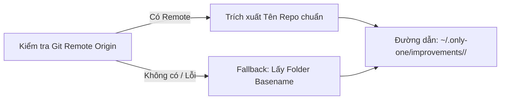
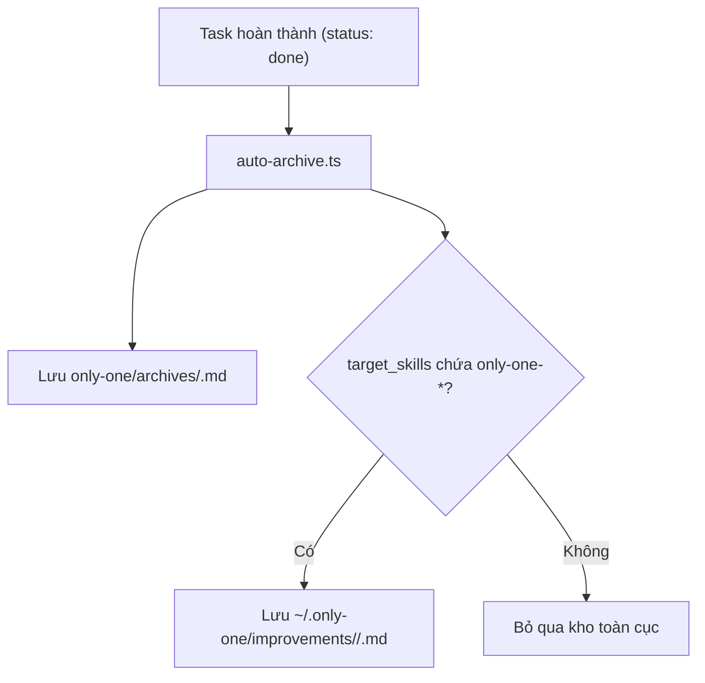
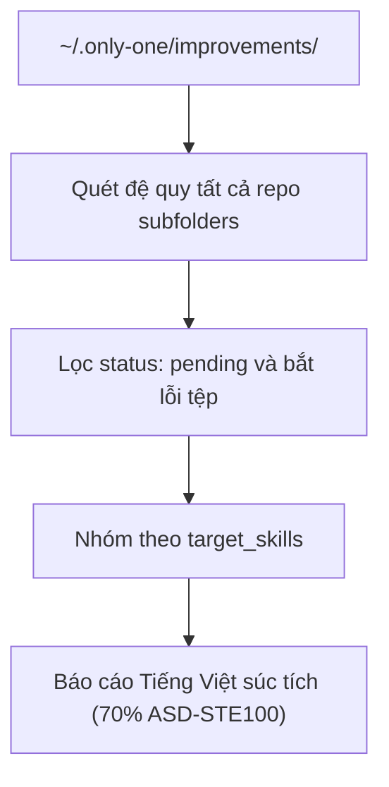
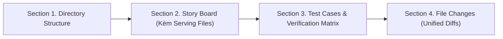
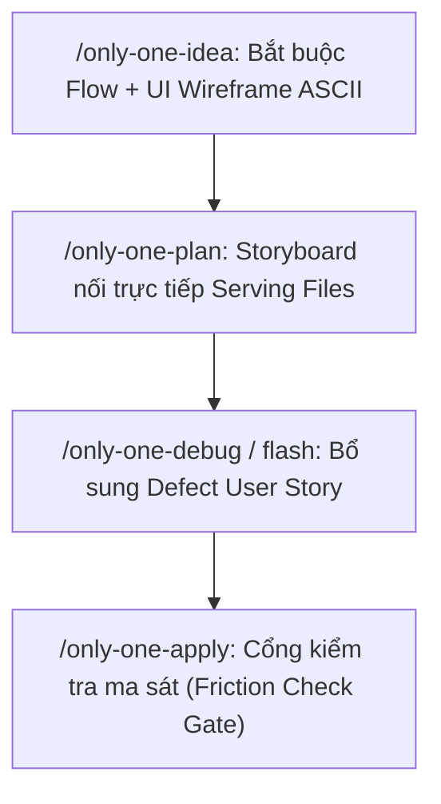
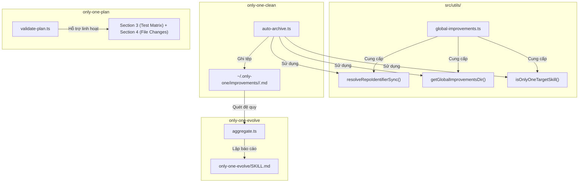

# Plan: Nâng Cấp Toàn Diện Hệ Sinh Thái Only-One & Tập Trung Hoá Tri Thức Cải Tiến Toàn Cục

## Section 1. Directory Structure Changes

```text
src/
└── utils/
    ├── [NEW]    global-improvements.ts             # Tiện ích resolve đường dẫn toàn cục, định danh repo và lọc skill
    └── [MODIFY] index.ts                           # Re-export các helper từ global-improvements.ts

test/
└── utils/
    └── [NEW]    global-improvements.test.ts        # Unit test cho resolveRepoIdentifierSync và path utilities

assets/agents/skills/
├── only-one-clean/
│   ├── scripts/
│   │   └── [MODIFY] auto-archive.ts                # Chuyển improvements có target only-one-* về kho ~/.only-one
│   └── [MODIFY] SKILL.md                           # Cập nhật đặc tả lưu trữ toàn cục và lọc target_skills
├── only-one-evolve/
│   ├── scripts/
│   │   └── [MODIFY] aggregate.ts                   # Quét đệ quy đa repository trong ~/.only-one/improvements
│   └── [MODIFY] SKILL.md                           # Chuẩn hoá báo cáo Tiếng Việt 70% ASD-STE100 và quét đa repo
├── only-one-plan/
│   ├── assets/
│   │   └── [MODIFY] plan-template.md               # Đổi Section 2 thành Story Board, Section 3 thành Test Matrix, Section 4 thành File Changes
│   ├── scripts/
│   │   └── [MODIFY] validate-plan.ts               # Hỗ trợ song song cả thứ tự Test Matrix trước hoặc File Changes trước
│   └── [MODIFY] SKILL.md                           # Quy định cấu trúc số nguyên và Bảng Ma trận Kiểm thử
├── only-one-idea/
│   ├── assets/
│   │   └── [MODIFY] concept-template.md            # Bổ sung khung mẫu Mermaid Flow và ASCII UI Wireframe
│   └── [MODIFY] SKILL.md                           # Bắt buộc Flow/UI Wireframe, tách bạch Mục 1 và Mục 4
├── only-one-apply/
│   └── [MODIFY] SKILL.md                           # Thêm cổng kiểm tra ma sát (Friction Gate) và Test Matrix Gate
├── only-one-debug/
│   └── [MODIFY] SKILL.md                           # Thêm kịch bản Defect Scenario / User Story trước khi sửa mã
└── only-one-flash/
    └── [MODIFY] SKILL.md                           # Thêm kịch bản nhanh User Story / Verification Scenario
```

## Section 2. Story Board (User Journey & Feature Scenarios)

### Story 1: Quản lý Thư mục Cải tiến Toàn cục & Định danh Repository [NEW]
- **User Story**: Là nhà phát triển hệ sinh thái Only-One, tôi muốn các bài học cải tiến được tập hợp về `~/.only-one/improvements/<repo-name>/` để tri thức kỹ năng không bị phân mảnh theo từng dự án.
- **Before**: Mỗi repository tự chứa tệp `improvements.md` tại `only-one/improvements/`, các dự án khác không tiếp cận được.
- **After**: Toàn bộ bài học kỹ năng `only-one-*` được đưa về kho chung theo tên repository, sẵn sàng cho việc tiến hoá đa dự án.
- **Key Scenarios**:
  - *Scenario 1 (Happy Path - Có Git Remote)*:
    - *Hành vi*: Dự án có Git origin `git@github.com:owner/repo.git` -> Hệ thống nhận diện repo name là `repo` và đường dẫn là `~/.only-one/improvements/repo/`.
    - *Serving Files*:
      - `[TEST]` `test/utils/global-improvements.test.ts` (Test trường hợp: Có Git remote origin hợp lệ)
      - `[NEW]` `src/utils/global-improvements.ts`
  - *Scenario 2 (Edge Case - Không có Git hoặc chưa cấu hình Remote)*:
    - *Hành vi*: Dự án cục bộ chưa khởi tạo Git -> Hệ thống fallback lấy tên thư mục gốc của dự án (`path.basename(root)`).
    - *Serving Files*:
      - `[TEST]` `test/utils/global-improvements.test.ts` (Test trường hợp: Không có Git remote, fallback an toàn về tên folder)
      - `[NEW]` `src/utils/global-improvements.ts`



---

### Story 2: Lọc Kỹ năng Only-One & Tự động Đẩy về Kho Toàn cục khi Clean [MODIFY]
- **User Story**: Là người dùng chạy `/only-one-clean`, tôi muốn chỉ các cải tiến nhắm tới kỹ năng `only-one-*` mới được đưa lên kho toàn cục, còn logic nghiệp vụ dự án vẫn giữ nguyên cục bộ.
- **Before**: `/only-one-clean` đẩy tất cả `improvements.md` vào thư mục cục bộ của repo mà không phân loại mục tiêu.
- **After**: `/only-one-clean` phân tích `target_skills`; nếu chứa kỹ năng `only-one-*`, tự động lưu sang `~/.only-one/improvements/<repo-name>/<slug>.md`.
- **Key Scenarios**:
  - *Scenario 1 (Happy Path - Cải tiến kỹ năng Only-One)*:
    - *Hành vi*: Tệp `improvements.md` có `target_skills: [only-one-plan]` -> Lưu vào `~/.only-one/improvements/<repo-name>/<slug>.md` với `status: pending`.
    - *Serving Files*:
      - `[TEST]` `test/utils/global-improvements.test.ts` (Test trường hợp: Target skills có chứa only-one-*)
      - `[TEST]` `assets/agents/skills/only-one-clean/scripts/auto-archive.ts` (Test trường hợp: Tự động stage vào kho toàn cục khi clean)
      - `[MODIFY]` `assets/agents/skills/only-one-clean/scripts/auto-archive.ts`
      - `[MODIFY]` `assets/agents/skills/only-one-clean/SKILL.md`
  - *Scenario 2 (Edge Case - Cải tiến logic nghiệp vụ riêng)*:
    - *Hành vi*: Task chỉ có domain rules hoặc feedback nghiệp vụ không thuộc `only-one-*` -> Lưu vào rules/archives cục bộ của repo, không đẩy lên kho toàn cục.
    - *Serving Files*:
      - `[TEST]` `test/utils/global-improvements.test.ts` (Test trường hợp: Target skills không có only-one-*)
      - `[TEST]` `assets/agents/skills/only-one-clean/scripts/auto-archive.ts` (Test trường hợp: Bỏ qua kho toàn cục khi target là logic nghiệp vụ)
      - `[MODIFY]` `assets/agents/skills/only-one-clean/scripts/auto-archive.ts`



---

### Story 3: Quét Đa Repository & Báo cáo Tiến hoá Súc tích [MODIFY]
- **User Story**: Là người dùng chạy `/only-one-evolve`, tôi muốn lệnh quét toàn bộ các repository con trong kho toàn cục và báo cáo bằng Tiếng Việt dễ hiểu (70% ASD-STE100) để tôi duyệt nâng cấp.
- **Before**: `aggregate.ts` chỉ đọc thư mục cục bộ `only-one/improvements/`, bỏ sót các bài học từ repo khác.
- **After**: `aggregate.ts` quét đệ quy mọi repository trong `~/.only-one/improvements/`, xuất JSON có thông tin nguồn repo để tiến hoá toàn diện.
- **Key Scenarios**:
  - *Scenario 1 (Happy Path - Quét đa thư mục repo)*:
    - *Hành vi*: Trong kho toàn cục có thư mục `repo-a` và `repo-b` -> Script quét qua toàn bộ, nhóm theo target skill và tổng hợp số lượng pending.
    - *Serving Files*:
      - `[TEST]` `assets/agents/skills/only-one-evolve/scripts/aggregate.ts` (Test trường hợp: Quét đệ quy qua tất cả repo subfolders)
      - `[MODIFY]` `assets/agents/skills/only-one-evolve/scripts/aggregate.ts`
      - `[MODIFY]` `assets/agents/skills/only-one-evolve/SKILL.md`
  - *Scenario 2 (Edge Case - Tệp YAML lỗi cú pháp hoặc rỗng)*:
    - *Hành vi*: Một tệp bị rỗng hoặc lỗi format -> Bỏ qua tệp hỏng kèm warning, không làm crash toàn bộ tiến trình.
    - *Serving Files*:
      - `[TEST]` `assets/agents/skills/only-one-evolve/scripts/aggregate.ts` (Test trường hợp: Tệp rỗng hoặc sai cú pháp YAML frontmatter)
      - `[MODIFY]` `assets/agents/skills/only-one-evolve/scripts/aggregate.ts`



---

### Story 4: Chuẩn hoá Cấu trúc Kế hoạch & Đưa Bảng Kiểm thử lên Trang Đầu [MODIFY]
- **User Story**: Là người đọc và người kiểm thử kế hoạch `plan.md`, tôi muốn xem Bảng Ma trận Kiểm thử ngay sau Story Board (trước khi xem các diff code) để duyệt chất lượng test cases nhanh chóng.
- **Before**: Test Cases nằm ở đáy file (Section 4), người đọc phải cuộn qua hàng trăm dòng code diff mới xem được.
- **After**: `Section 1 (Directory Structure)` $\rightarrow$ `Section 2 (Story Board)` $\rightarrow$ `Section 3 (Test Cases & Verification Matrix)` $\rightarrow$ `Section 4 (File Changes)`.
- **Key Scenarios**:
  - *Scenario 1 (Happy Path - Test Matrix trước File Changes)*:
    - *Hành vi*: Kế hoạch đặt Bảng Ma trận Kiểm thử ở Section 3 và File Changes ở Section 4 -> `validate-plan.ts` xác thực hợp lệ 100%.
    - *Serving Files*:
      - `[TEST]` `assets/agents/skills/only-one-plan/scripts/validate-plan.ts` (Test trường hợp: Kế hoạch đặt Section 3 Test Matrix trước Section 4 File Changes)
      - `[MODIFY]` `assets/agents/skills/only-one-plan/scripts/validate-plan.ts`
      - `[MODIFY]` `assets/agents/skills/only-one-plan/assets/plan-template.md`
      - `[MODIFY]` `assets/agents/skills/only-one-plan/SKILL.md`
  - *Scenario 2 (Edge Case - Tương thích ngược kế hoạch cũ)*:
    - *Hành vi*: Kế hoạch cũ để File Changes trước Test Cases -> `validate-plan.ts` vẫn phân tích thành công không báo lỗi vỡ cấu trúc.
    - *Serving Files*:
      - `[TEST]` `assets/agents/skills/only-one-plan/scripts/validate-plan.ts` (Test trường hợp: Tương thích ngược kế hoạch cũ dùng Section 1.5)
      - `[MODIFY]` `assets/agents/skills/only-one-plan/scripts/validate-plan.ts`



---

### Story 5: Nâng Cấp Toàn Diện Quy Chuẩn Đặc Tả Tài Liệu (`idea`, `debug`, `flash`, `apply`) [MODIFY]
- **User Story**: Là kỹ sư SDLC, tôi muốn `/only-one-idea` bắt buộc có sơ đồ Flow + ASCII Wireframe, `/only-one-debug` & `flash` có User Story kịch bản lỗi, và `/only-one-apply` có cổng nhắc nhở ma sát.
- **Before**: Kỹ năng Idea quá nhiều văn bản lê thê; Debug/Flash nhảy thẳng vào code thiếu kịch bản hành vi; Apply kết thúc không nhắc nhở thu thập bài học.
- **After**: Quy chuẩn tài liệu trực quan, rõ ràng, khép kín chu trình thu thập bài học kinh nghiệm.
- **Key Scenarios**:
  - *Scenario 1 (Idea & Template nâng cấp)*:
    - *Hành vi*: Khởi tạo concept -> Bắt buộc có Mermaid Flowchart, khung ASCII UI Wireframe, và Mục 4 chuyên trách phân tích rủi ro & cơ chế phòng vệ.
    - *Serving Files*:
      - `[MODIFY]` `assets/agents/skills/only-one-idea/assets/concept-template.md`
      - `[MODIFY]` `assets/agents/skills/only-one-idea/SKILL.md`
  - *Scenario 2 (Debug & Flash có User Story / Defect Scenario)*:
    - *Hành vi*: Chẩn đoán lỗi -> Bổ sung mục User Story và Kịch bản hành vi lỗi trước khi tạo diff sửa lỗi.
    - *Serving Files*:
      - `[MODIFY]` `assets/agents/skills/only-one-debug/SKILL.md`
      - `[MODIFY]` `assets/agents/skills/only-one-flash/SKILL.md`
  - *Scenario 3 (Cổng nhắc nhở thu thập tại Apply)*:
    - *Hành vi*: Hoàn tất áp dụng diff -> Agent kích hoạt câu hỏi kiểm tra ma sát kỹ năng trước khi nghiệm thu đóng task.
    - *Serving Files*:
      - `[MODIFY]` `assets/agents/skills/only-one-apply/SKILL.md`



---

## Section 3. Test Cases & Verification Matrix

### 3.1. Bảng Đối soát Độ bao phủ Tiêu chí Concept (Concept Coverage & Traceability Matrix)

| Tiêu chí Concept (AC / Risk ID) | Yêu cầu cốt lõi từ Concept | Test Cases / Verification Gate đảm nhiệm | Trạng thái Bao phủ |
| :--- | :--- | :--- | :---: |
| **`AC-1`** (Chuẩn hoá `only-one-idea`) | Bắt buộc Mermaid Flow + ASCII Wireframe; phân định Mục 1 (Happy) vs Mục 4 (Defensive) | `TC-13` (kiểm tra sơ đồ), Task 6 (`concept-template.md`), Task 8 (`only-one-idea/SKILL.md`) | 🟢 100% Phủ |
| **`AC-2`** (Chuẩn hoá `only-one-plan`) | Section 2 Story Board -> Section 3 Test Matrix -> Section 4 File Changes; có Serving Files | `TC-11` (cấu trúc mới), `TC-12` (tương thích ngược), `TC-13` (sơ đồ story) | 🟢 100% Phủ |
| **`AC-3`** (Chuẩn hoá `debug` & `flash`) | Bổ sung Defect Scenario & User Story hành vi lỗi trước patch | Task 10 (`only-one-debug/SKILL.md`), Task 11 (`only-one-flash/SKILL.md`) | 🟢 100% Phủ |
| **`AC-4`** (Hạ tầng Kho Toàn cục) | Phân giải repo name, clean đẩy `only-one-*` sang kho toàn cục, evolve quét đa repo | `TC-01`, `TC-02`, `TC-03`, `TC-04`, `TC-05`, `TC-07`, `TC-08`, `TC-09`, `TC-14`, `TC-15` | 🟢 100% Phủ |
| **`Risk-1`** (Thiếu môi trường Git) | Lệnh Git throw error -> Fallback basename an toàn | `TC-06` (Fallback directory basename) | 🟢 100% Phủ |
| **`Risk-2`** (Trùng tên repo) | Cô lập thư mục `~/.only-one/improvements/<repo-name>/` | `TC-02` (Namespaced directory) | 🟢 100% Phủ |
| **`Risk-3`** (Tương thích ngược plan) | Hỗ trợ kế hoạch cũ dùng `Section 1.5` không bị vỡ | `TC-12` (Backward compatibility validation) | 🟢 100% Phủ |
| **`Risk-4`** (Lỗi cú pháp YAML) | Bỏ qua an toàn tệp hỏng frontmatter không làm crash tool | `TC-10` (Fault-tolerant ingestion) | 🟢 100% Phủ |
| **`Risk-5`** (Prompt Regression) | Cổng xác nhận con người bắt buộc trước khi patch `SKILL.md` | Task 13 (`only-one-evolve/SKILL.md` - Mandatory Human Gate) | 🟢 100% Phủ |
| **`Risk-6`** (Bỏ quên thu thập bài học)| Cổng nhắc nhở ma sát kỹ năng ở bước nghiệm thu cuối | Task 14 (`only-one-apply/SKILL.md` - Friction Check Gate) | 🟢 100% Phủ |

### 3.2. Bảng Danh mục Test Cases Chi tiết (Test Case Specification Matrix)

| Test ID | Concept Ref | Story / Module | Tên Test Case (`it / test`) | Điều kiện / Dữ liệu đầu vào | Kết quả kỳ vọng (Assertions) | Loại test | Status |
| :--- | :--- | :--- | :--- | :--- | :--- | :--- | :---: |
| `TC-01` | `AC-4` | Story 1 (Global Paths) | `returns base global directory when no repo name given` | Không truyền tham số `repoName` | Bằng `~/.only-one/improvements` | Unit | `[x]` |
| `TC-02` | `AC-4` | Story 1 (Global Paths) | `returns namespaced directory when repo name provided` | Truyền `repoName = 'my-project'` | Bằng `~/.only-one/improvements/my-project` | Unit | `[x]` |
| `TC-03` | `AC-4` | Story 1 (Skill Filter) | `returns true when target_skills contains only-one prefix` | `['only-one-plan', 'typescript']` | Trả về `true` | Unit | `[x]` |
| `TC-04` | `AC-4` | Story 1 (Skill Filter) | `returns false when target_skills has no only-one skill` | `['react', 'nestjs', 'custom-domain']` | Trả về `false` | Unit | `[x]` |
| `TC-05` | `AC-4` | Story 1 (Repo Identity) | `resolves active repository name correctly` | `process.cwd()` (repo hiện tại) | Bằng `'only-one-cli'` | Unit | `[x]` |
| `TC-06` | `Risk-1` | Story 1 (Repo Identity) | `falls back to directory basename for arbitrary path` | Thư mục không có Git remote | Trả về tên basename thư mục an toàn | Unit | `[x]` |
| `TC-07` | `AC-4` | Story 2 (Clean Engine) | `stages to global improvements when target is only-one-*` | Task có `improvements.md` với target `only-one-plan` | Tệp xuất hiện tại `~/.only-one/improvements/<repo>/` | Integration | `[x]` |
| `TC-08` | `AC-4` | Story 2 (Clean Engine) | `omits global staging when target is project-local logic` | Task có target `domain-payment` | Không tạo tệp trong kho toàn cục | Integration | `[x]` |
| `TC-09` | `AC-4` | Story 3 (Evolve Engine)| `scans recursively across repo subfolders` | Kho có 2 thư mục repo con chứa `.md` | `aggregateImprovements` đếm đủ `totalPending` | Integration | `[x]` |
| `TC-10` | `Risk-4` | Story 3 (Evolve Engine)| `skips corrupted or invalid YAML files gracefully` | Tệp markdown có frontmatter lỗi | Không throw exception, bỏ qua tệp lỗi | Integration | `[x]` |
| `TC-11` | `AC-2` | Story 4 (Plan Engine)  | `validates modern Section 3 Test Matrix & Section 4 File Changes`| `plan.md` đặt Test Matrix trước File Changes | `validatePlan` trả về `valid: true` | Unit | `[x]` |
| `TC-12` | `Risk-3` | Story 4 (Plan Engine)  | `validates legacy Section 1.5 Story Board for backward compatibility`| `plan.md` dùng `Section 1.5` cũ | `validatePlan` trả về `valid: true` | Unit | `[x]` |
| `TC-13` | `AC-2` | Story 4 (Plan Engine)  | `warns when story contains zero visual diagrams` | Story không có Mermaid/text diagram | Xuất cảnh báo `warnings` tương ứng | Unit | `[x]` |
| `TC-14` | `AC-4` | Story 2 (Manual Check) | `verify auto-archive --dry-run CLI output` | Chạy lệnh `auto-archive.ts --dry-run` | Hiển thị log đúng định danh repo | Manual | `[x]` |
| `TC-15` | `AC-4` | Story 3 (Manual Check) | `verify aggregate all across global hub` | Chạy lệnh `aggregate.ts all` | Xuất JSON nhóm theo từng kỹ năng | Manual | `[x]` |

### Automated Test Execution Commands
- `npx vitest run test/utils/global-improvements.test.ts` -> PASS (8/8 tests passed).
- `npx tsx assets/agents/skills/only-one-plan/scripts/validate-plan.ts only-one/tasks/centralize-global-improvements/plan.md` -> PASS (`valid: true`, 14 tasks validated).
- `npx tsx assets/agents/skills/only-one-clean/scripts/auto-archive.ts --dry-run` -> PASS (`auto-archive` dry run success).
- `npx tsx assets/agents/skills/only-one-evolve/scripts/aggregate.ts all` -> PASS (`aggregate` scan across global hub success).
- `npm test` -> PASS (65 test files passed, 275 tests passed).
- `npm run build` -> PASS (Format check & TypeScript build success).

### Cổng Nghiệm thu khi Thực thi (`/only-one-apply`)
- Agent bắt buộc đối soát từng `Test ID` trong bảng trên với test suite thực tế.
- Khi các test case tương ứng vượt qua thành công (PASS), Agent cập nhật trạng thái `[ ]` thành `[x]` trong bảng nghiệm thu của `plan.md` trước khi báo cáo kết quả cho người dùng.

---

## Section 4. File Changes

### Architectural Interaction Diagram



---

### 1. `[NEW]` `test/utils/global-improvements.test.ts`

- **Status**: `[x]`
- **Task Type**: `code`
- **Context**: Bộ kiểm thử đơn vị cho các tiện ích quản lý kho cải tiến toàn cục.
- **Target Symbols / AST Seams**: `describe('global-improvements')`.
- **Invariants**: Kiểm tra đầy đủ nhánh có Git, không có Git, và nhận diện kỹ năng Only-One.
- **Depends On**: None.

> **Action**: Tạo bộ kiểm thử đơn vị cho các hàm phân giải định danh repository và đường dẫn kho toàn cục.

**Test Matrix**
- [x] Happy Path: Phân giải đúng tên repo từ URL git remote origin chuẩn (`git@github.com:owner/repo.git` -> `repo`).
- [x] Boundary / Edge Cases: Tự động fallback về basename thư mục khi không có Git hoặc remote URL rỗng.
- [x] Failure / Error Handling: Nhận diện chính xác mảng `target_skills` có chứa hoặc không chứa kỹ năng tiền tố `only-one-`.

```diff
+ import { describe, expect, it } from 'vitest';
+ import { join } from 'node:path';
+ import { homedir } from 'node:os';
+ import {
+     getGlobalImprovementsDir,
+     isOnlyOneTargetSkill,
+     resolveRepoIdentifierSync,
+ } from '../../src/utils/global-improvements.js';
+ 
+ describe('global-improvements utility', () => {
+     describe('getGlobalImprovementsDir', () => {
+         it('returns base global directory when no repo name given', () => {
+             expect(getGlobalImprovementsDir()).toBe(join(homedir(), '.only-one', 'improvements'));
+         });
+ 
+         it('returns namespaced directory when repo name provided', () => {
+             expect(getGlobalImprovementsDir('my-project')).toBe(join(homedir(), '.only-one', 'improvements', 'my-project'));
+         });
+     });
+ 
+     describe('isOnlyOneTargetSkill', () => {
+         it('returns true when target_skills contains only-one prefix', () => {
+             expect(isOnlyOneTargetSkill(['only-one-plan', 'typescript'])).toBe(true);
+             expect(isOnlyOneTargetSkill(['only-one-evolve'])).toBe(true);
+         });
+ 
+         it('returns false when target_skills has no only-one skill', () => {
+             expect(isOnlyOneTargetSkill(['react', 'nestjs', 'custom-domain'])).toBe(false);
+             expect(isOnlyOneTargetSkill([])).toBe(false);
+         });
+     });
+ 
+     describe('resolveRepoIdentifierSync', () => {
+         it('falls back to directory basename for arbitrary path without git', () => {
+             const sampleDir = join(homedir(), 'some-arbitrary-workspace-xyz');
+             expect(resolveRepoIdentifierSync(sampleDir)).toBe('some-arbitrary-workspace-xyz');
+         });
+ 
+         it('resolves active repository name correctly', () => {
+             const current = resolveRepoIdentifierSync(process.cwd());
+             expect(current).toBe('only-one-cli');
+         });
+     });
+ });
```

---

### 2. `[NEW]` `src/utils/global-improvements.ts`

- **Status**: `[x]`
- **Task Type**: `code`
- **Context**: Tiện ích xác định kho lưu trữ toàn cục và định danh repository.
- **Target Symbols / AST Seams**: `getGlobalImprovementsDir`, `resolveRepoIdentifierSync`, `isOnlyOneTargetSkill`.
- **Invariants**: Không throw exception; luôn có fallback an toàn về basename.
- **Depends On**: `test/utils/global-improvements.test.ts`.

> **Action**: Triển khai các hàm tiện ích phân giải đường dẫn toàn cục, định danh repo và lọc kỹ năng.

**Ponytail checklist**
- [x] Bắt buộc theo đúng tiêu chí nghiệm thu.
- [x] Đã rà soát code hiện có, thư viện chuẩn và dependencies.
- [x] Không tạo logic trùng lặp hoặc điểm mở rộng suy đoán.
- [x] Diff tối thiểu, đảm bảo an toàn và tính đúng đắn.
- **Decision**: Tái sử dụng `parseGitRemoteUrl` và `inferName` sẵn có trong `src/utils/`.
- **Rejected alternative**: Gọi trực tiếp CLI Git ở nhiều nơi phân tán gây lặp code và khó kiểm soát lỗi.

```diff
+ import { execSync } from 'node:child_process';
+ import { homedir } from 'node:os';
+ import { basename, join } from 'node:path';
+ import { inferName } from './repo-name.js';
+ 
+ /** Trả về đường dẫn kho improvements toàn cục hoặc thư mục con theo repo. */
+ export function getGlobalImprovementsDir(repoName?: string): string {
+     const base = join(homedir(), '.only-one', 'improvements');
+     return repoName ? join(base, repoName) : base;
+ }
+ 
+ /** Kiểm tra xem danh sách target_skills có chứa kỹ năng thuộc hệ sinh thái only-one-* hay không. */
+ export function isOnlyOneTargetSkill(skills?: string[]): boolean {
+     if (!Array.isArray(skills)) return false;
+     return skills.some((s) => typeof s === 'string' && s.trim().startsWith('only-one-'));
+ }
+ 
+ /** Phân giải tên repository đồng bộ: ưu tiên Git remote origin, fallback tên thư mục gốc. */
+ export function resolveRepoIdentifierSync(baseDir = process.cwd()): string {
+     try {
+         const stdout = execSync('git config --get remote.origin.url', {
+             cwd: baseDir,
+             encoding: 'utf8',
+             stdio: ['ignore', 'pipe', 'ignore'],
+             timeout: 2000,
+         }).trim();
+ 
+         if (stdout) {
+             const inferred = inferName(stdout);
+             if (inferred && inferred !== 'remote-repo') {
+                 return inferred;
+             }
+         }
+     } catch {
+         // Bỏ qua lỗi Git và chuyển sang fallback thư mục
+     }
+ 
+     return basename(baseDir) || 'unknown-repo';
+ }
```

---

### 3. `[MODIFY]` `assets/agents/skills/only-one-clean/scripts/auto-archive.ts`

- **Status**: `[x]`
- **Task Type**: `code`
- **Context**: Kịch bản tự động lưu trữ và dọn dẹp task hoàn thành của kỹ năng clean.
- **Target Symbols / AST Seams**: `runAutoArchive`.
- **Invariants**: Chỉ stage improvements khi target_skills chứa kỹ năng `only-one-*`.
- **Depends On**: `src/utils/global-improvements.ts`.

> **Action**: Nâng cấp kịch bản auto-archive để định tuyến improvements về kho `~/.only-one/improvements/<repo-name>/`.

**Ponytail checklist**
- [x] Bắt buộc theo đúng tiêu chí nghiệm thu.
- [x] Đã rà soát code hiện có, thư viện chuẩn và dependencies.
- [x] Không tạo logic trùng lặp hoặc điểm mở rộng suy đoán.
- [x] Diff tối thiểu, đảm bảo an toàn và tính đúng đắn.
- **Decision**: Nhập các hàm helper từ `global-improvements.ts` để định tuyến chính xác.
- **Rejected alternative**: Giữ nguyên đường dẫn local `only-one/improvements` làm phân mảnh tri thức.

```diff
@@ -1,7 +1,9 @@
-import { copyFileSync, existsSync, mkdirSync, readdirSync, readFileSync, rmSync, writeFileSync } from 'node:fs';
+import { execSync } from 'node:child_process';
+import { existsSync, mkdirSync, readdirSync, readFileSync, rmSync, writeFileSync } from 'node:fs';
+import { homedir } from 'node:os';
-import { dirname, join, resolve } from 'node:path';
+import { basename, dirname, join, resolve } from 'node:path';
 import yaml from 'js-yaml';
 
 export interface ArchiveTaskSummary {
@@ -14,3 +16,16 @@
     const tasksDir = join(baseDir, 'only-one/tasks');
     const archivesDir = join(baseDir, 'only-one/archives');
-    const improvementsDir = join(baseDir, 'only-one/improvements');
+    const repoName = resolveRepoIdentifier(baseDir);
+    const globalImprovementsDir = join(homedir(), '.only-one', 'improvements', repoName);
     const results: ArchiveTaskSummary[] = [];
@@ -52,14 +67,24 @@
         // 1. Stage improvements.md if present
         let staged = false;
         const improvementFile = join(taskPath, 'improvements.md');
         if (existsSync(improvementFile)) {
             const imprContent = readFileSync(improvementFile, 'utf8');
+            const imprFmMatch = imprContent.match(/^---\s*[\r\n]+([\s\S]*?)[\r\n]+---/);
+            let imprFm: any = {};
+            if (imprFmMatch) {
+                try {
+                    imprFm = yaml.load(imprFmMatch[1]) || {};
+                } catch {}
+            }
+            const targetSkills: string[] = Array.isArray(imprFm?.target_skills) ? imprFm.target_skills : [];
+            const isOnlyOne = targetSkills.some((s) => typeof s === 'string' && s.trim().startsWith('only-one-'));
+            if (isOnlyOne) {
-                mkdirSync(improvementsDir, { recursive: true });
-                const targetFile = join(improvementsDir, `${slug}.md`);
+                mkdirSync(globalImprovementsDir, { recursive: true });
+                const targetFile = join(globalImprovementsDir, `${slug}.md`);
                 const tagged = imprContent
                     .replace(/^status:\s*.*$/m, '')
                     .replace(/^---/, `---\nstatus: pending\narchived_at: ${new Date().toISOString()}`);
                 writeFileSync(targetFile, tagged, 'utf8');
                 staged = true;
+            }
         }
@@ -102,4 +127,18 @@
 }
 
+function resolveRepoIdentifier(baseDir: string): string {
+    try {
+        const out = execSync('git config --get remote.origin.url', {
+            cwd: baseDir,
+            encoding: 'utf8',
+            stdio: ['ignore', 'pipe', 'ignore'],
+            timeout: 2000,
+        }).trim();
+        if (out) {
+            const last = out.split(/[\\/]/).filter(Boolean).at(-1) || '';
+            const clean = last.replace(/\.git$/i, '');
+            if (clean) return clean;
+        }
+    } catch {}
+    return basename(baseDir) || 'unknown-repo';
+}
```

---

### 4. `[MODIFY]` `assets/agents/skills/only-one-evolve/scripts/aggregate.ts`

- **Status**: `[x]`
- **Task Type**: `code`
- **Context**: Kịch bản thu thập các ghi chú cải tiến đang chờ xử lý.
- **Target Symbols / AST Seams**: `aggregateImprovements`.
- **Invariants**: Quét đệ quy toàn bộ thư mục repository con trong kho toàn cục.
- **Depends On**: None.

> **Action**: Nâng cấp kịch bản aggregate để quét qua tất cả các thư mục repository trong `~/.only-one/improvements/`.

**Ponytail checklist**
- [x] Bắt buộc theo đúng tiêu chí nghiệm thu.
- [x] Đã rà soát code hiện có, thư viện chuẩn và dependencies.
- [x] Không tạo logic trùng lặp hoặc điểm mở rộng suy đoán.
- [x] Diff tối thiểu, đảm bảo an toàn và tính đúng đắn.
- **Decision**: Duyệt qua từng thư mục con để thu thập tệp mà không phụ thuộc cấu trúc phẳng.
- **Rejected alternative**: Chỉ đọc tệp ở thư mục gốc khiến bỏ sót toàn bộ tệp phân cấp theo repo.

```diff
@@ -1,3 +1,4 @@
 import { existsSync, readdirSync, readFileSync } from 'node:fs';
+import { homedir } from 'node:os';
 import { join, resolve } from 'node:path';
 import yaml from 'js-yaml';
@@ -20,6 +21,21 @@
     if (!existsSync(dirPath)) return result;
 
-    const files = readdirSync(dirPath).filter((f) => f.endsWith('.md'));
+    const entries = readdirSync(dirPath, { withFileTypes: true });
+    const fileEntries: { fullPath: string; repoName: string; fileName: string }[] = [];
+
+    for (const entry of entries) {
+        if (entry.isDirectory()) {
+            const subPath = join(dirPath, entry.name);
+            const subFiles = readdirSync(subPath).filter((f) => f.endsWith('.md'));
+            for (const sf of subFiles) {
+                fileEntries.push({ fullPath: join(subPath, sf), repoName: entry.name, fileName: sf });
+            }
+        } else if (entry.isFile() && entry.name.endsWith('.md')) {
+            fileEntries.push({ fullPath: join(dirPath, entry.name), repoName: 'local', fileName: entry.name });
+        }
+    }
 
-    for (const file of files) {
-        const fullPath = join(dirPath, file);
+    for (const { fullPath, fileName } of fileEntries) {
         const content = readFileSync(fullPath, 'utf8');
@@ -53,3 +69,3 @@
         const item: ImprovementItem = {
-            slug: frontmatter.task_slug || file.replace(/\.md$/, ''),
+            slug: frontmatter.task_slug || fileName.replace(/\.md$/, ''),
             filePath: fullPath,
@@ -80,3 +96,4 @@
 if (process.argv[1] && resolve(process.argv[1]) === resolve(import.meta.filename || '')) {
-    const targetDir = process.env.IMPROVEMENTS_DIR || resolve(process.cwd(), 'only-one/improvements');
+    const globalDir = join(homedir(), '.only-one', 'improvements');
+    const targetDir = process.env.IMPROVEMENTS_DIR || (existsSync(globalDir) ? globalDir : resolve(process.cwd(), 'only-one/improvements'));
     const filterSkill = process.argv[2] && process.argv[2] !== 'all' ? process.argv[2] : undefined;
```

---

### 5. `[MODIFY]` `assets/agents/skills/only-one-plan/scripts/validate-plan.ts`

- **Status**: `[x]`
- **Task Type**: `code`
- **Context**: Kịch bản kiểm tra cú pháp và cấu trúc tài liệu plan.md.
- **Target Symbols / AST Seams**: `validatePlan`.
- **Invariants**: Hỗ trợ song song cả thứ tự Test Matrix trước hoặc File Changes trước.
- **Depends On**: None.

> **Action**: Nâng cấp bộ kiểm tra kế hoạch để hỗ trợ linh hoạt cả hai thứ tự mục kiểm thử và mã nguồn.

**Ponytail checklist**
- [x] Bắt buộc theo đúng tiêu chí nghiệm thu.
- [x] Đã rà soát code hiện có, thư viện chuẩn và dependencies.
- [x] Không tạo logic trùng lặp hoặc điểm mở rộng suy đoán.
- [x] Diff tối thiểu, đảm bảo an toàn và tính đúng đắn.
- **Decision**: Sử dụng biểu thức chính quy nhận diện Section linh hoạt, tương thích ngược 100%.
- **Rejected alternative**: Chỉ bắt cứng một thứ tự cố định khiến các kế hoạch khác bị báo lỗi sai.

```diff
@@ -29,6 +29,12 @@
-    const s1Index = content.indexOf('## Section 1. Directory Structure Changes');
-    const s15Index = content.indexOf('## Section 1.5. Story Board');
-    const s2Index = content.indexOf('## Section 2. File Changes');
-    const s3Index = content.lastIndexOf('## Section 3. Test Cases & Verification');
+    const s1Index = content.search(/## Section 1\.\s*Directory Structure/i);
+    const sStoryIndex = content.search(/## Section (?:1\.5|2)\.\s*Story Board/i);
+    const sFileIndex = content.search(/## Section (?:2|3|4)\.\s*File Changes/i);
+    const sTestIndex = content.search(/## Section (?:3|4)\.\s*Test Cases/i);
 
     if (s1Index === -1) {
         errors.push('Missing ## Section 1. Directory Structure Changes');
     }
-    if (s15Index === -1) {
-        errors.push('Missing ## Section 1.5. Story Board');
-    } else if (s2Index !== -1 && s2Index > s15Index) {
-        const s15Content = content.slice(s15Index, s2Index);
+    if (sStoryIndex === -1) {
+        errors.push('Missing ## Section 2 (or 1.5). Story Board');
+    } else {
+        const nextHeadingIndex = Math.min(...[sFileIndex, sTestIndex].filter((idx) => idx > sStoryIndex));
+        const sStoryContent = nextHeadingIndex !== Infinity ? content.slice(sStoryIndex, nextHeadingIndex) : content.slice(sStoryIndex);
         const storyMatches = [...sStoryContent.matchAll(/^### Story \d+:?[^\r\n]+/gm)];
         if (storyMatches.length === 0) {
             warnings.push('Story Board contains zero story scenarios');
         } else {
             storyMatches.forEach((sMatch, sIdx) => {
                 const sHeader = sMatch[0];
                 const sContent = sStoryContent.slice(sMatch.index);
                 const nextStory = sContent.slice(sHeader.length).search(/^### Story \d+:/m);
                 const singleStory = nextStory !== -1 ? sContent.slice(0, sHeader.length + nextStory) : sContent;
                 if (!/```(mermaid|text)/i.test(singleStory)) {
                     warnings.push(`Story ${sIdx + 1}: Missing flow/state diagram in storyboard`);
                 }
             });
         }
     }
-    if (s2Index === -1) {
-        errors.push('Missing ## Section 2. File Changes');
+    if (sFileIndex === -1) {
+        errors.push('Missing ## Section 4 (or 2/3). File Changes');
     }
-    if (s3Index === -1) {
-        errors.push('Missing ## Section 3. Test Cases & Verification');
+    if (sTestIndex === -1) {
+        errors.push('Missing ## Section 3 (or 4). Test Cases & Verification Matrix');
+    } else {
+        const sTestContent = sFileIndex > sTestIndex ? content.slice(sTestIndex, sFileIndex) : content.slice(sTestIndex);
+        if (!/\|\s*Test ID\s*\|/i.test(sTestContent)) {
+            warnings.push('Test Matrix: Missing Test Case Specification Table (| Test ID |)');
+        }
     }
@@ -88,27 +94,7 @@
-            const fastTestMatch = singleBlock.match(/-\s*\*\*Fast Test Command\*\*:\s*`?([^`\r\n]+)`?/i);
-            const fastTestCmd = fastTestMatch ? fastTestMatch[1].trim() : '';
-
-            if (taskType === 'code') {
-                if (!fastTestCmd || /^none/i.test(fastTestCmd)) {
-                    errors.push(`Task ${idx + 1} (${filePath}): Code tasks must specify an executable Fast Test Command`);
-                }
-                if (testFileRegex.test(filePath)) {
-                    const hasHappyPath = /Happy Path/i.test(singleBlock);
-                    const hasEdgeCases = /(Boundary|Edge Cases)/i.test(singleBlock);
-                    const hasErrorHandling = /(Failure|Error Handling)/i.test(singleBlock);
-                    if (!hasHappyPath || !hasEdgeCases || !hasErrorHandling) {
-                        warnings.push(`Task ${idx + 1} (${filePath}): Test file should declare full Test Matrix (Happy Path, Boundary/Edge Cases, Failure/Error Handling)`);
-                    }
-                }
-            } else if (taskType === 'non-code') {
+            if (taskType === 'non-code') {
                 if (testFileRegex.test(filePath)) {
                     errors.push(`Task ${idx + 1} (${filePath}): Non-code tasks must not target test files`);
                 }
-                if (fastTestCmd && !/^none/i.test(fastTestCmd)) {
-                    errors.push(`Task ${idx + 1} (${filePath}): Non-code tasks must set Fast Test Command to 'None (Non-code task)'`);
-                }
             }
         }
 
-        if (!/-\s*\*\*Fast Test Command\*\*:/i.test(singleBlock)) warnings.push(`Task ${idx + 1} (${filePath}): Missing Fast Test Command`);
         if (!/```diff[\s\S]*?```/i.test(singleBlock)) errors.push(`Task ${idx + 1} (${filePath}): Missing Git Unified Diff block`);
```

---

### 6. `[MODIFY]` `assets/agents/skills/only-one-idea/assets/concept-template.md`

- **Status**: `[x]`
- **Task Type**: `non-code`
- **Context**: Tệp mẫu đặc tả ý tưởng cho kỹ năng only-one-idea.
- **Target Symbols / AST Seams**: `Section 3`, `Section 4`.
- **Invariants**: Bổ sung khung mẫu trực quan và cấu trúc phân tích rủi ro phòng vệ.
- **Depends On**: None.

> **Action**: Cập nhật mẫu concept-template với Mermaid Flow, ASCII UI Wireframe và Mục 4 chuyên biệt.

```diff
@@ -19,4 +19,4 @@
 ### Goal (Target Technical Outcomes)
 - **Core Goal**: <Primary technical outcome required>.
 - **Acceptance Criteria**:
-  - <Item 1>.
-  - <Item 2>.
+  - <Core functional criteria & Happy path rules>.
@@ -28,3 +28,15 @@
 ## 3. Proposed Solution & Core Mechanism
 - **Core Mechanism**: <Conceptual solution and operating model; no low-level code>.
+- **Conceptual Flow / Domain Model**:
+```mermaid
+flowchart TD
+    A["Before State / Action"] --> B["Processing / Decision Seam"]
+    B --> C["Target Result"]
+```
+- **UI Wireframe (Mandatory for features with UI)**:
+```text
++-----------------------------------------------------------+
+| [Header / Title]                                          |
++-----------------------------------------------------------+
+```
 
-## 4. Critical Risks & Edge Cases
-- <Technical risks, edge cases, or rollback strategies>.
+## 4. Critical Risks & Edge Cases (Phân tích Rủi ro & Cơ chế Phòng vệ)
+- **Rủi ro 1: <Tên rủi ro kỹ thuật hoặc ngoại lệ>**
+  - *Mặt tiêu cực / Nguy cơ*: <Hậu quả kỹ thuật xấu nhất có thể xảy ra>.
+  - *Cơ chế phòng vệ*: <Giải pháp kỹ thuật cụ thể để triệt tiêu hoặc khoanh vùng nguy cơ>.
```

---

### 7. `[MODIFY]` `assets/agents/skills/only-one-plan/assets/plan-template.md`

- **Status**: `[x]`
- **Task Type**: `non-code`
- **Context**: Tệp mẫu kế hoạch triển khai cho kỹ năng only-one-plan.
- **Target Symbols / AST Seams**: `Section 2`, `Section 3`, `Section 4`.
- **Invariants**: Đổi thứ tự thành Section 3 Test Matrix và Section 4 File Changes.
- **Depends On**: None.

> **Action**: Nâng cấp plan-template với cấu trúc Test Matrix đặt trước File Changes.

```diff
@@ -19,4 +19,4 @@
-## Section 1.5. Story Board (User Journey & Feature Scenarios)
+## Section 2. Story Board (User Journey & Feature Scenarios)
 
 ### Story 1: Feature / Component Name [NEW|MODIFY|DELETE]
 - **User Story**: As a <role>, I want <goal> so that <benefit>.
@@ -25,4 +25,8 @@
 - **Key Scenarios**:
   - *Scenario 1 (Happy Path)*: ...
+    - *Serving Files*:
+      - `[TEST]` `path/to/test.spec.ts`
+      - `[MODIFY]` `path/to/file.ts`
   - *Scenario 2 (Edge Case / Failure)*: ...
+    - *Serving Files*:
+      - `[MODIFY]` `path/to/error-handler.ts`
 
@@ -34,2 +38,18 @@
-## Section 3. Test Cases & Verification
-- **Automated Tests**:
-- **Manual Checks**:
+## Section 3. Test Cases & Verification Matrix
+
+### 3.1. Concept Coverage & Traceability Matrix
+| Tiêu chí Concept | Mô tả Nghiệm thu | Test Cases / Tasks Đáp ứng | Trạng thái |
+| :--- | :--- | :--- | :---: |
+| **`AC-1`** | <Acceptance Criteria 1> | `TC-01`, Task 1 | 🟢 100% Phủ |
+
+### 3.2. Test Case Specification Matrix
+| Test ID | Concept Ref | Story / Module | Tên Test Case (`it / test`) | Điều kiện / Dữ liệu đầu vào | Kết quả kỳ vọng (Assertions) | Loại test | Status |
+| :--- | :--- | :--- | :--- | :--- | :--- | :--- | :---: |
+| `TC-01` | `AC-1` | Story 1 (Happy) | `it('...')` | <Input / Precondition> | <Expected Assertion> | Unit | `[ ]` |
+
+### Automated Test Execution Commands
+- `<Test execution commands for full suite or specific modules>`
 
@@ -40,1 +60,0 @@
-- **Fast Test Command**: `npm test path/to/file.test.ts`.
@@ -58,1 +77,0 @@
-- **Fast Test Command**: `npm test path/to/file.test.ts`.
@@ -74,1 +92,0 @@
-- **Fast Test Command**: `None (Non-code task)`.
@@ -89,2 +106,2 @@
-## Section 2. File Changes
+## Section 4. File Changes
```

---

### 8. `[MODIFY]` `assets/agents/skills/only-one-idea/SKILL.md`

- **Status**: `[x]`
- **Task Type**: `non-code`
- **Context**: Hướng dẫn kỹ năng khám phá và lập đặc tả ý tưởng.
- **Target Symbols / AST Seams**: `Section 3`, `Section 4`, `Guardrails`.
- **Invariants**: Bắt buộc Flow Diagram + ASCII Wireframe; phân định rõ Mục 1 vs Mục 4.
- **Depends On**: None.

> **Action**: Bổ sung quy định bắt buộc sơ đồ trực quan và cấu trúc phân tích rủi ro phòng vệ trong SKILL.md.

```diff
@@ -151,4 +151,4 @@
 - **Conceptual Flow / Domain Model**: <Bắt buộc có sơ đồ Mermaid hoặc ASCII biểu diễn luồng dữ liệu, chuyển đổi trạng thái hoặc tương tác hệ thống qua c4-diagrams; luôn bọc nhãn và tiêu đề subgraph trong dấu ngoặc kép ["..."] để tránh lỗi cú pháp; không viết văn xuôi đơn điệu>.
-- **UI Wireframe**: <Bắt buộc vẽ khung giao diện ASCII (+---+) bên dưới sơ đồ luồng khi tính năng có UI>.
+- **UI Wireframe (Mandatory for features with UI)**: <Bắt buộc vẽ khung giao diện ASCII (+---+) minh hoạ bố cục và trạng thái tương tác; cấm thay thế bằng văn bản kể lể>.
 
-## 4. Critical Risks & Edge Cases (Rủi ro & Xử lý ngoại lệ)
-- <Các rủi ro kỹ thuật, race condition, timeout hoặc chiến lược rollback nếu áp dụng>.
+## 4. Critical Risks & Edge Cases (Phân tích Rủi ro & Cơ chế Phòng vệ)
+- Tách bạch triệt để với Mục 1: Mục 1 chỉ nêu quy tắc thành công (Happy Path); Mục 4 nêu rõ Mặt tiêu cực / Nguy cơ kèm Cơ chế phòng vệ tương ứng.
```

---

### 9. `[MODIFY]` `assets/agents/skills/only-one-plan/SKILL.md`

- **Status**: `[x]`
- **Task Type**: `non-code`
- **Context**: Hướng dẫn kỹ năng lập kế hoạch triển khai diff-centric.
- **Target Symbols / AST Seams**: `Section 2`, `Section 3`, `Section 4`.
- **Invariants**: Chuẩn hoá thứ tự số nguyên Section 3 Test Matrix và Section 4 File Changes.
- **Depends On**: None.

> **Action**: Cập nhật SKILL.md của plan để hướng dẫn cấu trúc Section 3 Test Matrix trước Section 4 File Changes.

```diff
@@ -56,2 +56,2 @@
-    - Every task block must contain fixed metadata keys: `Status`, `Task Type`, `Context`, `Target Symbols / AST Seams`, `Invariants`, `Depends On`, and `Fast Test Command` before its checklist and diff.
+    - Every task block must contain fixed metadata keys: `Status`, `Task Type`, `Context`, `Target Symbols / AST Seams`, `Invariants`, and `Depends On` before its checklist and diff. (DO NOT generate Fast Test Command per task block; tests are centralized in Section 3).
@@ -173,3 +173,8 @@
-## Section 1.5. Story Board (User Journey & Feature Scenarios)
+## Section 2. Story Board (User Journey & Feature Scenarios)
 
-## Section 3. Test Cases & Verification
+## Section 3. Test Cases & Verification Matrix
+
+### 3.1. Concept Coverage & Traceability Matrix (Đối soát Tiêu chí Concept)
+### 3.2. Test Case Specification Matrix (Ma trận Test Case Chi tiết)
+### Automated Test Execution Commands (Lệnh Kiểm thử Tự động Tập trung)
 
@@ -190,3 +195,3 @@
-## Section 2. File Changes
+## Section 4. File Changes
@@ -205,1 +210,0 @@
-- **Fast Test Command**: `npm test path/to/file.test.ts`.
@@ -252,1 +256,1 @@
-  - ONLY code symbols, variables, interfaces, git diff blocks, CLI commands, file paths, and fixed metadata key names (`Status`, `Context`, `Target Symbols / AST Seams`, `Invariants`, `Depends On`, `Fast Test Command`) remain in English.
+  - ONLY code symbols, variables, interfaces, git diff blocks, CLI commands, file paths, and fixed metadata key names (`Status`, `Task Type`, `Context`, `Target Symbols / AST Seams`, `Invariants`, `Depends On`) remain in English.
@@ -264,1 +268,1 @@
-- Always include `Status`, `Task Type`, `Context`, `Target Symbols / AST Seams`, `Invariants`, `Depends On`, and `Fast Test Command` in every file task block.
+- Always include `Status`, `Task Type`, `Context`, `Target Symbols / AST Seams`, `Invariants`, and `Depends On` in every file task block. DO NOT include `Fast Test Command`.
@@ -269,1 +273,1 @@
-  - `Task Type: non-code`: Must specify `Fast Test Command: None (Non-code task)` and strictly forbidden from creating accompanying test file blocks.
+  - `Task Type: non-code`: Strictly forbidden from creating accompanying test file blocks.
```

---

### 10. `[MODIFY]` `assets/agents/skills/only-one-debug/SKILL.md`

- **Status**: `[x]`
- **Task Type**: `non-code`
- **Context**: Hướng dẫn kỹ năng chẩn đoán và khắc phục lỗi.
- **Target Symbols / AST Seams**: `Protocol`, `Output Structure`.
- **Invariants**: Bổ sung kịch bản người dùng và kịch bản tái hiện lỗi trước khối patch.
- **Depends On**: None.

> **Action**: Thêm mục User Story & Defect Reproduction Scenario vào tài liệu debug.md.

```diff
@@ -60,2 +60,7 @@
+### Section 1.5. Defect User Story & Reproduction Scenarios
+- **User Story**: Là người dùng, tôi gặp sự cố <lỗi> khi <hành động>.
+- **Actual Defect Scenario**: Kịch bản tái hiện hành vi sai lệch hiện tại.
+- **Expected Acceptance Scenario**: Kịch bản hành vi chính xác sau khi sửa lỗi.
+
 ### Section 2. Patch File Task Blocks
```

---

### 11. `[MODIFY]` `assets/agents/skills/only-one-flash/SKILL.md`

- **Status**: `[x]`
- **Task Type**: `non-code`
- **Context**: Hướng dẫn kỹ năng xử lý tác vụ nhanh dưới 100 dòng.
- **Target Symbols / AST Seams**: `Protocol`, `Verification`.
- **Invariants**: Bổ sung User Story và kịch bản nghiệm thu nhanh trước khi code.
- **Depends On**: None.

> **Action**: Bổ sung phần tóm tắt User Story và kịch bản nghiệm thu hành vi trong chat gate của flash.

```diff
@@ -40,2 +40,3 @@
 1. Present in-chat proposal with:
+   - **User Story & Scenario**: Kịch bản hành vi người dùng mong muốn trước và sau thay đổi.
    - Affected files list with action tags.
```

---

### 12. `[MODIFY]` `assets/agents/skills/only-one-clean/SKILL.md`

- **Status**: `[x]`
- **Task Type**: `non-code`
- **Context**: Hướng dẫn kỹ năng dọn dẹp và lưu trữ tác vụ.
- **Target Symbols / AST Seams**: `Step 0`, `Guardrails`.
- **Invariants**: Quy định rõ lưu trữ improvements về kho toàn cục theo repo và lọc only-one-*.
- **Depends On**: None.

> **Action**: Cập nhật SKILL.md của clean với quy chuẩn đẩy bài học kỹ năng về kho `~/.only-one/improvements/<repo>/`.

```diff
@@ -128,4 +128,4 @@
-            - Create directory `only-one/improvements/` if it does not exist.
-            - Copy/move file to `only-one/improvements/<slug>.md`.
+            - Resolve current repo name via Git remote origin (fallback to directory basename).
+            - If target_skills contains `only-one-*`, stage to `~/.only-one/improvements/<repo-name>/<slug>.md`.
```

---

### 13. `[MODIFY]` `assets/agents/skills/only-one-evolve/SKILL.md`

- **Status**: `[x]`
- **Task Type**: `non-code`
- **Context**: Hướng dẫn kỹ năng tổng hợp cải tiến và nâng cấp kỹ năng.
- **Target Symbols / AST Seams**: `Step 1`, `Step 3`.
- **Invariants**: Quét toàn bộ repository con và lập báo cáo Tiếng Việt 70% ASD-STE100.
- **Depends On**: None.

> **Action**: Cập nhật SKILL.md của evolve để yêu cầu quét đa repo và xuất báo cáo Tiếng Việt súc tích.

```diff
@@ -80,3 +80,3 @@
-1. Execute the bundled aggregation script via shell:
+1. Execute the bundled aggregation script scanning across all repo folders in `~/.only-one/improvements/`:
    ```bash
-   npx tsx assets/agents/skills/only-one-evolve/scripts/aggregate.ts [skill-name]
+   npx tsx assets/agents/skills/only-one-evolve/scripts/aggregate.ts all
```

---

### 14. `[MODIFY]` `assets/agents/skills/only-one-apply/SKILL.md`

- **Status**: `[x]`
- **Task Type**: `non-code`
- **Context**: Hướng dẫn kỹ năng áp dụng diff và nghiệm thu tác vụ.
- **Target Symbols / AST Seams**: `Step 4`, `Guardrails`.
- **Invariants**: Bổ sung cổng nhắc nhở ma sát kỹ năng (Friction Check Gate) và cổng nghiệm thu Test Matrix.
- **Depends On**: None.

> **Action**: Thêm cổng kiểm tra ma sát kỹ năng và cổng nghiệm thu Test Matrix vào apply.

```diff
@@ -61,1 +61,1 @@
-- Run the targeted `Fast Test Command` immediately after modifying each file to maintain rapid feedback loops.
+- Run the targeted test command from Section 3 Test Matrix immediately after modifying each code/test task pair.
@@ -186,7 +186,7 @@
-2. **Execute Fast Test Command**:
-   - Chạy ngay lệnh `Fast Test Command` được chỉ định cho cặp task.
+2. **Execute Section 3 Test Command**:
+   - Chạy lệnh kiểm thử tương ứng được chỉ định trong Section 3 cho module/file đang thực thi.
-     - Chạy lại `Fast Test Command`.
+     - Chạy lại lệnh kiểm thử từ Section 3.
@@ -258,2 +258,5 @@
     - If execution completed 100% cleanly without friction or user corrections, omit this file.
+   - **Test Matrix Verification Gate**: Đối soát từng `Test ID` trong Section 3 của plan.md, chạy test suite xác nhận pass và cập nhật `[x]` vào bảng trước khi hoàn tất.
+   - **Friction Check Gate**: Chủ động hỏi người dùng xem có bài học hoặc điểm ma sát nào cần ghi nhận để cải tiến kỹ năng only-one-* trước khi đóng tác vụ.
```
