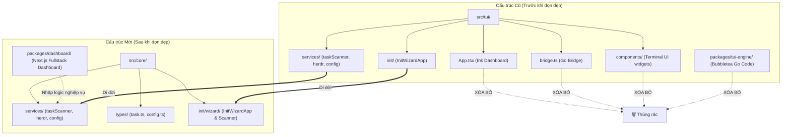

# Concept: Dọn dẹp Mã nguồn TUI Cũ & Tái cấu trúc Core Services

## 1. Problem & Goal (Vấn đề & Mục tiêu)

### Problem (Điểm nghẽn & Thiếu sót hiện tại)
- **Context & Trigger**: Hệ sinh thái `only-one` đã chuyển hướng sang bảng điều khiển Fullstack Next.js (`packages/dashboard/`) với Desktop App Mode.
- **Symptom & Defect**:
  - Mã nguồn Dashboard TUI cũ (`src/tui/App.tsx`, `src/tui/components/`, `src/tui/bridge.ts`) và engine Go (`packages/tui-engine/`) vẫn tồn tại trong dự án, gây dư thừa mã nguồn.
  - Các service nghiệp vụ quan trọng (`taskScanner`, `herdrService`, `configService`, `taskCleaner`) đang bị đặt nhầm dưới thư mục `src/tui/services/`, gây hiểu nhầm rằng chúng chỉ phục vụ giao diện terminal.
  - Lệnh `only-one tui` tạo sự phân mảnh trải nghiệm khi người dùng có cả 2 lệnh `tui` và `ui`.
- **Root Cause**:
  - Giai đoạn phát triển ban đầu đặt toàn bộ logic quét task và điều phối herdr bên trong module `src/tui/` phục vụ màn hình Ink terminal.
- **Impact / Blast Radius**:
  - Gây lãng phí dung lượng npm package, khó bảo trì, phân mảnh kiến trúc và gây nhầm lẫn đường dẫn import cho Dashboard Next.js mới.

### Goal (Kết quả kỹ thuật mục tiêu)
- **Core Goal**: Xóa bỏ hoàn toàn mã nguồn Dashboard TUI cũ (Ink Dashboard, Go tui-engine, bridge), đồng thời di dời toàn bộ Core Services (`taskScanner`, `herdrService`, `configService`, `taskCleaner`) và Types sang thư mục dùng chung `src/core/services/` và `src/core/types/`. Giữ nguyên Init Wizard phục vụ lệnh `only-one init`.
- **Acceptance Criteria**:
  - Xóa sạch thư mục `packages/tui-engine/` (mã nguồn Go bubbletea và file nhị phân).
  - Xóa sạch các thành phần Dashboard TUI trong `src/tui/`: `App.tsx`, `bridge.ts`, `components/`, `theme/`, `utils/`.
  - Di dời toàn bộ `src/tui/services/` sang `src/core/services/task/` hoặc `src/core/services/herdr/`.
  - Di dời `src/tui/types/` sang `src/core/types/`.
  - Di dời `src/tui/init/` sang `src/core/init/wizard/` để giải phóng hoàn toàn thư mục `src/tui/`.
  - Điều hướng hoặc cập nhật lệnh `only-one tui` thông báo chuyển hướng sang `only-one ui`.
  - 100% các unit test liên quan (`test/tui/*.test.ts`) được cập nhật đường dẫn import mới và chạy pass (`npm test`).

---

## 2. Scope Boundaries (Ranh giới phạm vi)

### In-Scope
- **Xóa bỏ Legacy Dashboard TUI**:
  - Xóa `packages/tui-engine/` (toàn bộ code Go, go.mod, go.sum).
  - Xóa `src/tui/App.tsx`, `src/tui/bridge.ts`.
  - Xóa các components giao diện TUI cũ: `src/tui/components/`.
  - Xóa các tiện ích hiển thị TUI cũ: `src/tui/theme/`, `src/tui/utils/`.
  - Xóa lệnh `src/commands/tui/` hoặc thay bằng command redirect sang `ui`.
- **Di dời & Chuẩn hóa Core Services**:
  - Chuyển `taskScanner.ts`, `taskCleaner.ts`, `taskWatcher.ts`, `herdrService.ts`, `configService.ts` sang `src/core/services/`.
  - Chuyển các kiểu dữ liệu `task.ts`, `config.ts` sang `src/core/types/`.
  - Chuyển `src/tui/init/` sang `src/core/init/wizard/` (bảo toàn tính năng `only-one init`).
- **Cập nhật Import Callers & Tests**:
  - Cập nhật `src/core/init/interactive-orchestrator.ts` trỏ tới đường dẫn mới.
  - Cập nhật toàn bộ các bài test trong `test/tui/` sang thư mục mới `test/core/services/`.

### Explicit Out-of-Scope
- Không xóa Init Wizard (`InitWizardApp.tsx` và `workspaceScanner.ts`) vì lệnh `only-one init` vẫn sử dụng giao diện này.
- Không thay đổi hành vi logic bên trong `taskScanner`, `herdrService`, `configService`, `taskCleaner`.
- Không gỡ bỏ package `ink` khỏi `package.json` ở giai đoạn này (vì `InitWizardApp` vẫn cần `ink`).

---

## 3. Proposed Solution & Core Mechanism (Giải pháp đề xuất & Cơ chế cốt lõi)

### So sánh các phương án giải pháp (Solution Trade-offs)

| Tiêu chí | Phương án 1: Dọn dẹp Dashboard TUI, Di dời Services sang Core (Được chọn) | Phương án 2: Xóa 100% cả TUI và Init Wizard | Phương án 3: Giữ nguyên TUI cũ làm Fallback |
| :--- | :--- | :--- | :--- |
| **Phạm vi dọn dẹp** | Xóa Dashboard TUI và Go engine; bảo toàn Init Wizard | Xóa sạch sẽ toàn bộ `src/tui/` và gỡ bỏ `ink` | Chỉ xóa Go engine, giữ nguyên code Ink |
| **Tác động tới `only-one init`** | Không ảnh hưởng, `init` tiếp tục hoạt động ổn định | Phải viết lại `init` bằng `@inquirer/prompts` | Không ảnh hưởng |
| **Độ rõ ràng kiến trúc** | Tách bạch rõ rệt giữa Core Services và UI layer | Rất sạch sẽ nhưng phạm vi công việc lớn | Tiếp tục tồn tại mã nguồn rác và trùng lặp |
| **Rủi ro hồi quy (Regression)** | Rất thấp (chỉ thay đổi đường dẫn import) | Trung bình (phải kiểm thử lại toàn bộ luồng init) | Thấp nhưng nợ kỹ thuật tồn đọng |
| **Đánh giá** | **Lựa chọn tối ưu, an toàn và đúng trọng tâm** | Tốn công sức vượt quá yêu cầu hiện tại | Không giải quyết triệt để vấn đề |

---

### Sơ đồ Tái cấu trúc Thư mục (Architecture Refactoring Diagram)

---

### Danh mục Tái cấu trúc & Di chuyển Chi tiết

1. **Các thư mục & file XÓA HOÀN TOÀN (`[DELETE]`)**:
   - `packages/tui-engine/` (toàn bộ thư mục Go engine)
   - `src/tui/App.tsx`
   - `src/tui/bridge.ts`
   - `src/tui/components/`
   - `src/tui/theme/`
   - `src/tui/utils/`
   - `src/commands/tui/` (hoặc chuyển thành lệnh alias hướng dẫn người dùng chạy `only-one ui`)
   - `test/tui/goBridge.test.ts`
   - `test/tui/markdownParser.test.ts`

2. **Các file DI DỜI sang Core (`[MOVE / RENAME]`)**:
   - `src/tui/services/taskScanner.ts` $\rightarrow$ `src/core/services/taskScanner.ts`
   - `src/tui/services/taskCleaner.ts` $\rightarrow$ `src/core/services/taskCleaner.ts`
   - `src/tui/services/taskWatcher.ts` $\rightarrow$ `src/core/services/taskWatcher.ts`
   - `src/tui/services/herdrService.ts` $\rightarrow$ `src/core/services/herdrService.ts`
   - `src/tui/services/configService.ts` $\rightarrow$ `src/core/services/configService.ts`
   - `src/tui/types/task.ts` $\rightarrow$ `src/core/types/task.ts`
   - `src/tui/types/config.ts` $\rightarrow$ `src/core/types/config.ts`
   - `src/tui/init/` $\rightarrow$ `src/core/init/wizard/`

3. **Cập nhật Import Callers**:
   - `src/core/init/interactive-orchestrator.ts`: Sửa import từ `@/tui/init/...` sang `@/core/init/wizard/...`
   - `scripts/postbuild-paths.cjs`: Cập nhật regex nếu có xử lý path alias cho `tui/init`.
   - `test/tui/*.test.ts`: Di chuyển về `test/core/services/` và sửa đường dẫn import.

---

## 4. Critical Risks & Edge Cases (Rủi ro & Xử lý ngoại lệ)

- **Đứt gãy đường dẫn import trong `postbuild-paths.cjs`**:
  - *Rủi ro*: Script build `scripts/postbuild-paths.cjs` có thể đang chứa rule rewrite đường dẫn `tui/init`.
  - *Giải pháp*: Kiểm tra và cập nhật `scripts/postbuild-paths.cjs` và `test/core/postbuild-paths.test.ts` để đồng bộ với cấu trúc mới `src/core/init/wizard/`.
- **Người dùng có thói quen gõ `only-one tui`**:
  - *Rủi ro*: Xóa lệnh đột ngột khiến người dùng gặp lỗi command not found.
  - *Giải pháp*: Giữ lại alias `tui` cho lệnh `ui` kèm dòng thông báo: *"Giao diện TUI đã được nâng cấp lên Desktop Dashboard. Đang mở 'only-one ui'..."*.
- **Xáo trộn Git History khi di chuyển file**:
  - *Giải pháp*: Sử dụng thao tác di dời chuẩn để giữ nguyên lịch sử commit của các Core Services.
