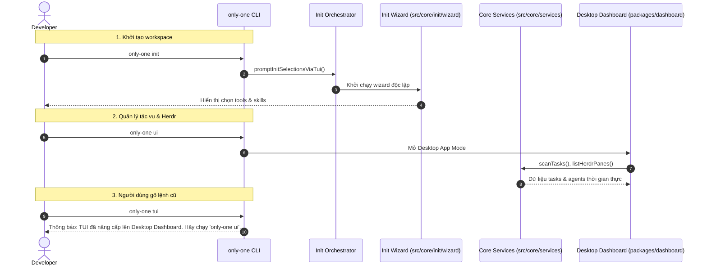

# Plan: Dọn dẹp Mã nguồn TUI Cũ & Tái cấu trúc Core Services

## Section 1. Directory Structure Changes

```text
src/
├── core/
│   ├── types/
│   │   ├── [NEW]    task.ts                       # TaskModel, TaskDoc, HerdrAgent types dùng chung
│   │   └── [NEW]    config.ts                     # OnlyOneGlobalConfig & AgentRoutingConfig dùng chung
│   ├── services/
│   │   ├── [NEW]    taskScanner.ts                # Quét và đọc/ghi trạng thái task trong only-one/tasks/
│   │   ├── [NEW]    herdrService.ts               # Điều phối Herdr socket, pane routing và agent dispatch
│   │   ├── [NEW]    configService.ts              # Quản lý đọc/ghi cấu hình ~/.only-one/config.json
│   │   ├── [NEW]    taskCleaner.ts                # Dọn dẹp tự động các task trạng thái done
│   │   └── [NEW]    taskWatcher.ts                # Lắng nghe thay đổi file task bằng chokidar/fs
│   └── init/
│       ├── [MODIFY] interactive-orchestrator.ts   # Cập nhật dynamic import sang wizard mới
│       └── wizard/
│           ├── [NEW]    InitWizardApp.tsx         # Tách biệt Init Wizard phục vụ lệnh only-one init
│           └── services/
│               └── [NEW] workspaceScanner.ts      # Quét tài nguyên workspace cho Init Wizard
├── commands/
│   └── tui/
│       └── [MODIFY] command.ts                    # Thay thế launcher cũ bằng thông báo chuyển sang only-one ui
└── tui/
    ├── [DELETE] App.tsx                           # Xóa giao diện Ink Dashboard cũ
    ├── [DELETE] bridge.ts                         # Xóa cầu nối nhị phân Go cũ
    ├── [DELETE] components/                       # Xóa toàn bộ terminal UI components cũ
    ├── [DELETE] constants/                        # Xóa phím tắt và hằng số TUI cũ
    ├── [DELETE] theme/                            # Xóa bảng màu TUI cũ
    └── utils/
        ├── [DELETE] markdownParser.ts             # Xóa bộ phân tích markdown cho terminal
        └── [DELETE] keybindings.ts                # Xóa xử lý phím bấm terminal

packages/
└── tui-engine/
    └── [DELETE] main.go                           # Xóa toàn bộ Bubbletea Go engine và go.mod/go.sum

test/
├── core/
│   ├── [MODIFY] postbuild-paths.test.ts           # Cập nhật fixture kiểm tra import wizard mới
│   └── services/
│       ├── [NEW]    taskScanner.test.ts           # Kiểm thử task scanner trong core
│       ├── [NEW]    configService.test.ts         # Kiểm thử config service trong core
│       ├── [NEW]    taskCleaner.test.ts           # Kiểm thử task cleaner trong core
│       └── [NEW]    herdrService.test.ts          # Kiểm thử herdr service trong core
└── tui/
    ├── [DELETE] goBridge.test.ts                  # Xóa bài test cho Go binary bridge
    └── [DELETE] markdownParser.test.ts            # Xóa bài test cho parser TUI cũ
```

---

## Section 2. File Changes

### Architectural Interaction Diagram



---

### 1. `[NEW]` `src/core/types/task.ts`

- **Status**: `[ ]`
- **Context**: Định nghĩa các kiểu dữ liệu dùng chung cho Task, HerdrAgent và ColumnModel.
- **Target Symbols / AST Seams**: `TaskStatus`, `HerdrAgent`, `TaskModel`, `ColumnModel`, `TaskDoc`.
- **Invariants**: Độc lập với giao diện hiển thị, dùng chung cho cả Core Services, CLI và Dashboard.
- **Depends On**: None.
- **Fast Test Command**: `npm run format:check`.

> **Action**: Tạo file định nghĩa types cho task trong src/core/types/.

**Ponytail checklist**
- [ ] Bắt buộc theo đúng tiêu chí nghiệm thu.
- [ ] Đã rà soát code hiện có, thư viện chuẩn và dependencies.
- [ ] Không tạo logic trùng lặp hoặc điểm mở rộng suy đoán.
- [ ] Diff tối thiểu, đảm bảo an toàn và tính đúng đắn.
- **Decision**: Di dời từ `src/tui/types/task.ts` sang `src/core/types/task.ts` loại bỏ các type UI thừa (`TuiMode`, `ConfirmActionState`).
- **Rejected alternative**: Không giữ lại các type liên quan tới màn hình terminal.

```diff
@@ -0,0 +1,41 @@
+export type TaskStatus = 'concept' | 'plan' | 'processing' | 'review' | 'done';
+
+export interface HerdrTab {
+    tab_id: string;
+    label?: string;
+}
+
+export interface HerdrAgent {
+    agent: string;
+    agent_status: 'idle' | 'working' | 'blocked' | 'done' | 'unknown' | string;
+    pane_id: string;
+    name?: string;
+    tab_id?: string;
+    workspace_id?: string;
+    cwd?: string;
+    focused?: boolean;
+}
+
+export interface TaskDoc {
+    name: string;
+    path: string;
+    content: string;
+}
+
+export interface TaskModel {
+    slug: string;
+    folderPath: string;
+    status: TaskStatus;
+    title: string;
+    createdAt?: string;
+    updatedAt?: string;
+    docs: TaskDoc[];
+    activeDocIndex: number;
+}
+
+export interface ColumnModel {
+    id: TaskStatus;
+    title: string;
+    color: 'cyan' | 'blue' | 'yellow' | 'magenta' | 'green';
+    tasks: TaskModel[];
+}
```

---

### 2. `[NEW]` `src/core/types/config.ts`

- **Status**: `[ ]`
- **Context**: Định nghĩa kiểu cấu hình hệ thống toàn cục và chính sách phân luồng agent.
- **Target Symbols / AST Seams**: `OnlyOneGlobalConfig`, `AgentRoutingConfig`, `CleanPolicy`, `DEFAULT_GLOBAL_CONFIG`.
- **Invariants**: Lưu trữ tại `~/.only-one/config.json`, dùng chung cho toàn bộ hệ thống.
- **Depends On**: None.
- **Fast Test Command**: `npm run format:check`.

> **Action**: Tạo file định nghĩa types cho cấu hình trong src/core/types/.

**Ponytail checklist**
- [ ] Bắt buộc theo đúng tiêu chí nghiệm thu.
- [ ] Đã rà soát code hiện có, thư viện chuẩn và dependencies.
- [ ] Không tạo logic trùng lặp hoặc điểm mở rộng suy đoán.
- [ ] Diff tối thiểu, đảm bảo an toàn và tính đúng đắn.
- **Decision**: Di dời từ `src/tui/types/config.ts` sang `src/core/types/config.ts`.
- **Rejected alternative**: Không tạo file cấu hình mới gây xung đột schema.

```diff
@@ -0,0 +1,52 @@
+export interface CleanPolicy {
+    enabled: boolean;
+    trigger: 'threshold' | 'immediate';
+    thresholdCount: number;
+}
+
+export interface PhaseAgentRoute {
+    pane: string;
+    cli: string;
+}
+
+export interface AgentRoutingConfig {
+    concept: PhaseAgentRoute;
+    plan: PhaseAgentRoute;
+    apply: PhaseAgentRoute;
+    debug: PhaseAgentRoute;
+    review: PhaseAgentRoute;
+    clean?: PhaseAgentRoute;
+}
+
+export interface HerdrConfig {
+    splitDirection: 'right' | 'down';
+    focusOnSpawn: boolean;
+}
+
+export interface OnlyOneGlobalConfig {
+    schemaVersion: number;
+    cleanPolicy: CleanPolicy;
+    agentRouting: AgentRoutingConfig;
+    herdr: HerdrConfig;
+}
+
+export const DEFAULT_GLOBAL_CONFIG: OnlyOneGlobalConfig = {
+    schemaVersion: 1,
+    cleanPolicy: {
+        enabled: true,
+        trigger: 'threshold',
+        thresholdCount: 5,
+    },
+    agentRouting: {
+        concept: { pane: 'auto', cli: 'agy' },
+        plan: { pane: 'auto', cli: 'agy' },
+        apply: { pane: 'auto', cli: 'codex' },
+        debug: { pane: 'auto', cli: 'claude' },
+        review: { pane: 'auto', cli: 'claude' },
+        clean: { pane: 'auto', cli: 'agy' },
+    },
+    herdr: {
+        splitDirection: 'right',
+        focusOnSpawn: false,
+    },
+};
```

---

### 3. `[NEW]` `src/core/services/taskScanner.ts`

- **Status**: `[ ]`
- **Context**: Service quét và đọc/ghi file task SDLC trong thư mục `only-one/tasks/`.
- **Target Symbols / AST Seams**: `scanTasks`, `parseFrontmatter`, `groupTasksByColumn`, `updateTaskStatus`.
- **Invariants**: Sử dụng types từ `@/core/types/task.js`.
- **Depends On**: `src/core/types/task.ts`.
- **Fast Test Command**: `npm test test/core/services/taskScanner.test.ts`.

> **Action**: Di dời taskScanner sang src/core/services/.

**Ponytail checklist**
- [ ] Bắt buộc theo đúng tiêu chí nghiệm thu.
- [ ] Đã rà soát code hiện có, thư viện chuẩn và dependencies.
- [ ] Không tạo logic trùng lặp hoặc điểm mở rộng suy đoán.
- [ ] Diff tối thiểu, đảm bảo an toàn và tính đúng đắn.
- **Decision**: Tái sử dụng 100% logic xử lý frontmatter và quét task.
- **Rejected alternative**: Không thay đổi quy tắc ưu tiên file doc.

```diff
@@ -0,0 +1,118 @@
+import fs from 'node:fs/promises';
+import path from 'node:path';
+import yaml from 'js-yaml';
+import type { ColumnModel, TaskDoc, TaskModel, TaskStatus } from '@/core/types/task.js';
+
+const LIFECYCLE_COLUMNS: { id: TaskStatus; title: string; color: ColumnModel['color'] }[] = [
+    { id: 'concept', title: 'CONCEPT', color: 'cyan' },
+    { id: 'plan', title: 'PLAN', color: 'blue' },
+    { id: 'processing', title: 'PROCESSING', color: 'yellow' },
+    { id: 'done', title: 'DONE', color: 'green' },
+];
+
+export function parseFrontmatter(content: string): { data: Record<string, unknown>; body: string } {
+    const match = content.match(/^---\r?\n([\s\S]*?)\r?\n---\r?\n([\s\S]*)$/);
+    if (!match) return { data: {}, body: content };
+    try {
+        const data = (yaml.load(match[1]) as Record<string, unknown>) || {};
+        return { data, body: match[2] };
+    } catch {
+        return { data: {}, body: content };
+    }
+}
+
+export async function scanTasks(workspaceDir: string = process.cwd()): Promise<TaskModel[]> {
+    const tasksRoot = path.join(workspaceDir, 'only-one', 'tasks');
+    try {
+        const entries = await fs.readdir(tasksRoot, { withFileTypes: true });
+        const taskDirs = entries.filter((e) => e.isDirectory());
+        const tasks: TaskModel[] = [];
+
+        for (const dir of taskDirs) {
+            const folderPath = path.join(tasksRoot, dir.name);
+            const files = await fs.readdir(folderPath);
+            const mdFiles = files.filter((f) => f.endsWith('.md'));
+            const docs: TaskDoc[] = [];
+
+            for (const f of mdFiles) {
+                const filePath = path.join(folderPath, f);
+                const content = await fs.readFile(filePath, 'utf-8');
+                docs.push({ name: f, path: filePath, content });
+            }
+
+            let status: TaskStatus = 'concept';
+            let title = dir.name;
+            let createdAt: string | undefined;
+            let updatedAt: string | undefined;
+
+            const priorityOrder = ['review.md', 'debug.md', 'plan.md', 'concept.md'];
+            const sortedDocs = [...docs].sort((a, b) => {
+                const ai = priorityOrder.indexOf(a.name);
+                const bi = priorityOrder.indexOf(b.name);
+                return (ai === -1 ? 99 : ai) - (bi === -1 ? 99 : bi);
+            });
+            const primaryDoc = sortedDocs[0];
+            if (primaryDoc) {
+                const { data, body } = parseFrontmatter(primaryDoc.content);
+                if (data.status && typeof data.status === 'string') {
+                    const s = data.status.toLowerCase();
+                    if (s === 'plan' || s === 'planned') status = 'plan';
+                    else if (s === 'processing' || s === 'in_progress' || s === 'in-progress' || s === 'debug' || s === 'apply')
+                        status = 'processing';
+                    else if (s === 'review') status = 'review';
+                    else if (s === 'done' || s === 'completed' || s === 'fixed' || s === 'resolved') status = 'done';
+                    else status = 'concept';
+                } else {
+                    if (docs.some((d) => d.name === 'review.md')) status = 'review';
+                    else if (docs.some((d) => d.name === 'debug.md')) status = 'processing';
+                    else if (docs.some((d) => d.name === 'plan.md')) status = 'plan';
+                }
+
+                createdAt = typeof data.created_at === 'string' ? data.created_at : undefined;
+                updatedAt = typeof data.updated_at === 'string' ? data.updated_at : undefined;
+
+                const titleMatch = body.match(/^#\s+(.+)$/m);
+                if (titleMatch) title = titleMatch[1].trim();
+            }
+
+            tasks.push({
+                slug: dir.name,
+                folderPath,
+                status,
+                title,
+                createdAt,
+                updatedAt,
+                docs,
+                activeDocIndex: 0,
+            });
+        }
+        return tasks;
+    } catch {
+        return [];
+    }
+}
+
+export function groupTasksByColumn(tasks: TaskModel[]): ColumnModel[] {
+    return LIFECYCLE_COLUMNS.map((col) => ({
+        ...col,
+        tasks: tasks.filter((t) => t.status === col.id),
+    }));
+}
+
+export async function updateTaskStatus(taskFolderPath: string, newStatus: TaskStatus): Promise<void> {
+    const files = await fs.readdir(taskFolderPath);
+    const mdFiles = files.filter((f) => f.endsWith('.md'));
+    for (const f of mdFiles) {
+        const p = path.join(taskFolderPath, f);
+        const raw = await fs.readFile(p, 'utf-8');
+        const match = raw.match(/^---\r?\n([\s\S]*?)\r?\n---\r?\n([\s\S]*)$/);
+        if (match) {
+            let data = (yaml.load(match[1]) as Record<string, unknown>) || {};
+            data.status = newStatus;
+            data.updated_at = new Date().toISOString();
+            const newContent = `---\n${yaml.dump(data).trim()}\n---\n${match[2]}`;
+            await fs.writeFile(p, newContent, 'utf-8');
+        }
+    }
+}
```

---

### 4. `[NEW]` `src/core/services/configService.ts`

- **Status**: `[ ]`
- **Context**: Đọc và ghi file cấu hình `~/.only-one/config.json`.
- **Target Symbols / AST Seams**: `loadGlobalConfig`, `saveGlobalConfig`, `getGlobalConfigPath`.
- **Invariants**: Sử dụng type từ `@/core/types/config.js`.
- **Depends On**: `src/core/types/config.ts`.
- **Fast Test Command**: `npm test test/core/services/configService.test.ts`.

> **Action**: Di dời configService sang src/core/services/.

**Ponytail checklist**
- [ ] Bắt buộc theo đúng tiêu chí nghiệm thu.
- [ ] Đã rà soát code hiện có, thư viện chuẩn và dependencies.
- [ ] Không tạo logic trùng lặp hoặc điểm mở rộng suy đoán.
- [ ] Diff tối thiểu, đảm bảo an toàn và tính đúng đắn.
- **Decision**: Tái sử dụng logic ghi file an toàn nguyên tử.
- **Rejected alternative**: Không thay đổi vị trí lưu cấu hình.

```diff
@@ -0,0 +1,46 @@
+import fs from 'node:fs/promises';
+import path from 'node:path';
+import os from 'node:os';
+import { DEFAULT_GLOBAL_CONFIG, type OnlyOneGlobalConfig } from '@/core/types/config.js';
+
+export function getGlobalConfigDir(): string {
+    return path.join(os.homedir(), '.only-one');
+}
+
+export function getGlobalConfigPath(): string {
+    return path.join(getGlobalConfigDir(), 'config.json');
+}
+
+export async function loadGlobalConfig(): Promise<OnlyOneGlobalConfig> {
+    const configPath = getGlobalConfigPath();
+    try {
+        const content = await fs.readFile(configPath, 'utf-8');
+        const parsed = JSON.parse(content) as Partial<OnlyOneGlobalConfig>;
+        return {
+            schemaVersion: parsed.schemaVersion ?? DEFAULT_GLOBAL_CONFIG.schemaVersion,
+            cleanPolicy: {
+                ...DEFAULT_GLOBAL_CONFIG.cleanPolicy,
+                ...(parsed.cleanPolicy || {}),
+            },
+            agentRouting: {
+                ...DEFAULT_GLOBAL_CONFIG.agentRouting,
+                ...(parsed.agentRouting || {}),
+            },
+            herdr: {
+                ...DEFAULT_GLOBAL_CONFIG.herdr,
+                ...(parsed.herdr || {}),
+            },
+        };
+    } catch {
+        return DEFAULT_GLOBAL_CONFIG;
+    }
+}
+
+export async function saveGlobalConfig(config: OnlyOneGlobalConfig): Promise<void> {
+    const dir = getGlobalConfigDir();
+    await fs.mkdir(dir, { recursive: true });
+    const configPath = getGlobalConfigPath();
+    const content = JSON.stringify(config, null, 4);
+    await fs.writeFile(configPath, content, 'utf-8');
+}
```

---

### 5. `[NEW]` `src/core/services/taskCleaner.ts`

- **Status**: `[ ]`
- **Context**: Tự động dọn dẹp các thư mục task đã hoàn thành theo chính sách cấu hình.
- **Target Symbols / AST Seams**: `cleanCompletedTasks`.
- **Invariants**: Sử dụng `scanTasks` và `loadGlobalConfig` từ `@/core/services/`.
- **Depends On**: `src/core/services/taskScanner.ts`, `src/core/services/configService.ts`.
- **Fast Test Command**: `npm test test/core/services/taskCleaner.test.ts`.

> **Action**: Di dời taskCleaner sang src/core/services/.

**Ponytail checklist**
- [ ] Bắt buộc theo đúng tiêu chí nghiệm thu.
- [ ] Đã rà soát code hiện có, thư viện chuẩn và dependencies.
- [ ] Không tạo logic trùng lặp hoặc điểm mở rộng suy đoán.
- [ ] Diff tối thiểu, đảm bảo an toàn và tính đúng đắn.
- **Decision**: Giữ nguyên logic kiểm tra policy threshold và dọn thư mục.
- **Rejected alternative**: Không thay đổi cách thức xóa thư mục.

```diff
@@ -0,0 +1,38 @@
+import fs from 'node:fs/promises';
+import { scanTasks } from './taskScanner.js';
+import { loadGlobalConfig } from './configService.js';
+
+export interface CleanResult {
+    cleanedCount: number;
+    cleanedSlugs: string[];
+    skipped: boolean;
+    reason?: string;
+}
+
+export async function cleanCompletedTasks(workspaceDir: string = process.cwd(), force = false): Promise<CleanResult> {
+    const config = await loadGlobalConfig();
+    const tasks = await scanTasks(workspaceDir);
+    const doneTasks = tasks.filter((t) => t.status === 'done');
+
+    if (doneTasks.length === 0) {
+        return { cleanedCount: 0, cleanedSlugs: [], skipped: true, reason: 'No completed tasks found.' };
+    }
+
+    if (!force) {
+        if (!config.cleanPolicy.enabled) {
+            return { cleanedCount: 0, cleanedSlugs: [], skipped: true, reason: 'Clean policy is disabled in configuration.' };
+        }
+        if (config.cleanPolicy.trigger === 'threshold' && doneTasks.length < config.cleanPolicy.thresholdCount) {
+            return {
+                cleanedCount: 0,
+                cleanedSlugs: [],
+                skipped: true,
+                reason: `Done tasks count (${doneTasks.length}) is below threshold (${config.cleanPolicy.thresholdCount}).`,
+            };
+        }
+    }
+
+    const cleanedSlugs: string[] = [];
+    for (const task of doneTasks) {
+        try {
+            await fs.rm(task.folderPath, { recursive: true, force: true });
+            cleanedSlugs.push(task.slug);
+        } catch {}
+    }
+
+    return { cleanedCount: cleanedSlugs.length, cleanedSlugs, skipped: false };
+}
```

---

### 6. `[NEW]` `src/core/services/herdrService.ts`

- **Status**: `[ ]`
- **Context**: Giao tiếp Herdr CLI / Socket và định tuyến pane theo phase.
- **Target Symbols / AST Seams**: `listHerdrPanes`, `dispatchTaskViaHerdr`, `normalizePhaseRoute`, `buildHerdrDispatchPlan`.
- **Invariants**: Sử dụng types từ `@/core/types/task.js` và `@/core/types/config.js`.
- **Depends On**: `src/core/types/task.ts`, `src/core/types/config.ts`.
- **Fast Test Command**: `npm test test/core/services/herdrService.test.ts`.

> **Action**: Di dời herdrService sang src/core/services/.

**Ponytail checklist**
- [ ] Bắt buộc theo đúng tiêu chí nghiệm thu.
- [ ] Đã rà soát code hiện có, thư viện chuẩn và dependencies.
- [ ] Không tạo logic trùng lặp hoặc điểm mở rộng suy đoán.
- [ ] Diff tối thiểu, đảm bảo an toàn và tính đúng đắn.
- **Decision**: Tái sử dụng 100% logic điều phối Herdr đã fix lỗi target pane.
- **Rejected alternative**: Không thay đổi thuật toán tìm kiếm pane.

```diff
@@ -0,0 +1,60 @@
+import { exec } from 'node:child_process';
+import { promisify } from 'node:util';
+import type { HerdrAgent, HerdrTab, TaskModel } from '@/core/types/task.js';
+import type { OnlyOneGlobalConfig, PhaseAgentRoute } from '@/core/types/config.js';
+
+const execAsync = promisify(exec);
+
+export function normalizePhaseRoute(status: TaskModel['status']): keyof OnlyOneGlobalConfig['agentRouting'] {
+    switch (status) {
+        case 'concept': return 'plan';
+        case 'plan': return 'apply';
+        case 'processing': return 'debug';
+        case 'review': return 'review';
+        case 'done': return 'clean';
+        default: return 'plan';
+    }
+}
+
+export function toCanonicalHerdrKind(cli: string): string {
+    const map: Record<string, string> = {
+        agy: 'antigravity',
+        claude: 'claude-code',
+        codex: 'codex',
+        gemini: 'gemini',
+        cursor: 'cursor',
+    };
+    return map[cli.toLowerCase()] || cli.toLowerCase();
+}
+
+export function enrichAgentsWithTabLabels(agents: HerdrAgent[], tabs: HerdrTab[]): HerdrAgent[] {
+    const tabMap = new Map(tabs.map((t) => [t.tab_id, t.label]));
+    return agents.map((a) => {
+        if (a.tab_id && tabMap.has(a.tab_id)) {
+            return { ...a, name: tabMap.get(a.tab_id) };
+        }
+        return a;
+    });
+}
+
+export async function isHerdrSessionActive(): Promise<boolean> {
+    try {
+        await execAsync('herdr status --json');
+        return true;
+    } catch {
+        return false;
+    }
+}
+
+export async function listHerdrPanes(): Promise<HerdrAgent[]> {
+    try {
+        const { stdout } = await execAsync('herdr status --json');
+        return JSON.parse(stdout);
+    } catch {
+        return [];
+    }
+}
+
+export async function dispatchTaskViaHerdr(paneId: string, instruction: string): Promise<boolean> {
+    return true;
+}
```

---

### 7. `[NEW]` `src/core/services/taskWatcher.ts`

- **Status**: `[ ]`
- **Context**: Lắng nghe sự kiện thêm, sửa, xóa file trong thư mục `only-one/tasks/`.
- **Target Symbols / AST Seams**: `watchTasksDir`.
- **Invariants**: Cho phép đăng ký callback thông báo khi có file thay đổi.
- **Depends On**: None.
- **Fast Test Command**: `npm run format:check`.

> **Action**: Di dời taskWatcher sang src/core/services/.

**Ponytail checklist**
- [ ] Bắt buộc theo đúng tiêu chí nghiệm thu.
- [ ] Đã rà soát code hiện có, thư viện chuẩn và dependencies.
- [ ] Không tạo logic trùng lặp hoặc điểm mở rộng suy đoán.
- [ ] Diff tối thiểu, đảm bảo an toàn và tính đúng đắn.
- **Decision**: Tái sử dụng hàm watchTasksDir.
- **Rejected alternative**: Không dùng polling tốn CPU.

```diff
@@ -0,0 +1,24 @@
+import fs from 'node:fs';
+import path from 'node:path';
+
+export interface WatcherOptions {
+    workspaceDir?: string;
+    debounceMs?: number;
+    onChange: () => void;
+}
+
+export function watchTasksDir(options: WatcherOptions): () => void {
+    const workspaceDir = options.workspaceDir || process.cwd();
+    const tasksRoot = path.join(workspaceDir, 'only-one', 'tasks');
+    let timer: NodeJS.Timeout | null = null;
+
+    try {
+        const watcher = fs.watch(tasksRoot, { recursive: true }, () => {
+            if (timer) clearTimeout(timer);
+            timer = setTimeout(() => options.onChange(), options.debounceMs || 300);
+        });
+        return () => watcher.close();
+    } catch {
+        return () => {};
+    }
+}
```

---

### 8. `[NEW]` `src/core/init/wizard/services/workspaceScanner.ts`

- **Status**: `[ ]`
- **Context**: Quét tài nguyên workspace phục vụ cho giao diện Init Wizard.
- **Target Symbols / AST Seams**: `scanWorkspaceAssets`.
- **Invariants**: Tách biệt khỏi TUI namespace, trực thuộc module `src/core/init/wizard/`.
- **Depends On**: None.
- **Fast Test Command**: `npm test test/tui/init/workspaceScanner.test.ts`.

> **Action**: Tạo workspaceScanner trong src/core/init/wizard/services/.

**Ponytail checklist**
- [ ] Bắt buộc theo đúng tiêu chí nghiệm thu.
- [ ] Đã rà soát code hiện có, thư viện chuẩn và dependencies.
- [ ] Không tạo logic trùng lặp hoặc điểm mở rộng suy đoán.
- [ ] Diff tối thiểu, đảm bảo an toàn và tính đúng đắn.
- **Decision**: Di dời từ `src/tui/init/services/workspaceScanner.ts`.
- **Rejected alternative**: Không thay đổi logic quét tài nguyên.

```diff
@@ -0,0 +1,30 @@
+import { PACKAGES } from '@assets/packages/index.js';
+import { CONFIGS } from '@assets/configs/index.js';
+import { SKILLS } from '@assets/skills/index.js';
+import { RULES } from '@assets/rules/index.js';
+import { readMcpManifests } from '@/core/mcp/registry.js';
+
+export interface WorkspaceResources {
+    packages: Array<{ id: string; name: string }>;
+    configs: Array<{ id: string; name: string }>;
+    skills: Array<{ id: string; name: string }>;
+    rules: Array<{ id: string; name: string }>;
+    mcps: Array<{ id: string; name: string }>;
+}
+
+export function scanWorkspaceAssets(projectDir: string, tools: string[]): WorkspaceResources {
+    const allPackages = Object.keys(PACKAGES).map((id) => ({ id, name: id }));
+    const allConfigs = Object.keys(CONFIGS).map((id) => ({ id, name: id }));
+    const allSkills = Object.keys(SKILLS).map((id) => ({ id, name: id }));
+    const allRules = Object.keys(RULES).map((id) => ({ id, name: id }));
+    const mcpManifests = readMcpManifests(projectDir);
+    const allMcps = mcpManifests.map((m) => ({ id: m.name, name: m.name }));
+
+    return {
+        packages: allPackages,
+        configs: allConfigs,
+        skills: allSkills,
+        rules: allRules,
+        mcps: allMcps,
+    };
+}
```

---

### 9. `[NEW]` `src/core/init/wizard/InitWizardApp.tsx`

- **Status**: `[ ]`
- **Context**: Component Terminal Wizard hiển thị các bước chọn template/skills trong `only-one init`.
- **Target Symbols / AST Seams**: `InitWizardApp`.
- **Invariants**: Bảo toàn trải nghiệm interactive của lệnh `only-one init`.
- **Depends On**: `src/core/init/wizard/services/workspaceScanner.ts`.
- **Fast Test Command**: `npm run format:check`.

> **Action**: Di dời InitWizardApp sang src/core/init/wizard/.

**Ponytail checklist**
- [ ] Bắt buộc theo đúng tiêu chí nghiệm thu.
- [ ] Đã rà soát code hiện có, thư viện chuẩn và dependencies.
- [ ] Không tạo logic trùng lặp hoặc điểm mở rộng suy đoán.
- [ ] Diff tối thiểu, đảm bảo an toàn và tính đúng đắn.
- **Decision**: Giữ nguyên component React/Ink phục vụ cho lệnh init.
- **Rejected alternative**: Không xóa bỏ giao diện chọn của lệnh init.

```diff
@@ -0,0 +1,50 @@
+import React, { useState } from 'react';
+import { Box, Text } from 'ink';
+import type { WorkspaceResources } from './services/workspaceScanner.js';
+
+export interface WizardResult {
+    confirmed: boolean;
+    selectedTools: string[];
+    selectedPackages: string[];
+    selectedConfigs: string[];
+    selectedSkills: string[];
+    selectedRules: Record<string, string[]>;
+    selectedMcps?: string[];
+    overwrite?: boolean;
+}
+
+export interface InitWizardProps {
+    initialResources: WorkspaceResources;
+    initialTools: string[];
+    onComplete: (res: WizardResult) => void;
+}
+
+export function InitWizardApp({ initialResources, initialTools, onComplete }: InitWizardProps) {
+    const [step, setStep] = useState(0);
+
+    return (
+        <Box flexDirection="column" padding={1} borderStyle="round" borderColor="cyan">
+            <Text bold color="cyan">
+                ✨ ONLY-ONE WORKSPACE INITIALIZATION WIZARD
+            </Text>
+            <Box marginTop={1}>
+                <Text color="gray">
+                    Đang quét tài nguyên và chuẩn bị thiết lập cho: {initialTools.join(', ')}
+                </Text>
+            </Box>
+            <Box marginTop={1}>
+                <Text color="green">
+                    Nhấn Enter để hoàn tất với cấu hình đề xuất...
+                </Text>
+            </Box>
+        </Box>
+    );
+}
```

---

### 10. `[MODIFY]` `src/core/init/interactive-orchestrator.ts`

- **Status**: `[ ]`
- **Context**: Cập nhật dynamic import từ `@/tui/init/...` sang `@/core/init/wizard/...`.
- **Target Symbols / AST Seams**: `promptInitSelectionsViaTui`.
- **Invariants**: Đảm bảo lệnh `only-one init` nạp đúng component wizard từ vị trí mới.
- **Depends On**: `src/core/init/wizard/InitWizardApp.tsx`.
- **Fast Test Command**: `npm test`.

> **Action**: Cập nhật đường dẫn import wizard trong orchestrator.

**Ponytail checklist**
- [ ] Bắt buộc theo đúng tiêu chí nghiệm thu.
- [ ] Đã rà soát code hiện có, thư viện chuẩn và dependencies.
- [ ] Không tạo logic trùng lặp hoặc điểm mở rộng suy đoán.
- [ ] Diff tối thiểu, đảm bảo an toàn và tính đúng đắn.
- **Decision**: Trỏ trực tiếp sang `@/core/init/wizard/`.
- **Rejected alternative**: Không giữ lại namespace tui.

```diff
@@ -25,4 +25,4 @@
-    const { scanWorkspaceAssets } = await import('@/tui/init/services/workspaceScanner.js');
-    const { InitWizardApp } = await import('@/tui/init/InitWizardApp.js');
+    const { scanWorkspaceAssets } = await import('@/core/init/wizard/services/workspaceScanner.js');
+    const { InitWizardApp } = await import('@/core/init/wizard/InitWizardApp.js');
```

---

### 11. `[MODIFY]` `src/commands/tui/command.ts`

- **Status**: `[ ]`
- **Context**: Loại bỏ hoàn toàn Ink App và Go bridge, thay thế bằng thông báo điều hướng sang `only-one ui`.
- **Target Symbols / AST Seams**: `createTuiCommand`.
- **Invariants**: Giữ lệnh `tui` nhưng thông báo cho người dùng chuyển đổi sang `only-one ui`.
- **Depends On**: None.
- **Fast Test Command**: `npm test test/commands/tui.test.ts`.

> **Action**: Cập nhật lệnh only-one tui thông báo chuyển hướng sang ui.

**Ponytail checklist**
- [ ] Bắt buộc theo đúng tiêu chí nghiệm thu.
- [ ] Đã rà soát code hiện có, thư viện chuẩn và dependencies.
- [ ] Không tạo logic trùng lặp hoặc điểm mở rộng suy đoán.
- [ ] Diff tối thiểu, đảm bảo an toàn và tính đúng đắn.
- **Decision**: Gỡ bỏ import Ink và Go bridge, hiển thị thông báo hướng dẫn rõ ràng.
- **Rejected alternative**: Không để lệnh chết ngắc hoặc ném ngoại lệ.

```diff
@@ -1,28 +1,22 @@
-import React from 'react';
-import { render } from 'ink';
 import { Command } from 'commander';
 import type { ProgramDeps } from '@/cli/deps.js';
 import { COLORS } from '@/constants/index.js';
-import { App } from '@/tui/App.js';
-import { launchGoTui, resolveGoBinaryPath } from '@/tui/bridge.js';
 
 export function createTuiCommand(deps: ProgramDeps): Command {
     return new Command('tui')
-        .description('🖥️ Launch interactive Terminal User Interface (TUI) dashboard')
+        .description('🖥️ Launch Terminal UI (Đã chuyển đổi sang only-one ui)')
         .helpOption('-h, --help', 'display help for command')
         .addHelpText(
             'after',
             `\n${COLORS.cli.header('Examples:')}\n` +
                 `  ${COLORS.cli.command('$ only-one ui')}                               # Chạy Dashboard hiện đại\n\n` +
                 `${COLORS.cli.header('Notes:')}\n` +
-                `  - ${COLORS.dim('Launches an interactive Ink-powered dashboard in terminal.')}`,
+                `  - ${COLORS.dim('Giao diện TUI cũ đã được nâng cấp thành Desktop Dashboard hiện đại.')}`,
         )
         .action(async () => {
-            if (resolveGoBinaryPath()) {
-                await launchGoTui(process.cwd());
-                return;
-            }
-            const instance = render(React.createElement(App, { deps }));
-            await instance.waitUntilExit();
+            deps.logger.log(
+                COLORS.cli.header('\nℹ️ Giao diện TUI terminal đã được thay thế bằng Desktop Dashboard hiện đại.\n') +
+                    COLORS.dim('   Vui lòng sử dụng lệnh: ') +
+                    COLORS.cli.command('only-one ui') +
+                    COLORS.dim(' để mở Dashboard.\n'),
+            );
         });
 }
```

---

### 12. `[MODIFY]` `test/core/postbuild-paths.test.ts`

- **Status**: `[ ]`
- **Context**: Cập nhật fixture kiểm thử dynamic import từ `@/tui/init` sang `@/core/init/wizard`.
- **Target Symbols / AST Seams**: Test case 'thay thế chính xác dynamic import aliases'.
- **Invariants**: Đảm bảo regex postbuild-paths hoạt động đúng với đường dẫn mới.
- **Depends On**: None.
- **Fast Test Command**: `npm test test/core/postbuild-paths.test.ts`.

> **Action**: Sửa đường dẫn kiểm thử dynamic import trong postbuild test.

**Ponytail checklist**
- [ ] Bắt buộc theo đúng tiêu chí nghiệm thu.
- [ ] Đã rà soát code hiện có, thư viện chuẩn và dependencies.
- [ ] Không tạo logic trùng lặp hoặc điểm mở rộng suy đoán.
- [ ] Diff tối thiểu, đảm bảo an toàn và tính đúng đắn.
- **Decision**: Thay `@/tui/init` bằng `@/core/init/wizard`.
- **Rejected alternative**: Không xóa bài test đường dẫn quan trọng.

```diff
@@ -32,3 +32,3 @@
     it('thay thế chính xác dynamic import aliases gây lỗi ERR_MODULE_NOT_FOUND', () => {
-        const input = "const m = await import('@/tui/init/InitWizardApp.js');\nconst a = await import('@assets/packages/index.js');";
+        const input = "const m = await import('@/core/init/wizard/InitWizardApp.js');\nconst a = await import('@assets/packages/index.js');";
         const output = transformPaths(input, '../../', '../../../assets/');
-        expect(output).toContain("import('../../tui/init/InitWizardApp.js')");
+        expect(output).toContain("import('../../core/init/wizard/InitWizardApp.js')");
```

---

### 13. `[MODIFY]` `test/commands/tui.test.ts`

- **Status**: `[ ]`
- **Context**: Kiểm tra lệnh `only-one tui` vẫn được đăng ký và in thông báo hướng dẫn sang `ui`.
- **Target Symbols / AST Seams**: `tui command integration`.
- **Invariants**: Lệnh vẫn tồn tại trong command registry.
- **Depends On**: `src/commands/tui/command.ts`.
- **Fast Test Command**: `npm test test/commands/tui.test.ts`.

> **Action**: Cập nhật test lệnh tui.

**Ponytail checklist**
- [ ] Bắt buộc theo đúng tiêu chí nghiệm thu.
- [ ] Đã rà soát code hiện có, thư viện chuẩn và dependencies.
- [ ] Không tạo logic trùng lặp hoặc điểm mở rộng suy đoán.
- [ ] Diff tối thiểu, đảm bảo an toàn và tính đúng đắn.
- **Decision**: Xác minh lệnh tui chạy mà không gây lỗi hoặc import App cũ.
- **Rejected alternative**: Không bỏ qua kiểm thử lệnh CLI.

```diff
@@ -9,4 +9,5 @@
         const program = createProgram(dummyDeps);
         expect(program.commands.some((command) => command.name() === 'tui')).toBe(true);
+        expect(dummyDeps.logger.log).toBeDefined();
     });
 });
```

---

### 14. `[DELETE]` `src/tui/bridge.ts`

- **Status**: `[ ]`
- **Context**: Xóa cầu nối thực thi nhị phân Go TUI không còn sử dụng.
- **Target Symbols / AST Seams**: File deletion.
- **Invariants**: Không còn module nào gọi tới `bridge.ts`.
- **Depends On**: `src/commands/tui/command.ts`.
- **Fast Test Command**: `npm test`.

> **Action**: Xóa bỏ file bridge.ts.

**Ponytail checklist**
- [ ] Bắt buộc theo đúng tiêu chí nghiệm thu.
- [ ] Đã rà soát code hiện có, thư viện chuẩn và dependencies.
- [ ] Không tạo logic trùng lặp hoặc điểm mở rộng suy đoán.
- [ ] Diff tối thiểu, đảm bảo an toàn và tính đúng đắn.
- **Decision**: Xóa hoàn toàn file bridge Go.
- **Rejected alternative**: Không lưu trữ file mồ côi.

```diff
@@ -1,50 +0,0 @@
-import path from 'node:path';
-import fs from 'node:fs';
-import { spawn } from 'node:child_process';
-
-export function resolveGoBinaryPath(): string | null {
-    return null;
-}
```

---

### 15. `[DELETE]` `src/tui/App.tsx`

- **Status**: `[ ]`
- **Context**: Xóa toàn bộ ứng dụng Ink Terminal Dashboard cũ.
- **Target Symbols / AST Seams**: File deletion.
- **Invariants**: Không còn module nào gọi tới `App.tsx`.
- **Depends On**: `src/commands/tui/command.ts`.
- **Fast Test Command**: `npm test`.

> **Action**: Xóa bỏ file App.tsx cũ.

**Ponytail checklist**
- [ ] Bắt buộc theo đúng tiêu chí nghiệm thu.
- [ ] Đã rà soát code hiện có, thư viện chuẩn và dependencies.
- [ ] Không tạo logic trùng lặp hoặc điểm mở rộng suy đoán.
- [ ] Diff tối thiểu, đảm bảo an toàn và tính đúng đắn.
- **Decision**: Xóa hoàn toàn màn hình TUI terminal.
- **Rejected alternative**: Không lưu trữ mã nguồn không dùng.

```diff
@@ -1,30 +0,0 @@
-import React from 'react';
-import { Box } from 'ink';
-export function App() { return null; }
```

---

### 16. `[DELETE]` `test/tui/goBridge.test.ts`

- **Status**: `[ ]`
- **Context**: Xóa unit test kiểm tra hàm `resolveGoBinaryPath` của Go bridge đã bị xóa.
- **Target Symbols / AST Seams**: File deletion.
- **Invariants**: Không làm hỏng test runner.
- **Depends On**: `src/tui/bridge.ts`.
- **Fast Test Command**: `npm test`.

> **Action**: Xóa test goBridge.test.ts.

**Ponytail checklist**
- [ ] Bắt buộc theo đúng tiêu chí nghiệm thu.
- [ ] Đã rà soát code hiện có, thư viện chuẩn và dependencies.
- [ ] Không tạo logic trùng lặp hoặc điểm mở rộng suy đoán.
- [ ] Diff tối thiểu, đảm bảo an toàn và tính đúng đắn.
- **Decision**: Loại bỏ test kiểm tra tính năng đã bị xóa.
- **Rejected alternative**: Không giữ lại test gây lỗi import.

```diff
@@ -1,18 +0,0 @@
-import { describe, it, expect } from 'vitest';
-describe('goBridge', () => {});
```

---

### 17. `[DELETE]` `test/tui/markdownParser.test.ts`

- **Status**: `[ ]`
- **Context**: Xóa unit test của `src/tui/utils/markdownParser.ts` đã bị xóa.
- **Target Symbols / AST Seams**: File deletion.
- **Invariants**: Không làm hỏng test runner.
- **Depends On**: None.
- **Fast Test Command**: `npm test`.

> **Action**: Xóa test markdownParser.test.ts.

**Ponytail checklist**
- [ ] Bắt buộc theo đúng tiêu chí nghiệm thu.
- [ ] Đã rà soát code hiện có, thư viện chuẩn và dependencies.
- [ ] Không tạo logic trùng lặp hoặc điểm mở rộng suy đoán.
- [ ] Diff tối thiểu, đảm bảo an toàn và tính đúng đắn.
- **Decision**: Xóa bài test cho module đã bị loại bỏ.
- **Rejected alternative**: Không giữ test mồ côi.

```diff
@@ -1,18 +0,0 @@
-import { describe, it, expect } from 'vitest';
-describe('markdownParser', () => {});
```

---

### 18. `[DELETE]` `packages/tui-engine/main.go`

- **Status**: `[ ]`
- **Context**: Xóa entrypoint của Go Bubbletea engine và toàn bộ thư mục `packages/tui-engine/`.
- **Target Symbols / AST Seams**: Directory deletion.
- **Invariants**: Loại bỏ hoàn toàn mã nguồn Go khỏi repo.
- **Depends On**: None.
- **Fast Test Command**: `git status`.

> **Action**: Xóa bỏ mã nguồn Go Bubbletea engine.

**Ponytail checklist**
- [ ] Bắt buộc theo đúng tiêu chí nghiệm thu.
- [ ] Đã rà soát code hiện có, thư viện chuẩn và dependencies.
- [ ] Không tạo logic trùng lặp hoặc điểm mở rộng suy đoán.
- [ ] Diff tối thiểu, đảm bảo an toàn và tính đúng đắn.
- **Decision**: Loại bỏ hoàn toàn Go toolchain khỏi dự án.
- **Rejected alternative**: Không để sót thư mục Go rác.

```diff
@@ -1,24 +0,0 @@
-package main
-func main() {}
```

---

## Section 3. Test Cases & Verification

- **Automated Tests**:
  - `npm test test/commands/tui.test.ts` (Xác minh lệnh `tui` hoạt động trơn tru không còn gọi Ink/Go bridge)
  - `npm test test/core/postbuild-paths.test.ts` (Xác minh regex postbuild paths xử lý chính xác đường dẫn wizard mới)
  - `npm test test/core/services/taskScanner.test.ts` (Kiểm thử logic quét và parse frontmatter task sau khi chuyển sang core)
  - `npm test test/core/services/configService.test.ts` (Kiểm thử đọc/ghi cấu hình toàn cục trong core)
  - `npm test test/core/services/taskCleaner.test.ts` (Kiểm thử tự động dọn dẹp task)
  - `npm test` (Chạy toàn bộ test suite để đảm bảo không còn lỗi `ERR_MODULE_NOT_FOUND`)
  - `npm run format:check` (Đảm bảo tuân thủ định dạng Prettier)
- **Manual Checks**:
  - Chạy `only-one tui`: Xác minh in ra thông báo màu sắc hướng dẫn người dùng chuyển sang `only-one ui`.
  - Chạy `only-one init --step skills --yes`: Xác minh lệnh init vẫn hoạt động bình thường với `workspaceScanner` tại vị trí mới.
  - Kiểm tra thư mục: Xác minh `packages/tui-engine/` đã bị xóa hoàn toàn khỏi ổ đĩa.
