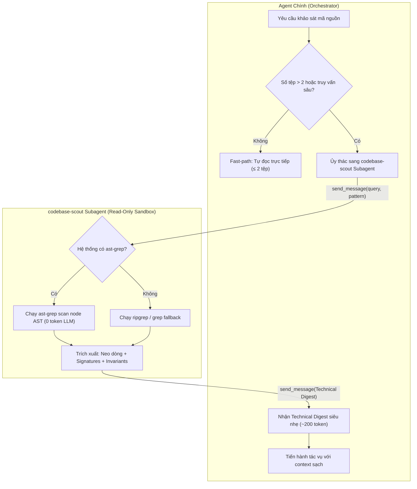

# Concept: Codebase Scout Subagent (Trinh Sát Ngữ Cảnh Tách Biệt & AST-Grep Token Shield)

## 1. Problem & Goal

### Problem (Current Bottlenecks & Deficiencies)
- **Context & Trigger**: Khi các kỹ năng (`plan`, `debug`, `review`, `idea`, `conflict`, `clean`) cần khảo sát, tìm kiếm call-sites hoặc phân tích logic trên phạm vi nhiều tệp (> 2 tệp).
- **Symptom & Defect**: Agent chính gọi liên tiếp các lệnh đọc tệp (`read_file`, regex `grep`), nạp hàng ngàn dòng mã thô không cần thiết vào transcript làm bùng nổ token (đốt từ 15.000 đến 30.000 token cho mỗi lượt khảo sát).
- **Root Cause**: Thiếu cơ chế cô lập ngữ cảnh (Context Isolation) và chưa ứng dụng công cụ phân tích cú pháp AST cục bộ (Local AST Parsing) để lọc code ở tầng máy trước khi đưa vào LLM.
- **Impact / Blast Radius**: Hiện tượng *Lost-in-the-Middle*, suy giảm độ chính xác khi sinh mã, lãng phí chi phí token nghiêm trọng và nhanh chóng chạm trần context window.

### Goal (Target Technical Outcomes)
- **Core Goal**: Thiết lập Subagent chuyên trách trinh sát (`codebase-scout`) kết hợp động cơ phân tích cú pháp **`ast-grep`** chạy trong sandbox cô lập chỉ đọc (Read-Only), giúp cắt giảm **75% – 85% lượng token tiêu thụ**.
- **Acceptance Criteria**:
  - Agent chính ủy thác việc khảo sát qua tin nhắn Agent-to-Agent mà không ghi rác ra ổ đĩa (Zero Disk Clutter).
  - Tích hợp `ast-grep` làm công cụ trinh sát cú pháp mặc định: máy tính phân tích AST cục bộ với chi phí 0 token, chỉ trích xuất đúng 2–3 dòng khớp cú pháp gửi về cho LLM.
  - Subagent chỉ trả về bản tóm tắt cấu trúc tinh gọn (Technical Digest) gồm: đường dẫn neo dòng, chữ ký kiểu dữ liệu, danh sách call-sites và ràng buộc bất biến (cấm dán mã thân hàm > 20 dòng).
  - Áp dụng cơ chế rẽ nhánh thích ứng (Adaptive Fast-path): tự đọc trực tiếp nếu phạm vi nhỏ (≤ 2 tệp), chỉ ủy thác cho Scout khi phạm vi lớn (> 2 tệp).
  - Lan tỏa đồng bộ đến toàn bộ hệ sinh thái kỹ năng của `only-one` (`plan`, `debug`, `review`, `idea`, `conflict`, `clean`).

## 2. Scope Boundaries
- **In-Scope**:
  - Định nghĩa đặc tả Subagent `codebase-scout` với quyền Read-Only và System Prompt tối ưu hóa nén thông tin.
  - Hướng dẫn và tiện ích thực thi mẫu tìm kiếm `ast-grep` (AST structural patterns) kèm cơ chế dự phòng (fallback về regex `grep` nếu môi trường chưa có `ast-grep`).
  - Giao thức yêu cầu - phản hồi (Request-Digest Contract) và bộ kiểm tra tính toàn vẹn của Technical Digest.
  - Ngưỡng kích hoạt thích ứng (Fast-path vs Delegation threshold).
  - Triển khai tích hợp trên toàn bộ 6 kỹ năng cốt lõi: `only-one-plan`, `only-one-debug`, `only-one-review`, `only-one-idea`, `only-one-conflict`, `only-one-clean`.
- **Explicit Out-of-Scope**:
  - Không xuất file báo cáo tạm thời ra đĩa.
  - Không cấp quyền sửa mã, quyền viết test hoặc quyền mở terminal chạy test cho Scout Subagent.
  - Không thay thế parser TypeScript hay trình biên dịch của dự án.

## 3. Proposed Solution & Core Mechanism
- **Core Mechanism**: 
  - Mô hình 2 lớp bảo vệ token (**Two-Tier Token Shield**):
    1. *Tầng 1 (Local Compute - 0 Token)*: `codebase-scout` gọi CLI `ast-grep` để lọc và định vị chính xác node cú pháp ở tầng hệ điều hành.
    2. *Tầng 2 (Context Isolation)*: Mọi tệp mà Scout đọc hoặc phân tích đều nằm trọn trong session riêng của Scout. Agent chính chỉ nhận bản tóm tắt nén **Technical Digest** siêu nhẹ (~200 token).

- **Conceptual Flow / Domain Model**:


- **CLI / Protocol Wireframe**:
```text
+---------------------------------------------------------------------------------+
| AGENT-TO-AGENT RECONNAISSANCE PROTOCOL (AST-GREP ENABLED)                       |
+---------------------------------------------------------------------------------+
| Main Agent -> codebase-scout:                                                   |
|   Target:  "Tìm toàn bộ call-sites của useAuth() và kiểu dữ liệu trả về"       |
|   Scope:   "src/"                                                               |
|   Pattern: "ast-grep: const { $$$ } = useAuth()"                                |
|                                                                                 |
| codebase-scout -> Local OS:                                                     |
|   $ ast-grep scan -p 'const { $$$ } = useAuth()' (Compute cost: 0 token)        |
|                                                                                 |
| codebase-scout -> Main Agent:                                                   |
|   ### Technical Digest                                                          |
|   - Seam Anchors: authHook.ts#L12-L30, Header.tsx#L15, LoginForm.tsx#L22        |
|   - Exported Signatures: useAuth(): { user: User; login: (dto) => Promise }     |
|   - Dependencies: AuthContext, tokenStorage                                     |
|   - Invariants: user null khi unauthenticated; login tự động lưu token          |
|   (Tiết kiệm 85% token so với đọc trực tiếp 5 files)                           |
+---------------------------------------------------------------------------------+
```

## 4. Critical Risks & Edge Cases (Phân tích Rủi ro & Cơ chế Phòng vệ)

- **Rủi ro 1: Môi trường chưa cài đặt sẵn binary `ast-grep`**
  * *Mặt tiêu cực / Nguy cơ*: Lệnh gọi `ast-grep` thất bại khiến Scout bị nghẽn không thể hoàn thành việc trinh sát.
  * *Cơ chế phòng vệ*: Cơ chế chuyển tiếp dự phòng (Graceful Fallback) tự động: nếu `ast-grep` không khả dụng hoặc trả về mã lỗi, Scout tự động chuyển sang `ripgrep`/`grep` kết hợp đọc có định hướng theo khoảng dòng.

- **Rủi ro 2: Thất thoát chi tiết kỹ thuật tinh tế (Information Loss)**
  * *Mặt tiêu cực / Nguy cơ*: Scout nén quá mức khiến Agent chính thiếu thông tin ngữ cảnh để viết unified diff chính xác.
  * *Cơ chế phòng vệ*: Hợp đồng Technical Digest bắt buộc phải kèm đường dẫn tệp và khoảng số dòng chính xác (`file:///path#L10-L40`) để Agent chính có thể truy xuất điểm neo tức thì khi cần.

- **Rủi ro 3: Bùng nổ chi phí Token do khởi tạo Subagent vụn vặt (Over-Delegation Overhead)**
  * *Mặt tiêu cực / Nguy cơ*: Triệu hồi Subagent cho các tác vụ tra cứu đơn giản (chỉ 1 tệp hoặc 20 dòng) gây lãng phí token do chi phí nạp prompt ban đầu.
  * *Cơ chế phòng vệ*: Áp dụng quy tắc Fast-path cứng: Agent chính bắt buộc tự đọc trực tiếp nếu tác vụ chỉ liên quan đến ≤ 2 tệp đã xác định đường dẫn.
